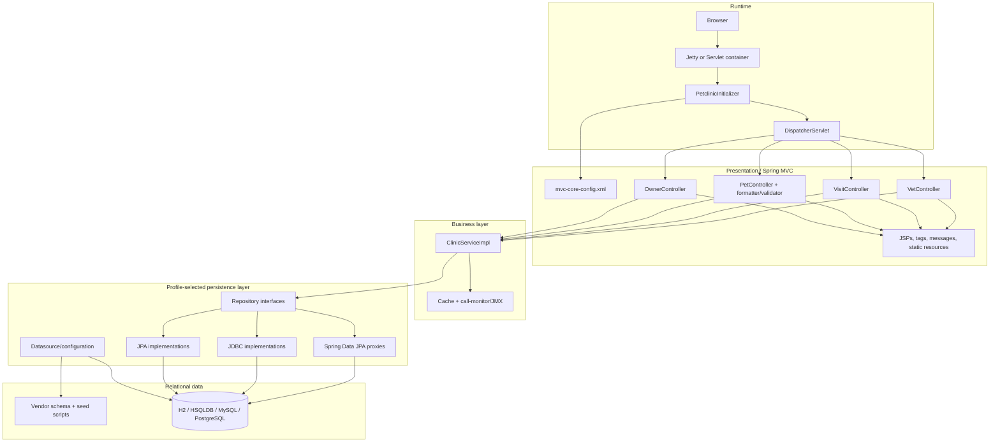

# discovery-terra1 — discovery/init-assess (ses_e53a4a81bffeACTozoy8XRrqLC)

### 1. User — 2026-11-05T15:37:09.871Z

## Invocation context

Execute the discovery workflow for the following change.

**Change name** (<name>): discovery-terra1
**Scanning directory** (<scan_directory>): .
**Doc directory** (<doc_directory>):   ./openspec/changes/discovery-terra1/discovery/

Using the discovery assessment workflow, generate a brand new map for each repository in this workspace, plus another "common" one documenting how the repositories relate at system level.

Save each repository assessment under:

<doc_directory>/<repository-name>/assessment/

If more than one repository is found, save the common system-level assessment under:

<doc_directory>/common/assessment/

Accept all defaults and proceed to the next step without asking.


---

**Mode select.** If the invocation context above starts with `--portfolio`,
run **Portfolio mode**. Otherwise run **Workspace mode**.

---

# Portfolio mode (`--portfolio <parent-dir>`)

Sweep every immediate subdirectory of the parent dir and produce a
heat-map a steering committee can use to sequence a multi-year program.

## Step P1 — Per-system metrics

For each subdirectory `<sys>`:

```bash
cloc --quiet --csv <parent>/<sys>          # LOC by language
lizard -s cyclomatic_complexity <parent>/<sys> 2>/dev/null | tail -1
```

If `cloc`/`lizard` are not installed, fall back to `scc <parent>/<sys>`
(LOC + complexity) or `find` + `wc -l` grouped by extension, and estimate
complexity by counting decision keywords per file. Note which tool you used.

Capture: total SLOC, dominant language, file count, mean & max
cyclomatic complexity (CCN). For dependency freshness, locate the
manifest (`package.json`, `pom.xml`, `*.csproj`, `requirements*.txt`,
copybook dir) and note its age / pinned-version count.

## Step P2 — COCOMO-II effort

Compute person-months per system using COCOMO-II basic:
`PM = 2.94 × (KSLOC)^1.10` (nominal scale factors). Show the formula and
inputs so the figure is defensible, not a guess.

## Step P3 — Documentation coverage

For each system, count source files with vs without a header comment
block, and list architecture docs present (`README`, `docs/`, ADRs).
Report coverage % and the top undocumented subsystems.

## Step P4 — Render the heat-map

Write `<doc_directory>/portfolio.html` (dark `#1e1e1e` bg, `#d4d4d4` text,
`#cc785c` accent, system-ui font, all CSS inline). One row per system;
columns: **System · Lang · KSLOC · Files · Mean CCN · Max CCN · Dep
Freshness · Doc Coverage % · COCOMO PM · Risk**. Color-grade the PM and
Risk cells (green→amber→red). Below the table, a 2-3 sentence
sequencing recommendation: which system first and why.

Then stop. Tell the user to open `<doc_directory>/portfolio.html`.

---

# Workspace mode

Treat `<scan_directory>` as the **Discovery workspace**.

The workspace contains one or more repositories as immediate child
directories. `<scan_directory>` itself is not a repository to assess.

A workspace may contain repositories implemented with any programming
language, runtime, technology stack, architectural style, or execution model.

Do not assume any particular:

- programming language
- technology stack
- architecture
- repository role
- runtime
- deployment model
- integration style
- application type

Derive these characteristics from source code, configuration, build files,
runtime definitions, deployment descriptors, documentation, and other
available evidence.

Examples in this command are illustrative only and must not be interpreted
as an exhaustive list of supported technologies or repository types.

---

## Step W1 — Identify repositories

Inspect the immediate child directories of `<scan_directory>` and identify
the repositories that belong to the Discovery workspace.

Use available repository and project evidence such as:

- `.git`
- build descriptors
- dependency manifests
- source directory structures
- runtime or deployment descriptors
- project configuration
- language-specific project files
- repository documentation

Examples of project markers include `pom.xml`, `build.gradle`,
`package.json`, `*.csproj`, `pyproject.toml`, `requirements*.txt`,
Makefiles, JCL structures, COBOL source trees, Pascal project files,
copybook collections, or equivalent stack-specific markers.

These examples are not exhaustive.

Do not treat generated directories, dependency caches, build outputs, IDE
metadata, or workspace-support directories as independent repositories.

Record the resolved repositories before continuing.

For each repository use:

```text
<repository> = <scan_directory>/<repository-name>
<repository_doc_directory> = <doc_directory>/<repository-name>/assessment
```

Perform the complete **Repository assessment** independently for every
resolved repository.

Do not merge repository-level metrics, technologies, dependencies,
complexity, technical debt, security findings, architecture evidence,
documentation gaps, or effort estimates while performing these assessments.

After all repository-level assessments are complete:

- if the workspace contains one repository, finish with the repository-level
  result;
- if the workspace contains more than one repository, perform the
  **Common system assessment**.

---

# Repository assessment

For each `<repository>`, perform a complete modernization assessment.

This is the discovery phase — the goal is a fact-grounded executive brief that
a VP of Engineering could take into a budget meeting.

Assess the repository according to the technology and execution model actually
present in it. Do not force concepts from one stack onto another.

Work in this order:

## Step 1 — Quantitative inventory

Run and show the output of:

```bash
scc <repository>
```

Then run:

```bash
scc --by-file -s complexity <repository> | head -25
```

to identify the highest-complexity files. Capture the COCOMO effort/cost
estimate `scc` provides.

If `scc` is not installed, fall back in order:

1. `cloc <repository>` for the LOC table, then compute COCOMO-II effort
yourself: `PM = 2.94 × (KSLOC)^1.10` (nominal scale factors). Show the
inputs.

2. If `cloc` is also missing, use `find` + `wc -l` grouped by extension
for LOC, and estimate complexity using stack-appropriate decision/control
constructs.

Do not assume C-family syntax when assessing other languages. Adapt complexity
signals to the repository's actual language and execution model.

For example:

- COBOL: `IF`, `EVALUATE`, `WHEN`, `PERFORM`
- C-family / Java / JavaScript: `if`, `for`, `while`, `case`, `catch`
- Pascal: `if`, `case`, `for`, `while`, `repeat`
- other languages: use equivalent control-flow constructs

Compute COCOMO from KSLOC as above when needed.

Note in the assessment which tool and method were used so the figures are
reproducible.

## Step 2 — Technology fingerprint

Identify, with file evidence:

- Languages, frameworks, platforms, and runtime versions in use
- Build system and dependency manifest locations
- Data stores and persistent data structures
- Integration points and external interfaces
- Runtime, deployment, scheduling, transaction, batch, messaging, or
  invocation mechanisms where applicable
- Test presence and approximate coverage signal

Adapt the investigation to the repository.

Potential evidence may include schemas, copybooks, record definitions,
database definitions, ORM mappings, message definitions, APIs, queues,
files, batch jobs, transaction definitions, screen definitions, generated
interfaces, configuration-driven integrations, or other stack-specific
mechanisms.

Do not require any of these mechanisms to exist.

## Step 3 — Parallel deep analysis

Spawn three subagents **in parallel**:

1. **legacy-analyst** —

   "Build a structural map of <repository>.

   Identify the 5-12 major functional or structural domains/components
   represented in the repository, which source files or artifacts belong
   to each, and how they depend on each other through control flow, shared
   data, invocation, configuration, runtime definitions, or other
   stack-specific mechanisms.

   Group optional or feature-gated subsystems under one umbrella where
   appropriate.

   Return a markdown table + a Mermaid `graph TD` of domain-level
   dependencies. Use `subgraph` to cluster and cap at ~40 edges.

   Cite repository-relative file paths.

   Flag dangling references such as defined-but-missing targets or apparently
   unused elements, while accounting for dynamic, configuration-driven,
   scheduled, transactional, generated, or externally invoked entry points."

2. **legacy-analyst** —

   "Identify technical debt in <repository>.

   Adapt the analysis to the repository's actual technology and execution
   model.

   Look for dead code, deprecated constructs or APIs, duplication, overly
   coupled modules, god objects/programs, missing error handling, hardcoded
   configuration, obsolete dependencies, difficult-to-maintain structures,
   and other stack-specific technical debt.

   Return the top 10 findings ranked by remediation value, each with
   file:line evidence where available."

3. **security-auditor** —

   "Scan <repository> for security vulnerabilities.

   Adapt the security assessment to the repository's technology, execution
   model, trust boundaries, and interfaces.

   Consider applicable risks such as injection, authentication weaknesses,
   authorization weaknesses, hardcoded secrets, vulnerable dependencies,
   unsafe data handling, missing input validation, insecure configuration,
   file or resource permissions, and other stack-specific vulnerabilities.

   Return findings in CWE-tagged table form with file:line evidence and
   severity."

Wait for all three. Synthesize their findings.

## Step 4 — Production runtime overlay (optional)

If production telemetry or runtime evidence is available — for example an
observability/APM MCP server, batch logs, transaction logs, scheduler output,
runtime exports, operational records, or equivalent stack-specific evidence —
gather relevant runtime measurements for the repository's key execution paths.

These may include jobs, transactions, programs, services, routes, messages,
batch processes, scheduled tasks, or other runtime units.

Where meaningful, gather p50/p95/p99 wall-clock values and use them to:

- Tag functional or structural domains from Step 3 with their production
  execution cost.
- Calculate **p99 variance** (`p99/p50`) where those metrics are meaningful.
- Flag high-variance execution paths as operational risks.

Include a small **Runtime Profile** table adapted to the repository's
execution model.

If no telemetry is available, skip this step and note the gap in the
assessment.

Do not fabricate runtime metrics.

## Step 5 — Documentation gap analysis

Compare what the repository actually does against what its README,
documentation, comments, schemas, configuration, operational definitions,
or other available documentation says.

List the top 5 undocumented behaviors, structures, dependencies, interfaces,
or subsystems that a new engineer would need explained.

## Step 6 — Write the repository assessment

Create:

```text
<repository_doc_directory>/ASSESSMENT.md
<repository_doc_directory>/ARCHITECTURE.mmd
```

Write `<repository_doc_directory>/ASSESSMENT.md` with these sections:

- **Executive Summary**
  - 3-4 sentences: what this repository is responsible for, how big it is,
    how risky it is, and the headline recommendation.

- **System Inventory**
  - quantitative inventory
  - technology fingerprint

- **Architecture-at-a-Glance**
  - structural/domain table
  - reference the architecture diagram

- **Production Runtime Profile**
  - runtime evidence from Step 4, or explicitly state that no telemetry was
    available

- **Technical Debt**
  - top 10 findings, ranked

- **Security Findings**
  - CWE-tagged findings where applicable

- **Documentation Gaps**
  - top 5

- **Effort Estimation**
  - COCOMO-derived person-months
  - ±range
  - key cost drivers
  - calculation method

- **Recommended Modernization Pattern**
  - one of: Rehost / Replatform / Refactor / Rearchitect / Rebuild / Replace
  - one-paragraph rationale based on repository evidence

Write `<repository_doc_directory>/ARCHITECTURE.mmd` containing the Mermaid
domain/component dependency diagram from the legacy-analyst.

Verify that both files exist before continuing to the next repository.

---

# Common system assessment

Run this section **only when more than one repository was identified in
`<scan_directory>`**.

The purpose of the common assessment is to discover and document what can only
be understood by considering multiple repositories together.

`common` must not be a concatenation or duplication of repository-level
assessments.

Repository-local findings must remain in their corresponding repository
artifacts.

Read all generated repository-level:

```text
<doc_directory>/<repository-name>/assessment/ASSESSMENT.md
<doc_directory>/<repository-name>/assessment/ARCHITECTURE.mmd
```

Use those artifacts as the starting point.

Inspect repository source, configuration, runtime definitions, contracts,
data definitions, deployment artifacts, or other evidence when necessary to
confirm relationships between repositories.

Do not assume that repositories are related merely because they exist in the
same workspace.

Do not assume predefined repository roles such as frontend, backend, batch,
database, shared library, service, or adapter.

Discover each repository's role from evidence.

## Step C1 — Repository landscape

For each repository, identify its responsibility and role within the overall
system based on evidence.

Describe the role using terminology appropriate to the system being analyzed.

Examples may include, but are not limited to:

- transaction processing
- user interaction
- batch processing
- shared business definitions
- data processing
- integration
- reporting
- persistence
- calculation
- orchestration
- runtime support

Do not force a repository into one of these categories.

Record:

- repository name
- discovered responsibility
- main technologies/platforms
- major inputs
- major outputs
- confirmed relationships to other repositories
- supporting evidence

## Step C2 — Cross-repository relationships

Identify confirmed relationships between repositories.

Relationships may be expressed through any technology or execution mechanism.

Look for evidence including, but not limited to:

- program or module invocation
- procedure or routine calls
- APIs, RPC, service calls, or remote invocations
- batch or job invocation
- scheduler relationships
- transaction definitions
- message producers and consumers
- shared files
- exchanged files or generated outputs
- shared record layouts
- copybooks
- shared schemas
- contracts or interface definitions
- shared libraries
- imported modules
- shared or coordinated data stores
- database relationships
- configuration-driven references
- runtime or deployment relationships
- generated clients or generated interfaces
- user-interface to processing relationships
- external-system mediation
- other stack-specific integration mechanisms

These examples are not exhaustive.

For every confirmed relationship, identify:

- source repository
- target repository
- relationship or interaction type
- relevant artifact/program/module/interface
- direction
- supporting evidence
- confidence level

Distinguish clearly between:

- confirmed relationships
- inferred relationships
- unresolved potential relationships

Do not present inferred relationships as facts.

## Step C3 — System-level architecture

Build an end-to-end architecture view showing how the repositories form the
overall system.

Generate a Mermaid diagram showing:

- repository boundaries
- each repository's discovered responsibility
- confirmed relationships between repositories
- important shared resources or external systems where necessary to explain
  repository interaction

Do not reproduce complete internal repository-level call graphs.

Expand internal repository elements only where necessary to explain a
cross-repository relationship or critical end-to-end execution path.

## Step C4 — Cross-repository execution and data flows

Identify important flows that cross repository boundaries.

A flow may involve any combination of:

- user interaction
- program execution
- jobs
- transactions
- messages
- files
- databases
- services
- APIs
- shared data structures
- configuration
- schedulers
- external systems
- other stack-specific mechanisms

For each significant confirmed flow, describe:

- trigger
- participating repositories
- sequence of interactions
- data or control exchanged
- final outcome
- source evidence

Where the available evidence does not support a complete end-to-end flow,
document the gap instead of inventing missing steps.

## Step C5 — Shared and cross-repository concerns

Identify findings that can only be understood by considering multiple
repositories together.

Examples may include:

- duplicated or inconsistent contracts
- duplicated business concepts or data definitions
- incompatible interface assumptions
- shared data ownership
- coupling through shared files or databases
- version compatibility dependencies
- deployment or runtime coupling
- sequencing dependencies
- shared security assumptions
- cross-repository technical debt
- duplicated functionality
- conflicting data representations
- undocumented integration points
- modernization ordering constraints

These examples are not exhaustive.

Do not move repository-local findings into `common`.

## Step C6 — System-level modernization implications

Determine how relationships between repositories affect modernization.

Identify:

- repositories that can be modernized independently
- repositories that must be coordinated
- dependency ordering constraints
- contracts or data structures that must remain compatible
- shared runtime or deployment constraints
- cross-repository migration risks
- opportunities to decouple repositories before or during modernization

Base recommendations on evidence from the discovered system.

Do not assume that repositories should be merged, split, converted to
services, or migrated independently.

## Step C7 — Write the common assessment

Create:

```text
<doc_directory>/common/assessment/ASSESSMENT.md
<doc_directory>/common/assessment/ARCHITECTURE.mmd
```

Write `<doc_directory>/common/ASSESSMENT.md` with:

- **System Executive Summary**
  - what the repositories collectively represent
  - major relationships
  - headline system-level risks
  - headline modernization implication

- **Repository Landscape**
  - repository
  - discovered responsibility
  - technology/platform
  - main inputs/outputs
  - relationships

- **Cross-Repository Relationships**
  - confirmed relationships
  - evidence
  - confidence

- **Cross-Repository Execution and Data Flows**
  - significant end-to-end flows

- **System Architecture-at-a-Glance**
  - reference the common architecture diagram

- **Shared and Cross-Repository Risks**
  - findings that cannot be attributed to only one repository

- **System Documentation Gaps**
  - missing or ambiguous cross-repository knowledge

- **Modernization Dependencies and Sequencing**
  - dependencies that influence migration planning
  - coordination requirements
  - ordering constraints

- **Overall Modernization Pattern**
  - system-level recommendation
  - explicitly distinguish it from individual repository recommendations
    where they differ

For effort estimation, preserve each repository's independently calculated
COCOMO estimate.

If an overall figure is presented, show the repository estimates separately
and clearly explain how the overall value was derived.

Do not calculate system effort by treating the repositories as an artificially
merged source tree.

Write `<doc_directory>/common/assessment/ARCHITECTURE.mmd` containing the system-level
Mermaid diagram showing repository boundaries and confirmed relationships.

Verify both common artifacts exist.

---

# Present

Report:

- repositories discovered under `<scan_directory>`
- repository-level assessment artifacts generated for each repository
- whether a common system assessment was required
- common artifacts generated, when applicable
- unresolved or inferred cross-repository relationships, when applicable

For each repository suggest:

```text
glow -p <doc_directory>/<repository-name>/assessment/ASSESSMENT.md
```

If more than one repository exists, also suggest:

```text
glow -p <doc_directory>/common/assessment/ASSESSMENT.md
```

---

### 2. Assistant — 2026-11-05T15:37:09.931Z

_(Step started)_

#### Reasoning

```
**Assessing repository root directories**
```

#### Tool: todowrite

```json
{
  "todos": [
    {
      "content": "Identify workspace repositories and inventory Petclinic",
      "status": "in_progress",
      "priority": "high"
    },
    {
      "content": "Run parallel architecture, debt, and security assessments",
      "status": "pending",
      "priority": "high"
    },
    {
      "content": "Write and verify discovery assessment artifacts",
      "status": "pending",
      "priority": "high"
    }
  ]
}
```

```
[
  {
    "content": "Identify workspace repositories and inventory Petclinic",
    "status": "in_progress",
    "priority": "high"
  },
  {
    "content": "Run parallel architecture, debt, and security assessments",
    "status": "pending",
    "priority": "high"
  },
  {
    "content": "Write and verify discovery assessment artifacts",
    "status": "pending",
    "priority": "high"
  }
]
```

_(Step finished: tool-calls)_

---

### 3. Assistant — 2026-11-05T15:37:17.716Z

_(Step started)_

#### Tool: bash

```json
{
  "command": "pwd && ls -la && ls -la \"./spring-framework-petclinic\" && (command -v scc || true) && (command -v cloc || true)",
  "workdir": ".",
  "timeout": 120000
}
```

```
/home/mduenasb/ainative-workspaces/spring-framework-petclinic
total 36
drwxr-xr-x 2 mduenasb mduenasb 4096 Nov  5 13:41 .
drwxr-xr-x 5 mduenasb mduenasb 4096 Nov  5 12:49 ..
lrwxrwxrwx 1 mduenasb mduenasb   81 Nov  5 12:49 .ai-native-config -> /home/mduenasb/work-framework/spring-framework-petclinic/.ai-native-config/common
-rw-r--r-- 1 mduenasb mduenasb  453 Nov  5 12:49 .envrc
-rw-r--r-- 1 mduenasb mduenasb   81 Nov  5 12:49 .graphifyignore
-rw-r--r-- 1 mduenasb mduenasb 2694 Nov  5 16:04 agent-sessions-log-errors.log
lrwxrwxrwx 1 mduenasb mduenasb   64 Nov  5 12:49 ai-docs -> /home/mduenasb/work-framework/spring-framework-petclinic/ai-docs
lrwxrwxrwx 1 mduenasb mduenasb   69 Nov  5 12:49 graphify-out -> /home/mduenasb/work-framework/spring-framework-petclinic/graphify-out
lrwxrwxrwx 1 mduenasb mduenasb   83 Nov  5 12:49 openspec -> /home/mduenasb/work-framework/spring-framework-petclinic/.ai-native-config/openspec
lrwxrwxrwx 1 mduenasb mduenasb   56 Nov  5 12:49 spring-framework-petclinic -> /home/mduenasb/work-framework/spring-framework-petclinic
lrwxrwxrwx 1 mduenasb mduenasb 56 Nov  5 12:49 ./spring-framework-petclinic -> /home/mduenasb/work-framework/spring-framework-petclinic
/usr/local/bin/scc
/usr/local/bin/cloc

```

_(Step finished: tool-calls)_

---

### 4. Assistant — 2026-11-05T15:37:24.166Z

_(Step started)_

#### Reasoning

```
**Inspecting project root and files**
```

#### Tool: bash

```json
{
  "command": "env -C \"./spring-framework-petclinic\" scc .",
  "workdir": ".",
  "timeout": 120000
}
```

```
───────────────────────────────────────────────────────────────────────────────
Language            Files       Lines    Blanks  Comments       Code Complexity
───────────────────────────────────────────────────────────────────────────────
Java                   61       4,295       648     1,356      2,291         91
Markdown               18       6,166     1,582         0      4,584          0
JavaServer Pag…         9         402        35         0        367          0
XML                     9         996        96       131        769          0
SQL                     8         485        71         0        414          0
JSON                    6         865         0         0        865          0
Properties File         6          62         4        24         34          0
YAML                    5          70         9         2         59          0
Plain Text              4         257        44         0        213          0
Sass                    4         384        64        16        304          0
SVG                     2       9,158         0         0      9,158          0
Batch                   1         187        35         0        152         27
CSS                     1       8,011       852        28      7,131          1
Shell                   1         287        20        49        218         32
───────────────────────────────────────────────────────────────────────────────
Total                 135      31,625     3,460     1,606     26,559        151
───────────────────────────────────────────────────────────────────────────────
Estimated Cost to Develop (organic) $845,313
Estimated Schedule Effort (organic) 12.90 months
Estimated People Required (organic) 5.82
───────────────────────────────────────────────────────────────────────────────
Processed 1166855 bytes, 1.167 megabytes (SI)
───────────────────────────────────────────────────────────────────────────────

```

#### Tool: bash

```json
{
  "command": "env -C \"./spring-framework-petclinic\" bash -c 'scc --by-file -s complexity . | head -25'",
  "workdir": ".",
  "timeout": 120000
}
```

```
───────────────────────────────────────────────────────────────────────────────
Language            Files       Lines    Blanks  Comments       Code Complexity
───────────────────────────────────────────────────────────────────────────────
Java                   61       4,295       648     1,356      2,291         91
───────────────────────────────────────────────────────────────────────────────
~anyResultSetExtractor.java       159        15        74         70         18
~c/web/OwnerController.java       132        19        32         81          9
~inic/web/PetValidator.java        67         9        30         28          6
~petclinic/model/Owner.java       152        22        35         95          6
~nic/web/PetController.java       111        17        20         74          6
~bcOwnerRepositoryImpl.java       156        17        41         98          6
~/CallMonitoringAspect.java        97        14        26         57          5
~JdbcPetRepositoryImpl.java       117        14        27         76          4
~inic/util/EntityUtils.java        57         7        34         16          4
~paVisitRepositoryImpl.java        65        10        26         29          3
~paOwnerRepositoryImpl.java        81        12        35         34          3
~bcVisitRepositoryImpl.java        99        16        29         54          3
~/JpaPetRepositoryImpl.java        65        10        24         31          3
~JdbcPetVisitExtractor.java        53         7        19         27          3
~/petclinic/model/Vets.java        43         6        21         16          2
~s/petclinic/model/Vet.java        77        11        23         43          2
~JdbcVetRepositoryImpl.java        89         8        33         48          2
~s/petclinic/model/Pet.java       110        20        22         68          2
~/web/PetTypeFormatter.java        65         9        27         29          2
~inic/model/BaseEntity.java        47         6        21         20          1

```

#### Tool: bash

```json
{
  "command": "git -C \"./spring-framework-petclinic\" status --short && git -C \"./spring-framework-petclinic\" log --oneline -5",
  "workdir": ".",
  "timeout": 120000
}
```

```
 M .ai-native-config/openspec/changes/discovery-terra1/agent-conversations/system--local-orchestrator-ses_e53b01f5dffeS9sPv39z8dSacI.md
?? .ai-native-config/openspec/changes/discovery-terra1/agent-conversations/discovery--init-assess-ses_e53a4a81bffeACTozoy8XRrqLC.md
7275534 chore(orchestrators/discovery): log session for discovery-terra1
43da716 move(archivist): archive
c8772c8 chore(archivist): log session for init-ainative-context
1b1b070 chore(pr-publisher): log session for init-ainative-context
21d9481 chore(pr-publisher): log session for init-ainative-context

```

#### Tool: glob

```json
{
  "path": "./spring-framework-petclinic",
  "pattern": "{pom.xml,README*,mvnw,Dockerfile,compose*.yml,**/application*.properties,**/application*.yml,**/*Test.java}"
}
```

```
/home/mduenasb/ainative-workspaces/spring-framework-petclinic/spring-framework-petclinic/pom.xml
/home/mduenasb/ainative-workspaces/spring-framework-petclinic/spring-framework-petclinic/mvnw
```

#### Tool: grep

```json
{
  "path": "./spring-framework-petclinic",
  "include": "pom.xml",
  "pattern": "<java.version>|<spring-framework.version>|<spring-boot.version>|<dependency>|<artifactId>|<version>"
}
```

```
Found 100 matches (more matches available)
/home/mduenasb/ainative-workspaces/spring-framework-petclinic/spring-framework-petclinic/pom.xml:
  Line 6:     <artifactId>spring-framework-petclinic</artifactId>

  Line 7:     <version>7.0.3</version>

  Line 17:         <java.version>17</java.version>

  Line 31:         <spring-framework.version>7.0.7</spring-framework.version>

  Line 95:             <dependency>

  Line 97:                 <artifactId>jackson-bom</artifactId>

  Line 98:                 <version>${jackson.version}</version>

  Line 102:             <dependency>

  Line 104:                 <artifactId>spring-data-bom</artifactId>

  Line 105:                 <version>${spring-data.version}</version>

  Line 113:         <dependency>

  Line 115:             <artifactId>jakarta.servlet-api</artifactId>

  Line 116:             <version>${servlet-api.version}</version>

  Line 119:         <dependency>

  Line 121:             <artifactId>tomcat-jasper-el</artifactId>

  Line 122:             <version>${tomcat.version}</version>

  Line 126:         <dependency>

  Line 128:             <artifactId>jakarta.servlet.jsp.jstl-api</artifactId>

  Line 129:             <version>${jstl-api.version}</version>

  Line 132:         <dependency>

  Line 134:             <artifactId>jakarta.servlet.jsp.jstl</artifactId>

  Line 135:             <version>${jstl-glassfish.version}</version>

  Line 139:         <dependency>

  Line 141:             <artifactId>jackson-core</artifactId>

  Line 142:             <version>${jackson.version}</version>

  Line 144:         <dependency>

  Line 146:             <artifactId>jackson-databind</artifactId>

  Line 147:             <version>${jackson.version}</version>

  Line 149:         <dependency>

  Line 151:             <artifactId>json-path</artifactId>

  Line 152:             <version>${json-path.version}</version>

  Line 156:         <dependency>

  Line 158:             <artifactId>spring-data-jpa</artifactId>

  Line 162:                     <artifactId>*</artifactId>

  Line 167:         <dependency>

  Line 169:             <artifactId>spring-jdbc</artifactId>

  Line 170:             <version>${spring-framework.version}</version>

  Line 172:         <dependency>

  Line 174:             <artifactId>spring-orm</artifactId>

  Line 175:             <version>${spring-framework.version}</version>

  Line 177:         <dependency>

  Line 179:             <artifactId>spring-webmvc</artifactId>

  Line 180:             <version>${spring-framework.version}</version>

  Line 183:         <dependency>

  Line 185:             <artifactId>spring-context-support</artifactId>

  Line 186:             <version>${spring-framework.version}</version>

  Line 188:         <dependency>

  Line 190:             <artifactId>spring-oxm</artifactId>

  Line 191:             <version>${spring-framework.version}</version>

  Line 194:         <dependency>

  Line 196:             <artifactId>caffeine</artifactId>

  Line 197:             <version>${caffeine.version}</version>

  Line 200:         <dependency>

  Line 202:             <artifactId>aspectjweaver</artifactId>

  Line 203:             <version>${aspectj.version}</version>

  Line 210:         <dependency>

  Line 212:             <artifactId>tomcat-jdbc</artifactId>

  Line 213:             <version>${tomcat.version}</version>

  Line 218:         <dependency>

  Line 220:             <artifactId>slf4j-api</artifactId>

  Line 221:             <version>${slf4j.version}</version>

  Line 223:         <dependency>

  Line 225:             <artifactId>logback-classic</artifactId>

  Line 226:             <version>${logback.version}</version>

  Line 231:         <dependency>

  Line 233:             <artifactId>jakarta.persistence-api</artifactId>

  Line 234:             <version>${jpa-api.version}</version>

  Line 236:         <dependency>

  Line 238:             <artifactId>hibernate-core</artifactId>

  Line 239:             <version>${hibernate.version}</version>

  Line 241:         <dependency>

  Line 243:             <artifactId>hibernate-validator</artifactId>

  Line 244:             <version>${hibernate-validator.version}</version>

  Line 246:         <dependency>

  Line 248:             <artifactId>hibernate-jcache</artifactId>

  Line 249:             <version>${hibernate.version}</version>

  Line 254:         <dependency>

  Line 256:             <artifactId>bootstrap</artifactId>

  Line 257:             <version>${webjars-bootstrap.version}</version>

  Line 259:         <dependency>

  Line 261:             <artifactId>font-awesome</artifactId>

  Line 262:             <version>${webjars-font-awesome.version}</version>

  Line 264:         <dependency>

  Line 266:             <artifactId>flatpickr</artifactId>

  Line 267:             <version>${webjars-flatpickr.version}</version>

  Line 271:         <dependency>

  Line 273:             <artifactId>spring-test</artifactId>

  Line 274:             <version>${spring-framework.version}</version>

  Line 277:         <dependency>

  Line 279:             <artifactId>junit-jupiter-engine</artifactId>

  Line 280:             <version>${junit-jupiter.version}</version>

  Line 282:         <dependency>

  Line 284:             <artifactId>assertj-core</artifactId>

  Line 285:             <version>${assertj.version}</version>

  Line 288:         <dependency>

  Line 290:             <artifactId>mockito-core</artifactId>

  Line 291:             <version>${mockito.version}</version>

  Line 294:         <dependency>

  Line 296:             <artifactId>mockito-junit-jupiter</artifactId>

  Line 297:             <version>${mockito.version}</version>


(Results truncated. Consider using a more specific path or pattern.)
```

#### Tool: grep

```json
{
  "path": "./spring-framework-petclinic",
  "include": "*.java",
  "pattern": "@(RestController|Controller|Entity|Repository|Service|Configuration|Scheduled)|class\\s+|interface\\s+"
}
```

```
Found 100 matches (more matches available)
/home/mduenasb/ainative-workspaces/spring-framework-petclinic/spring-framework-petclinic/src/test/java/org/springframework/samples/petclinic/model/PetTests.java:
  Line 11: class PetTests {


/home/mduenasb/ainative-workspaces/spring-framework-petclinic/spring-framework-petclinic/src/test/java/org/springframework/samples/petclinic/model/VetTests.java:
  Line 10: class VetTests {


/home/mduenasb/ainative-workspaces/spring-framework-petclinic/spring-framework-petclinic/src/test/java/org/springframework/samples/petclinic/web/VisitControllerTests.java:
  Line 18:  * Test class for {@link VisitController}

  Line 23: class VisitControllerTests {


/home/mduenasb/ainative-workspaces/spring-framework-petclinic/spring-framework-petclinic/src/test/java/org/springframework/samples/petclinic/web/CrashControllerTests.java:
  Line 15:  * Test class for {@link CrashController}

  Line 20: class CrashControllerTests {


/home/mduenasb/ainative-workspaces/spring-framework-petclinic/spring-framework-petclinic/src/test/java/org/springframework/samples/petclinic/web/PetControllerTests.java:
  Line 22:  * Test class for the {@link PetController}

  Line 27: class PetControllerTests {


/home/mduenasb/ainative-workspaces/spring-framework-petclinic/spring-framework-petclinic/src/test/java/org/springframework/samples/petclinic/model/ValidatorTests.java:
  Line 22: class ValidatorTests {


/home/mduenasb/ainative-workspaces/spring-framework-petclinic/spring-framework-petclinic/src/test/java/org/springframework/samples/petclinic/web/VetControllerTests.java:
  Line 22:  * Test class for the {@link VetController}

  Line 25: class VetControllerTests {


/home/mduenasb/ainative-workspaces/spring-framework-petclinic/spring-framework-petclinic/src/test/java/org/springframework/samples/petclinic/web/PetTypeFormatterTests.java:
  Line 21:  * Test class for {@link PetTypeFormatter}

  Line 26: class PetTypeFormatterTests {


/home/mduenasb/ainative-workspaces/spring-framework-petclinic/spring-framework-petclinic/src/test/java/org/springframework/samples/petclinic/web/OwnerControllerTests.java:
  Line 21:  * Test class for {@link OwnerController}

  Line 27: class OwnerControllerTests {


/home/mduenasb/ainative-workspaces/spring-framework-petclinic/spring-framework-petclinic/src/main/java/org/springframework/samples/petclinic/util/CallMonitoringAspect.java:
  Line 39: public class CallMonitoringAspect {


/home/mduenasb/ainative-workspaces/spring-framework-petclinic/spring-framework-petclinic/src/main/java/org/springframework/samples/petclinic/repository/VetRepository.java:
  Line 23:  * Repository class for <code>Vet</code> domain objects All method names are compliant with Spring Data naming

  Line 24:  * conventions so this interface can easily be extended for Spring Data See here: http://static.springsource.org/spring-data/jpa/docs/current/reference/html/jpa.repositories.html#jpa.query-methods.query-creation

  Line 31: public interface VetRepository {


/home/mduenasb/ainative-workspaces/spring-framework-petclinic/spring-framework-petclinic/src/main/java/org/springframework/samples/petclinic/util/EntityUtils.java:
  Line 25:  * Utility methods for handling entities. Separate from the BaseEntity class mainly because of dependency on the

  Line 33: public class EntityUtils {

  Line 40:      * Look up the entity of the given class with the given id in the given collection.

  Line 43:      * @param entityClass the entity class to look up


/home/mduenasb/ainative-workspaces/spring-framework-petclinic/spring-framework-petclinic/src/main/java/org/springframework/samples/petclinic/repository/VisitRepository.java:
  Line 24:  * Repository class for <code>Visit</code> domain objects All method names are compliant with Spring Data naming

  Line 25:  * conventions so this interface can easily be extended for Spring Data See here: http://static.springsource.org/spring-data/jpa/docs/current/reference/html/jpa.repositories.html#jpa.query-methods.query-creation

  Line 32: public interface VisitRepository {


/home/mduenasb/ainative-workspaces/spring-framework-petclinic/spring-framework-petclinic/src/test/java/org/springframework/samples/petclinic/service/ClinicServiceJpaTests.java:
  Line 17: class ClinicServiceJpaTests extends AbstractClinicServiceTests {


/home/mduenasb/ainative-workspaces/spring-framework-petclinic/spring-framework-petclinic/src/main/java/org/springframework/samples/petclinic/web/PetTypeFormatter.java:
  Line 41: public class PetTypeFormatter implements Formatter<PetType> {


/home/mduenasb/ainative-workspaces/spring-framework-petclinic/spring-framework-petclinic/src/main/java/org/springframework/samples/petclinic/web/PetValidator.java:
  Line 34: public class PetValidator implements Validator {


/home/mduenasb/ainative-workspaces/spring-framework-petclinic/spring-framework-petclinic/src/main/java/org/springframework/samples/petclinic/repository/jdbc/JdbcVisitRepositoryImpl.java:
  Line 39: @Repository

  Line 40: public class JdbcVisitRepositoryImpl implements VisitRepository {


/home/mduenasb/ainative-workspaces/spring-framework-petclinic/spring-framework-petclinic/src/main/java/org/springframework/samples/petclinic/web/VetController.java:
  Line 33: @Controller

  Line 34: public class VetController {


/home/mduenasb/ainative-workspaces/spring-framework-petclinic/spring-framework-petclinic/src/test/java/org/springframework/samples/petclinic/service/AbstractClinicServiceTests.java:
  Line 35:  * <p> Base class for {@link ClinicService} integration tests. </p> <p> Subclasses should specify Spring context

  Line 53: abstract class AbstractClinicServiceTests {


/home/mduenasb/ainative-workspaces/spring-framework-petclinic/spring-framework-petclinic/src/main/java/org/springframework/samples/petclinic/repository/jdbc/OneToManyResultSetExtractor.java:
  Line 40:  * This class comes from the Spring Data JDBC Extensions project that has been archived in 2019:

  Line 48: public abstract class OneToManyResultSetExtractor<R, C, K> implements ResultSetExtractor<List<R>> {


/home/mduenasb/ainative-workspaces/spring-framework-petclinic/spring-framework-petclinic/src/main/java/org/springframework/samples/petclinic/web/OwnerController.java:
  Line 38: @Controller

  Line 39: public class OwnerController {


/home/mduenasb/ainative-workspaces/spring-framework-petclinic/spring-framework-petclinic/src/main/java/org/springframework/samples/petclinic/repository/springdatajpa/SpringDataPetRepository.java:
  Line 32: public interface SpringDataPetRepository extends PetRepository, Repository<Pet, Integer> {


/home/mduenasb/ainative-workspaces/spring-framework-petclinic/spring-framework-petclinic/src/test/java/org/springframework/samples/petclinic/service/ClinicServiceSpringDataJpaTests.java:
  Line 15: class ClinicServiceSpringDataJpaTests extends AbstractClinicServiceTests {


/home/mduenasb/ainative-workspaces/spring-framework-petclinic/spring-framework-petclinic/src/main/java/org/springframework/samples/petclinic/web/VisitController.java:
  Line 36: @Controller

  Line 37: public class VisitController {


/home/mduenasb/ainative-workspaces/spring-framework-petclinic/spring-framework-petclinic/src/main/java/org/springframework/samples/petclinic/repository/jdbc/JdbcVetRepositoryImpl.java:
  Line 44: @Repository

  Line 45: public class JdbcVetRepositoryImpl implements VetRepository {


/home/mduenasb/ainative-workspaces/spring-framework-petclinic/spring-framework-petclinic/src/main/java/org/springframework/samples/petclinic/repository/springdatajpa/SpringDataVisitRepository.java:
  Line 28: public interface SpringDataVisitRepository extends VisitRepository, Repository<Visit, Integer> {


/home/mduenasb/ainative-workspaces/spring-framework-petclinic/spring-framework-petclinic/src/test/java/org/springframework/samples/petclinic/service/ClinicServiceJdbcTests.java:
  Line 31: class ClinicServiceJdbcTests extends AbstractClinicServiceTests {


/home/mduenasb/ainative-workspaces/spring-framework-petclinic/spring-framework-petclinic/src/main/java/org/springframework/samples/petclinic/web/CrashController.java:
  Line 29: @Controller

  Line 30: public class CrashController {


/home/mduenasb/ainative-workspaces/spring-framework-petclinic/spring-framework-petclinic/src/main/java/org/springframework/samples/petclinic/repository/jdbc/JdbcPetVisitExtractor.java:
  Line 28: public class JdbcPetVisitExtractor extends


/home/mduenasb/ainative-workspaces/spring-framework-petclinic/spring-framework-petclinic/src/main/java/org/springframework/samples/petclinic/repository/springdatajpa/SpringDataVetRepository.java:
  Line 28: public interface SpringDataVetRepository extends VetRepository, Repository<Vet, Integer> {


/home/mduenasb/ainative-workspaces/spring-framework-petclinic/spring-framework-petclinic/src/main/java/org/springframework/samples/petclinic/web/PetController.java:
  Line 38: @Controller

  Line 40: public class PetController {


/home/mduenasb/ainative-workspaces/spring-framework-petclinic/spring-framework-petclinic/src/main/java/org/springframework/samples/petclinic/repository/springdatajpa/SpringDataOwnerRepository.java:
  Line 32: public interface SpringDataOwnerRepository extends OwnerRepository, Repository<Owner, Integer> {


/home/mduenasb/ainative-workspaces/spring-framework-petclinic/spring-framework-petclinic/src/main/java/org/springframework/samples/petclinic/repository/jdbc/JdbcPetRepositoryImpl.java:
  Line 44: @Repository

  Line 45: public class JdbcPetRepositoryImpl implements PetRepository {


/home/mduenasb/ainative-workspaces/spring-framework-petclinic/spring-framework-petclinic/src/main/java/org/springframework/samples/petclinic/PetclinicInitializer.java:
  Line 29:  * In Servlet 3.0+ environments, this class replaces the traditional {@code web.xml}-based approach in order to configure the

  Line 39: public class PetclinicInitializer extends AbstractDispatcherServletInitializer {


/home/mduenasb/ainative-workspaces/spring-framework-petclinic/spring-framework-petclinic/src/main/java/org/springframework/samples/petclinic/repository/PetRepository.java:
  Line 25:  * Repository class for <code>Pet</code> domain objects All method names are compliant with Spring Data naming

  Line 26:  * conventions so this interface can easily be extended for Spring Data See here: http://static.springsource.org/spring-data/jpa/docs/current/reference/html/jpa.repositories.html#jpa.query-methods.query-creation

  Line 33: public interface PetRepository {


/home/mduenasb/ainative-workspaces/spring-framework-petclinic/spring-framework-petclinic/src/main/java/org/springframework/samples/petclinic/repository/jdbc/JdbcPetRowMapper.java:
  Line 28: class JdbcPetRowMapper implements RowMapper<JdbcPet> {


/home/mduenasb/ainative-workspaces/spring-framework-petclinic/spring-framework-petclinic/src/main/java/org/springframework/samples/petclinic/repository/jdbc/JdbcVisitRowMapper.java:
  Line 30: class JdbcVisitRowMapper implements RowMapper<Visit> {


/home/mduenasb/ainative-workspaces/spring-framework-petclinic/spring-framework-petclinic/src/main/java/org/springframework/samples/petclinic/model/Pet.java:
  Line 44: @Entity

  Line 46: public class Pet extends NamedEntity {


/home/mduenasb/ainative-workspaces/spring-framework-petclinic/spring-framework-petclinic/src/main/java/org/springframework/samples/petclinic/service/ClinicService.java:
  Line 32: public interface ClinicService {


/home/mduenasb/ainative-workspaces/spring-framework-petclinic/spring-framework-petclinic/src/main/java/org/springframework/samples/petclinic/model/Vets.java:
  Line 31: public class Vets {


/home/mduenasb/ainative-workspaces/spring-framework-petclinic/spring-framework-petclinic/src/main/java/org/springframework/samples/petclinic/repository/jdbc/JdbcOwnerRepositoryImpl.java:
  Line 47: @Repository

  Line 48: public class JdbcOwnerRepositoryImpl implements OwnerRepository {


/home/mduenasb/ainative-workspaces/spring-framework-petclinic/spring-framework-petclinic/src/main/java/org/springframework/samples/petclinic/service/ClinicServiceImpl.java:
  Line 39: @Service

  Line 40: public class ClinicServiceImpl implements ClinicService {


/home/mduenasb/ainative-workspaces/spring-framework-petclinic/spring-framework-petclinic/src/main/java/org/springframework/samples/petclinic/model/Specialty.java:
  Line 26: @Entity

  Line 28: public class Specialty extends NamedEntity {


/home/mduenasb/ainative-workspaces/spring-framework-petclinic/spring-framework-petclinic/src/main/java/org/springframework/samples/petclinic/model/PetType.java:
  Line 25: @Entity

  Line 27: public class PetType extends NamedEntity {


/home/mduenasb/ainative-workspaces/spring-framework-petclinic/spring-framework-petclinic/src/main/java/org/springframework/samples/petclinic/repository/jdbc/JdbcPet.java:
  Line 21:  * Subclass of Pet that carries temporary id properties which are only relevant for a JDBC implementation of the

  Line 26: class JdbcPet extends Pet {


/home/mduenasb/ainative-workspaces/spring-framework-petclinic/spring-framework-petclinic/src/main/java/org/springframework/samples/petclinic/repository/OwnerRepository.java:
  Line 24:  * Repository class for <code>Owner</code> domain objects All method names are compliant with Spring Data naming

  Line 25:  * conventions so this interface can easily be extended for Spring Data See here: http://static.springsource.org/spring-data/jpa/docs/current/reference/html/jpa.repositories.html#jpa.query-methods.query-creation

  Line 32: public interface OwnerRepository {


/home/mduenasb/ainative-workspaces/spring-framework-petclinic/spring-framework-petclinic/src/main/java/org/springframework/samples/petclinic/model/Owner.java:
  Line 43: @Entity

  Line 45: public class Owner extends Person {


/home/mduenasb/ainative-workspaces/spring-framework-petclinic/spring-framework-petclinic/src/main/java/org/springframework/samples/petclinic/model/NamedEntity.java:
  Line 23:  * Simple JavaBean domain object adds a name property to <code>BaseEntity</code>. Used as a base class for objects

  Line 30: public class NamedEntity extends BaseEntity {


/home/mduenasb/ainative-workspaces/spring-framework-petclinic/spring-framework-petclinic/src/main/java/org/springframework/samples/petclinic/model/Visit.java:
  Line 33: @Entity

  Line 35: public class Visit extends BaseEntity {


/home/mduenasb/ainative-workspaces/spring-framework-petclinic/spring-framework-petclinic/src/main/java/org/springframework/samples/petclinic/model/Vet.java:
  Line 42: @Entity

  Line 44: public class Vet extends Person {


/home/mduenasb/ainative-workspaces/spring-framework-petclinic/spring-framework-petclinic/src/main/java/org/springframework/samples/petclinic/model/Person.java:
  Line 28: public class Person extends BaseEntity {


/home/mduenasb/ainative-workspaces/spring-framework-petclinic/spring-framework-petclinic/src/main/java/org/springframework/samples/petclinic/repository/jpa/JpaVetRepositoryImpl.java:
  Line 34: @Repository

  Line 35: public class JpaVetRepositoryImpl implements VetRepository {


/home/mduenasb/ainative-workspaces/spring-framework-petclinic/spring-framework-petclinic/src/main/java/org/springframework/samples/petclinic/repository/jpa/JpaVisitRepositoryImpl.java:
  Line 28:  * JPA implementation of the ClinicService interface using EntityManager.

  Line 38: @Repository

  Line 39: public class JpaVisitRepositoryImpl implements VisitRepository {


/home/mduenasb/ainative-workspaces/spring-framework-petclinic/spring-framework-petclinic/src/main/java/org/springframework/samples/petclinic/model/BaseEntity.java:
  Line 24:  * Simple JavaBean domain object with an id property. Used as a base class for objects needing this property.

  Line 30: public class BaseEntity {


/home/mduenasb/ainative-workspaces/spring-framework-petclinic/spring-framework-petclinic/src/main/java/org/springframework/samples/petclinic/repository/jpa/JpaOwnerRepositoryImpl.java:
  Line 36: @Repository

  Line 37: public class JpaOwnerRepositoryImpl implements OwnerRepository {


/home/mduenasb/ainative-workspaces/spring-framework-petclinic/spring-framework-petclinic/src/main/java/org/springframework/samples/petclinic/repository/jpa/JpaPetRepositoryImpl.java:
  Line 36: @Repository

  Line 37: public class JpaPetRepositoryImpl implements PetRepository {


(Results truncated. Consider using a more specific path or pattern.)
```

_(Step finished: tool-calls)_

---

### 5. Assistant — 2026-11-05T15:37:39.050Z

_(Step started)_

#### Tool: task

```json
{
  "description": "Map Petclinic architecture",
  "subagent_type": "discovery/legacy-analyst",
  "prompt": "Read-only analysis only; do not write files. Build a structural map of repository ./spring-framework-petclinic. Identify 5-12 major domains/components, source artifacts belonging to each, and dependencies through control flow, shared data, config, and runtime. Return a markdown table plus Mermaid graph TD (with subgraphs, <=40 edges), citing repository-relative file paths. Flag dangling/unused references while accounting for dynamically selected persistence implementations. Also summarize test and deployment/config evidence relevant to architecture."
}
```

```
<task id="ses_e53a40131ffepxdde0uc1FLOv2" state="completed">
<task_result>
## Structural map

Repository root: `spring-framework-petclinic/`. This is a Java 17 Maven **WAR** application using Servlet/Spring MVC, XML Spring contexts, JSP/JSTL, and profile-selected persistence. `pom.xml:10-21`, `pom.xml:167-180`.

| Domain / component | Responsibility and main artifacts | Dependencies and control/data flow |
|---|---|---|
| **Servlet bootstrap** | `PetclinicInitializer` creates separate root and DispatcherServlet XML contexts, maps the servlet to `/`, and installs UTF-8 request handling. `src/main/java/org/springframework/samples/petclinic/PetclinicInitializer.java:39-79` | Loads business/tool contexts and MVC context; default persistence profile is `jpa`, overridable with `spring.profiles.active`. `PetclinicInitializer.java:42-59` |
| **Web/MVC routing** | Controllers: `OwnerController`, `PetController`, `VisitController`, `VetController`, and deliberate exception route `CrashController`; MVC component scanning and annotation routing are enabled in `mvc-core-config.xml`. `src/main/resources/spring/mvc-core-config.xml:17-25` | Browser requests enter `DispatcherServlet` → controller → `ClinicService`; logical view names resolve to JSPs. Owner routes include create/search/edit/detail. `src/main/java/.../web/OwnerController.java:53-129` |
| **Owner management** | Owner model, CRUD/search controller, and owner JSPs: `model/Owner.java`, `web/OwnerController.java`, `WEB-INF/jsp/owners/*.jsp`. `Owner.java:43-60`; `OwnerController.java:60-117` | Owners own pets through a bidirectional `@OneToMany` relation. `Owner.java:59-60`, `Owner.java:104-107`. Searches use a prefix last-name query through the service. `OwnerController.java:76-98` |
| **Pet and type management** | Pet model/type model, pet controller, formatter, validator, and pet form JSP. `model/Pet.java`, `model/PetType.java`, `web/PetController.java`, `web/PetTypeFormatter.java`, `web/PetValidator.java`. | Pet belongs to Owner and PetType; controller preloads owner/types, rejects duplicate pet names per owner, and saves through the service. `Pet.java:52-61`; `PetController.java:49-57`, `PetController.java:77-89`. Formatter resolves submitted type names through `ClinicService`. `PetTypeFormatter.java:43-62` |
| **Visit history** | `Visit`, `VisitController`, visit form/list rendering within owner detail. `model/Visit.java`, `web/VisitController.java`, `WEB-INF/jsp/owners/ownerDetails.jsp`. | A visit belongs to a pet; the controller attaches a new visit to a loaded pet before persistence. `Visit.java:54-56`; `VisitController.java:60-65`, `VisitController.java:75-82`. Owner details traverse `owner → pets → visits`. `ownerDetails.jsp:46-72` |
| **Veterinary directory** | `Vet`, `Specialty`, `Vets`, `VetController`, `vets/vetList.jsp`. `model/Vet.java:42-49`; `web/VetController.java:42-70`. | Vets and specialties are many-to-many via `vet_specialties`; the controller wraps the collection in `Vets` for HTML, JSON, and XML output. `Vet.java:46-49`; `VetController.java:42-63` |
| **Service façade and cross-cutting behavior** | `ClinicService` and `ClinicServiceImpl` provide the controller-facing façade; transactions are applied at service methods, and vet retrieval is cached. `service/ClinicService.java:27-50`; `ClinicServiceImpl.java:54-107`. | Delegates each operation to an interface-level repository. `ClinicServiceImpl.java:42-51`, `:56-107`. Tool context enables caching, AspectJ proxying, and JMX export. `src/main/resources/spring/tools-config.xml:24-47` |
| **Persistence ports and implementations** | Repository ports: `OwnerRepository`, `PetRepository`, `VetRepository`, `VisitRepository`. Implementations live under `repository/jpa/`, `repository/jdbc/`, and `repository/springdatajpa/`. `repository/OwnerRepository.java:32-60`; `business-config.xml:29-96`. | **Dynamically selected** by Spring profile: `jpa` scans JPA repositories, `jdbc` scans JDBC repositories, `spring-data-jpa` creates Spring Data proxies. `business-config.xml:66-96`. Do not treat the unselected implementation directories as unused. |
| **Relational schema and seed data** | Per-database schema/data scripts under `src/main/resources/db/{h2,hsqldb,mysql,postgresql}/`; H2 is default. `pom.xml:520-542`; `data-access.properties:7-18`. | Datasource initialization chooses `db/${db.script}/schema.sql` and `data.sql`. `datasource-config.xml:32-37`. H2 schema establishes owners→pets→visits, pet types, and vet specialties. `db/h2/schema.sql:23-64` |
| **Presentation and internationalization** | JSPs and custom tags under `src/main/webapp/WEB-INF/{jsp,tags}/`; static resources under `src/main/webapp/resources/`; localized messages under `src/main/resources/messages/`. `mvc-core-config.xml:27-54`; `mvc-view-config.xml:25-28`. | JSP resolver maps logical names to `/WEB-INF/jsp/*.jsp`; `/resources/**` and `/webjars/**` are static mappings. `mvc-view-config.xml:25-28`; `mvc-core-config.xml:27-39` |
| **Observability and error presentation** | `CallMonitoringAspect` measures repository calls and exposes JMX attributes; MVC maps exceptions to the `exception` view. `util/CallMonitoringAspect.java:37-95`; `mvc-core-config.xml:56-66`. | The aspect pointcut targets `@Repository` classes, so it observes active annotated JPA/JDBC repository classes; its own comment says Spring Data JPA lacks suitable annotated join points. `CallMonitoringAspect.java:27-31`, `:77-95` |



## Runtime/configuration evidence

- The default is an in-memory H2 database, with HSQLDB, MySQL, and PostgreSQL Maven profiles supplying driver/URL/dialect properties. `pom.xml:520-599`.
- Persistence technology is independently selected with Spring profiles: default `jpa`; alternatives `jdbc` and `spring-data-jpa`. `PetclinicInitializer.java:42-59`; `business-config.xml:35-96`.
- The application is packaged as `petclinic.war`; Maven config allows WAR creation without `web.xml`. `pom.xml:10-11`, `pom.xml:381-388`.
- Local runtime evidence supports Jetty Maven deployment and a Docker image based on Jetty 11/JDK 17 through Jib. `readme.md:17-32`; `pom.xml:465-490`.
- `jetty-web.xml` retains a Jetty classloader-priority workaround. `src/main/webapp/WEB-INF/jetty-web.xml:3-7`.

## Test evidence

- Maven Surefire only includes `**/*Tests.java`; JaCoCo prepares an agent and emits XML during `prepare-package`. `pom.xml:370-379`, `pom.xml:428-451`.
- Service integration tests share behavior through `AbstractClinicServiceTests`; they exercise owner, pet, type, vet, and visit reads/writes. `src/test/java/org/springframework/samples/petclinic/service/AbstractClinicServiceTests.java:53-200`.
- The same service contract runs under all three persistence profiles: JPA, JDBC, and Spring Data JPA. `ClinicServiceJpaTests.java:15-17`; `ClinicServiceJdbcTests.java:29-31`; `ClinicServiceSpringDataJpaTests.java:13-15`.
- MVC controller tests use `MockMvc` and a Mockito-backed `ClinicService` bean rather than a database. `src/test/resources/spring/mvc-test-config.xml:8-15`; `web/OwnerControllerTests.java:26-43`.
- CI runs Maven `verify` for pull requests and main, across Java 17 and 21; main additionally invokes Sonar analysis. `.github/workflows/maven-build-pull-request.yml:1-26`; `.github/workflows/maven-build-main.yml:4-30`.

## Dangling or apparently stale references

| Finding | Evidence | Interpretation |
|---|---|---|
| `namedParameterJdbcTemplate` bean has no source consumer. | It is declared in `business-config.xml:76-79`; source search found no Java/XML reference beyond that declaration. | **Apparently unused in this checkout.** JDBC repositories use `JdbcClient` and `SimpleJdbcInsert`, for example `JdbcOwnerRepositoryImpl.java:50-60`. It may remain as a compatibility/teaching artifact. |
| XML `MarshallingView` bean `vets/vetList.xml` has no static caller. | Defined in `mvc-view-config.xml:30-38`; source search found no other production reference. | **Apparently unused.** `VetController` serves `/vets.xml` as `@ResponseBody`, not by returning that view name. `VetController.java:51-63`. Dynamic external selection cannot be completely ruled out, but no route returns `vets/vetList.xml`. |
| `ClinicService.findVisitsByPetId` is not used by production web flow. | Declared/implemented at `ClinicService.java:50` and `ClinicServiceImpl.java:105-108`; the production visit-list route instead loads a Pet and calls `getVisits()`. `VisitController.java:85-89`. | **Test-supported but production-unreached in the inspected routes.** It is exercised by the common service integration test. `AbstractClinicServiceTests.java:192-200`. |
| Some comments name obsolete XML locations. | `CrashController` points to `/WEB-INF/mvc-core-config.xml`. `CrashController.java:21-28`; the actual file is `src/main/resources/spring/mvc-core-config.xml`. | Documentation drift only; the exception resolver itself is configured at `mvc-core-config.xml:60-66`. |
| No `persistence.xml` was found, although the JPA factory names persistence unit `petclinic`. | JPA factory sets `persistenceUnitName` and `packagesToScan`. `business-config.xml:37-51`. | **Configuration gap to validate at deployment time.** The inspected source has no `persistence.xml`; whether the configured container/provider accepts this combination cannot be determined by static reading alone. |

## Confidence & Gaps

- **High confidence:** request-to-controller-to-service-to-repository structure; profile-driven persistence selection; schema relationships; test/CI evidence.
- **Moderate confidence:** the two static “apparently unused” configuration entries; reflection, externally supplied Spring context fragments, or runtime view-name selection could alter reachability.
- **Not determined:** actual production profile, database, container configuration, JNDI `javaee` profile usage, or whether a build/runtime dependency supplies the named JPA persistence unit.
- **Ask an SME:** Which persistence profile and database are deployed; whether JNDI is active; whether the XML vet view and `NamedParameterJdbcTemplate` are retained for external integrations or historical examples; and how the JPA persistence unit is supplied in the deployed WAR.
</task_result>
</task>
```

#### Tool: task

```json
{
  "description": "Assess Petclinic debt",
  "subagent_type": "discovery/legacy-analyst",
  "prompt": "Read-only analysis only; do not write files. Analyze technical debt in ./spring-framework-petclinic for its actual Java/Spring MVC stack. Return top 10 findings ranked by remediation value, each with precise repository-relative file:line evidence when available. Cover dead code, deprecated APIs, duplication, coupling, god objects, errors, configuration, dependencies, and maintainability. Clearly distinguish evidence-backed facts from hypotheses."
}
```

```
<task id="ses_e53a400fcffeJ0bDgMDyXG4HG6" state="completed">
<task_result>
## Stack observed

Traditional Spring MVC WAR: servlet initializer → XML root/web contexts → annotated controllers → `ClinicService` facade → profile-selected JDBC/JPA/Spring Data repositories → JSP views. Evidence: `PetclinicInitializer.java:39-66`, `business-config.xml:29-96`, `mvc-view-config.xml:16-38`, `pom.xml:10-11`.

## Top 10 findings, ranked by remediation value

| Rank | Finding | Evidence-backed facts | Recommended remediation |
|---:|---|---|---|
| 1 | **Container API-version mismatch risk** | The WAR compiles against Servlet 6.1 (`pom.xml:43`, `pom.xml:113-118`) but the Jib image base is Jetty 11 (`pom.xml:471-490`). | Align the runtime image with the Servlet API target, or lower/standardize the API dependency. **Hypothesis:** this can cause deployment/runtime incompatibility; validate with an image build and deployed smoke test. |
| 2 | **Three persistence implementations multiply maintenance** | Profile selection enables JDBC, handwritten JPA, or Spring Data JPA (`business-config.xml:29-96`), while each repository contract has implementations in all three styles; e.g., owner query logic is duplicated in JPA and Spring Data (`JpaOwnerRepositoryImpl.java:53-58`, `SpringDataOwnerRepository.java:34-40`). | Retire unused profiles after confirming operational needs; retain one supported persistence path and migration-test it. |
| 3 | **Repository contract diverges by profile** | `VisitRepository.save()` promises insert *or update* (`VisitRepository.java:34-40`). JPA handles both with `persist`/`merge` (`JpaVisitRepositoryImpl.java:47-54`), while JDBC throws on updates (`JdbcVisitRepositoryImpl.java:55-64`). | Make the contract explicit (create-only vs upsert) or implement update consistently. Add a profile-contract test covering updates. |
| 4 | **Known over-fetching in owner search** | The JPA implementation explicitly documents loading all owners’ pets and visits even though visits are not needed (`JpaOwnerRepositoryImpl.java:45-51`); its query fetches pets (`JpaOwnerRepositoryImpl.java:53-58`) and `Pet.visits` is eager (`Pet.java:60-61`). | Introduce a list/search projection or DTO that retrieves only fields required by the owner-search views. |
| 5 | **JDBC veterinarian retrieval has an N+1 query pattern** | It queries vets once (`JdbcVetRepositoryImpl.java:57-62`), specialties once (`:64-67`), then issues a `vet_specialties` query inside the vet loop (`:69-85`). | Replace the per-vet query with one join query or one bulk `WHERE vet_id IN (...)` query and assemble in memory. |
| 6 | **Write-capable MVC endpoints have no application security configuration** | Owner, pet, and visit POST handlers mutate data (`OwnerController.java:60-68`, `PetController.java:77-90`, `VisitController.java:75-82`). The build declares MVC/persistence dependencies but no Spring Security dependency (`pom.xml:155-250`), and MVC XML contains no security integration (`mvc-core-config.xml:17-66`). | Decide whether this is intentionally demo-only. If deployable beyond a trusted environment, add authentication, authorization, and CSRF protection at the application or platform boundary. |
| 7 | **Intentional crash endpoint is exposed in normal navigation and reveals exception text** | `/oups` always throws a `RuntimeException` (`CrashController.java:32-36`), is linked in the main menu (`menu.tag:30-34`), and the error JSP renders `${exception.message}` (`exception.jsp:10-12`). The test expects HTTP 200 with the exception view (`CrashControllerTests.java:38-45`). | Remove or restrict the demonstration route outside development; use a controlled error response without exposing internal messages. |
| 8 | **Vets cache has no freshness or invalidation policy** | `findVets()` is cacheable (`ClinicServiceImpl.java:98-103`) and the Caffeine manager only names caches—no expiry/size policy is configured (`tools-config.xml:37-47`). No cache eviction/update annotation appears in the service methods shown (`ClinicServiceImpl.java:72-107`). | Specify TTL/size and eviction behavior, or remove caching if the dataset is sufficiently small. **Hypothesis:** external database changes can remain stale for the JVM lifetime. |
| 9 | **`findVisitsByPetId` appears unused by production MVC flow** | The service exposes and delegates it (`ClinicService.java:48-50`, `ClinicServiceImpl.java:105-108`), but the visits page instead loads a pet and calls `getVisits()` (`VisitController.java:85-88`). Repository-wide source search found its non-service use only in the service test (`AbstractClinicServiceTests.java:192-200`). | Confirm no external caller depends on this service interface; then remove it and the associated profile-specific implementations, or route the controller through it consistently. |
| 10 | **Build configuration mixes generated web assets into source directories and packages test libraries** | The optional CSS profile writes generated CSS directly to `src/main/webapp/resources/css` (`pom.xml:629-646`), while that compiled CSS is present in the source tree (`src/main/webapp/resources/css/petclinic.css`). Also, `junit-jupiter-engine` and `mockito-junit-jupiter` omit `<scope>test</scope>` (`pom.xml:277-281`, `pom.xml:294-298`), unlike adjacent test dependencies. | Generate CSS under `target/` and copy it into the WAR during packaging; keep source and generated assets separate. Add test scope to test-only libraries and verify the resulting WAR dependency set. |

## Coupling / god-object assessment

- `ClinicServiceImpl` is a cross-aggregate façade with four repository dependencies (`ClinicServiceImpl.java:42-52`) and owns transaction/cache concerns (`:54-103`). This is **coupling evidence**, but it is only nine operations (`ClinicService.java:34-50`), so calling it a “god object” would not be justified.
- The profile architecture adds a stronger form of coupling: every business contract must remain behaviorally aligned across JDBC, handwritten JPA, and Spring Data JPA implementations.

## Deprecated API assessment

No source use of `@Deprecated` or an explicitly deprecated Java/Spring API was found in the inspected production Java files. The repository does retain older-style XML configuration, JSP view resolution, WAR packaging, and a `libsass-maven-plugin` build path (`pom.xml:10`, `mvc-view-config.xml:16-38`, `pom.xml:629-646`), but their deprecation status cannot be established from repository contents alone.

## Confidence & Gaps

- **High confidence:** findings 2–5, 7, 9, and the concrete build facts in 10 are directly supported by code/configuration.
- **Medium confidence:** findings 1, 6, and 8 include operational implications that require deployment/environment confirmation.
- This was static, read-only analysis; no build, tests, dependency-tree, WAR inspection, or runtime profiling was run.
- Ask SMEs:
  1. Which persistence profiles are supported in real deployments?
  2. Is this application intentionally demo-only and protected by infrastructure controls?
  3. Is the Jib/Jetty image actively used for production delivery?
  4. Are veterinarian records changed outside this application, making cache freshness relevant?
</task_result>
</task>
```

#### Tool: task

```json
{
  "description": "Audit Petclinic security",
  "subagent_type": "discovery/security-auditor",
  "prompt": "Read-only analysis only; do not write files. Scan ./spring-framework-petclinic for security risks appropriate to Java/Spring MVC. Return a CWE-tagged markdown table with file:line evidence, severity, rationale, and remediation direction. Assess injection, input validation, authz/authn, secrets, dependencies, configuration, error handling, CSRF/session considerations, and data exposure. Clearly state if a control is absent from repository evidence rather than asserting a runtime condition."
}
```

```
<task id="ses_e53a400cdffehELkJKtOoeTnCG" state="completed">
<task_result>
## Security review — Spring MVC Petclinic

Read-only review completed; no files were written.

| ID | CWE | Severity | Location | Exploit scenario | Rationale / remediation direction |
|---|---|---:|---|---|---|
| SEC-001 | CWE-306: Missing Authentication for Critical Function; CWE-862: Missing Authorization | High | `PetclinicInitializer.java:75-79`; `pom.xml:112-338`; controllers under `web/` | An unauthenticated remote user requests `/owners/{id}` to read owner addresses/telephone numbers or POSTs to owner/pet/visit endpoints to change records. | Repository evidence contains no Spring Security dependency, `SecurityFilterChain`, authorization annotations, or servlet security filter; the initializer registers only `CharacterEncodingFilter`. The public controllers expose owner data and state-changing handlers, e.g. `OwnerController.java:60-67`, `:108-116`, `PetController.java:77-89`, and `VisitController.java:75-82`. Add Spring Security, require authenticated users by default, define roles/ownership checks at the service layer, and restrict owner/pet/visit data to the owning principal or authorized staff. External gateway controls may exist, but none are evidenced in this repository. |
| SEC-002 | CWE-915: Improperly Controlled Modification of Dynamically-Determined Object Attributes; CWE-639: Authorization Bypass Through User-Controlled Key | High | `PetController.java:64-67`, `:99-108`; `createOrUpdatePetForm.jsp:21`; `JdbcPetRepositoryImpl.java:88-114` | An attacker POSTs an arbitrary `id` to `/owners/{ownerId}/pets/{petId}/edit`; the handler ignores `petId`, accepts the form-bound `pet.id`, and updates that target pet, including assigning it to the owner selected by the URL. | The pet binder installs only a validator and does not disallow `id`; the form contains a client-controlled hidden `id`. The update handler does not take or compare `{petId}`, and persistence uses `pet.getId()` and `pet.getOwner().getId()`. Do not bind entities directly: use a DTO containing only editable fields, load the pet by path ID, verify it belongs to the path owner and current principal, then copy allowed fields. At minimum disallow `id` and nested ownership fields and compare every path/entity relationship server-side. |
| SEC-003 | CWE-798: Use of Hard-coded Credentials | Medium | `pom.xml:563-570`, `pom.xml:581-589` | If a deployment activates the MySQL or PostgreSQL Maven profile without overriding properties, an attacker who can reach the database can try the committed `petclinic` credentials. | Database usernames/passwords are embedded in deployable build configuration. These may be sample values, but profiles directly provide them to the datasource configuration (`datasource-config.xml:28-30`). Remove credentials from source and profiles; inject them through a secret manager, protected environment variables, or a deployment-only configuration with least-privilege DB accounts. Rotate any credential ever used outside local development. |
| SEC-004 | CWE-20: Improper Input Validation | Low | `Owner.java:46-57`; `NamedEntity.java:30-40`; `Visit.java:47-49`; `PetValidator.java:39-55`; `h2/schema.sql:36-62` | An attacker submits overlong owner, pet, or visit text directly to a POST endpoint, bypassing browser UI limits and causing database constraint errors or avoidable resource consumption. | Server-side validation checks presence and telephone digits but has no `@Size` limits for owner names/address/city, pet name, or visit description, while schemas impose `VARCHAR(30/80/255)` limits. Add Bean Validation limits matching the strictest supported schema, reject invalid requests before persistence, and configure binder-level field-size limits. Browser `maxlength` is only a usability control and must not be relied upon. |
| SEC-005 | CWE-209: Generation of Error Message Containing Sensitive Information | Low | `CrashController.java:32-35`; `mvc-core-config.xml:60-66`; `exception.jsp:12` | An attacker requests `/oups` to trigger the global exception page; future exception paths may disclose internal exception messages directly to clients. | `SimpleMappingExceptionResolver` routes exceptions to a JSP that renders `${exception.message}` without output encoding. The currently explicit `/oups` message is non-sensitive, so no secret disclosure was proven, but this pattern can expose database/framework details or become XSS if a future exception includes attacker-controlled text. Return a generic error page/message, log the full exception server-side with correlation IDs, and render any displayed value with `<c:out>`. Remove or restrict the demonstration crash endpoint in production. |

### Assessment notes

- **SQL/JPQL injection:** No confirmed issue found in reviewed repository implementations. JDBC queries use named parameters, e.g. `JdbcOwnerRepositoryImpl.java:72-79`, and JPA queries use bound parameters, e.g. `JpaOwnerRepositoryImpl.java:56-58`. No user-controlled query structure was found.
- **Command injection, SSRF, deserialization, and XML parser hazards:** No repository evidence of process execution, outbound HTTP clients, Java deserialization, `XMLDecoder`, or custom XML parsing in application Java sources.
- **XSS:** Persistent/displayed owner, pet, and visit values are generally rendered with `<c:out>`. The exception view is the exception noted in SEC-005.
- **CSRF/session:** No CSRF configuration or token fields were found. There is also no repository evidence of authentication/session-based authorization, so CSRF is not a separate demonstrated exploit in the reviewed state. If cookie-based authentication is added, enable Spring Security CSRF protection and include tokens on every state-changing form.
- **Security headers/cookies:** No repository evidence configures CSP, frame protections, HSTS, secure cookie flags, or proxy TLS behavior. These may be supplied by the runtime container or reverse proxy; this review does not assert their runtime absence.
- **Data exposure:** Owner address and telephone data are returned in `/owners`, `/owners/{id}`, and related JSPs. This is materially exposed by SEC-001 unless an external access-control layer exists.
- **Dependency review:** Direct versions are pinned in `pom.xml`, but no dependency-vulnerability scanner is configured in the POM. A full resolved dependency/CVE audit could not be run because Maven and vulnerability-audit tooling are unavailable in this environment. Tool output verbatim:

```text
/bin/bash: line 1: mvn: command not found
11.19.1
/bin/bash: line 1: pip-audit: command not found
/bin/bash: line 1: dependency-check: command not found
```

`npm` is installed, but this is a Maven application with no `package.json`; `npm audit` is not applicable.
</task_result>
</task>
```

_(Step finished: tool-calls)_

---

### 6. Assistant — 2026-11-05T15:43:17.613Z

_(Step started)_

#### Reasoning

```
**Calculating COCOMO effort estimates**
```

#### Tool: read

```json
{
  "filePath": "./spring-framework-petclinic/pom.xml",
  "offset": 1,
  "limit": 220
}
```

```
<path>/home/mduenasb/ainative-workspaces/spring-framework-petclinic/spring-framework-petclinic/pom.xml</path>
<type>file</type>
<content>
1: <?xml version="1.0" encoding="UTF-8"?>
2: <project xmlns:xsi="http://www.w3.org/2001/XMLSchema-instance" xmlns="http://maven.apache.org/POM/4.0.0"
3:          xsi:schemaLocation="http://maven.apache.org/POM/4.0.0 http://maven.apache.org/maven-v4_0_0.xsd">
4:     <modelVersion>4.0.0</modelVersion>
5:     <groupId>org.springframework.samples</groupId>
6:     <artifactId>spring-framework-petclinic</artifactId>
7:     <version>7.0.3</version>
8: 
9:     <name>Spring Framework Petclinic</name>
10:     <packaging>war</packaging>
11:     <description>A Spring Framework application based on JSP, Spring MVC, Spring Data JPA, Hibernate and JDBC</description>
12:     <url>https://spring-petclinic.github.io/</url>
13: 
14:     <properties>
15: 
16:         <!-- Generic properties -->
17:         <java.version>17</java.version>
18:         <project.build.sourceEncoding>UTF-8</project.build.sourceEncoding>
19:         <project.reporting.outputEncoding>UTF-8</project.reporting.outputEncoding>
20:         <maven.compiler.source>${java.version}</maven.compiler.source>
21:         <maven.compiler.target>${java.version}</maven.compiler.target>
22: 
23:         <!-- SonarQube configuration -->
24:         <sonar.organization>spring-petclinic</sonar.organization>
25:         <sonar.host.url>https://sonarcloud.io</sonar.host.url>
26: 
27:         <!-- Spring -->
28:         <!-- For framework compatibility, refer to the Spring Boot Dependencies BOM and to the gradle.properties -->
29:         <!-- https://github.com/spring-projects/spring-boot/blob/main/spring-boot-project/spring-boot-dependencies/build.gradle -->
30:         <!-- https://github.com/spring-projects/spring-boot/blob/main/gradle.properties -->
31:         <spring-framework.version>7.0.7</spring-framework.version>
32: 
33:         <!-- Web dependencies -->
34:         <webjars-bootstrap.version>5.3.8</webjars-bootstrap.version> <!-- Report bootstrap version to the footer.tag -->
35:         <webjars-font-awesome.version>4.7.0</webjars-font-awesome.version>
36:         <webjars-flatpickr.version>4.6.13</webjars-flatpickr.version>
37: 
38:         <!-- Jakarta EE / Java SE dependencies -->
39:         <tomcat.version>11.0.18</tomcat.version>
40:         <jaxb-api.version>4.0.5</jaxb-api.version>
41:         <jaxb-runtime.version>4.0.7</jaxb-runtime.version>
42:         <jakarta-activation.version>2.1.4</jakarta-activation.version>
43:         <servlet-api.version>6.1.0</servlet-api.version>
44:         <jstl-api.version>3.0.2</jstl-api.version>
45:         <jstl-glassfish.version>3.0.1</jstl-glassfish.version>
46:         <jpa-api.version>3.2.0</jpa-api.version>
47: 
48:         <!-- Persistence -->
49:         <spring-data.version>2025.1.5</spring-data.version>
50:         <hibernate.version>7.3.2.Final</hibernate.version>
51:         <hibernate-validator.version>9.1.0.Final</hibernate-validator.version>
52:         <hsqldb.version>2.7.4</hsqldb.version>
53:         <h2database.version>2.4.240</h2database.version>
54:         <caffeine.version>3.2.3</caffeine.version>
55: 
56:         <!-- Logging -->
57:         <slf4j.version>2.0.17</slf4j.version>
58:         <logback.version>1.5.32</logback.version>
59: 
60:         <!-- Test -->
61:         <assertj.version>3.27.7</assertj.version>
62:         <json-path.version>2.10.0</json-path.version>
63:         <mockito.version>5.23.0</mockito.version>
64:         <hamcrest.version>3.0</hamcrest.version>
65:         <junit-jupiter.version>6.0.2</junit-jupiter.version>
66: 
67:         <!-- JDBC Drivers -->
68:         <mysql-driver.version>8.1.0</mysql-driver.version>
69:         <postgresql-driver.version>42.7.11</postgresql-driver.version>
70: 
71:         <!-- Others -->
72:         <jackson.version>3.1.2</jackson.version>
73:         <aspectj.version>1.9.25.1</aspectj.version>
74: 
75:         <!-- Maven plugins -->
76:         <jetty-maven-plugin.version>11.0.26</jetty-maven-plugin.version>
77:         <maven-assembly-plugin.version>3.8.0</maven-assembly-plugin.version>
78:         <maven-compiler-plugin.version>3.15.0</maven-compiler-plugin.version>
79:         <maven-eclipse-plugin.version>2.10</maven-eclipse-plugin.version>
80:         <maven-resources-plugin.version>3.4.0</maven-resources-plugin.version>
81:         <maven-surefire-plugin.version>3.5.5</maven-surefire-plugin.version>
82:         <maven-war-plugin.version>3.5.1</maven-war-plugin.version>
83:         <jacoco-maven-plugin>0.8.14</jacoco-maven-plugin>
84:         <maven-enforcer-plugin.version>3.6.2</maven-enforcer-plugin.version>
85:         <libsass-maven-plugin.version>0.3.4</libsass-maven-plugin.version>
86: 
87:         <!-- Docker image -->
88:         <docker.jib-maven-plugin.version>3.5.1</docker.jib-maven-plugin.version>
89:         <docker.image.prefix>springcommunity</docker.image.prefix>
90: 
91:     </properties>
92: 
93:     <dependencyManagement>
94:         <dependencies>
95:             <dependency>
96:                 <groupId>tools.jackson</groupId>
97:                 <artifactId>jackson-bom</artifactId>
98:                 <version>${jackson.version}</version>
99:                 <scope>import</scope>
100:                 <type>pom</type>
101:             </dependency>
102:             <dependency>
103:                 <groupId>org.springframework.data</groupId>
104:                 <artifactId>spring-data-bom</artifactId>
105:                 <version>${spring-data.version}</version>
106:                 <scope>import</scope>
107:                 <type>pom</type>
108:             </dependency>
109:         </dependencies>
110:     </dependencyManagement>
111: 
112:     <dependencies>
113:         <dependency>
114:             <groupId>jakarta.servlet</groupId>
115:             <artifactId>jakarta.servlet-api</artifactId>
116:             <version>${servlet-api.version}</version>
117:             <scope>provided</scope>
118:         </dependency>
119:         <dependency>
120:             <groupId>org.apache.tomcat</groupId>
121:             <artifactId>tomcat-jasper-el</artifactId>
122:             <version>${tomcat.version}</version>
123:             <scope>provided</scope>
124:         </dependency>
125: 
126:         <dependency>
127:             <groupId>jakarta.servlet.jsp.jstl</groupId>
128:             <artifactId>jakarta.servlet.jsp.jstl-api</artifactId>
129:             <version>${jstl-api.version}</version>
130:         </dependency>
131:         <!-- Tomcat 10 looks like to require it -->
132:         <dependency>
133:             <groupId>org.glassfish.web</groupId>
134:             <artifactId>jakarta.servlet.jsp.jstl</artifactId>
135:             <version>${jstl-glassfish.version}</version>
136:         </dependency>
137: 
138:         <!--  Json -->
139:         <dependency>
140:             <groupId>tools.jackson.core</groupId>
141:             <artifactId>jackson-core</artifactId>
142:             <version>${jackson.version}</version>
143:         </dependency>
144:         <dependency>
145:             <groupId>tools.jackson.core</groupId>
146:             <artifactId>jackson-databind</artifactId>
147:             <version>${jackson.version}</version>
148:         </dependency>
149:         <dependency>
150:             <groupId>com.jayway.jsonpath</groupId>
151:             <artifactId>json-path</artifactId>
152:             <version>${json-path.version}</version>
153:             <scope>test</scope>
154:         </dependency>
155:         <!-- SPRING, SPRING, SPRINGITY SPRING -->
156:         <dependency>
157:             <groupId>org.springframework.data</groupId>
158:             <artifactId>spring-data-jpa</artifactId>
159:             <exclusions>
160:                 <exclusion>
161:                     <groupId>org.springframework</groupId>
162:                     <artifactId>*</artifactId>
163:                 </exclusion>
164:             </exclusions>
165:         </dependency>
166: 
167:         <dependency>
168:             <groupId>org.springframework</groupId>
169:             <artifactId>spring-jdbc</artifactId>
170:             <version>${spring-framework.version}</version>
171:         </dependency>
172:         <dependency>
173:             <groupId>org.springframework</groupId>
174:             <artifactId>spring-orm</artifactId>
175:             <version>${spring-framework.version}</version>
176:         </dependency>
177:         <dependency>
178:             <groupId>org.springframework</groupId>
179:             <artifactId>spring-webmvc</artifactId>
180:             <version>${spring-framework.version}</version>
181:         </dependency>
182:         <!-- used for EhCacheCacheManager -->
183:         <dependency>
184:             <groupId>org.springframework</groupId>
185:             <artifactId>spring-context-support</artifactId>
186:             <version>${spring-framework.version}</version>
187:         </dependency>
188:         <dependency>
189:             <groupId>org.springframework</groupId>
190:             <artifactId>spring-oxm</artifactId>
191:             <version>${spring-framework.version}</version>
192:         </dependency>
193: 
194:         <dependency>
195:             <groupId>com.github.ben-manes.caffeine</groupId>
196:             <artifactId>caffeine</artifactId>
197:             <version>${caffeine.version}</version>
198:         </dependency>
199: 
200:         <dependency>
201:             <groupId>org.aspectj</groupId>
202:             <artifactId>aspectjweaver</artifactId>
203:             <version>${aspectj.version}</version>
204:         </dependency>
205: 
206:         <!-- Database connection pool
207:         See here for more details on commons-dbcp versus tomcat-jdbc:
208:         http://blog.ippon.fr/2013/03/13/improving-the-performance-of-the-spring-petclinic-sample-application-part-3-of-5/
209:     -->
210:         <dependency>
211:             <groupId>org.apache.tomcat</groupId>
212:             <artifactId>tomcat-jdbc</artifactId>
213:             <version>${tomcat.version}</version>
214:             <scope>runtime</scope>
215:         </dependency>
216: 
217:         <!-- Logging with SLF4J & LogBack -->
218:         <dependency>
219:             <groupId>org.slf4j</groupId>
220:             <artifactId>slf4j-api</artifactId>

(Showing lines 1-220 of 653. Use offset=221 to continue.)
</content>
```

#### Tool: read

```json
{
  "filePath": "./spring-framework-petclinic/readme.md",
  "offset": 1,
  "limit": 180
}
```

```
<path>/home/mduenasb/ainative-workspaces/spring-framework-petclinic/spring-framework-petclinic/readme.md</path>
<type>file</type>
<content>
1: # Spring PetClinic Sample Application
2: 
3: [](https://github.com/spring-petclinic/spring-framework-petclinic/actions/workflows/maven-build.yml)
4: [](https://sonarcloud.io/dashboard?id=spring-petclinic_spring-framework-petclinic)
5: [](https://sonarcloud.io/dashboard?id=spring-petclinic_spring-framework-petclinic)
6: 
7: Approved by the Spring team, this repo is a fork of the [spring-projects/spring-petclinic](https://github.com/spring-projects/spring-petclinic).
8: It allows the Spring community to maintain a Petclinic version with a plain old **Spring Framework configuration**
9: and with a **3-layer architecture** (i.e. presentation --> service --> repository).
10: The "canonical" implementation is now based on Spring Boot, Thymeleaf and [aggregate-oriented domain]([https://github.com/spring-projects/spring-petclinic/pull/200). 
11: 
12: 
13: ## Understanding the Spring Petclinic application with a few diagrams
14: 
15: [See the presentation here](http://fr.slideshare.net/AntoineRey/spring-framework-petclinic-sample-application) (2017 update)
16: 
17: ## Running petclinic locally
18: 
19: ### With Maven command line
20: ```
21: git clone https://github.com/spring-petclinic/spring-framework-petclinic.git
22: cd spring-framework-petclinic
23: ./mvnw jetty:run-war
24: # For Windows : ./mvnw.cmd jetty:run-war
25: ```
26: 
27: ### With Docker
28: ```
29: docker run -p 8080:8080 springcommunity/spring-framework-petclinic
30: ```
31: 
32: You can then access petclinic here: [http://localhost:8080/](http://localhost:8080/)
33: 
34: 
35: 
36: ## In case you find a bug/suggested improvement for Spring Petclinic
37: 
38: Our issue tracker is available here: https://github.com/spring-petclinic/spring-framework-petclinic/issues
39: 
40: 
41: ## Database configuration
42: 
43: In its default configuration, Petclinic uses an in-memory database (H2) which gets populated at startup with data.
44: 
45: A similar setups is provided for MySQL and PostgreSQL in case a persistent database configuration is needed.
46: To run petclinic locally using persistent database, it is needed to run with profile defined in main pom.xml file.
47: 
48: For MySQL database, it is needed to run with 'MySQL' profile defined in main pom.xml file.
49: 
50: ```
51: ./mvnw jetty:run-war -P MySQL
52: ```
53: 
54: Before do this, would be good to check properties defined in MySQL profile inside pom.xml file.
55: 
56: ```
57: <properties>
58:     <jpa.database>MYSQL</jpa.database>
59:     <jdbc.driverClassName>com.mysql.cj.jdbc.Driver</jdbc.driverClassName>
60:     <jdbc.url>jdbc:mysql://localhost:3306/petclinic?useUnicode=true</jdbc.url>
61:     <jdbc.username>petclinic</jdbc.username>
62:     <jdbc.password>petclinic</jdbc.password>
63: </properties>
64: ```      
65: 
66: You could start MySQL locally with whatever installer works for your OS, or with docker:
67: 
68: ```
69: docker run -e MYSQL_USER=petclinic -e MYSQL_PASSWORD=petclinic -e MYSQL_ROOT_PASSWORD=root -e MYSQL_DATABASE=petclinic -p 3306:3306 mysql:5.7.8
70: ```
71: 
72: For PostgreSQL database, it is needed to run with 'PostgreSQL' profile defined in main pom.xml file.
73: 
74: ```
75: ./mvnw jetty:run-war -P PostgreSQL
76: ```
77: 
78: Before do this, would be good to check properties defined in PostgreSQL profile inside pom.xml file.
79: 
80: ```
81: <properties>
82:     <jpa.database>POSTGRESQL</jpa.database>
83:     <jdbc.driverClassName>org.postgresql.Driver</jdbc.driverClassName>
84:     <jdbc.url>jdbc:postgresql://localhost:5432/petclinic</jdbc.url>
85:     <jdbc.username>postgres</jdbc.username>
86:     <jdbc.password>petclinic</jdbc.password>
87: </properties>
88: ```
89: You could also start PostgreSQL locally with whatever installer works for your OS, or with docker:
90: 
91: ```
92: docker run --name postgres-petclinic -e POSTGRES_PASSWORD=petclinic -e POSTGRES_DB=petclinic -p 5432:5432 -d postgres:9.6.0
93: ```
94: 
95: ## Persistence layer choice
96: 
97: The persistence layer have 3 available implementations: JPA (default), JDBC and Spring Data JPA.
98: The default JPA implementation could be changed by using a Spring profile: `jdbc`, `spring-data-jpa` and `jpa`.  
99: As an example, you may use the `-Dspring.profiles.active=jdbc` VM options to start the application with the JDBC implementation.
100: 
101: ```
102: ./mvnw jetty:run-war -Dspring.profiles.active=jdbc
103: ```
104: 
105: ## Compiling the CSS
106: 
107: There is a `petclinic.css` in `src/main/webapp/resources/resources/css`. 
108: It was generated from the `petclinic.scss` source, combined with the [Bootstrap](https://getbootstrap.com/) library.
109: If you make changes to the `scss`, or upgrade Bootstrap, you will need to re-compile the CSS resources
110: using the Maven profile "css", i.e. `./mvnw generate-resources -P css`.
111: 
112: ## Working with Petclinic in your IDE
113: 
114: ### Prerequisites
115: The following items should be installed in your system:
116: * Java 17 or newer (full JDK not a JRE)
117: * Maven 3.8+ (https://maven.apache.org/install.html)
118: * git command line tool (https://help.github.com/articles/set-up-git)
119: * Jetty 11.0+ or Tomcat 11+
120: * Your prefered IDE 
121:   * Eclipse with the m2e plugin. Note: when m2e is available, there is an m2 icon in Help -> About dialog. If m2e is not there, just follow the install process here: http://www.eclipse.org/m2e/
122:   * [Spring Tools Suite](https://spring.io/tools) (STS)
123:   * IntelliJ IDEA
124: 
125: 
126: ### Steps:
127: 
128: 1) On the command line
129: ```
130: git clone https://github.com/spring-petclinic/spring-framework-petclinic.git
131: ```
132: 
133: 2) Inside Eclipse or STS
134: ```
135: File -> Import -> Maven -> Existing Maven project
136: ```
137: Then either build on the command line `./mvnw generate-resources` or using the Eclipse launcher (right click on project and `Run As -> Maven install`) to generate the CSS.
138: Configure a Jetty or a Tomcat web container then deploy the `spring-petclinic.war` file.
139: 
140: 3) Inside IntelliJ IDEA
141: 
142: In the main menu, select `File > Open` and select the Petclinic [pom.xml](pom.xml). Click on the `Open` button.
143: 
144: CSS files are generated from the Maven build. You can either build them on the command line `./mvnw generate-resources` 
145: or right click on the `spring-petclinic` project then `Maven -> Generates sources and Update Folders`.
146: 
147: Go to the `Run -> Edit Configuration` then configure a Tomcat or a Jetty web container. Deploy the `spring-petclinic.war` file.
148: Run the application by clicking on the `Run` icon.
149: 
150: 
151: 4) Navigate to Petclinic
152: 
153: Visit [http://localhost:8080](http://localhost:8080) in your browser.
154: 
155: 
156: ## Working with Petclinic in IntelliJ IDEA
157: 
158: ### prerequisites
159: The following items should be installed in your system:
160: 
161: 
162: ## Looking for something in particular?
163: 
164: | Java Config |   |
165: |-------------|---|
166: | Java config branch | Petclinic uses XML configuration by default. In case you'd like to use Java Config instead, there is a Java Config branch available [here](https://github.com/spring-petclinic/spring-framework-petclinic/tree/javaconfig) |
167: 
168: | Inside the 'Web' layer | Files |
169: |------------------------|-------|
170: | Spring MVC - XML integration | [mvc-view-config.xml](src/main/resources/spring/mvc-view-config.xml)  |
171: | Spring MVC - ContentNegotiatingViewResolver| [mvc-view-config.xml](src/main/resources/spring/mvc-view-config.xml) |
172: | JSP custom tags | [WEB-INF/tags](src/main/webapp/WEB-INF/tags), [createOrUpdateOwnerForm.jsp](src/main/webapp/WEB-INF/jsp/owners/createOrUpdateOwnerForm.jsp)|
173: | JavaScript dependencies | [JavaScript libraries are declared as webjars in the pom.xml](pom.xml) |
174: | Static resources config | [Resource mapping in Spring configuration](/src/main/resources/spring/mvc-core-config.xml#L30) |
175: | Static resources usage | [htmlHeader.tag](src/main/webapp/WEB-INF/tags/htmlHeader.tag), [footer.tag](src/main/webapp/WEB-INF/tags/footer.tag) |
176: | Thymeleaf | In the late 2016, the original [Spring Petclinic](https://github.com/spring-projects/spring-petclinic) has moved from JSP to Thymeleaf. |
177: 
178: | 'Service' and 'Repository' layers | Files |
179: |-----------------------------------|-------|
180: | Transactions | [business-config.xml](src/main/resources/spring/business-config.xml), [ClinicServiceImpl.java](src/main/java/org/springframework/samples/petclinic/service/ClinicServiceImpl.java) |

(Showing lines 1-180 of 235. Use offset=181 to continue.)
</content>
```

#### Tool: read

```json
{
  "filePath": "./spring-framework-petclinic/src/main/resources/spring/business-config.xml",
  "offset": 1,
  "limit": 140
}
```

```
<path>/home/mduenasb/ainative-workspaces/spring-framework-petclinic/spring-framework-petclinic/src/main/resources/spring/business-config.xml</path>
<type>file</type>
<content>
1: <?xml version="1.0" encoding="UTF-8"?>
2: <!--
3:     Repository and Service layers
4: -->
5: <beans xmlns:xsi="http://www.w3.org/2001/XMLSchema-instance" xmlns:p="http://www.springframework.org/schema/p"
6:        xmlns:context="http://www.springframework.org/schema/context" xmlns:tx="http://www.springframework.org/schema/tx"
7:        xmlns:jpa="http://www.springframework.org/schema/data/jpa" xmlns="http://www.springframework.org/schema/beans"
8:        xsi:schemaLocation="http://www.springframework.org/schema/beans http://www.springframework.org/schema/beans/spring-beans.xsd
9: 		http://www.springframework.org/schema/data/jpa http://www.springframework.org/schema/data/jpa/spring-jpa.xsd
10: 		http://www.springframework.org/schema/tx http://www.springframework.org/schema/tx/spring-tx.xsd
11: 		http://www.springframework.org/schema/context http://www.springframework.org/schema/context/spring-context.xsd">
12: 
13:     <!-- ========================= RESOURCE DEFINITIONS ========================= -->
14: 
15:     <!-- import the dataSource definition -->
16:     <import resource="datasource-config.xml"/>
17: 
18:     <context:component-scan
19:         base-package="org.springframework.samples.petclinic.service"/>
20: 
21:     <!-- Configurer that replaces ${...} placeholders with values from a properties file -->
22:     <!-- (in this case, JDBC-related settings for the JPA EntityManager definition below) -->
23:     <context:property-placeholder location="classpath:spring/data-access.properties" system-properties-mode="OVERRIDE"/>
24: 
25:     <!-- enables scanning for @Transactional annotations -->
26:     <tx:annotation-driven/>
27: 
28: 
29:     <!-- ==================		 3 Profiles to choose from 			===================
30:                                     - jdbc (uses Spring" JdbcTemplate)
31:                                     - jpa
32:                                     - spring-data-jpa
33:           =============================================================================-->
34: 
35:     <beans profile="jpa,spring-data-jpa">
36:         <!-- JPA EntityManagerFactory -->
37:         <bean id="entityManagerFactory" class="org.springframework.orm.jpa.LocalContainerEntityManagerFactoryBean"
38:               p:dataSource-ref="dataSource">
39:             <property name="jpaVendorAdapter">
40:                 <bean class="org.springframework.orm.jpa.vendor.HibernateJpaVendorAdapter"
41:                       p:database="${jpa.database}" p:showSql="${jpa.showSql}"/>
42:                 <!-- the 'database' parameter refers to the database dialect being used.
43:                 	By default, Hibernate will use a 'HSQL' dialect because 'jpa.database' has been set to 'HSQL'
44:                 	inside file spring/data-access.properties
45: 
46:                  -->
47:             </property>
48:             <!-- gDickens: BOTH Persistence Unit and Packages to Scan are NOT compatible, persistenceUnit will win -->
49:             <property name="persistenceUnitName" value="petclinic"/>
50:             <property name="packagesToScan" value="org.springframework.samples.petclinic"/>
51:         </bean>
52: 
53:         <!-- Transaction manager for a single JPA EntityManagerFactory (alternative to JTA) -->
54:         <bean id="transactionManager" class="org.springframework.orm.jpa.JpaTransactionManager"
55:               p:entityManagerFactory-ref="entityManagerFactory"/>
56: 
57: 
58:         <!--
59:             Post-processor to perform exception translation on @Repository classes (from native
60:             exceptions such as JPA PersistenceExceptions to Spring's DataAccessException hierarchy).
61:         -->
62:         <bean class="org.springframework.dao.annotation.PersistenceExceptionTranslationPostProcessor"/>
63: 
64:     </beans>
65: 
66:     <beans profile="jdbc">
67:         <!-- Transaction manager for a single JDBC DataSource (alternative to JTA) -->
68:         <bean id="transactionManager" class="org.springframework.jdbc.datasource.DataSourceTransactionManager"
69:               p:dataSource-ref="dataSource"/>
70: 
71:         <bean id="jdbcClient" class="org.springframework.jdbc.core.simple.JdbcClient"
72:               factory-method="create">
73:             <constructor-arg ref="dataSource"/>
74:         </bean>
75: 
76:         <bean id="namedParameterJdbcTemplate"
77:               class="org.springframework.jdbc.core.namedparam.NamedParameterJdbcTemplate">
78:             <constructor-arg ref="dataSource"/>
79:         </bean>
80: 
81:         <context:component-scan base-package="org.springframework.samples.petclinic.repository.jdbc"/>
82:     </beans>
83: 
84:     <beans profile="jpa">
85:         <!--
86:             Loads JPA beans
87:             Will automatically be transactional due to @Transactional.
88:             EntityManager will be auto-injected due to @PersistenceContext.
89:             PersistenceExceptions will be auto-translated due to @Repository.
90:         -->
91:         <context:component-scan base-package="org.springframework.samples.petclinic.repository.jpa"/>
92:     </beans>
93: 
94:     <beans profile="spring-data-jpa">
95:         <jpa:repositories base-package="org.springframework.samples.petclinic.repository.springdatajpa"/>
96:     </beans>
97: </beans>

(End of file - total 97 lines)
</content>
```

#### Tool: read

```json
{
  "filePath": "./spring-framework-petclinic/src/main/resources/spring/datasource-config.xml",
  "offset": 1,
  "limit": 100
}
```

```
<path>/home/mduenasb/ainative-workspaces/spring-framework-petclinic/spring-framework-petclinic/src/main/resources/spring/datasource-config.xml</path>
<type>file</type>
<content>
1: <?xml version="1.0" encoding="UTF-8"?>
2: <!--
3:     Application context definition for PetClinic Datasource.
4: -->
5: <beans xmlns:xsi="http://www.w3.org/2001/XMLSchema-instance" xmlns:p="http://www.springframework.org/schema/p"
6:        xmlns:context="http://www.springframework.org/schema/context"
7:        xmlns:jdbc="http://www.springframework.org/schema/jdbc"
8:        xmlns:jee="http://www.springframework.org/schema/jee"
9:        xmlns="http://www.springframework.org/schema/beans"
10:        xsi:schemaLocation="http://www.springframework.org/schema/beans
11:          http://www.springframework.org/schema/beans/spring-beans.xsd
12:          http://www.springframework.org/schema/context
13:          http://www.springframework.org/schema/context/spring-context.xsd
14:          http://www.springframework.org/schema/jdbc
15:          http://www.springframework.org/schema/jdbc/spring-jdbc.xsd
16:          http://www.springframework.org/schema/jee
17:          http://www.springframework.org/schema/jee/spring-jee.xsd">
18: 
19:     <!-- ========================= DATASOURCE DEFINITION ========================= -->
20: 
21:     <!-- Configurer that replaces ${...} placeholders with values from a properties file -->
22:     <!-- (in this case, JDBC-related settings for the dataSource definition below) -->
23:     <context:property-placeholder location="classpath:spring/data-access.properties" system-properties-mode="OVERRIDE"/>
24: 
25:     <!-- DataSource configuration for the tomcat jdbc connection pool 
26:     See here for more details on commons-dbcp versus tomcat-jdbc: 
27:     http://blog.ippon.fr/2013/03/13/improving-the-performance-of-the-spring-petclinic-sample-application-part-3-of-5/-->
28:     <bean id="dataSource" class="org.apache.tomcat.jdbc.pool.DataSource"
29:           p:driverClassName="${jdbc.driverClassName}" p:url="${jdbc.url}"
30:           p:username="${jdbc.username}" p:password="${jdbc.password}"/>
31: 
32:     <!-- Database initializer. If any of the script fails, the initialization stops. -->
33:     <!-- As an alternative, for embedded databases see <jdbc:embedded-database/>. -->
34:     <jdbc:initialize-database data-source="dataSource">
35:         <jdbc:script location="${jdbc.initLocation}"/>
36:         <jdbc:script location="${jdbc.dataLocation}"/>
37:     </jdbc:initialize-database>
38: 
39:     <beans profile="javaee">
40:         <!-- JNDI DataSource for JEE environments -->
41:         <jee:jndi-lookup id="dataSource" jndi-name="java:comp/env/jdbc/petclinic"/>
42:     </beans>
43: </beans>

(End of file - total 43 lines)
</content>
```

#### Tool: read

```json
{
  "filePath": "./spring-framework-petclinic/src/main/java/org/springframework/samples/petclinic/web/PetController.java",
  "offset": 1,
  "limit": 160
}
```

```
<path>/home/mduenasb/ainative-workspaces/spring-framework-petclinic/spring-framework-petclinic/src/main/java/org/springframework/samples/petclinic/web/PetController.java</path>
<type>file</type>
<content>
1: /*
2:  * Copyright 2002-2022 the original author or authors.
3:  *
4:  * Licensed under the Apache License, Version 2.0 (the "License");
5:  * you may not use this file except in compliance with the License.
6:  * You may obtain a copy of the License at
7:  *
8:  *      http://www.apache.org/licenses/LICENSE-2.0
9:  *
10:  * Unless required by applicable law or agreed to in writing, software
11:  * distributed under the License is distributed on an "AS IS" BASIS,
12:  * WITHOUT WARRANTIES OR CONDITIONS OF ANY KIND, either express or implied.
13:  * See the License for the specific language governing permissions and
14:  * limitations under the License.
15:  */
16: package org.springframework.samples.petclinic.web;
17: 
18: import org.springframework.samples.petclinic.model.Owner;
19: import org.springframework.samples.petclinic.model.Pet;
20: import org.springframework.samples.petclinic.model.PetType;
21: import org.springframework.samples.petclinic.service.ClinicService;
22: import org.springframework.stereotype.Controller;
23: import org.springframework.ui.ModelMap;
24: import org.springframework.util.StringUtils;
25: import org.springframework.validation.BindingResult;
26: import org.springframework.web.bind.WebDataBinder;
27: import org.springframework.web.bind.annotation.*;
28: 
29: import jakarta.validation.Valid;
30: 
31: import java.util.Collection;
32: 
33: /**
34:  * @author Juergen Hoeller
35:  * @author Ken Krebs
36:  * @author Arjen Poutsma
37:  */
38: @Controller
39: @RequestMapping("/owners/{ownerId}")
40: public class PetController {
41: 
42:     private static final String VIEWS_PETS_CREATE_OR_UPDATE_FORM = "pets/createOrUpdatePetForm";
43:     private final ClinicService clinicService;
44: 
45:     public PetController(ClinicService clinicService) {
46:         this.clinicService = clinicService;
47:     }
48: 
49:     @ModelAttribute("types")
50:     public Collection<PetType> populatePetTypes() {
51:         return this.clinicService.findPetTypes();
52:     }
53: 
54:     @ModelAttribute("owner")
55:     public Owner findOwner(@PathVariable("ownerId") int ownerId) {
56:         return this.clinicService.findOwnerById(ownerId);
57:     }
58: 
59:     @InitBinder("owner")
60:     public void initOwnerBinder(WebDataBinder dataBinder) {
61:         dataBinder.setDisallowedFields("id");
62:     }
63: 
64:     @InitBinder("pet")
65:     public void initPetBinder(WebDataBinder dataBinder) {
66:         dataBinder.setValidator(new PetValidator());
67:     }
68: 
69:     @GetMapping(value = "/pets/new")
70:     public String initCreationForm(Owner owner, ModelMap model) {
71:         Pet pet = new Pet();
72:         owner.addPet(pet);
73:         model.put("pet", pet);
74:         return VIEWS_PETS_CREATE_OR_UPDATE_FORM;
75:     }
76: 
77:     @PostMapping(value = "/pets/new")
78:     public String processCreationForm(Owner owner, @Valid Pet pet, BindingResult result, ModelMap model) {
79:         if (StringUtils.hasLength(pet.getName()) && pet.isNew() && owner.getPet(pet.getName(), true) != null){
80:             result.rejectValue("name", "duplicate", "already exists");
81:         }
82:         if (result.hasErrors()) {
83:             model.put("pet", pet);
84:             return VIEWS_PETS_CREATE_OR_UPDATE_FORM;
85:         }
86: 
87:         owner.addPet(pet);
88:         this.clinicService.savePet(pet);
89:         return "redirect:/owners/{ownerId}";
90:     }
91: 
92:     @GetMapping(value = "/pets/{petId}/edit")
93:     public String initUpdateForm(@PathVariable("petId") int petId, ModelMap model) {
94:         Pet pet = this.clinicService.findPetById(petId);
95:         model.put("pet", pet);
96:         return VIEWS_PETS_CREATE_OR_UPDATE_FORM;
97:     }
98: 
99:     @PostMapping(value = "/pets/{petId}/edit")
100:     public String processUpdateForm(@Valid Pet pet, BindingResult result, Owner owner, ModelMap model) {
101:         if (result.hasErrors()) {
102:             model.put("pet", pet);
103:             return VIEWS_PETS_CREATE_OR_UPDATE_FORM;
104:         }
105: 
106:         owner.addPet(pet);
107:         this.clinicService.savePet(pet);
108:         return "redirect:/owners/{ownerId}";
109:     }
110: 
111: }

(End of file - total 111 lines)
</content>
```

#### Tool: bash

```json
{
  "command": "python3 -c 'import math; k=26.559; pm=2.94*k**1.10; print(f\"KSLOC={k:.3f}; PM={pm:.2f}; low={pm*.75:.2f}; high={pm*1.25:.2f}\")' && env -C \"./spring-framework-petclinic\" bash -c 'printf \"Tests: \"; find src/test -type f -name \"*.java\" | wc -l; printf \"Production Java: \"; find src/main -type f -name \"*.java\" | wc -l; printf \"Documentation files: \"; find . -path \"./.git\" -prune -o -type f \\( -iname \"readme*\" -o -path \"./docs/*\" -o -path \"*/adr/*\" \\) -print | wc -l'",
  "workdir": ".",
  "timeout": 120000
}
```

```
KSLOC=26.559; PM=108.39; low=81.29; high=135.48
Tests: 14
Production Java: 47
Documentation files: 1

```

#### Tool: glob

```json
{
  "path": "./spring-framework-petclinic",
  "pattern": "{.github/workflows/*,src/main/resources/db/**/*.sql,src/main/webapp/WEB-INF/**/*.jsp,src/main/resources/spring/*.xml,**/Dockerfile,**/docker-compose*.yml,docs/**,README*,readme*}"
}
```

```
/home/mduenasb/ainative-workspaces/spring-framework-petclinic/spring-framework-petclinic/readme.md
/home/mduenasb/ainative-workspaces/spring-framework-petclinic/spring-framework-petclinic/src/main/resources/db/postgresql/schema.sql
/home/mduenasb/ainative-workspaces/spring-framework-petclinic/spring-framework-petclinic/src/main/resources/db/postgresql/data.sql
/home/mduenasb/ainative-workspaces/spring-framework-petclinic/spring-framework-petclinic/src/main/resources/db/h2/schema.sql
/home/mduenasb/ainative-workspaces/spring-framework-petclinic/spring-framework-petclinic/src/main/resources/db/h2/data.sql
/home/mduenasb/ainative-workspaces/spring-framework-petclinic/spring-framework-petclinic/src/main/resources/db/hsqldb/schema.sql
/home/mduenasb/ainative-workspaces/spring-framework-petclinic/spring-framework-petclinic/src/main/resources/db/hsqldb/data.sql
/home/mduenasb/ainative-workspaces/spring-framework-petclinic/spring-framework-petclinic/src/main/webapp/WEB-INF/jsp/vets/vetList.jsp
/home/mduenasb/ainative-workspaces/spring-framework-petclinic/spring-framework-petclinic/src/main/webapp/WEB-INF/jsp/welcome.jsp
/home/mduenasb/ainative-workspaces/spring-framework-petclinic/spring-framework-petclinic/src/main/webapp/WEB-INF/jsp/pets/createOrUpdateVisitForm.jsp
/home/mduenasb/ainative-workspaces/spring-framework-petclinic/spring-framework-petclinic/src/main/webapp/WEB-INF/jsp/pets/createOrUpdatePetForm.jsp
/home/mduenasb/ainative-workspaces/spring-framework-petclinic/spring-framework-petclinic/src/main/webapp/WEB-INF/jsp/exception.jsp
/home/mduenasb/ainative-workspaces/spring-framework-petclinic/spring-framework-petclinic/src/main/resources/db/mysql/data.sql
/home/mduenasb/ainative-workspaces/spring-framework-petclinic/spring-framework-petclinic/src/main/resources/db/mysql/schema.sql
/home/mduenasb/ainative-workspaces/spring-framework-petclinic/spring-framework-petclinic/src/main/webapp/WEB-INF/jsp/owners/ownerDetails.jsp
/home/mduenasb/ainative-workspaces/spring-framework-petclinic/spring-framework-petclinic/src/main/webapp/WEB-INF/jsp/owners/createOrUpdateOwnerForm.jsp
/home/mduenasb/ainative-workspaces/spring-framework-petclinic/spring-framework-petclinic/src/main/webapp/WEB-INF/jsp/owners/ownersList.jsp
/home/mduenasb/ainative-workspaces/spring-framework-petclinic/spring-framework-petclinic/src/main/webapp/WEB-INF/jsp/owners/findOwners.jsp
/home/mduenasb/ainative-workspaces/spring-framework-petclinic/spring-framework-petclinic/src/main/resources/spring/mvc-core-config.xml
/home/mduenasb/ainative-workspaces/spring-framework-petclinic/spring-framework-petclinic/src/main/resources/spring/tools-config.xml
/home/mduenasb/ainative-workspaces/spring-framework-petclinic/spring-framework-petclinic/src/main/resources/spring/business-config.xml
/home/mduenasb/ainative-workspaces/spring-framework-petclinic/spring-framework-petclinic/src/main/resources/spring/mvc-view-config.xml
/home/mduenasb/ainative-workspaces/spring-framework-petclinic/spring-framework-petclinic/src/main/resources/spring/datasource-config.xml
```

_(Step finished: tool-calls)_

---

### 7. Assistant — 2026-11-05T15:43:36.848Z

_(Step started)_

#### Reasoning

```
**Verifying and preparing parent directories**
```

#### Tool: bash

```json
{
  "command": "ls -la \"./openspec/changes/discovery-terra1\" && ls -la \"./openspec/changes/discovery-terra1/discovery\" 2>/dev/null || true",
  "workdir": ".",
  "timeout": 120000
}
```

```
total 28
drwxr-xr-x 3 mduenasb mduenasb 4096 Nov  5 16:30 .
drwxr-xr-x 4 mduenasb mduenasb 4096 Nov  5 16:29 ..
-rw-r--r-- 1 mduenasb mduenasb   55 Nov  5 16:29 .openspec.yaml
drwxr-xr-x 2 mduenasb mduenasb 4096 Nov  5 16:37 agent-conversations
-rw-r--r-- 1 mduenasb mduenasb 7794 Nov  5 16:43 agent-sessions-audit.json
-rw-r--r-- 1 mduenasb mduenasb  727 Nov  5 16:32 agent-sessions-log.json

```

_(Step finished: tool-calls)_

---

### 8. Assistant — 2026-11-05T15:43:45.169Z

_(Step started)_

#### Reasoning

```
**Planning directory creation after verification**
```

#### Tool: bash

```json
{
  "command": "mkdir -p \"./openspec/changes/discovery-terra1/discovery/spring-framework-petclinic/assessment\" && ls -ld \"./openspec/changes/discovery-terra1/discovery/spring-framework-petclinic/assessment\"",
  "workdir": ".",
  "timeout": 120000
}
```

```
drwxr-xr-x 2 mduenasb mduenasb 4096 Nov  5 16:43 ./openspec/changes/discovery-terra1/discovery/spring-framework-petclinic/assessment

```

_(Step finished: tool-calls)_

---

### 9. Assistant — 2026-11-05T15:43:51.661Z

_(Step started)_

#### Reasoning

```
**Summarizing COCOMO estimates**
```

#### Reasoning

```
**Recommending refactor over rewrite**
```

#### Tool: apply_patch

```json
{
  "patchText": "*** Begin Patch\n*** Add File: ./openspec/changes/discovery-terra1/discovery/spring-framework-petclinic/assessment/ARCHITECTURE.mmd\n+graph TD\n+  subgraph Runtime\n+    Browser[Browser]\n+    Container[Jetty or Servlet container]\n+    Init[PetclinicInitializer]\n+    DS[DispatcherServlet]\n+  end\n+\n+  subgraph Presentation[Presentation / Spring MVC]\n+    MVC[mvc-core-config.xml]\n+    OwnerWeb[OwnerController]\n+    PetWeb[PetController + formatter/validator]\n+    VisitWeb[VisitController]\n+    VetWeb[VetController]\n+    JSP[JSPs, tags, messages, static resources]\n+  end\n+\n+  subgraph Business[Business layer]\n+    Service[ClinicServiceImpl]\n+    Tools[Cache + call-monitor/JMX]\n+  end\n+\n+  subgraph Persistence[Profile-selected persistence layer]\n+    Ports[Repository interfaces]\n+    JPA[JPA implementations]\n+    JDBC[JDBC implementations]\n+    SDJPA[Spring Data JPA proxies]\n+    DSConfig[Datasource/configuration]\n+  end\n+\n+  subgraph Data[Relational data]\n+    Schema[Vendor schema + seed scripts]\n+    DB[(H2 / HSQLDB / MySQL / PostgreSQL)]\n+  end\n+\n+  Browser --> Container --> Init\n+  Init --> DS\n+  Init --> MVC\n+  DS --> OwnerWeb\n+  DS --> PetWeb\n+  DS --> VisitWeb\n+  DS --> VetWeb\n+  OwnerWeb --> Service\n+  PetWeb --> Service\n+  VisitWeb --> Service\n+  VetWeb --> Service\n+  OwnerWeb --> JSP\n+  PetWeb --> JSP\n+  VisitWeb --> JSP\n+  VetWeb --> JSP\n+  Service --> Ports\n+  Service --> Tools\n+  Ports --> JPA\n+  Ports --> JDBC\n+  Ports --> SDJPA\n+  DSConfig --> Schema\n+  DSConfig --> DB\n+  JPA --> DB\n+  JDBC --> DB\n+  SDJPA --> DB\n*** Add File: ./openspec/changes/discovery-terra1/discovery/spring-framework-petclinic/assessment/ASSESSMENT.md\n+# Spring Framework Petclinic — Modernization Assessment\n+\n+## Executive Summary\n+\n+Spring Framework Petclinic is a Java 17, Maven-built WAR sample application for managing owners, pets, visits, and veterinarians through a classic Spring MVC/JSP three-layer design. SCC counted 135 files and 26,559 code lines across the checkout; the primary executable code is 2,291 Java lines in 61 Java files, with material web assets and documentation included in the aggregate. The principal modernization risks are an unauthenticated write-capable web surface, client-controlled pet update identity, embedded database credentials, and maintaining three selectable persistence implementations. Prefer **Refactor**: retain the bounded business domain and current Java/Spring baseline, while consolidating persistence and applying security, validation, configuration, and delivery improvements incrementally.\n+\n+## System Inventory\n+\n+### Quantitative inventory\n+\n+**Method.** `scc .` and `scc --by-file -s complexity . | head -25` were run at the repository root. SCC’s aggregate includes source, JSP, SQL, stylesheets, SVGs, Markdown, XML, JSON, and build scripts; it should not be interpreted as Java-only application SLOC.\n+\n+| Measure | Observation |\n+|---|---:|\n+| Files counted by SCC | 135 |\n+| Total lines | 31,625 |\n+| Code lines | 26,559 |\n+| Java | 61 files / 2,291 code lines / complexity 91 |\n+| Markdown | 18 files / 4,584 code lines |\n+| CSS + SVG | 3 files / 16,289 code lines |\n+| JSP | 9 files / 367 code lines |\n+| SQL | 8 files / 414 code lines |\n+| Production Java files | 47 |\n+| Test Java files | 14 |\n+| Highest SCC file complexity | `src/main/java/org/springframework/samples/petclinic/repository/jdbc/OneToManyResultSetExtractor.java` — 18 |\n+| Other high-complexity files | `web/OwnerController.java` — 9; `web/PetValidator.java`, `model/Owner.java`, `web/PetController.java`, and `repository/jdbc/JdbcOwnerRepositoryImpl.java` — 6 each |\n+| SCC organic estimates | $845,313 cost; 12.90-month schedule; 5.82 people (about 75 person-months when multiplied) |\n+\n+### Technology fingerprint\n+\n+| Area | Evidence |\n+|---|---|\n+| Language and packaging | Java 17 and Maven WAR (`pom.xml:10`, `pom.xml:17-21`). |\n+| Web/runtime | Servlet 6.1, Spring MVC 7.0.7, JSP/JSTL; runs with Maven Jetty or a servlet container, with Docker image instructions (`pom.xml:31`, `:43-45`, `readme.md:17-32`, `:114-120`). |\n+| Business/data frameworks | Spring transactions, JPA/Hibernate, JDBC, Spring Data JPA, Caffeine, AspectJ and Logback (`pom.xml:48-58`, `:167-203`; `business-config.xml:18-26`). |\n+| Presentation | Annotated controllers, JSP views/custom tags, static resources, internationalized messages (`mvc-core-config.xml:17-54`; `mvc-view-config.xml:25-28`). |\n+| Persistence/data stores | H2 default; HSQLDB, MySQL, and PostgreSQL profile configurations; vendor schema and seed SQL (`readme.md:41-45`; `src/main/resources/db/`; `datasource-config.xml:28-37`). |\n+| Persistence invocation | Interfaces are implemented by profile-selected handwritten JPA, JDBC, or Spring Data JPA repositories (`business-config.xml:29-96`). |\n+| Interfaces/integration | Browser HTTP routes, JSP/JSON/XML representations, JNDI datasource option, JMX call monitoring, and relational database only; no repository evidence of message brokers or outbound service clients. |\n+| Build/test/quality | Maven Wrapper; JUnit Jupiter, Mockito, AssertJ; Surefire and JaCoCo configuration; CI runs `verify` for Java 17/21 and Sonar on main (README badge is not an inline coverage figure) (`pom.xml:60-85`; `readme.md:3-5`). |\n+\n+## Architecture-at-a-Glance\n+\n+The application follows the documented presentation → service → repository structure (`readme.md:7-10`). `PetclinicInitializer` creates the root and DispatcherServlet contexts; requests enter MVC controllers, flow through the transactional `ClinicService`, and reach a repository implementation selected by active Spring profile. The relational schema supplies owners, pets, visits, vets, specialties, and types; JSPs render the server-side web UI.\n+\n+| Domain/component | Main artifacts | Dependencies and observations |\n+|---|---|---|\n+| Servlet bootstrap | `PetclinicInitializer.java` | Registers root/MVC contexts and encoding filter; active profile selects persistence path. |\n+| Web/MVC | `web/*Controller.java`, `mvc-core-config.xml`, `mvc-view-config.xml` | Routes browser requests to service calls and logical JSP views. |\n+| Owner management | `model/Owner.java`, `web/OwnerController.java`, `WEB-INF/jsp/owners/` | Owner owns pets; supports search/create/edit/detail. |\n+| Pet/type management | `model/Pet.java`, `PetType.java`, `web/PetController.java`, `PetValidator.java`, `PetTypeFormatter.java` | Pet belongs to an owner and type; creates/edits pets. |\n+| Visits | `model/Visit.java`, `web/VisitController.java` | Visit belongs to a pet and is displayed from owner detail. |\n+| Veterinarians | `model/Vet.java`, `Specialty.java`, `web/VetController.java` | Many-to-many specialties; supports HTML, JSON, and XML representations. |\n+| Service/cross-cutting | `service/ClinicService*.java`, `tools-config.xml`, `CallMonitoringAspect.java` | Transactional façade delegates to repository ports; cache and JMX monitoring configured. |\n+| Persistence ports/implementations | `repository/*.java`, `repository/{jpa,jdbc,springdatajpa}/` | Exactly one implementation family is activated by `jpa`, `jdbc`, or `spring-data-jpa`; inactive families are not dead code merely from static reachability. |\n+| Data initialization | `datasource-config.xml`, `spring/data-access.properties`, `db/*/{schema,data}.sql` | Configures Tomcat JDBC pool then applies vendor schema and seed scripts. |\n+| Presentation assets | `WEB-INF/jsp/`, `WEB-INF/tags/`, `resources/`, `messages/` | JSP resolver and static mappings bind views/assets to controllers. |\n+\n+See [`ARCHITECTURE.mmd`](ARCHITECTURE.mmd) for the component dependency diagram.\n+\n+Static-review follow-ups: `namedParameterJdbcTemplate` in `business-config.xml:76-79` and the XML `vets/vetList.xml` view appear unused; confirm that no external configuration selects them before removal. `findVisitsByPetId` is test-supported but is not used by the inspected production visit route. The JPA context simultaneously sets `persistenceUnitName` and `packagesToScan` (`business-config.xml:48-50`); the comment says the persistence unit wins, and no `persistence.xml` was found, so deployed behavior warrants a smoke test.\n+\n+## Production Runtime Profile\n+\n+No production telemetry, APM data, request logs, batch logs, or operational export was provided or discovered. Consequently, no p50/p95/p99 timing, p99/p50 variance, or production execution-cost tagging is asserted. The repository does contain JMX call-monitoring configuration (`tools-config.xml`) and a `CallMonitoringAspect`, which are potential collection points rather than evidence of runtime performance.\n+\n+## Technical Debt\n+\n+| Rank | Finding | Evidence | Remediation value |\n+|---:|---|---|---|\n+| 1 | Container API-version compatibility requires verification | WAR compiles against Servlet 6.1, while Jib references Jetty 11 (`pom.xml:43`, `:471-490`). | Align target container/image with the Servlet API, then smoke-test the built image. The incompatibility is a hypothesis pending deployment validation. |\n+| 2 | Three persistence paths duplicate maintenance | JDBC, handwritten JPA, and Spring Data JPA are selectable (`business-config.xml:29-96`); owner query logic exists in multiple forms. | Confirm supported deployment profiles and retire the unneeded implementations. |\n+| 3 | Visit save contract differs by profile | Interface promises insert/update; JPA uses persist/merge while JDBC rejects update (`VisitRepository.java:34-40`; `JpaVisitRepositoryImpl.java:47-54`; `JdbcVisitRepositoryImpl.java:55-64`). | Define create-only versus upsert semantics and enforce a cross-profile contract test. |\n+| 4 | Owner search over-fetches visit data | JPA repository documents unnecessary visit loading and fetches pets; `Pet.visits` is eager (`JpaOwnerRepositoryImpl.java:45-58`; `Pet.java:60-61`). | Add search projections/DTOs and fetch only data used by list views. |\n+| 5 | JDBC vet retrieval is N+1 | A specialty-link query runs inside the vet loop (`JdbcVetRepositoryImpl.java:57-85`). | Use a bulk/join query and assemble results in memory. |\n+| 6 | Security is absent from application configuration | Write handlers exist but POM/MVC config show no Spring Security integration (`OwnerController.java:60-68`; `PetController.java:77-89`; `VisitController.java:75-82`). | Establish an application or verified platform security boundary; see Security Findings. |\n+| 7 | Deliberate crash route is exposed | `/oups` throws, menu links it, and exception JSP displays its message (`CrashController.java:32-36`; `menu.tag:30-34`; `exception.jsp:10-12`). | Remove or restrict it outside development and present a generic error response. |\n+| 8 | Vet cache has no declared expiry/invalidation | `findVets()` is cacheable and cache manager only names caches (`ClinicServiceImpl.java:98-103`; `tools-config.xml:37-47`). | Set TTL/size and eviction behavior, or remove cache; stale data is an operational hypothesis. |\n+| 9 | Unused-looking visit service operation | `findVisitsByPetId` is service/test-used, but inspected MVC visit display uses `Pet.getVisits()` (`ClinicService.java:48-50`; `VisitController.java:85-88`). | Verify non-MVC callers and remove or route through it consistently. |\n+| 10 | Source/build hygiene issues | CSS profile emits into source tree; some JUnit/Mockito dependencies lack test scope (`pom.xml:277-281`, `:294-298`, `:629-646`). | Emit generated assets under `target/`, scope test libraries correctly, and inspect resulting WAR contents. |\n+\n+## Security Findings\n+\n+| ID | CWE | Severity | Evidence | Finding and direction |\n+|---|---|---:|---|---|\n+| SEC-001 | CWE-306, CWE-862 | High | `PetclinicInitializer.java:75-79`; `pom.xml:112-338`; write/read controllers under `web/` | No Spring Security dependency, filter chain, or authorization evidence accompanies public owner/pet/visit routes. Require authentication, role/ownership authorization, and restrict personal data. External gateway controls remain unverified. |\n+| SEC-002 | CWE-915, CWE-639 | High | `PetController.java:64-67`, `:99-108`; `createOrUpdatePetForm.jsp:21`; `JdbcPetRepositoryImpl.java:88-114` | Pet update accepts a form-bound entity and does not compare `{petId}` with its ID or prove it belongs to `{ownerId}`. Use a constrained DTO, load by path ID, verify ownership/authorization, and copy allowed fields. |\n+| SEC-003 | CWE-798 | Medium | `pom.xml:563-570`, `:581-589`; `datasource-config.xml:28-30` | MySQL/PostgreSQL profile credentials are in source and feed the datasource. Move secrets to protected deployment configuration and rotate any non-local use. |\n+| SEC-004 | CWE-20 | Low | `Owner.java:46-57`; `NamedEntity.java:30-40`; `Visit.java:47-49`; `PetValidator.java:39-55`; `db/h2/schema.sql:36-62` | Domain inputs lack server-side size constraints matching SQL columns. Add Bean Validation and binder request limits. |\n+| SEC-005 | CWE-209 | Low | `CrashController.java:32-35`; `mvc-core-config.xml:60-66`; `exception.jsp:12` | Global exception view renders exception message. Use generic client errors, server-side correlated logging, and output encoding; current explicit message alone is not a proven sensitive disclosure. |\n+\n+No confirmed SQL/JPQL injection was found in the reviewed repositories: examined JDBC and JPA paths use bound parameters. No repository evidence showed command execution, outbound HTTP clients, deserialization, or custom XML parsing. CSRF, transport headers, cookie settings, and proxy TLS configuration are not configured in this repository; their runtime absence is not asserted.\n+\n+## Documentation Gaps\n+\n+1. **Operational security model:** README documents local launch but not authentication, authorization, CSRF, TLS/proxy headers, or ownership boundaries for owner information and writes.\n+2. **Persistence-profile support policy:** Three profiles are documented, but no decision states which is supported in a deployed environment, how parity is maintained, or a retirement path.\n+3. **Deployment compatibility:** The runtime/container matrix does not reconcile Servlet 6.1, Jetty 11, Tomcat 11, and the Jib image configuration.\n+4. **Production operations:** No documented observability dashboard, log/metric collection, cache-freshness policy, backup/recovery process, or database migration approach was found.\n+5. **Data and error contracts:** Schema scripts exist but no concise data dictionary or HTTP/form error-handling contract explains field constraints, data ownership, or user-safe error semantics.\n+\n+## Effort Estimation\n+\n+SCC’s all-file organic output is **$845,313**, **12.90 months**, and **5.82 people** (approximately **75 person-months** by schedule × people). To make the COCOMO calculation independently reproducible, applying the requested nominal basic COCOMO-II-style formula to SCC’s aggregate code count gives:\n+\n+```text\n+KSLOC = 26.559\n+PM = 2.94 × (KSLOC ^ 1.10)\n+PM = 2.94 × (26.559 ^ 1.10) = 108.39 person-months\n+Indicative ±25% range = 81.29–135.48 person-months\n+```\n+\n+This is a sizing estimate, not a delivery commitment. It is deliberately shown separately from SCC’s own estimate because SCC’s input includes substantial Markdown, SVG, CSS, and other non-executable assets. Key cost drivers are selecting/consolidating persistence, security remediation and test additions, JSP/XML/WAR delivery compatibility, database deployment choices, and the lack of runtime performance evidence.\n+\n+## Recommended Modernization Pattern\n+\n+**Refactor.** The domain is compact, its architecture is already layered, Java 17 and Spring 7 are current baseline technologies, and the code has a working test suite spanning web and all three persistence profiles. A rebuild would discard useful behavior without evidence of a business need; instead, first establish authentication/authorization and safe binding, make database configuration secret-managed, choose and contract-test one persistence strategy, remove retired configuration, and gradually modernize delivery/configuration only after container compatibility and runtime requirements are measured.\n*** End Patch"
}
```

```
Success. Updated the following files:
A home/mduenasb/ainative-workspaces/spring-framework-petclinic/openspec/changes/discovery-terra1/discovery/spring-framework-petclinic/assessment/ARCHITECTURE.mmd
A home/mduenasb/ainative-workspaces/spring-framework-petclinic/openspec/changes/discovery-terra1/discovery/spring-framework-petclinic/assessment/ASSESSMENT.md
```

_(Step finished: tool-calls)_

---

### 10. Assistant — 2026-11-05T15:45:40.130Z

_(Step started)_

#### Reasoning

```
**Verifying file existence and git status**
```

#### Tool: todowrite

```json
{
  "todos": [
    {
      "content": "Identify workspace repositories and inventory Petclinic",
      "status": "completed",
      "priority": "high"
    },
    {
      "content": "Run parallel architecture, debt, and security assessments",
      "status": "completed",
      "priority": "high"
    },
    {
      "content": "Write and verify discovery assessment artifacts",
      "status": "in_progress",
      "priority": "high"
    }
  ]
}
```

```
[
  {
    "content": "Identify workspace repositories and inventory Petclinic",
    "status": "completed",
    "priority": "high"
  },
  {
    "content": "Run parallel architecture, debt, and security assessments",
    "status": "completed",
    "priority": "high"
  },
  {
    "content": "Write and verify discovery assessment artifacts",
    "status": "in_progress",
    "priority": "high"
  }
]
```

_(Step finished: tool-calls)_

---

### 11. Assistant — 2026-11-05T15:45:46.779Z

_(Step started)_

#### Tool: bash

```json
{
  "command": "test -s \"./openspec/changes/discovery-terra1/discovery/spring-framework-petclinic/assessment/ASSESSMENT.md\" && test -s \"./openspec/changes/discovery-terra1/discovery/spring-framework-petclinic/assessment/ARCHITECTURE.mmd\" && printf 'Assessment artifacts verified.\\n' && git -C \"./spring-framework-petclinic\" status --short && git -C \"./spring-framework-petclinic\" diff --check -- \"openspec/changes/discovery-terra1/discovery/spring-framework-petclinic/assessment/ASSESSMENT.md\" \"openspec/changes/discovery-terra1/discovery/spring-framework-petclinic/assessment/ARCHITECTURE.mmd\"",
  "workdir": ".",
  "timeout": 120000
}
```

```
Assessment artifacts verified.
 M .ai-native-config/openspec/changes/discovery-terra1/agent-conversations/discovery--init-assess-ses_e53a4a81bffeACTozoy8XRrqLC.md
?? .ai-native-config/openspec/changes/discovery-terra1/discovery/

```

#### Tool: read

```json
{
  "filePath": "./openspec/changes/discovery-terra1/discovery/spring-framework-petclinic/assessment/ASSESSMENT.md",
  "offset": 1,
  "limit": 80
}
```

```
<path>/home/mduenasb/ainative-workspaces/spring-framework-petclinic/openspec/changes/discovery-terra1/discovery/spring-framework-petclinic/assessment/ASSESSMENT.md</path>
<type>file</type>
<content>
1: # Spring Framework Petclinic — Modernization Assessment
2: 
3: ## Executive Summary
4: 
5: Spring Framework Petclinic is a Java 17, Maven-built WAR sample application for managing owners, pets, visits, and veterinarians through a classic Spring MVC/JSP three-layer design. SCC counted 135 files and 26,559 code lines across the checkout; the primary executable code is 2,291 Java lines in 61 Java files, with material web assets and documentation included in the aggregate. The principal modernization risks are an unauthenticated write-capable web surface, client-controlled pet update identity, embedded database credentials, and maintaining three selectable persistence implementations. Prefer **Refactor**: retain the bounded business domain and current Java/Spring baseline, while consolidating persistence and applying security, validation, configuration, and delivery improvements incrementally.
6: 
7: ## System Inventory
8: 
9: ### Quantitative inventory
10: 
11: **Method.** `scc .` and `scc --by-file -s complexity . | head -25` were run at the repository root. SCC’s aggregate includes source, JSP, SQL, stylesheets, SVGs, Markdown, XML, JSON, and build scripts; it should not be interpreted as Java-only application SLOC.
12: 
13: | Measure | Observation |
14: |---|---:|
15: | Files counted by SCC | 135 |
16: | Total lines | 31,625 |
17: | Code lines | 26,559 |
18: | Java | 61 files / 2,291 code lines / complexity 91 |
19: | Markdown | 18 files / 4,584 code lines |
20: | CSS + SVG | 3 files / 16,289 code lines |
21: | JSP | 9 files / 367 code lines |
22: | SQL | 8 files / 414 code lines |
23: | Production Java files | 47 |
24: | Test Java files | 14 |
25: | Highest SCC file complexity | `src/main/java/org/springframework/samples/petclinic/repository/jdbc/OneToManyResultSetExtractor.java` — 18 |
26: | Other high-complexity files | `web/OwnerController.java` — 9; `web/PetValidator.java`, `model/Owner.java`, `web/PetController.java`, and `repository/jdbc/JdbcOwnerRepositoryImpl.java` — 6 each |
27: | SCC organic estimates | $845,313 cost; 12.90-month schedule; 5.82 people (about 75 person-months when multiplied) |
28: 
29: ### Technology fingerprint
30: 
31: | Area | Evidence |
32: |---|---|
33: | Language and packaging | Java 17 and Maven WAR (`pom.xml:10`, `pom.xml:17-21`). |
34: | Web/runtime | Servlet 6.1, Spring MVC 7.0.7, JSP/JSTL; runs with Maven Jetty or a servlet container, with Docker image instructions (`pom.xml:31`, `:43-45`, `readme.md:17-32`, `:114-120`). |
35: | Business/data frameworks | Spring transactions, JPA/Hibernate, JDBC, Spring Data JPA, Caffeine, AspectJ and Logback (`pom.xml:48-58`, `:167-203`; `business-config.xml:18-26`). |
36: | Presentation | Annotated controllers, JSP views/custom tags, static resources, internationalized messages (`mvc-core-config.xml:17-54`; `mvc-view-config.xml:25-28`). |
37: | Persistence/data stores | H2 default; HSQLDB, MySQL, and PostgreSQL profile configurations; vendor schema and seed SQL (`readme.md:41-45`; `src/main/resources/db/`; `datasource-config.xml:28-37`). |
38: | Persistence invocation | Interfaces are implemented by profile-selected handwritten JPA, JDBC, or Spring Data JPA repositories (`business-config.xml:29-96`). |
39: | Interfaces/integration | Browser HTTP routes, JSP/JSON/XML representations, JNDI datasource option, JMX call monitoring, and relational database only; no repository evidence of message brokers or outbound service clients. |
40: | Build/test/quality | Maven Wrapper; JUnit Jupiter, Mockito, AssertJ; Surefire and JaCoCo configuration; CI runs `verify` for Java 17/21 and Sonar on main (README badge is not an inline coverage figure) (`pom.xml:60-85`; `readme.md:3-5`). |
41: 
42: ## Architecture-at-a-Glance
43: 
44: The application follows the documented presentation → service → repository structure (`readme.md:7-10`). `PetclinicInitializer` creates the root and DispatcherServlet contexts; requests enter MVC controllers, flow through the transactional `ClinicService`, and reach a repository implementation selected by active Spring profile. The relational schema supplies owners, pets, visits, vets, specialties, and types; JSPs render the server-side web UI.
45: 
46: | Domain/component | Main artifacts | Dependencies and observations |
47: |---|---|---|
48: | Servlet bootstrap | `PetclinicInitializer.java` | Registers root/MVC contexts and encoding filter; active profile selects persistence path. |
49: | Web/MVC | `web/*Controller.java`, `mvc-core-config.xml`, `mvc-view-config.xml` | Routes browser requests to service calls and logical JSP views. |
50: | Owner management | `model/Owner.java`, `web/OwnerController.java`, `WEB-INF/jsp/owners/` | Owner owns pets; supports search/create/edit/detail. |
51: | Pet/type management | `model/Pet.java`, `PetType.java`, `web/PetController.java`, `PetValidator.java`, `PetTypeFormatter.java` | Pet belongs to an owner and type; creates/edits pets. |
52: | Visits | `model/Visit.java`, `web/VisitController.java` | Visit belongs to a pet and is displayed from owner detail. |
53: | Veterinarians | `model/Vet.java`, `Specialty.java`, `web/VetController.java` | Many-to-many specialties; supports HTML, JSON, and XML representations. |
54: | Service/cross-cutting | `service/ClinicService*.java`, `tools-config.xml`, `CallMonitoringAspect.java` | Transactional façade delegates to repository ports; cache and JMX monitoring configured. |
55: | Persistence ports/implementations | `repository/*.java`, `repository/{jpa,jdbc,springdatajpa}/` | Exactly one implementation family is activated by `jpa`, `jdbc`, or `spring-data-jpa`; inactive families are not dead code merely from static reachability. |
56: | Data initialization | `datasource-config.xml`, `spring/data-access.properties`, `db/*/{schema,data}.sql` | Configures Tomcat JDBC pool then applies vendor schema and seed scripts. |
57: | Presentation assets | `WEB-INF/jsp/`, `WEB-INF/tags/`, `resources/`, `messages/` | JSP resolver and static mappings bind views/assets to controllers. |
58: 
59: See [`ARCHITECTURE.mmd`](ARCHITECTURE.mmd) for the component dependency diagram.
60: 
61: Static-review follow-ups: `namedParameterJdbcTemplate` in `business-config.xml:76-79` and the XML `vets/vetList.xml` view appear unused; confirm that no external configuration selects them before removal. `findVisitsByPetId` is test-supported but is not used by the inspected production visit route. The JPA context simultaneously sets `persistenceUnitName` and `packagesToScan` (`business-config.xml:48-50`); the comment says the persistence unit wins, and no `persistence.xml` was found, so deployed behavior warrants a smoke test.
62: 
63: ## Production Runtime Profile
64: 
65: No production telemetry, APM data, request logs, batch logs, or operational export was provided or discovered. Consequently, no p50/p95/p99 timing, p99/p50 variance, or production execution-cost tagging is asserted. The repository does contain JMX call-monitoring configuration (`tools-config.xml`) and a `CallMonitoringAspect`, which are potential collection points rather than evidence of runtime performance.
66: 
67: ## Technical Debt
68: 
69: | Rank | Finding | Evidence | Remediation value |
70: |---:|---|---|---|
71: | 1 | Container API-version compatibility requires verification | WAR compiles against Servlet 6.1, while Jib references Jetty 11 (`pom.xml:43`, `:471-490`). | Align target container/image with the Servlet API, then smoke-test the built image. The incompatibility is a hypothesis pending deployment validation. |
72: | 2 | Three persistence paths duplicate maintenance | JDBC, handwritten JPA, and Spring Data JPA are selectable (`business-config.xml:29-96`); owner query logic exists in multiple forms. | Confirm supported deployment profiles and retire the unneeded implementations. |
73: | 3 | Visit save contract differs by profile | Interface promises insert/update; JPA uses persist/merge while JDBC rejects update (`VisitRepository.java:34-40`; `JpaVisitRepositoryImpl.java:47-54`; `JdbcVisitRepositoryImpl.java:55-64`). | Define create-only versus upsert semantics and enforce a cross-profile contract test. |
74: | 4 | Owner search over-fetches visit data | JPA repository documents unnecessary visit loading and fetches pets; `Pet.visits` is eager (`JpaOwnerRepositoryImpl.java:45-58`; `Pet.java:60-61`). | Add search projections/DTOs and fetch only data used by list views. |
75: | 5 | JDBC vet retrieval is N+1 | A specialty-link query runs inside the vet loop (`JdbcVetRepositoryImpl.java:57-85`). | Use a bulk/join query and assemble results in memory. |
76: | 6 | Security is absent from application configuration | Write handlers exist but POM/MVC config show no Spring Security integration (`OwnerController.java:60-68`; `PetController.java:77-89`; `VisitController.java:75-82`). | Establish an application or verified platform security boundary; see Security Findings. |
77: | 7 | Deliberate crash route is exposed | `/oups` throws, menu links it, and exception JSP displays its message (`CrashController.java:32-36`; `menu.tag:30-34`; `exception.jsp:10-12`). | Remove or restrict it outside development and present a generic error response. |
78: | 8 | Vet cache has no declared expiry/invalidation | `findVets()` is cacheable and cache manager only names caches (`ClinicServiceImpl.java:98-103`; `tools-config.xml:37-47`). | Set TTL/size and eviction behavior, or remove cache; stale data is an operational hypothesis. |
79: | 9 | Unused-looking visit service operation | `findVisitsByPetId` is service/test-used, but inspected MVC visit display uses `Pet.getVisits()` (`ClinicService.java:48-50`; `VisitController.java:85-88`). | Verify non-MVC callers and remove or route through it consistently. |
80: | 10 | Source/build hygiene issues | CSS profile emits into source tree; some JUnit/Mockito dependencies lack test scope (`pom.xml:277-281`, `:294-298`, `:629-646`). | Emit generated assets under `target/`, scope test libraries correctly, and inspect resulting WAR contents. |

(Showing lines 1-80 of 117. Use offset=81 to continue.)
</content>
```

#### Tool: read

```json
{
  "filePath": "./openspec/changes/discovery-terra1/discovery/spring-framework-petclinic/assessment/ARCHITECTURE.mmd",
  "offset": 1,
  "limit": 120
}
```

```
<path>/home/mduenasb/ainative-workspaces/spring-framework-petclinic/openspec/changes/discovery-terra1/discovery/spring-framework-petclinic/assessment/ARCHITECTURE.mmd</path>
<type>file</type>
<content>
1: graph TD
2:   subgraph Runtime
3:     Browser[Browser]
4:     Container[Jetty or Servlet container]
5:     Init[PetclinicInitializer]
6:     DS[DispatcherServlet]
7:   end
8: 
9:   subgraph Presentation[Presentation / Spring MVC]
10:     MVC[mvc-core-config.xml]
11:     OwnerWeb[OwnerController]
12:     PetWeb[PetController + formatter/validator]
13:     VisitWeb[VisitController]
14:     VetWeb[VetController]
15:     JSP[JSPs, tags, messages, static resources]
16:   end
17: 
18:   subgraph Business[Business layer]
19:     Service[ClinicServiceImpl]
20:     Tools[Cache + call-monitor/JMX]
21:   end
22: 
23:   subgraph Persistence[Profile-selected persistence layer]
24:     Ports[Repository interfaces]
25:     JPA[JPA implementations]
26:     JDBC[JDBC implementations]
27:     SDJPA[Spring Data JPA proxies]
28:     DSConfig[Datasource/configuration]
29:   end
30: 
31:   subgraph Data[Relational data]
32:     Schema[Vendor schema + seed scripts]
33:     DB[(H2 / HSQLDB / MySQL / PostgreSQL)]
34:   end
35: 
36:   Browser --> Container --> Init
37:   Init --> DS
38:   Init --> MVC
39:   DS --> OwnerWeb
40:   DS --> PetWeb
41:   DS --> VisitWeb
42:   DS --> VetWeb
43:   OwnerWeb --> Service
44:   PetWeb --> Service
45:   VisitWeb --> Service
46:   VetWeb --> Service
47:   OwnerWeb --> JSP
48:   PetWeb --> JSP
49:   VisitWeb --> JSP
50:   VetWeb --> JSP
51:   Service --> Ports
52:   Service --> Tools
53:   Ports --> JPA
54:   Ports --> JDBC
55:   Ports --> SDJPA
56:   DSConfig --> Schema
57:   DSConfig --> DB
58:   JPA --> DB
59:   JDBC --> DB
60:   SDJPA --> DB

(End of file - total 60 lines)
</content>
```

_(Step finished: tool-calls)_

---

### 12. Assistant — 2026-11-05T15:45:57.652Z

_(Step started)_

#### Reasoning

```
**Confirming symlinked docs and final update**
```

#### Tool: todowrite

```json
{
  "todos": [
    {
      "content": "Identify workspace repositories and inventory Petclinic",
      "status": "completed",
      "priority": "high"
    },
    {
      "content": "Run parallel architecture, debt, and security assessments",
      "status": "completed",
      "priority": "high"
    },
    {
      "content": "Write and verify discovery assessment artifacts",
      "status": "completed",
      "priority": "high"
    }
  ]
}
```

```
[
  {
    "content": "Identify workspace repositories and inventory Petclinic",
    "status": "completed",
    "priority": "high"
  },
  {
    "content": "Run parallel architecture, debt, and security assessments",
    "status": "completed",
    "priority": "high"
  },
  {
    "content": "Write and verify discovery assessment artifacts",
    "status": "completed",
    "priority": "high"
  }
]
```

_(Step finished: tool-calls)_

---

### 13. Assistant — 2026-11-05T15:46:04.550Z

_(Step started)_

Change: `discovery-terra1`  
Location: `./openspec/changes/discovery-terra1/discovery/`

Repositories discovered: `spring-framework-petclinic` (one). Common assessment not required.

Artifacts created:
- `spring-framework-petclinic/assessment/ASSESSMENT.md` — executive modernization assessment, inventory, architecture, debt, security, gaps, effort, and recommendation.
- `spring-framework-petclinic/assessment/ARCHITECTURE.mmd` — Mermaid component dependency diagram.

All expected artifacts created!.

View with:
```text
glow -p ./openspec/changes/discovery-terra1/discovery/spring-framework-petclinic/assessment/ASSESSMENT.md
```

STEP_STATUS: success

_(Step finished: stop)_

---
