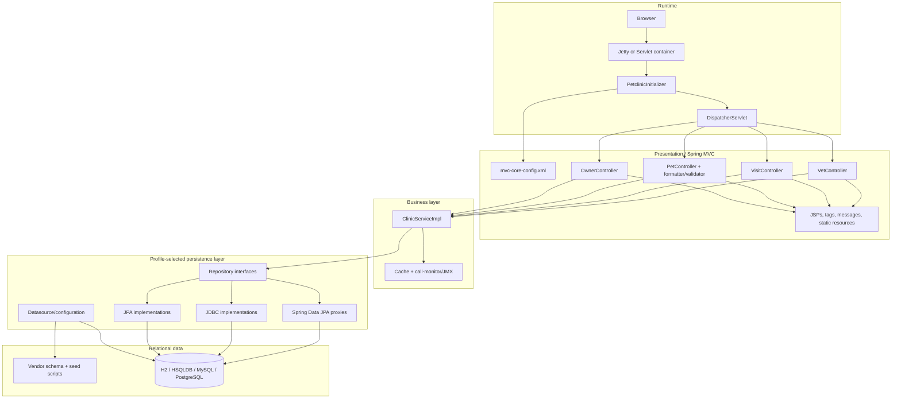

# discovery-terra1 — discovery/init-assess (ses_e53a4a81bffeACTozoy8XRrqLC)

### 1. User — 2026-11-05T15:37:09.871Z

## Invocation context

Execute the discovery workflow for the following change.

**Change name** (<name>): discovery-terra1
**Scanning directory** (<scan_directory>): .
**Doc directory** (<doc_directory>):   ./openspec/changes/discovery-terra1/discovery/

Using the discovery assessment workflow, generate a brand new map for each repository in this workspace, plus another "common" one documenting how the repositories relate at system level.

Save each repository assessment under:

<doc_directory>/<repository-name>/assessment/

If more than one repository is found, save the common system-level assessment under:

<doc_directory>/common/assessment/

Accept all defaults and proceed to the next step without asking.


---

**Mode select.** If the invocation context above starts with `--portfolio`,
run **Portfolio mode**. Otherwise run **Workspace mode**.

---

# Portfolio mode (`--portfolio <parent-dir>`)

Sweep every immediate subdirectory of the parent dir and produce a
heat-map a steering committee can use to sequence a multi-year program.

## Step P1 — Per-system metrics

For each subdirectory `<sys>`:

```bash
cloc --quiet --csv <parent>/<sys>          # LOC by language
lizard -s cyclomatic_complexity <parent>/<sys> 2>/dev/null | tail -1
```

If `cloc`/`lizard` are not installed, fall back to `scc <parent>/<sys>`
(LOC + complexity) or `find` + `wc -l` grouped by extension, and estimate
complexity by counting decision keywords per file. Note which tool you used.

Capture: total SLOC, dominant language, file count, mean & max
cyclomatic complexity (CCN). For dependency freshness, locate the
manifest (`package.json`, `pom.xml`, `*.csproj`, `requirements*.txt`,
copybook dir) and note its age / pinned-version count.

## Step P2 — COCOMO-II effort

Compute person-months per system using COCOMO-II basic:
`PM = 2.94 × (KSLOC)^1.10` (nominal scale factors). Show the formula and
inputs so the figure is defensible, not a guess.

## Step P3 — Documentation coverage

For each system, count source files with vs without a header comment
block, and list architecture docs present (`README`, `docs/`, ADRs).
Report coverage % and the top undocumented subsystems.

## Step P4 — Render the heat-map

Write `<doc_directory>/portfolio.html` (dark `#1e1e1e` bg, `#d4d4d4` text,
`#cc785c` accent, system-ui font, all CSS inline). One row per system;
columns: **System · Lang · KSLOC · Files · Mean CCN · Max CCN · Dep
Freshness · Doc Coverage % · COCOMO PM · Risk**. Color-grade the PM and
Risk cells (green→amber→red). Below the table, a 2-3 sentence
sequencing recommendation: which system first and why.

Then stop. Tell the user to open `<doc_directory>/portfolio.html`.

---

# Workspace mode

Treat `<scan_directory>` as the **Discovery workspace**.

The workspace contains one or more repositories as immediate child
directories. `<scan_directory>` itself is not a repository to assess.

A workspace may contain repositories implemented with any programming
language, runtime, technology stack, architectural style, or execution model.

Do not assume any particular:

- programming language
- technology stack
- architecture
- repository role
- runtime
- deployment model
- integration style
- application type

Derive these characteristics from source code, configuration, build files,
runtime definitions, deployment descriptors, documentation, and other
available evidence.

Examples in this command are illustrative only and must not be interpreted
as an exhaustive list of supported technologies or repository types.

---

## Step W1 — Identify repositories

Inspect the immediate child directories of `<scan_directory>` and identify
the repositories that belong to the Discovery workspace.

Use available repository and project evidence such as:

- `.git`
- build descriptors
- dependency manifests
- source directory structures
- runtime or deployment descriptors
- project configuration
- language-specific project files
- repository documentation

Examples of project markers include `pom.xml`, `build.gradle`,
`package.json`, `*.csproj`, `pyproject.toml`, `requirements*.txt`,
Makefiles, JCL structures, COBOL source trees, Pascal project files,
copybook collections, or equivalent stack-specific markers.

These examples are not exhaustive.

Do not treat generated directories, dependency caches, build outputs, IDE
metadata, or workspace-support directories as independent repositories.

Record the resolved repositories before continuing.

For each repository use:

```text
<repository> = <scan_directory>/<repository-name>
<repository_doc_directory> = <doc_directory>/<repository-name>/assessment
```

Perform the complete **Repository assessment** independently for every
resolved repository.

Do not merge repository-level metrics, technologies, dependencies,
complexity, technical debt, security findings, architecture evidence,
documentation gaps, or effort estimates while performing these assessments.

After all repository-level assessments are complete:

- if the workspace contains one repository, finish with the repository-level
  result;
- if the workspace contains more than one repository, perform the
  **Common system assessment**.

---

# Repository assessment

For each `<repository>`, perform a complete modernization assessment.

This is the discovery phase — the goal is a fact-grounded executive brief that
a VP of Engineering could take into a budget meeting.

Assess the repository according to the technology and execution model actually
present in it. Do not force concepts from one stack onto another.

Work in this order:

## Step 1 — Quantitative inventory

Run and show the output of:

```bash
scc <repository>
```

Then run:

```bash
scc --by-file -s complexity <repository> | head -25
```

to identify the highest-complexity files. Capture the COCOMO effort/cost
estimate `scc` provides.

If `scc` is not installed, fall back in order:

1. `cloc <repository>` for the LOC table, then compute COCOMO-II effort
yourself: `PM = 2.94 × (KSLOC)^1.10` (nominal scale factors). Show the
inputs.

2. If `cloc` is also missing, use `find` + `wc -l` grouped by extension
for LOC, and estimate complexity using stack-appropriate decision/control
constructs.

Do not assume C-family syntax when assessing other languages. Adapt complexity
signals to the repository's actual language and execution model.

For example:

- COBOL: `IF`, `EVALUATE`, `WHEN`, `PERFORM`
- C-family / Java / JavaScript: `if`, `for`, `while`, `case`, `catch`
- Pascal: `if`, `case`, `for`, `while`, `repeat`
- other languages: use equivalent control-flow constructs

Compute COCOMO from KSLOC as above when needed.

Note in the assessment which tool and method were used so the figures are
reproducible.

## Step 2 — Technology fingerprint

Identify, with file evidence:

- Languages, frameworks, platforms, and runtime versions in use
- Build system and dependency manifest locations
- Data stores and persistent data structures
- Integration points and external interfaces
- Runtime, deployment, scheduling, transaction, batch, messaging, or
  invocation mechanisms where applicable
- Test presence and approximate coverage signal

Adapt the investigation to the repository.

Potential evidence may include schemas, copybooks, record definitions,
database definitions, ORM mappings, message definitions, APIs, queues,
files, batch jobs, transaction definitions, screen definitions, generated
interfaces, configuration-driven integrations, or other stack-specific
mechanisms.

Do not require any of these mechanisms to exist.

## Step 3 — Parallel deep analysis

Spawn three subagents **in parallel**:

1. **legacy-analyst** —

   "Build a structural map of <repository>.

   Identify the 5-12 major functional or structural domains/components
   represented in the repository, which source files or artifacts belong
   to each, and how they depend on each other through control flow, shared
   data, invocation, configuration, runtime definitions, or other
   stack-specific mechanisms.

   Group optional or feature-gated subsystems under one umbrella where
   appropriate.

   Return a markdown table + a Mermaid `graph TD` of domain-level
   dependencies. Use `subgraph` to cluster and cap at ~40 edges.

   Cite repository-relative file paths.

   Flag dangling references such as defined-but-missing targets or apparently
   unused elements, while accounting for dynamic, configuration-driven,
   scheduled, transactional, generated, or externally invoked entry points."

2. **legacy-analyst** —

   "Identify technical debt in <repository>.

   Adapt the analysis to the repository's actual technology and execution
   model.

   Look for dead code, deprecated constructs or APIs, duplication, overly
   coupled modules, god objects/programs, missing error handling, hardcoded
   configuration, obsolete dependencies, difficult-to-maintain structures,
   and other stack-specific technical debt.

   Return the top 10 findings ranked by remediation value, each with
   file:line evidence where available."

3. **security-auditor** —

   "Scan <repository> for security vulnerabilities.

   Adapt the security assessment to the repository's technology, execution
   model, trust boundaries, and interfaces.

   Consider applicable risks such as injection, authentication weaknesses,
   authorization weaknesses, hardcoded secrets, vulnerable dependencies,
   unsafe data handling, missing input validation, insecure configuration,
   file or resource permissions, and other stack-specific vulnerabilities.

   Return findings in CWE-tagged table form with file:line evidence and
   severity."

Wait for all three. Synthesize their findings.

## Step 4 — Production runtime overlay (optional)

If production telemetry or runtime evidence is available — for example an
observability/APM MCP server, batch logs, transaction logs, scheduler output,
runtime exports, operational records, or equivalent stack-specific evidence —
gather relevant runtime measurements for the repository's key execution paths.

These may include jobs, transactions, programs, services, routes, messages,
batch processes, scheduled tasks, or other runtime units.

Where meaningful, gather p50/p95/p99 wall-clock values and use them to:

- Tag functional or structural domains from Step 3 with their production
  execution cost.
- Calculate **p99 variance** (`p99/p50`) where those metrics are meaningful.
- Flag high-variance execution paths as operational risks.

Include a small **Runtime Profile** table adapted to the repository's
execution model.

If no telemetry is available, skip this step and note the gap in the
assessment.

Do not fabricate runtime metrics.

## Step 5 — Documentation gap analysis

Compare what the repository actually does against what its README,
documentation, comments, schemas, configuration, operational definitions,
or other available documentation says.

List the top 5 undocumented behaviors, structures, dependencies, interfaces,
or subsystems that a new engineer would need explained.

## Step 6 — Write the repository assessment

Create:

```text
<repository_doc_directory>/ASSESSMENT.md
<repository_doc_directory>/ARCHITECTURE.mmd
```

Write `<repository_doc_directory>/ASSESSMENT.md` with these sections:

- **Executive Summary**
  - 3-4 sentences: what this repository is responsible for, how big it is,
    how risky it is, and the headline recommendation.

- **System Inventory**
  - quantitative inventory
  - technology fingerprint

- **Architecture-at-a-Glance**
  - structural/domain table
  - reference the architecture diagram

- **Production Runtime Profile**
  - runtime evidence from Step 4, or explicitly state that no telemetry was
    available

- **Technical Debt**
  - top 10 findings, ranked

- **Security Findings**
  - CWE-tagged findings where applicable

- **Documentation Gaps**
  - top 5

- **Effort Estimation**
  - COCOMO-derived person-months
  - ±range
  - key cost drivers
  - calculation method

- **Recommended Modernization Pattern**
  - one of: Rehost / Replatform / Refactor / Rearchitect / Rebuild / Replace
  - one-paragraph rationale based on repository evidence

Write `<repository_doc_directory>/ARCHITECTURE.mmd` containing the Mermaid
domain/component dependency diagram from the legacy-analyst.

Verify that both files exist before continuing to the next repository.

---

# Common system assessment

Run this section **only when more than one repository was identified in
`<scan_directory>`**.

The purpose of the common assessment is to discover and document what can only
be understood by considering multiple repositories together.

`common` must not be a concatenation or duplication of repository-level
assessments.

Repository-local findings must remain in their corresponding repository
artifacts.

Read all generated repository-level:

```text
<doc_directory>/<repository-name>/assessment/ASSESSMENT.md
<doc_directory>/<repository-name>/assessment/ARCHITECTURE.mmd
```

Use those artifacts as the starting point.

Inspect repository source, configuration, runtime definitions, contracts,
data definitions, deployment artifacts, or other evidence when necessary to
confirm relationships between repositories.

Do not assume that repositories are related merely because they exist in the
same workspace.

Do not assume predefined repository roles such as frontend, backend, batch,
database, shared library, service, or adapter.

Discover each repository's role from evidence.

## Step C1 — Repository landscape

For each repository, identify its responsibility and role within the overall
system based on evidence.

Describe the role using terminology appropriate to the system being analyzed.

Examples may include, but are not limited to:

- transaction processing
- user interaction
- batch processing
- shared business definitions
- data processing
- integration
- reporting
- persistence
- calculation
- orchestration
- runtime support

Do not force a repository into one of these categories.

Record:

- repository name
- discovered responsibility
- main technologies/platforms
- major inputs
- major outputs
- confirmed relationships to other repositories
- supporting evidence

## Step C2 — Cross-repository relationships

Identify confirmed relationships between repositories.

Relationships may be expressed through any technology or execution mechanism.

Look for evidence including, but not limited to:

- program or module invocation
- procedure or routine calls
- APIs, RPC, service calls, or remote invocations
- batch or job invocation
- scheduler relationships
- transaction definitions
- message producers and consumers
- shared files
- exchanged files or generated outputs
- shared record layouts
- copybooks
- shared schemas
- contracts or interface definitions
- shared libraries
- imported modules
- shared or coordinated data stores
- database relationships
- configuration-driven references
- runtime or deployment relationships
- generated clients or generated interfaces
- user-interface to processing relationships
- external-system mediation
- other stack-specific integration mechanisms

These examples are not exhaustive.

For every confirmed relationship, identify:

- source repository
- target repository
- relationship or interaction type
- relevant artifact/program/module/interface
- direction
- supporting evidence
- confidence level

Distinguish clearly between:

- confirmed relationships
- inferred relationships
- unresolved potential relationships

Do not present inferred relationships as facts.

## Step C3 — System-level architecture

Build an end-to-end architecture view showing how the repositories form the
overall system.

Generate a Mermaid diagram showing:

- repository boundaries
- each repository's discovered responsibility
- confirmed relationships between repositories
- important shared resources or external systems where necessary to explain
  repository interaction

Do not reproduce complete internal repository-level call graphs.

Expand internal repository elements only where necessary to explain a
cross-repository relationship or critical end-to-end execution path.

## Step C4 — Cross-repository execution and data flows

Identify important flows that cross repository boundaries.

A flow may involve any combination of:

- user interaction
- program execution
- jobs
- transactions
- messages
- files
- databases
- services
- APIs
- shared data structures
- configuration
- schedulers
- external systems
- other stack-specific mechanisms

For each significant confirmed flow, describe:

- trigger
- participating repositories
- sequence of interactions
- data or control exchanged
- final outcome
- source evidence

Where the available evidence does not support a complete end-to-end flow,
document the gap instead of inventing missing steps.

## Step C5 — Shared and cross-repository concerns

Identify findings that can only be understood by considering multiple
repositories together.

Examples may include:

- duplicated or inconsistent contracts
- duplicated business concepts or data definitions
- incompatible interface assumptions
- shared data ownership
- coupling through shared files or databases
- version compatibility dependencies
- deployment or runtime coupling
- sequencing dependencies
- shared security assumptions
- cross-repository technical debt
- duplicated functionality
- conflicting data representations
- undocumented integration points
- modernization ordering constraints

These examples are not exhaustive.

Do not move repository-local findings into `common`.

## Step C6 — System-level modernization implications

Determine how relationships between repositories affect modernization.

Identify:

- repositories that can be modernized independently
- repositories that must be coordinated
- dependency ordering constraints
- contracts or data structures that must remain compatible
- shared runtime or deployment constraints
- cross-repository migration risks
- opportunities to decouple repositories before or during modernization

Base recommendations on evidence from the discovered system.

Do not assume that repositories should be merged, split, converted to
services, or migrated independently.

## Step C7 — Write the common assessment

Create:

```text
<doc_directory>/common/assessment/ASSESSMENT.md
<doc_directory>/common/assessment/ARCHITECTURE.mmd
```

Write `<doc_directory>/common/ASSESSMENT.md` with:

- **System Executive Summary**
  - what the repositories collectively represent
  - major relationships
  - headline system-level risks
  - headline modernization implication

- **Repository Landscape**
  - repository
  - discovered responsibility
  - technology/platform
  - main inputs/outputs
  - relationships

- **Cross-Repository Relationships**
  - confirmed relationships
  - evidence
  - confidence

- **Cross-Repository Execution and Data Flows**
  - significant end-to-end flows

- **System Architecture-at-a-Glance**
  - reference the common architecture diagram

- **Shared and Cross-Repository Risks**
  - findings that cannot be attributed to only one repository

- **System Documentation Gaps**
  - missing or ambiguous cross-repository knowledge

- **Modernization Dependencies and Sequencing**
  - dependencies that influence migration planning
  - coordination requirements
  - ordering constraints

- **Overall Modernization Pattern**
  - system-level recommendation
  - explicitly distinguish it from individual repository recommendations
    where they differ

For effort estimation, preserve each repository's independently calculated
COCOMO estimate.

If an overall figure is presented, show the repository estimates separately
and clearly explain how the overall value was derived.

Do not calculate system effort by treating the repositories as an artificially
merged source tree.

Write `<doc_directory>/common/assessment/ARCHITECTURE.mmd` containing the system-level
Mermaid diagram showing repository boundaries and confirmed relationships.

Verify both common artifacts exist.

---

# Present

Report:

- repositories discovered under `<scan_directory>`
- repository-level assessment artifacts generated for each repository
- whether a common system assessment was required
- common artifacts generated, when applicable
- unresolved or inferred cross-repository relationships, when applicable

For each repository suggest:

```text
glow -p <doc_directory>/<repository-name>/assessment/ASSESSMENT.md
```

If more than one repository exists, also suggest:

```text
glow -p <doc_directory>/common/assessment/ASSESSMENT.md
```

---

### 2. Assistant — 2026-11-05T15:37:09.931Z

_(Step started)_

#### Reasoning

```
**Assessing repository root directories**
```

#### Tool: todowrite

```json
{
  "todos": [
    {
      "content": "Identify workspace repositories and inventory Petclinic",
      "status": "in_progress",
      "priority": "high"
    },
    {
      "content": "Run parallel architecture, debt, and security assessments",
      "status": "pending",
      "priority": "high"
    },
    {
      "content": "Write and verify discovery assessment artifacts",
      "status": "pending",
      "priority": "high"
    }
  ]
}
```

```
[
  {
    "content": "Identify workspace repositories and inventory Petclinic",
    "status": "in_progress",
    "priority": "high"
  },
  {
    "content": "Run parallel architecture, debt, and security assessments",
    "status": "pending",
    "priority": "high"
  },
  {
    "content": "Write and verify discovery assessment artifacts",
    "status": "pending",
    "priority": "high"
  }
]
```

_(Step finished: tool-calls)_

---

### 3. Assistant — 2026-11-05T15:37:17.716Z

_(Step started)_

#### Tool: bash

```json
{
  "command": "pwd && ls -la && ls -la \"./spring-framework-petclinic\" && (command -v scc || true) && (command -v cloc || true)",
  "workdir": ".",
  "timeout": 120000
}
```

```
/home/mduenasb/ainative-workspaces/spring-framework-petclinic
total 36
drwxr-xr-x 2 mduenasb mduenasb 4096 Nov  5 13:41 .
drwxr-xr-x 5 mduenasb mduenasb 4096 Nov  5 12:49 ..
lrwxrwxrwx 1 mduenasb mduenasb   81 Nov  5 12:49 .ai-native-config -> /home/mduenasb/work-framework/spring-framework-petclinic/.ai-native-config/common
-rw-r--r-- 1 mduenasb mduenasb  453 Nov  5 12:49 .envrc
-rw-r--r-- 1 mduenasb mduenasb   81 Nov  5 12:49 .graphifyignore
-rw-r--r-- 1 mduenasb mduenasb 2694 Nov  5 16:04 agent-sessions-log-errors.log
lrwxrwxrwx 1 mduenasb mduenasb   64 Nov  5 12:49 ai-docs -> /home/mduenasb/work-framework/spring-framework-petclinic/ai-docs
lrwxrwxrwx 1 mduenasb mduenasb   69 Nov  5 12:49 graphify-out -> /home/mduenasb/work-framework/spring-framework-petclinic/graphify-out
lrwxrwxrwx 1 mduenasb mduenasb   83 Nov  5 12:49 openspec -> /home/mduenasb/work-framework/spring-framework-petclinic/.ai-native-config/openspec
lrwxrwxrwx 1 mduenasb mduenasb   56 Nov  5 12:49 spring-framework-petclinic -> /home/mduenasb/work-framework/spring-framework-petclinic
lrwxrwxrwx 1 mduenasb mduenasb 56 Nov  5 12:49 ./spring-framework-petclinic -> /home/mduenasb/work-framework/spring-framework-petclinic
/usr/local/bin/scc
/usr/local/bin/cloc

```

_(Step finished: tool-calls)_

---

### 4. Assistant — 2026-11-05T15:37:24.166Z

_(Step started)_

#### Reasoning

```
**Inspecting project root and files**
```

#### Tool: bash

```json
{
  "command": "env -C \"./spring-framework-petclinic\" scc .",
  "workdir": ".",
  "timeout": 120000
}
```

```
───────────────────────────────────────────────────────────────────────────────
Language            Files       Lines    Blanks  Comments       Code Complexity
───────────────────────────────────────────────────────────────────────────────
Java                   61       4,295       648     1,356      2,291         91
Markdown               18       6,166     1,582         0      4,584          0
JavaServer Pag…         9         402        35         0        367          0
XML                     9         996        96       131        769          0
SQL                     8         485        71         0        414          0
JSON                    6         865         0         0        865          0
Properties File         6          62         4        24         34          0
YAML                    5          70         9         2         59          0
Plain Text              4         257        44         0        213          0
Sass                    4         384        64        16        304          0
SVG                     2       9,158         0         0      9,158          0
Batch                   1         187        35         0        152         27
CSS                     1       8,011       852        28      7,131          1
Shell                   1         287        20        49        218         32
───────────────────────────────────────────────────────────────────────────────
Total                 135      31,625     3,460     1,606     26,559        151
───────────────────────────────────────────────────────────────────────────────
Estimated Cost to Develop (organic) $845,313
Estimated Schedule Effort (organic) 12.90 months
Estimated People Required (organic) 5.82
───────────────────────────────────────────────────────────────────────────────
Processed 1166855 bytes, 1.167 megabytes (SI)
───────────────────────────────────────────────────────────────────────────────

```

#### Tool: bash

```json
{
  "command": "env -C \"./spring-framework-petclinic\" bash -c 'scc --by-file -s complexity . | head -25'",
  "workdir": ".",
  "timeout": 120000
}
```

```
───────────────────────────────────────────────────────────────────────────────
Language            Files       Lines    Blanks  Comments       Code Complexity
───────────────────────────────────────────────────────────────────────────────
Java                   61       4,295       648     1,356      2,291         91
───────────────────────────────────────────────────────────────────────────────
~anyResultSetExtractor.java       159        15        74         70         18
~c/web/OwnerController.java       132        19        32         81          9
~inic/web/PetValidator.java        67         9        30         28          6
~petclinic/model/Owner.java       152        22        35         95          6
~nic/web/PetController.java       111        17        20         74          6
~bcOwnerRepositoryImpl.java       156        17        41         98          6
~/CallMonitoringAspect.java        97        14        26         57          5
~JdbcPetRepositoryImpl.java       117        14        27         76          4
~inic/util/EntityUtils.java        57         7        34         16          4
~paVisitRepositoryImpl.java        65        10        26         29          3
~paOwnerRepositoryImpl.java        81        12        35         34          3
~bcVisitRepositoryImpl.java        99        16        29         54          3
~/JpaPetRepositoryImpl.java        65        10        24         31          3
~JdbcPetVisitExtractor.java        53         7        19         27          3
~/petclinic/model/Vets.java        43         6        21         16          2
~s/petclinic/model/Vet.java        77        11        23         43          2
~JdbcVetRepositoryImpl.java        89         8        33         48          2
~s/petclinic/model/Pet.java       110        20        22         68          2
~/web/PetTypeFormatter.java        65         9        27         29          2
~inic/model/BaseEntity.java        47         6        21         20          1

```

#### Tool: bash

```json
{
  "command": "git -C \"./spring-framework-petclinic\" status --short && git -C \"./spring-framework-petclinic\" log --oneline -5",
  "workdir": ".",
  "timeout": 120000
}
```

```
 M .ai-native-config/openspec/changes/discovery-terra1/agent-conversations/system--local-orchestrator-ses_e53b01f5dffeS9sPv39z8dSacI.md
?? .ai-native-config/openspec/changes/discovery-terra1/agent-conversations/discovery--init-assess-ses_e53a4a81bffeACTozoy8XRrqLC.md
7275534 chore(orchestrators/discovery): log session for discovery-terra1
43da716 move(archivist): archive
c8772c8 chore(archivist): log session for init-ainative-context
1b1b070 chore(pr-publisher): log session for init-ainative-context
21d9481 chore(pr-publisher): log session for init-ainative-context

```

#### Tool: glob

```json
{
  "path": "./spring-framework-petclinic",
  "pattern": "{pom.xml,README*,mvnw,Dockerfile,compose*.yml,**/application*.properties,**/application*.yml,**/*Test.java}"
}
```

```
/home/mduenasb/ainative-workspaces/spring-framework-petclinic/spring-framework-petclinic/pom.xml
/home/mduenasb/ainative-workspaces/spring-framework-petclinic/spring-framework-petclinic/mvnw
```

#### Tool: grep

```json
{
  "path": "./spring-framework-petclinic",
  "include": "pom.xml",
  "pattern": "<java.version>|<spring-framework.version>|<spring-boot.version>|<dependency>|<artifactId>|<version>"
}
```

```
Found 100 matches (more matches available)
/home/mduenasb/ainative-workspaces/spring-framework-petclinic/spring-framework-petclinic/pom.xml:
  Line 6:     <artifactId>spring-framework-petclinic</artifactId>

  Line 7:     <version>7.0.3</version>

  Line 17:         <java.version>17</java.version>

  Line 31:         <spring-framework.version>7.0.7</spring-framework.version>

  Line 95:             <dependency>

  Line 97:                 <artifactId>jackson-bom</artifactId>

  Line 98:                 <version>${jackson.version}</version>

  Line 102:             <dependency>

  Line 104:                 <artifactId>spring-data-bom</artifactId>

  Line 105:                 <version>${spring-data.version}</version>

  Line 113:         <dependency>

  Line 115:             <artifactId>jakarta.servlet-api</artifactId>

  Line 116:             <version>${servlet-api.version}</version>

  Line 119:         <dependency>

  Line 121:             <artifactId>tomcat-jasper-el</artifactId>

  Line 122:             <version>${tomcat.version}</version>

  Line 126:         <dependency>

  Line 128:             <artifactId>jakarta.servlet.jsp.jstl-api</artifactId>

  Line 129:             <version>${jstl-api.version}</version>

  Line 132:         <dependency>

  Line 134:             <artifactId>jakarta.servlet.jsp.jstl</artifactId>

  Line 135:             <version>${jstl-glassfish.version}</version>

  Line 139:         <dependency>

  Line 141:             <artifactId>jackson-core</artifactId>

  Line 142:             <version>${jackson.version}</version>

  Line 144:         <dependency>

  Line 146:             <artifactId>jackson-databind</artifactId>

  Line 147:             <version>${jackson.version}</version>

  Line 149:         <dependency>

  Line 151:             <artifactId>json-path</artifactId>

  Line 152:             <version>${json-path.version}</version>

  Line 156:         <dependency>

  Line 158:             <artifactId>spring-data-jpa</artifactId>

  Line 162:                     <artifactId>*</artifactId>

  Line 167:         <dependency>

  Line 169:             <artifactId>spring-jdbc</artifactId>

  Line 170:             <version>${spring-framework.version}</version>

  Line 172:         <dependency>

  Line 174:             <artifactId>spring-orm</artifactId>

  Line 175:             <version>${spring-framework.version}</version>

  Line 177:         <dependency>

  Line 179:             <artifactId>spring-webmvc</artifactId>

  Line 180:             <version>${spring-framework.version}</version>

  Line 183:         <dependency>

  Line 185:             <artifactId>spring-context-support</artifactId>

  Line 186:             <version>${spring-framework.version}</version>

  Line 188:         <dependency>

  Line 190:             <artifactId>spring-oxm</artifactId>

  Line 191:             <version>${spring-framework.version}</version>

  Line 194:         <dependency>

  Line 196:             <artifactId>caffeine</artifactId>

  Line 197:             <version>${caffeine.version}</version>

  Line 200:         <dependency>

  Line 202:             <artifactId>aspectjweaver</artifactId>

  Line 203:             <version>${aspectj.version}</version>

  Line 210:         <dependency>

  Line 212:             <artifactId>tomcat-jdbc</artifactId>

  Line 213:             <version>${tomcat.version}</version>

  Line 218:         <dependency>

  Line 220:             <artifactId>slf4j-api</artifactId>

  Line 221:             <version>${slf4j.version}</version>

  Line 223:         <dependency>

  Line 225:             <artifactId>logback-classic</artifactId>

  Line 226:             <version>${logback.version}</version>

  Line 231:         <dependency>

  Line 233:             <artifactId>jakarta.persistence-api</artifactId>

  Line 234:             <version>${jpa-api.version}</version>

  Line 236:         <dependency>

  Line 238:             <artifactId>hibernate-core</artifactId>

  Line 239:             <version>${hibernate.version}</version>

  Line 241:         <dependency>

  Line 243:             <artifactId>hibernate-validator</artifactId>

  Line 244:             <version>${hibernate-validator.version}</version>

  Line 246:         <dependency>

  Line 248:             <artifactId>hibernate-jcache</artifactId>

  Line 249:             <version>${hibernate.version}</version>

  Line 254:         <dependency>

  Line 256:             <artifactId>bootstrap</artifactId>

  Line 257:             <version>${webjars-bootstrap.version}</version>

  Line 259:         <dependency>

  Line 261:             <artifactId>font-awesome</artifactId>

  Line 262:             <version>${webjars-font-awesome.version}</version>

  Line 264:         <dependency>

  Line 266:             <artifactId>flatpickr</artifactId>

  Line 267:             <version>${webjars-flatpickr.version}</version>

  Line 271:         <dependency>

  Line 273:             <artifactId>spring-test</artifactId>

  Line 274:             <version>${spring-framework.version}</version>

  Line 277:         <dependency>

  Line 279:             <artifactId>junit-jupiter-engine</artifactId>

  Line 280:             <version>${junit-jupiter.version}</version>

  Line 282:         <dependency>

  Line 284:             <artifactId>assertj-core</artifactId>

  Line 285:             <version>${assertj.version}</version>

  Line 288:         <dependency>

  Line 290:             <artifactId>mockito-core</artifactId>

  Line 291:             <version>${mockito.version}</version>

  Line 294:         <dependency>

  Line 296:             <artifactId>mockito-junit-jupiter</artifactId>

  Line 297:             <version>${mockito.version}</version>


(Results truncated. Consider using a more specific path or pattern.)
```

#### Tool: grep

```json
{
  "path": "./spring-framework-petclinic",
  "include": "*.java",
  "pattern": "@(RestController|Controller|Entity|Repository|Service|Configuration|Scheduled)|class\\s+|interface\\s+"
}
```

```
Found 100 matches (more matches available)
/home/mduenasb/ainative-workspaces/spring-framework-petclinic/spring-framework-petclinic/src/test/java/org/springframework/samples/petclinic/model/PetTests.java:
  Line 11: class PetTests {


/home/mduenasb/ainative-workspaces/spring-framework-petclinic/spring-framework-petclinic/src/test/java/org/springframework/samples/petclinic/model/VetTests.java:
  Line 10: class VetTests {


/home/mduenasb/ainative-workspaces/spring-framework-petclinic/spring-framework-petclinic/src/test/java/org/springframework/samples/petclinic/web/VisitControllerTests.java:
  Line 18:  * Test class for {@link VisitController}

  Line 23: class VisitControllerTests {


/home/mduenasb/ainative-workspaces/spring-framework-petclinic/spring-framework-petclinic/src/test/java/org/springframework/samples/petclinic/web/CrashControllerTests.java:
  Line 15:  * Test class for {@link CrashController}

  Line 20: class CrashControllerTests {


/home/mduenasb/ainative-workspaces/spring-framework-petclinic/spring-framework-petclinic/src/test/java/org/springframework/samples/petclinic/web/PetControllerTests.java:
  Line 22:  * Test class for the {@link PetController}

  Line 27: class PetControllerTests {


/home/mduenasb/ainative-workspaces/spring-framework-petclinic/spring-framework-petclinic/src/test/java/org/springframework/samples/petclinic/model/ValidatorTests.java:
  Line 22: class ValidatorTests {


/home/mduenasb/ainative-workspaces/spring-framework-petclinic/spring-framework-petclinic/src/test/java/org/springframework/samples/petclinic/web/VetControllerTests.java:
  Line 22:  * Test class for the {@link VetController}

  Line 25: class VetControllerTests {


/home/mduenasb/ainative-workspaces/spring-framework-petclinic/spring-framework-petclinic/src/test/java/org/springframework/samples/petclinic/web/PetTypeFormatterTests.java:
  Line 21:  * Test class for {@link PetTypeFormatter}

  Line 26: class PetTypeFormatterTests {


/home/mduenasb/ainative-workspaces/spring-framework-petclinic/spring-framework-petclinic/src/test/java/org/springframework/samples/petclinic/web/OwnerControllerTests.java:
  Line 21:  * Test class for {@link OwnerController}

  Line 27: class OwnerControllerTests {


/home/mduenasb/ainative-workspaces/spring-framework-petclinic/spring-framework-petclinic/src/main/java/org/springframework/samples/petclinic/util/CallMonitoringAspect.java:
  Line 39: public class CallMonitoringAspect {


/home/mduenasb/ainative-workspaces/spring-framework-petclinic/spring-framework-petclinic/src/main/java/org/springframework/samples/petclinic/repository/VetRepository.java:
  Line 23:  * Repository class for <code>Vet</code> domain objects All method names are compliant with Spring Data naming

  Line 24:  * conventions so this interface can easily be extended for Spring Data See here: http://static.springsource.org/spring-data/jpa/docs/current/reference/html/jpa.repositories.html#jpa.query-methods.query-creation

  Line 31: public interface VetRepository {


/home/mduenasb/ainative-workspaces/spring-framework-petclinic/spring-framework-petclinic/src/main/java/org/springframework/samples/petclinic/util/EntityUtils.java:
  Line 25:  * Utility methods for handling entities. Separate from the BaseEntity class mainly because of dependency on the

  Line 33: public class EntityUtils {

  Line 40:      * Look up the entity of the given class with the given id in the given collection.

  Line 43:      * @param entityClass the entity class to look up


/home/mduenasb/ainative-workspaces/spring-framework-petclinic/spring-framework-petclinic/src/main/java/org/springframework/samples/petclinic/repository/VisitRepository.java:
  Line 24:  * Repository class for <code>Visit</code> domain objects All method names are compliant with Spring Data naming

  Line 25:  * conventions so this interface can easily be extended for Spring Data See here: http://static.springsource.org/spring-data/jpa/docs/current/reference/html/jpa.repositories.html#jpa.query-methods.query-creation

  Line 32: public interface VisitRepository {


/home/mduenasb/ainative-workspaces/spring-framework-petclinic/spring-framework-petclinic/src/test/java/org/springframework/samples/petclinic/service/ClinicServiceJpaTests.java:
  Line 17: class ClinicServiceJpaTests extends AbstractClinicServiceTests {


/home/mduenasb/ainative-workspaces/spring-framework-petclinic/spring-framework-petclinic/src/main/java/org/springframework/samples/petclinic/web/PetTypeFormatter.java:
  Line 41: public class PetTypeFormatter implements Formatter<PetType> {


/home/mduenasb/ainative-workspaces/spring-framework-petclinic/spring-framework-petclinic/src/main/java/org/springframework/samples/petclinic/web/PetValidator.java:
  Line 34: public class PetValidator implements Validator {


/home/mduenasb/ainative-workspaces/spring-framework-petclinic/spring-framework-petclinic/src/main/java/org/springframework/samples/petclinic/repository/jdbc/JdbcVisitRepositoryImpl.java:
  Line 39: @Repository

  Line 40: public class JdbcVisitRepositoryImpl implements VisitRepository {


/home/mduenasb/ainative-workspaces/spring-framework-petclinic/spring-framework-petclinic/src/main/java/org/springframework/samples/petclinic/web/VetController.java:
  Line 33: @Controller

  Line 34: public class VetController {


/home/mduenasb/ainative-workspaces/spring-framework-petclinic/spring-framework-petclinic/src/test/java/org/springframework/samples/petclinic/service/AbstractClinicServiceTests.java:
  Line 35:  * <p> Base class for {@link ClinicService} integration tests. </p> <p> Subclasses should specify Spring context

  Line 53: abstract class AbstractClinicServiceTests {


/home/mduenasb/ainative-workspaces/spring-framework-petclinic/spring-framework-petclinic/src/main/java/org/springframework/samples/petclinic/repository/jdbc/OneToManyResultSetExtractor.java:
  Line 40:  * This class comes from the Spring Data JDBC Extensions project that has been archived in 2019:

  Line 48: public abstract class OneToManyResultSetExtractor<R, C, K> implements ResultSetExtractor<List<R>> {


/home/mduenasb/ainative-workspaces/spring-framework-petclinic/spring-framework-petclinic/src/main/java/org/springframework/samples/petclinic/web/OwnerController.java:
  Line 38: @Controller

  Line 39: public class OwnerController {


/home/mduenasb/ainative-workspaces/spring-framework-petclinic/spring-framework-petclinic/src/main/java/org/springframework/samples/petclinic/repository/springdatajpa/SpringDataPetRepository.java:
  Line 32: public interface SpringDataPetRepository extends PetRepository, Repository<Pet, Integer> {


/home/mduenasb/ainative-workspaces/spring-framework-petclinic/spring-framework-petclinic/src/test/java/org/springframework/samples/petclinic/service/ClinicServiceSpringDataJpaTests.java:
  Line 15: class ClinicServiceSpringDataJpaTests extends AbstractClinicServiceTests {


/home/mduenasb/ainative-workspaces/spring-framework-petclinic/spring-framework-petclinic/src/main/java/org/springframework/samples/petclinic/web/VisitController.java:
  Line 36: @Controller

  Line 37: public class VisitController {


/home/mduenasb/ainative-workspaces/spring-framework-petclinic/spring-framework-petclinic/src/main/java/org/springframework/samples/petclinic/repository/jdbc/JdbcVetRepositoryImpl.java:
  Line 44: @Repository

  Line 45: public class JdbcVetRepositoryImpl implements VetRepository {


/home/mduenasb/ainative-workspaces/spring-framework-petclinic/spring-framework-petclinic/src/main/java/org/springframework/samples/petclinic/repository/springdatajpa/SpringDataVisitRepository.java:
  Line 28: public interface SpringDataVisitRepository extends VisitRepository, Repository<Visit, Integer> {


/home/mduenasb/ainative-workspaces/spring-framework-petclinic/spring-framework-petclinic/src/test/java/org/springframework/samples/petclinic/service/ClinicServiceJdbcTests.java:
  Line 31: class ClinicServiceJdbcTests extends AbstractClinicServiceTests {


/home/mduenasb/ainative-workspaces/spring-framework-petclinic/spring-framework-petclinic/src/main/java/org/springframework/samples/petclinic/web/CrashController.java:
  Line 29: @Controller

  Line 30: public class CrashController {


/home/mduenasb/ainative-workspaces/spring-framework-petclinic/spring-framework-petclinic/src/main/java/org/springframework/samples/petclinic/repository/jdbc/JdbcPetVisitExtractor.java:
  Line 28: public class JdbcPetVisitExtractor extends


/home/mduenasb/ainative-workspaces/spring-framework-petclinic/spring-framework-petclinic/src/main/java/org/springframework/samples/petclinic/repository/springdatajpa/SpringDataVetRepository.java:
  Line 28: public interface SpringDataVetRepository extends VetRepository, Repository<Vet, Integer> {


/home/mduenasb/ainative-workspaces/spring-framework-petclinic/spring-framework-petclinic/src/main/java/org/springframework/samples/petclinic/web/PetController.java:
  Line 38: @Controller

  Line 40: public class PetController {


/home/mduenasb/ainative-workspaces/spring-framework-petclinic/spring-framework-petclinic/src/main/java/org/springframework/samples/petclinic/repository/springdatajpa/SpringDataOwnerRepository.java:
  Line 32: public interface SpringDataOwnerRepository extends OwnerRepository, Repository<Owner, Integer> {


/home/mduenasb/ainative-workspaces/spring-framework-petclinic/spring-framework-petclinic/src/main/java/org/springframework/samples/petclinic/repository/jdbc/JdbcPetRepositoryImpl.java:
  Line 44: @Repository

  Line 45: public class JdbcPetRepositoryImpl implements PetRepository {


/home/mduenasb/ainative-workspaces/spring-framework-petclinic/spring-framework-petclinic/src/main/java/org/springframework/samples/petclinic/PetclinicInitializer.java:
  Line 29:  * In Servlet 3.0+ environments, this class replaces the traditional {@code web.xml}-based approach in order to configure the

  Line 39: public class PetclinicInitializer extends AbstractDispatcherServletInitializer {


/home/mduenasb/ainative-workspaces/spring-framework-petclinic/spring-framework-petclinic/src/main/java/org/springframework/samples/petclinic/repository/PetRepository.java:
  Line 25:  * Repository class for <code>Pet</code> domain objects All method names are compliant with Spring Data naming

  Line 26:  * conventions so this interface can easily be extended for Spring Data See here: http://static.springsource.org/spring-data/jpa/docs/current/reference/html/jpa.repositories.html#jpa.query-methods.query-creation

  Line 33: public interface PetRepository {


/home/mduenasb/ainative-workspaces/spring-framework-petclinic/spring-framework-petclinic/src/main/java/org/springframework/samples/petclinic/repository/jdbc/JdbcPetRowMapper.java:
  Line 28: class JdbcPetRowMapper implements RowMapper<JdbcPet> {


/home/mduenasb/ainative-workspaces/spring-framework-petclinic/spring-framework-petclinic/src/main/java/org/springframework/samples/petclinic/repository/jdbc/JdbcVisitRowMapper.java:
  Line 30: class JdbcVisitRowMapper implements RowMapper<Visit> {


/home/mduenasb/ainative-workspaces/spring-framework-petclinic/spring-framework-petclinic/src/main/java/org/springframework/samples/petclinic/model/Pet.java:
  Line 44: @Entity

  Line 46: public class Pet extends NamedEntity {


/home/mduenasb/ainative-workspaces/spring-framework-petclinic/spring-framework-petclinic/src/main/java/org/springframework/samples/petclinic/service/ClinicService.java:
  Line 32: public interface ClinicService {


/home/mduenasb/ainative-workspaces/spring-framework-petclinic/spring-framework-petclinic/src/main/java/org/springframework/samples/petclinic/model/Vets.java:
  Line 31: public class Vets {


/home/mduenasb/ainative-workspaces/spring-framework-petclinic/spring-framework-petclinic/src/main/java/org/springframework/samples/petclinic/repository/jdbc/JdbcOwnerRepositoryImpl.java:
  Line 47: @Repository

  Line 48: public class JdbcOwnerRepositoryImpl implements OwnerRepository {


/home/mduenasb/ainative-workspaces/spring-framework-petclinic/spring-framework-petclinic/src/main/java/org/springframework/samples/petclinic/service/ClinicServiceImpl.java:
  Line 39: @Service

  Line 40: public class ClinicServiceImpl implements ClinicService {


/home/mduenasb/ainative-workspaces/spring-framework-petclinic/spring-framework-petclinic/src/main/java/org/springframework/samples/petclinic/model/Specialty.java:
  Line 26: @Entity

  Line 28: public class Specialty extends NamedEntity {


/home/mduenasb/ainative-workspaces/spring-framework-petclinic/spring-framework-petclinic/src/main/java/org/springframework/samples/petclinic/model/PetType.java:
  Line 25: @Entity

  Line 27: public class PetType extends NamedEntity {


/home/mduenasb/ainative-workspaces/spring-framework-petclinic/spring-framework-petclinic/src/main/java/org/springframework/samples/petclinic/repository/jdbc/JdbcPet.java:
  Line 21:  * Subclass of Pet that carries temporary id properties which are only relevant for a JDBC implementation of the

  Line 26: class JdbcPet extends Pet {


/home/mduenasb/ainative-workspaces/spring-framework-petclinic/spring-framework-petclinic/src/main/java/org/springframework/samples/petclinic/repository/OwnerRepository.java:
  Line 24:  * Repository class for <code>Owner</code> domain objects All method names are compliant with Spring Data naming

  Line 25:  * conventions so this interface can easily be extended for Spring Data See here: http://static.springsource.org/spring-data/jpa/docs/current/reference/html/jpa.repositories.html#jpa.query-methods.query-creation

  Line 32: public interface OwnerRepository {


/home/mduenasb/ainative-workspaces/spring-framework-petclinic/spring-framework-petclinic/src/main/java/org/springframework/samples/petclinic/model/Owner.java:
  Line 43: @Entity

  Line 45: public class Owner extends Person {


/home/mduenasb/ainative-workspaces/spring-framework-petclinic/spring-framework-petclinic/src/main/java/org/springframework/samples/petclinic/model/NamedEntity.java:
  Line 23:  * Simple JavaBean domain object adds a name property to <code>BaseEntity</code>. Used as a base class for objects

  Line 30: public class NamedEntity extends BaseEntity {


/home/mduenasb/ainative-workspaces/spring-framework-petclinic/spring-framework-petclinic/src/main/java/org/springframework/samples/petclinic/model/Visit.java:
  Line 33: @Entity

  Line 35: public class Visit extends BaseEntity {


/home/mduenasb/ainative-workspaces/spring-framework-petclinic/spring-framework-petclinic/src/main/java/org/springframework/samples/petclinic/model/Vet.java:
  Line 42: @Entity

  Line 44: public class Vet extends Person {


/home/mduenasb/ainative-workspaces/spring-framework-petclinic/spring-framework-petclinic/src/main/java/org/springframework/samples/petclinic/model/Person.java:
  Line 28: public class Person extends BaseEntity {


/home/mduenasb/ainative-workspaces/spring-framework-petclinic/spring-framework-petclinic/src/main/java/org/springframework/samples/petclinic/repository/jpa/JpaVetRepositoryImpl.java:
  Line 34: @Repository

  Line 35: public class JpaVetRepositoryImpl implements VetRepository {


/home/mduenasb/ainative-workspaces/spring-framework-petclinic/spring-framework-petclinic/src/main/java/org/springframework/samples/petclinic/repository/jpa/JpaVisitRepositoryImpl.java:
  Line 28:  * JPA implementation of the ClinicService interface using EntityManager.

  Line 38: @Repository

  Line 39: public class JpaVisitRepositoryImpl implements VisitRepository {


/home/mduenasb/ainative-workspaces/spring-framework-petclinic/spring-framework-petclinic/src/main/java/org/springframework/samples/petclinic/model/BaseEntity.java:
  Line 24:  * Simple JavaBean domain object with an id property. Used as a base class for objects needing this property.

  Line 30: public class BaseEntity {


/home/mduenasb/ainative-workspaces/spring-framework-petclinic/spring-framework-petclinic/src/main/java/org/springframework/samples/petclinic/repository/jpa/JpaOwnerRepositoryImpl.java:
  Line 36: @Repository

  Line 37: public class JpaOwnerRepositoryImpl implements OwnerRepository {


/home/mduenasb/ainative-workspaces/spring-framework-petclinic/spring-framework-petclinic/src/main/java/org/springframework/samples/petclinic/repository/jpa/JpaPetRepositoryImpl.java:
  Line 36: @Repository

  Line 37: public class JpaPetRepositoryImpl implements PetRepository {


(Results truncated. Consider using a more specific path or pattern.)
```

_(Step finished: tool-calls)_

---

### 5. Assistant — 2026-11-05T15:37:39.050Z

_(Step started)_

#### Tool: task

```json
{
  "description": "Map Petclinic architecture",
  "subagent_type": "discovery/legacy-analyst",
  "prompt": "Read-only analysis only; do not write files. Build a structural map of repository ./spring-framework-petclinic. Identify 5-12 major domains/components, source artifacts belonging to each, and dependencies through control flow, shared data, config, and runtime. Return a markdown table plus Mermaid graph TD (with subgraphs, <=40 edges), citing repository-relative file paths. Flag dangling/unused references while accounting for dynamically selected persistence implementations. Also summarize test and deployment/config evidence relevant to architecture."
}
```

```
<task id="ses_e53a40131ffepxdde0uc1FLOv2" state="completed">
<task_result>
## Structural map

Repository root: `spring-framework-petclinic/`. This is a Java 17 Maven **WAR** application using Servlet/Spring MVC, XML Spring contexts, JSP/JSTL, and profile-selected persistence. `pom.xml:10-21`, `pom.xml:167-180`.

| Domain / component | Responsibility and main artifacts | Dependencies and control/data flow |
|---|---|---|
| **Servlet bootstrap** | `PetclinicInitializer` creates separate root and DispatcherServlet XML contexts, maps the servlet to `/`, and installs UTF-8 request handling. `src/main/java/org/springframework/samples/petclinic/PetclinicInitializer.java:39-79` | Loads business/tool contexts and MVC context; default persistence profile is `jpa`, overridable with `spring.profiles.active`. `PetclinicInitializer.java:42-59` |
| **Web/MVC routing** | Controllers: `OwnerController`, `PetController`, `VisitController`, `VetController`, and deliberate exception route `CrashController`; MVC component scanning and annotation routing are enabled in `mvc-core-config.xml`. `src/main/resources/spring/mvc-core-config.xml:17-25` | Browser requests enter `DispatcherServlet` → controller → `ClinicService`; logical view names resolve to JSPs. Owner routes include create/search/edit/detail. `src/main/java/.../web/OwnerController.java:53-129` |
| **Owner management** | Owner model, CRUD/search controller, and owner JSPs: `model/Owner.java`, `web/OwnerController.java`, `WEB-INF/jsp/owners/*.jsp`. `Owner.java:43-60`; `OwnerController.java:60-117` | Owners own pets through a bidirectional `@OneToMany` relation. `Owner.java:59-60`, `Owner.java:104-107`. Searches use a prefix last-name query through the service. `OwnerController.java:76-98` |
| **Pet and type management** | Pet model/type model, pet controller, formatter, validator, and pet form JSP. `model/Pet.java`, `model/PetType.java`, `web/PetController.java`, `web/PetTypeFormatter.java`, `web/PetValidator.java`. | Pet belongs to Owner and PetType; controller preloads owner/types, rejects duplicate pet names per owner, and saves through the service. `Pet.java:52-61`; `PetController.java:49-57`, `PetController.java:77-89`. Formatter resolves submitted type names through `ClinicService`. `PetTypeFormatter.java:43-62` |
| **Visit history** | `Visit`, `VisitController`, visit form/list rendering within owner detail. `model/Visit.java`, `web/VisitController.java`, `WEB-INF/jsp/owners/ownerDetails.jsp`. | A visit belongs to a pet; the controller attaches a new visit to a loaded pet before persistence. `Visit.java:54-56`; `VisitController.java:60-65`, `VisitController.java:75-82`. Owner details traverse `owner → pets → visits`. `ownerDetails.jsp:46-72` |
| **Veterinary directory** | `Vet`, `Specialty`, `Vets`, `VetController`, `vets/vetList.jsp`. `model/Vet.java:42-49`; `web/VetController.java:42-70`. | Vets and specialties are many-to-many via `vet_specialties`; the controller wraps the collection in `Vets` for HTML, JSON, and XML output. `Vet.java:46-49`; `VetController.java:42-63` |
| **Service façade and cross-cutting behavior** | `ClinicService` and `ClinicServiceImpl` provide the controller-facing façade; transactions are applied at service methods, and vet retrieval is cached. `service/ClinicService.java:27-50`; `ClinicServiceImpl.java:54-107`. | Delegates each operation to an interface-level repository. `ClinicServiceImpl.java:42-51`, `:56-107`. Tool context enables caching, AspectJ proxying, and JMX export. `src/main/resources/spring/tools-config.xml:24-47` |
| **Persistence ports and implementations** | Repository ports: `OwnerRepository`, `PetRepository`, `VetRepository`, `VisitRepository`. Implementations live under `repository/jpa/`, `repository/jdbc/`, and `repository/springdatajpa/`. `repository/OwnerRepository.java:32-60`; `business-config.xml:29-96`. | **Dynamically selected** by Spring profile: `jpa` scans JPA repositories, `jdbc` scans JDBC repositories, `spring-data-jpa` creates Spring Data proxies. `business-config.xml:66-96`. Do not treat the unselected implementation directories as unused. |
| **Relational schema and seed data** | Per-database schema/data scripts under `src/main/resources/db/{h2,hsqldb,mysql,postgresql}/`; H2 is default. `pom.xml:520-542`; `data-access.properties:7-18`. | Datasource initialization chooses `db/${db.script}/schema.sql` and `data.sql`. `datasource-config.xml:32-37`. H2 schema establishes owners→pets→visits, pet types, and vet specialties. `db/h2/schema.sql:23-64` |
| **Presentation and internationalization** | JSPs and custom tags under `src/main/webapp/WEB-INF/{jsp,tags}/`; static resources under `src/main/webapp/resources/`; localized messages under `src/main/resources/messages/`. `mvc-core-config.xml:27-54`; `mvc-view-config.xml:25-28`. | JSP resolver maps logical names to `/WEB-INF/jsp/*.jsp`; `/resources/**` and `/webjars/**` are static mappings. `mvc-view-config.xml:25-28`; `mvc-core-config.xml:27-39` |
| **Observability and error presentation** | `CallMonitoringAspect` measures repository calls and exposes JMX attributes; MVC maps exceptions to the `exception` view. `util/CallMonitoringAspect.java:37-95`; `mvc-core-config.xml:56-66`. | The aspect pointcut targets `@Repository` classes, so it observes active annotated JPA/JDBC repository classes; its own comment says Spring Data JPA lacks suitable annotated join points. `CallMonitoringAspect.java:27-31`, `:77-95` |



## Runtime/configuration evidence

- The default is an in-memory H2 database, with HSQLDB, MySQL, and PostgreSQL Maven profiles supplying driver/URL/dialect properties. `pom.xml:520-599`.
- Persistence technology is independently selected with Spring profiles: default `jpa`; alternatives `jdbc` and `spring-data-jpa`. `PetclinicInitializer.java:42-59`; `business-config.xml:35-96`.
- The application is packaged as `petclinic.war`; Maven config allows WAR creation without `web.xml`. `pom.xml:10-11`, `pom.xml:381-388`.
- Local runtime evidence supports Jetty Maven deployment and a Docker image based on Jetty 11/JDK 17 through Jib. `readme.md:17-32`; `pom.xml:465-490`.
- `jetty-web.xml` retains a Jetty classloader-priority workaround. `src/main/webapp/WEB-INF/jetty-web.xml:3-7`.

## Test evidence

- Maven Surefire only includes `**/*Tests.java`; JaCoCo prepares an agent and emits XML during `prepare-package`. `pom.xml:370-379`, `pom.xml:428-451`.
- Service integration tests share behavior through `AbstractClinicServiceTests`; they exercise owner, pet, type, vet, and visit reads/writes. `src/test/java/org/springframework/samples/petclinic/service/AbstractClinicServiceTests.java:53-200`.
- The same service contract runs under all three persistence profiles: JPA, JDBC, and Spring Data JPA. `ClinicServiceJpaTests.java:15-17`; `ClinicServiceJdbcTests.java:29-31`; `ClinicServiceSpringDataJpaTests.java:13-15`.
- MVC controller tests use `MockMvc` and a Mockito-backed `ClinicService` bean rather than a database. `src/test/resources/spring/mvc-test-config.xml:8-15`; `web/OwnerControllerTests.java:26-43`.
- CI runs Maven `verify` for pull requests and main, across Java 17 and 21; main additionally invokes Sonar analysis. `.github/workflows/maven-build-pull-request.yml:1-26`; `.github/workflows/maven-build-main.yml:4-30`.

## Dangling or apparently stale references

| Finding | Evidence | Interpretation |
|---|---|---|
| `namedParameterJdbcTemplate` bean has no source consumer. | It is declared in `business-config.xml:76-79`; source search found no Java/XML reference beyond that declaration. | **Apparently unused in this checkout.** JDBC repositories use `JdbcClient` and `SimpleJdbcInsert`, for example `JdbcOwnerRepositoryImpl.java:50-60`. It may remain as a compatibility/teaching artifact. |
| XML `MarshallingView` bean `vets/vetList.xml` has no static caller. | Defined in `mvc-view-config.xml:30-38`; source search found no other production reference. | **Apparently unused.** `VetController` serves `/vets.xml` as `@ResponseBody`, not by returning that view name. `VetController.java:51-63`. Dynamic external selection cannot be completely ruled out, but no route returns `vets/vetList.xml`. |
| `ClinicService.findVisitsByPetId` is not used by production web flow. | Declared/implemented at `ClinicService.java:50` and `ClinicServiceImpl.java:105-108`; the production visit-list route instead loads a Pet and calls `getVisits()`. `VisitController.java:85-89`. | **Test-supported but production-unreached in the inspected routes.** It is exercised by the common service integration test. `AbstractClinicServiceTests.java:192-200`. |
| Some comments name obsolete XML locations. | `CrashController` points to `/WEB-INF/mvc-core-config.xml`. `CrashController.java:21-28`; the actual file is `src/main/resources/spring/mvc-core-config.xml`. | Documentation drift only; the exception resolver itself is configured at `mvc-core-config.xml:60-66`. |
| No `persistence.xml` was found, although the JPA factory names persistence unit `petclinic`. | JPA factory sets `persistenceUnitName` and `packagesToScan`. `business-config.xml:37-51`. | **Configuration gap to validate at deployment time.** The inspected source has no `persistence.xml`; whether the configured container/provider accepts this combination cannot be determined by static reading alone. |

## Confidence & Gaps

- **High confidence:** request-to-controller-to-service-to-repository structure; profile-driven persistence selection; schema relationships; test/CI evidence.
- **Moderate confidence:** the two static “apparently unused” configuration entries; reflection, externally supplied Spring context fragments, or runtime view-name selection could alter reachability.
- **Not determined:** actual production profile, database, container configuration, JNDI `javaee` profile usage, or whether a build/runtime dependency supplies the named JPA persistence unit.
- **Ask an SME:** Which persistence profile and database are deployed; whether JNDI is active; whether the XML vet view and `NamedParameterJdbcTemplate` are retained for external integrations or historical examples; and how the JPA persistence unit is supplied in the deployed WAR.
</task_result>
</task>
```

#### Tool: task

_Status: running_

```json
{
  "description": "Assess Petclinic debt",
  "subagent_type": "discovery/legacy-analyst",
  "prompt": "Read-only analysis only; do not write files. Analyze technical debt in ./spring-framework-petclinic for its actual Java/Spring MVC stack. Return top 10 findings ranked by remediation value, each with precise repository-relative file:line evidence when available. Cover dead code, deprecated APIs, duplication, coupling, god objects, errors, configuration, dependencies, and maintainability. Clearly distinguish evidence-backed facts from hypotheses."
}
```

#### Tool: task

_Status: running_

```json
{
  "description": "Audit Petclinic security",
  "subagent_type": "discovery/security-auditor",
  "prompt": "Read-only analysis only; do not write files. Scan ./spring-framework-petclinic for security risks appropriate to Java/Spring MVC. Return a CWE-tagged markdown table with file:line evidence, severity, rationale, and remediation direction. Assess injection, input validation, authz/authn, secrets, dependencies, configuration, error handling, CSRF/session considerations, and data exposure. Clearly state if a control is absent from repository evidence rather than asserting a runtime condition."
}
```

---
