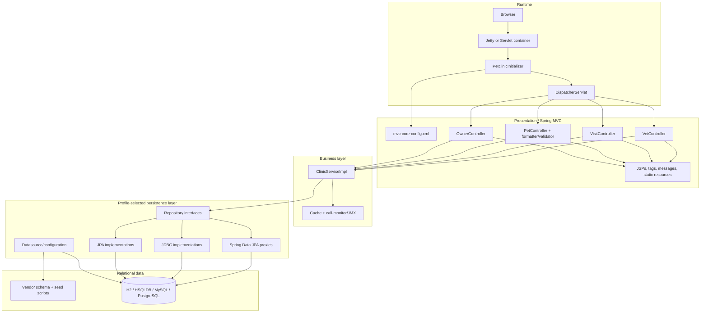

# discovery-terra1 — discovery/legacy-analyst (ses_e53a40131ffepxdde0uc1FLOv2)

### 1. User — 2026-11-05T15:37:52.594Z

Read-only analysis only; do not write files. Build a structural map of repository ./spring-framework-petclinic. Identify 5-12 major domains/components, source artifacts belonging to each, and dependencies through control flow, shared data, config, and runtime. Return a markdown table plus Mermaid graph TD (with subgraphs, <=40 edges), citing repository-relative file paths. Flag dangling/unused references while accounting for dynamically selected persistence implementations. Also summarize test and deployment/config evidence relevant to architecture.

---

### 2. Assistant — 2026-11-05T15:37:52.747Z

_(Step started)_

#### Reasoning

```
**Verifying directory access and task count**
```

#### Tool: todowrite

```json
{
  "todos": [
    {
      "content": "Inspect repository entry points, build metadata, and top-level structure",
      "status": "in_progress",
      "priority": "high"
    },
    {
      "content": "Trace major domains, shared data, configuration, and runtime dependencies",
      "status": "pending",
      "priority": "high"
    },
    {
      "content": "Review tests and deployment/config evidence; identify dangling references",
      "status": "pending",
      "priority": "medium"
    },
    {
      "content": "Deliver cited structural map and Mermaid architecture graph",
      "status": "pending",
      "priority": "high"
    }
  ]
}
```

```
[
  {
    "content": "Inspect repository entry points, build metadata, and top-level structure",
    "status": "in_progress",
    "priority": "high"
  },
  {
    "content": "Trace major domains, shared data, configuration, and runtime dependencies",
    "status": "pending",
    "priority": "high"
  },
  {
    "content": "Review tests and deployment/config evidence; identify dangling references",
    "status": "pending",
    "priority": "medium"
  },
  {
    "content": "Deliver cited structural map and Mermaid architecture graph",
    "status": "pending",
    "priority": "high"
  }
]
```

_(Step finished: tool-calls)_

---

### 3. Assistant — 2026-11-05T15:37:59.819Z

_(Step started)_

#### Tool: glob

```json
{
  "path": "/home/mduenasb/ainative-workspaces/spring-framework-petclinic",
  "pattern": "*"
}
```

```
/home/mduenasb/ainative-workspaces/spring-framework-petclinic/.graphifyignore
/home/mduenasb/ainative-workspaces/spring-framework-petclinic/agent-sessions-log-errors.log
/home/mduenasb/ainative-workspaces/spring-framework-petclinic/.envrc
```

#### Tool: glob

```json
{
  "path": "/home/mduenasb/ainative-workspaces/spring-framework-petclinic",
  "pattern": "**/pom.xml"
}
```

```
No files found
```

#### Tool: glob

```json
{
  "path": "/home/mduenasb/ainative-workspaces/spring-framework-petclinic",
  "pattern": "**/*.{yml,yaml,properties,xml}"
}
```

```
No files found
```

#### Tool: glob

```json
{
  "path": "/home/mduenasb/ainative-workspaces/spring-framework-petclinic",
  "pattern": "**/*Application*.java"
}
```

```
No files found
```

_(Step finished: tool-calls)_

---

### 4. Assistant — 2026-11-05T15:38:07.946Z

_(Step started)_

#### Reasoning

```
**Investigating directory reading discrepancy**
```

#### Tool: read

```json
{
  "filePath": "/home/mduenasb/ainative-workspaces/spring-framework-petclinic"
}
```

```
<path>/home/mduenasb/ainative-workspaces/spring-framework-petclinic</path>
<type>directory</type>
<entries>
.ai-native-config/
.envrc
.graphifyignore
agent-sessions-log-errors.log
ai-docs
graphify-out/
openspec/
spring-framework-petclinic/

(8 entries)
</entries>
```

_(Step finished: tool-calls)_

---

### 5. Assistant — 2026-11-05T15:38:12.621Z

_(Step started)_

#### Reasoning

```
**Inspecting nested root structure**
```

#### Tool: read

```json
{
  "filePath": "/home/mduenasb/ainative-workspaces/spring-framework-petclinic/spring-framework-petclinic"
}
```

```
<path>/home/mduenasb/ainative-workspaces/spring-framework-petclinic/spring-framework-petclinic</path>
<type>directory</type>
<entries>
_bmad/
.ai-native-config/
.devcontainer/
.editorconfig
.git/
.gitattributes
.github/
.gitignore
.graphifyignore
.mvn/
graphify-out/
LICENSE.txt
mvnw
mvnw.cmd
pom.xml
readme.md
src/

(17 entries)
</entries>
```

#### Tool: glob

```json
{
  "path": "/home/mduenasb/ainative-workspaces/spring-framework-petclinic/spring-framework-petclinic",
  "pattern": "{pom.xml,build.gradle,build.gradle.kts,settings.gradle,README*,Dockerfile,docker-compose*.yml}"
}
```

```
/home/mduenasb/ainative-workspaces/spring-framework-petclinic/spring-framework-petclinic/pom.xml
```

#### Tool: glob

```json
{
  "path": "/home/mduenasb/ainative-workspaces/spring-framework-petclinic/spring-framework-petclinic",
  "pattern": "src/main/**/*.java"
}
```

```
/home/mduenasb/ainative-workspaces/spring-framework-petclinic/spring-framework-petclinic/src/main/java/org/springframework/samples/petclinic/repository/VetRepository.java
/home/mduenasb/ainative-workspaces/spring-framework-petclinic/spring-framework-petclinic/src/main/java/org/springframework/samples/petclinic/repository/VisitRepository.java
/home/mduenasb/ainative-workspaces/spring-framework-petclinic/spring-framework-petclinic/src/main/java/org/springframework/samples/petclinic/util/CallMonitoringAspect.java
/home/mduenasb/ainative-workspaces/spring-framework-petclinic/spring-framework-petclinic/src/main/java/org/springframework/samples/petclinic/util/EntityUtils.java
/home/mduenasb/ainative-workspaces/spring-framework-petclinic/spring-framework-petclinic/src/main/java/org/springframework/samples/petclinic/repository/springdatajpa/SpringDataPetRepository.java
/home/mduenasb/ainative-workspaces/spring-framework-petclinic/spring-framework-petclinic/src/main/java/org/springframework/samples/petclinic/repository/springdatajpa/SpringDataVisitRepository.java
/home/mduenasb/ainative-workspaces/spring-framework-petclinic/spring-framework-petclinic/src/main/java/org/springframework/samples/petclinic/repository/springdatajpa/SpringDataVetRepository.java
/home/mduenasb/ainative-workspaces/spring-framework-petclinic/spring-framework-petclinic/src/main/java/org/springframework/samples/petclinic/repository/springdatajpa/SpringDataOwnerRepository.java
/home/mduenasb/ainative-workspaces/spring-framework-petclinic/spring-framework-petclinic/src/main/java/org/springframework/samples/petclinic/repository/PetRepository.java
/home/mduenasb/ainative-workspaces/spring-framework-petclinic/spring-framework-petclinic/src/main/java/org/springframework/samples/petclinic/web/package-info.java
/home/mduenasb/ainative-workspaces/spring-framework-petclinic/spring-framework-petclinic/src/main/java/org/springframework/samples/petclinic/web/PetTypeFormatter.java
/home/mduenasb/ainative-workspaces/spring-framework-petclinic/spring-framework-petclinic/src/main/java/org/springframework/samples/petclinic/web/PetValidator.java
/home/mduenasb/ainative-workspaces/spring-framework-petclinic/spring-framework-petclinic/src/main/java/org/springframework/samples/petclinic/web/VetController.java
/home/mduenasb/ainative-workspaces/spring-framework-petclinic/spring-framework-petclinic/src/main/java/org/springframework/samples/petclinic/web/OwnerController.java
/home/mduenasb/ainative-workspaces/spring-framework-petclinic/spring-framework-petclinic/src/main/java/org/springframework/samples/petclinic/web/VisitController.java
/home/mduenasb/ainative-workspaces/spring-framework-petclinic/spring-framework-petclinic/src/main/java/org/springframework/samples/petclinic/web/CrashController.java
/home/mduenasb/ainative-workspaces/spring-framework-petclinic/spring-framework-petclinic/src/main/java/org/springframework/samples/petclinic/web/PetController.java
/home/mduenasb/ainative-workspaces/spring-framework-petclinic/spring-framework-petclinic/src/main/java/org/springframework/samples/petclinic/PetclinicInitializer.java
/home/mduenasb/ainative-workspaces/spring-framework-petclinic/spring-framework-petclinic/src/main/java/org/springframework/samples/petclinic/repository/OwnerRepository.java
/home/mduenasb/ainative-workspaces/spring-framework-petclinic/spring-framework-petclinic/src/main/java/org/springframework/samples/petclinic/repository/jpa/package-info.java
/home/mduenasb/ainative-workspaces/spring-framework-petclinic/spring-framework-petclinic/src/main/java/org/springframework/samples/petclinic/repository/jdbc/package-info.java
/home/mduenasb/ainative-workspaces/spring-framework-petclinic/spring-framework-petclinic/src/main/java/org/springframework/samples/petclinic/repository/jpa/JpaOwnerRepositoryImpl.java
/home/mduenasb/ainative-workspaces/spring-framework-petclinic/spring-framework-petclinic/src/main/java/org/springframework/samples/petclinic/repository/jpa/JpaVetRepositoryImpl.java
/home/mduenasb/ainative-workspaces/spring-framework-petclinic/spring-framework-petclinic/src/main/java/org/springframework/samples/petclinic/repository/jpa/JpaVisitRepositoryImpl.java
/home/mduenasb/ainative-workspaces/spring-framework-petclinic/spring-framework-petclinic/src/main/java/org/springframework/samples/petclinic/repository/jdbc/JdbcPetRepositoryImpl.java
/home/mduenasb/ainative-workspaces/spring-framework-petclinic/spring-framework-petclinic/src/main/java/org/springframework/samples/petclinic/repository/jdbc/JdbcOwnerRepositoryImpl.java
/home/mduenasb/ainative-workspaces/spring-framework-petclinic/spring-framework-petclinic/src/main/java/org/springframework/samples/petclinic/repository/jdbc/JdbcPetRowMapper.java
/home/mduenasb/ainative-workspaces/spring-framework-petclinic/spring-framework-petclinic/src/main/java/org/springframework/samples/petclinic/repository/jdbc/JdbcVisitRowMapper.java
/home/mduenasb/ainative-workspaces/spring-framework-petclinic/spring-framework-petclinic/src/main/java/org/springframework/samples/petclinic/repository/jdbc/JdbcPet.java
/home/mduenasb/ainative-workspaces/spring-framework-petclinic/spring-framework-petclinic/src/main/java/org/springframework/samples/petclinic/repository/jdbc/JdbcVetRepositoryImpl.java
/home/mduenasb/ainative-workspaces/spring-framework-petclinic/spring-framework-petclinic/src/main/java/org/springframework/samples/petclinic/repository/jdbc/OneToManyResultSetExtractor.java
/home/mduenasb/ainative-workspaces/spring-framework-petclinic/spring-framework-petclinic/src/main/java/org/springframework/samples/petclinic/repository/jdbc/JdbcVisitRepositoryImpl.java
/home/mduenasb/ainative-workspaces/spring-framework-petclinic/spring-framework-petclinic/src/main/java/org/springframework/samples/petclinic/repository/jdbc/JdbcPetVisitExtractor.java
/home/mduenasb/ainative-workspaces/spring-framework-petclinic/spring-framework-petclinic/src/main/java/org/springframework/samples/petclinic/repository/jpa/JpaPetRepositoryImpl.java
/home/mduenasb/ainative-workspaces/spring-framework-petclinic/spring-framework-petclinic/src/main/java/org/springframework/samples/petclinic/service/ClinicServiceImpl.java
/home/mduenasb/ainative-workspaces/spring-framework-petclinic/spring-framework-petclinic/src/main/java/org/springframework/samples/petclinic/service/ClinicService.java
/home/mduenasb/ainative-workspaces/spring-framework-petclinic/spring-framework-petclinic/src/main/java/org/springframework/samples/petclinic/model/Visit.java
/home/mduenasb/ainative-workspaces/spring-framework-petclinic/spring-framework-petclinic/src/main/java/org/springframework/samples/petclinic/model/package-info.java
/home/mduenasb/ainative-workspaces/spring-framework-petclinic/spring-framework-petclinic/src/main/java/org/springframework/samples/petclinic/model/BaseEntity.java
/home/mduenasb/ainative-workspaces/spring-framework-petclinic/spring-framework-petclinic/src/main/java/org/springframework/samples/petclinic/model/Person.java
/home/mduenasb/ainative-workspaces/spring-framework-petclinic/spring-framework-petclinic/src/main/java/org/springframework/samples/petclinic/model/PetType.java
/home/mduenasb/ainative-workspaces/spring-framework-petclinic/spring-framework-petclinic/src/main/java/org/springframework/samples/petclinic/model/NamedEntity.java
/home/mduenasb/ainative-workspaces/spring-framework-petclinic/spring-framework-petclinic/src/main/java/org/springframework/samples/petclinic/model/Vet.java
/home/mduenasb/ainative-workspaces/spring-framework-petclinic/spring-framework-petclinic/src/main/java/org/springframework/samples/petclinic/model/Specialty.java
/home/mduenasb/ainative-workspaces/spring-framework-petclinic/spring-framework-petclinic/src/main/java/org/springframework/samples/petclinic/model/Owner.java
/home/mduenasb/ainative-workspaces/spring-framework-petclinic/spring-framework-petclinic/src/main/java/org/springframework/samples/petclinic/model/Vets.java
/home/mduenasb/ainative-workspaces/spring-framework-petclinic/spring-framework-petclinic/src/main/java/org/springframework/samples/petclinic/model/Pet.java
```

#### Tool: glob

```json
{
  "path": "/home/mduenasb/ainative-workspaces/spring-framework-petclinic/spring-framework-petclinic",
  "pattern": "src/{main,test}/resources/**/*"
}
```

```
/home/mduenasb/ainative-workspaces/spring-framework-petclinic/spring-framework-petclinic/src/main/resources/db/postgresql/petclinic_db_setup_postgresql.txt
/home/mduenasb/ainative-workspaces/spring-framework-petclinic/spring-framework-petclinic/src/main/resources/db/postgresql/schema.sql
/home/mduenasb/ainative-workspaces/spring-framework-petclinic/spring-framework-petclinic/src/main/resources/db/postgresql/data.sql
/home/mduenasb/ainative-workspaces/spring-framework-petclinic/spring-framework-petclinic/src/main/resources/db/h2/data.sql
/home/mduenasb/ainative-workspaces/spring-framework-petclinic/spring-framework-petclinic/src/test/resources/spring/mvc-test-config.xml
/home/mduenasb/ainative-workspaces/spring-framework-petclinic/spring-framework-petclinic/src/main/resources/db/h2/schema.sql
/home/mduenasb/ainative-workspaces/spring-framework-petclinic/spring-framework-petclinic/src/main/resources/spring/data-access.properties
/home/mduenasb/ainative-workspaces/spring-framework-petclinic/spring-framework-petclinic/src/main/resources/spring/business-config.xml
/home/mduenasb/ainative-workspaces/spring-framework-petclinic/spring-framework-petclinic/src/main/resources/spring/mvc-view-config.xml
/home/mduenasb/ainative-workspaces/spring-framework-petclinic/spring-framework-petclinic/src/main/resources/spring/datasource-config.xml
/home/mduenasb/ainative-workspaces/spring-framework-petclinic/spring-framework-petclinic/src/main/resources/spring/tools-config.xml
/home/mduenasb/ainative-workspaces/spring-framework-petclinic/spring-framework-petclinic/src/main/resources/spring/mvc-core-config.xml
/home/mduenasb/ainative-workspaces/spring-framework-petclinic/spring-framework-petclinic/src/main/resources/logback.xml
/home/mduenasb/ainative-workspaces/spring-framework-petclinic/spring-framework-petclinic/src/main/resources/db/mysql/schema.sql
/home/mduenasb/ainative-workspaces/spring-framework-petclinic/spring-framework-petclinic/src/main/resources/db/mysql/petclinic_db_setup_mysql.txt
/home/mduenasb/ainative-workspaces/spring-framework-petclinic/spring-framework-petclinic/src/main/resources/db/mysql/data.sql
/home/mduenasb/ainative-workspaces/spring-framework-petclinic/spring-framework-petclinic/src/main/resources/messages/messages_de.properties
/home/mduenasb/ainative-workspaces/spring-framework-petclinic/spring-framework-petclinic/src/main/resources/messages/messages.properties
/home/mduenasb/ainative-workspaces/spring-framework-petclinic/spring-framework-petclinic/src/main/resources/messages/messages_es.properties
/home/mduenasb/ainative-workspaces/spring-framework-petclinic/spring-framework-petclinic/src/main/resources/messages/messages_en.properties
/home/mduenasb/ainative-workspaces/spring-framework-petclinic/spring-framework-petclinic/src/main/resources/db/hsqldb/data.sql
/home/mduenasb/ainative-workspaces/spring-framework-petclinic/spring-framework-petclinic/src/main/resources/db/hsqldb/schema.sql
```

_(Step finished: tool-calls)_

---

### 6. Assistant — 2026-11-05T15:38:21.886Z

_(Step started)_

#### Reasoning

```
**Analyzing Spring Petclinic repository structure**
```

#### Tool: read

```json
{
  "filePath": "/home/mduenasb/ainative-workspaces/spring-framework-petclinic/spring-framework-petclinic/pom.xml"
}
```

```
<path>/home/mduenasb/ainative-workspaces/spring-framework-petclinic/spring-framework-petclinic/pom.xml</path>
<type>file</type>
<content>
1: <?xml version="1.0" encoding="UTF-8"?>
2: <project xmlns:xsi="http://www.w3.org/2001/XMLSchema-instance" xmlns="http://maven.apache.org/POM/4.0.0"
3:          xsi:schemaLocation="http://maven.apache.org/POM/4.0.0 http://maven.apache.org/maven-v4_0_0.xsd">
4:     <modelVersion>4.0.0</modelVersion>
5:     <groupId>org.springframework.samples</groupId>
6:     <artifactId>spring-framework-petclinic</artifactId>
7:     <version>7.0.3</version>
8: 
9:     <name>Spring Framework Petclinic</name>
10:     <packaging>war</packaging>
11:     <description>A Spring Framework application based on JSP, Spring MVC, Spring Data JPA, Hibernate and JDBC</description>
12:     <url>https://spring-petclinic.github.io/</url>
13: 
14:     <properties>
15: 
16:         <!-- Generic properties -->
17:         <java.version>17</java.version>
18:         <project.build.sourceEncoding>UTF-8</project.build.sourceEncoding>
19:         <project.reporting.outputEncoding>UTF-8</project.reporting.outputEncoding>
20:         <maven.compiler.source>${java.version}</maven.compiler.source>
21:         <maven.compiler.target>${java.version}</maven.compiler.target>
22: 
23:         <!-- SonarQube configuration -->
24:         <sonar.organization>spring-petclinic</sonar.organization>
25:         <sonar.host.url>https://sonarcloud.io</sonar.host.url>
26: 
27:         <!-- Spring -->
28:         <!-- For framework compatibility, refer to the Spring Boot Dependencies BOM and to the gradle.properties -->
29:         <!-- https://github.com/spring-projects/spring-boot/blob/main/spring-boot-project/spring-boot-dependencies/build.gradle -->
30:         <!-- https://github.com/spring-projects/spring-boot/blob/main/gradle.properties -->
31:         <spring-framework.version>7.0.7</spring-framework.version>
32: 
33:         <!-- Web dependencies -->
34:         <webjars-bootstrap.version>5.3.8</webjars-bootstrap.version> <!-- Report bootstrap version to the footer.tag -->
35:         <webjars-font-awesome.version>4.7.0</webjars-font-awesome.version>
36:         <webjars-flatpickr.version>4.6.13</webjars-flatpickr.version>
37: 
38:         <!-- Jakarta EE / Java SE dependencies -->
39:         <tomcat.version>11.0.18</tomcat.version>
40:         <jaxb-api.version>4.0.5</jaxb-api.version>
41:         <jaxb-runtime.version>4.0.7</jaxb-runtime.version>
42:         <jakarta-activation.version>2.1.4</jakarta-activation.version>
43:         <servlet-api.version>6.1.0</servlet-api.version>
44:         <jstl-api.version>3.0.2</jstl-api.version>
45:         <jstl-glassfish.version>3.0.1</jstl-glassfish.version>
46:         <jpa-api.version>3.2.0</jpa-api.version>
47: 
48:         <!-- Persistence -->
49:         <spring-data.version>2025.1.5</spring-data.version>
50:         <hibernate.version>7.3.2.Final</hibernate.version>
51:         <hibernate-validator.version>9.1.0.Final</hibernate-validator.version>
52:         <hsqldb.version>2.7.4</hsqldb.version>
53:         <h2database.version>2.4.240</h2database.version>
54:         <caffeine.version>3.2.3</caffeine.version>
55: 
56:         <!-- Logging -->
57:         <slf4j.version>2.0.17</slf4j.version>
58:         <logback.version>1.5.32</logback.version>
59: 
60:         <!-- Test -->
61:         <assertj.version>3.27.7</assertj.version>
62:         <json-path.version>2.10.0</json-path.version>
63:         <mockito.version>5.23.0</mockito.version>
64:         <hamcrest.version>3.0</hamcrest.version>
65:         <junit-jupiter.version>6.0.2</junit-jupiter.version>
66: 
67:         <!-- JDBC Drivers -->
68:         <mysql-driver.version>8.1.0</mysql-driver.version>
69:         <postgresql-driver.version>42.7.11</postgresql-driver.version>
70: 
71:         <!-- Others -->
72:         <jackson.version>3.1.2</jackson.version>
73:         <aspectj.version>1.9.25.1</aspectj.version>
74: 
75:         <!-- Maven plugins -->
76:         <jetty-maven-plugin.version>11.0.26</jetty-maven-plugin.version>
77:         <maven-assembly-plugin.version>3.8.0</maven-assembly-plugin.version>
78:         <maven-compiler-plugin.version>3.15.0</maven-compiler-plugin.version>
79:         <maven-eclipse-plugin.version>2.10</maven-eclipse-plugin.version>
80:         <maven-resources-plugin.version>3.4.0</maven-resources-plugin.version>
81:         <maven-surefire-plugin.version>3.5.5</maven-surefire-plugin.version>
82:         <maven-war-plugin.version>3.5.1</maven-war-plugin.version>
83:         <jacoco-maven-plugin>0.8.14</jacoco-maven-plugin>
84:         <maven-enforcer-plugin.version>3.6.2</maven-enforcer-plugin.version>
85:         <libsass-maven-plugin.version>0.3.4</libsass-maven-plugin.version>
86: 
87:         <!-- Docker image -->
88:         <docker.jib-maven-plugin.version>3.5.1</docker.jib-maven-plugin.version>
89:         <docker.image.prefix>springcommunity</docker.image.prefix>
90: 
91:     </properties>
92: 
93:     <dependencyManagement>
94:         <dependencies>
95:             <dependency>
96:                 <groupId>tools.jackson</groupId>
97:                 <artifactId>jackson-bom</artifactId>
98:                 <version>${jackson.version}</version>
99:                 <scope>import</scope>
100:                 <type>pom</type>
101:             </dependency>
102:             <dependency>
103:                 <groupId>org.springframework.data</groupId>
104:                 <artifactId>spring-data-bom</artifactId>
105:                 <version>${spring-data.version}</version>
106:                 <scope>import</scope>
107:                 <type>pom</type>
108:             </dependency>
109:         </dependencies>
110:     </dependencyManagement>
111: 
112:     <dependencies>
113:         <dependency>
114:             <groupId>jakarta.servlet</groupId>
115:             <artifactId>jakarta.servlet-api</artifactId>
116:             <version>${servlet-api.version}</version>
117:             <scope>provided</scope>
118:         </dependency>
119:         <dependency>
120:             <groupId>org.apache.tomcat</groupId>
121:             <artifactId>tomcat-jasper-el</artifactId>
122:             <version>${tomcat.version}</version>
123:             <scope>provided</scope>
124:         </dependency>
125: 
126:         <dependency>
127:             <groupId>jakarta.servlet.jsp.jstl</groupId>
128:             <artifactId>jakarta.servlet.jsp.jstl-api</artifactId>
129:             <version>${jstl-api.version}</version>
130:         </dependency>
131:         <!-- Tomcat 10 looks like to require it -->
132:         <dependency>
133:             <groupId>org.glassfish.web</groupId>
134:             <artifactId>jakarta.servlet.jsp.jstl</artifactId>
135:             <version>${jstl-glassfish.version}</version>
136:         </dependency>
137: 
138:         <!--  Json -->
139:         <dependency>
140:             <groupId>tools.jackson.core</groupId>
141:             <artifactId>jackson-core</artifactId>
142:             <version>${jackson.version}</version>
143:         </dependency>
144:         <dependency>
145:             <groupId>tools.jackson.core</groupId>
146:             <artifactId>jackson-databind</artifactId>
147:             <version>${jackson.version}</version>
148:         </dependency>
149:         <dependency>
150:             <groupId>com.jayway.jsonpath</groupId>
151:             <artifactId>json-path</artifactId>
152:             <version>${json-path.version}</version>
153:             <scope>test</scope>
154:         </dependency>
155:         <!-- SPRING, SPRING, SPRINGITY SPRING -->
156:         <dependency>
157:             <groupId>org.springframework.data</groupId>
158:             <artifactId>spring-data-jpa</artifactId>
159:             <exclusions>
160:                 <exclusion>
161:                     <groupId>org.springframework</groupId>
162:                     <artifactId>*</artifactId>
163:                 </exclusion>
164:             </exclusions>
165:         </dependency>
166: 
167:         <dependency>
168:             <groupId>org.springframework</groupId>
169:             <artifactId>spring-jdbc</artifactId>
170:             <version>${spring-framework.version}</version>
171:         </dependency>
172:         <dependency>
173:             <groupId>org.springframework</groupId>
174:             <artifactId>spring-orm</artifactId>
175:             <version>${spring-framework.version}</version>
176:         </dependency>
177:         <dependency>
178:             <groupId>org.springframework</groupId>
179:             <artifactId>spring-webmvc</artifactId>
180:             <version>${spring-framework.version}</version>
181:         </dependency>
182:         <!-- used for EhCacheCacheManager -->
183:         <dependency>
184:             <groupId>org.springframework</groupId>
185:             <artifactId>spring-context-support</artifactId>
186:             <version>${spring-framework.version}</version>
187:         </dependency>
188:         <dependency>
189:             <groupId>org.springframework</groupId>
190:             <artifactId>spring-oxm</artifactId>
191:             <version>${spring-framework.version}</version>
192:         </dependency>
193: 
194:         <dependency>
195:             <groupId>com.github.ben-manes.caffeine</groupId>
196:             <artifactId>caffeine</artifactId>
197:             <version>${caffeine.version}</version>
198:         </dependency>
199: 
200:         <dependency>
201:             <groupId>org.aspectj</groupId>
202:             <artifactId>aspectjweaver</artifactId>
203:             <version>${aspectj.version}</version>
204:         </dependency>
205: 
206:         <!-- Database connection pool
207:         See here for more details on commons-dbcp versus tomcat-jdbc:
208:         http://blog.ippon.fr/2013/03/13/improving-the-performance-of-the-spring-petclinic-sample-application-part-3-of-5/
209:     -->
210:         <dependency>
211:             <groupId>org.apache.tomcat</groupId>
212:             <artifactId>tomcat-jdbc</artifactId>
213:             <version>${tomcat.version}</version>
214:             <scope>runtime</scope>
215:         </dependency>
216: 
217:         <!-- Logging with SLF4J & LogBack -->
218:         <dependency>
219:             <groupId>org.slf4j</groupId>
220:             <artifactId>slf4j-api</artifactId>
221:             <version>${slf4j.version}</version>
222:         </dependency>
223:         <dependency>
224:             <groupId>ch.qos.logback</groupId>
225:             <artifactId>logback-classic</artifactId>
226:             <version>${logback.version}</version>
227:             <scope>runtime</scope>
228:         </dependency>
229: 
230:         <!-- JPA & Hibernate -->
231:         <dependency>
232:             <groupId>jakarta.persistence</groupId>
233:             <artifactId>jakarta.persistence-api</artifactId>
234:             <version>${jpa-api.version}</version>
235:         </dependency>
236:         <dependency>
237:             <groupId>org.hibernate.orm</groupId>
238:             <artifactId>hibernate-core</artifactId>
239:             <version>${hibernate.version}</version>
240:         </dependency>
241:         <dependency>
242:             <groupId>org.hibernate.validator</groupId>
243:             <artifactId>hibernate-validator</artifactId>
244:             <version>${hibernate-validator.version}</version>
245:         </dependency>
246:         <dependency>
247:             <groupId>org.hibernate.orm</groupId>
248:             <artifactId>hibernate-jcache</artifactId>
249:             <version>${hibernate.version}</version>
250:         </dependency>
251: 
252: 
253:         <!-- Webjars -->
254:         <dependency>
255:             <groupId>org.webjars</groupId>
256:             <artifactId>bootstrap</artifactId>
257:             <version>${webjars-bootstrap.version}</version>
258:         </dependency>
259:         <dependency>
260:             <groupId>org.webjars.npm</groupId>
261:             <artifactId>font-awesome</artifactId>
262:             <version>${webjars-font-awesome.version}</version>
263:         </dependency>
264:         <dependency>
265:             <groupId>org.webjars.npm</groupId>
266:             <artifactId>flatpickr</artifactId>
267:             <version>${webjars-flatpickr.version}</version>
268:         </dependency>
269: 
270:         <!-- Test Artifacts -->
271:         <dependency>
272:             <groupId>org.springframework</groupId>
273:             <artifactId>spring-test</artifactId>
274:             <version>${spring-framework.version}</version>
275:             <scope>test</scope>
276:         </dependency>
277:         <dependency>
278:             <groupId>org.junit.jupiter</groupId>
279:             <artifactId>junit-jupiter-engine</artifactId>
280:             <version>${junit-jupiter.version}</version>
281:         </dependency>
282:         <dependency>
283:             <groupId>org.assertj</groupId>
284:             <artifactId>assertj-core</artifactId>
285:             <version>${assertj.version}</version>
286:             <scope>test</scope>
287:         </dependency>
288:         <dependency>
289:             <groupId>org.mockito</groupId>
290:             <artifactId>mockito-core</artifactId>
291:             <version>${mockito.version}</version>
292:             <scope>test</scope>
293:         </dependency>
294:         <dependency>
295:             <groupId>org.mockito</groupId>
296:             <artifactId>mockito-junit-jupiter</artifactId>
297:             <version>${mockito.version}</version>
298:         </dependency>
299:         <dependency>
300:             <groupId>org.hamcrest</groupId>
301:             <artifactId>hamcrest</artifactId>
302:             <version>${hamcrest.version}</version>
303:             <scope>test</scope>
304:         </dependency>
305: 
306:         <!-- JAXB and Activation are considered to be a Jakarta EE API and therefore are
307:              no longer contained on the default class path from Java SE 9 -->
308:         <dependency>
309:             <groupId>jakarta.xml.bind</groupId>
310:             <artifactId>jakarta.xml.bind-api</artifactId>
311:             <version>${jaxb-api.version}</version>
312:             <exclusions>
313:                 <!-- Duplicated classes with jakarta.activation-api -->
314:                 <exclusion>
315:                     <groupId>com.sun.activation</groupId>
316:                     <artifactId>jakarta.activation</artifactId>
317:                 </exclusion>
318:             </exclusions>
319:         </dependency>
320:         <dependency>
321:             <groupId>org.glassfish.jaxb</groupId>
322:             <artifactId>jaxb-runtime</artifactId>
323:             <version>${jaxb-runtime.version}</version>
324:             <exclusions>
325:                 <!-- Duplicated classes with jakarta.activation-api -->
326:                 <exclusion>
327:                     <groupId>com.sun.activation</groupId>
328:                     <artifactId>jakarta.activation</artifactId>
329:                 </exclusion>
330:             </exclusions>
331:         </dependency>
332:         <dependency>
333:             <groupId>jakarta.activation</groupId>
334:             <artifactId>jakarta.activation-api</artifactId>
335:             <version>${jakarta-activation.version}</version>
336:         </dependency>
337: 
338:     </dependencies>
339: 
340:     <!-- Maven plugin versions are mentioned in order to guarantee the build reproducibility in the long term -->
341:     <build>
342:         <defaultGoal>install</defaultGoal>
343:         <finalName>petclinic</finalName>
344:         <resources>
345:             <resource>
346:                 <directory>${basedir}/src/main/resources</directory>
347:                 <filtering>true</filtering>
348:             </resource>
349:         </resources>
350:         <testResources>
351:             <testResource>
352:                 <!-- declared explicitly so Spring config files can be placed next to their corresponding JUnit test class  -->
353:                 <directory>${project.basedir}/src/test/java</directory>
354:             </testResource>
355:             <testResource>
356:                 <directory>${project.basedir}/src/test/resources</directory>
357:             </testResource>
358:         </testResources>
359:         <plugins>
360:             <plugin>
361:                 <groupId>org.apache.maven.plugins</groupId>
362:                 <artifactId>maven-compiler-plugin</artifactId>
363:                 <version>${maven-compiler-plugin.version}</version>
364:                 <configuration>
365:                     <!-- Required since Spring Framework 6.1 -->
366:                     <parameters>true</parameters>
367:                 </configuration>
368:             </plugin>
369: 
370:             <plugin>
371:                 <groupId>org.apache.maven.plugins</groupId>
372:                 <artifactId>maven-surefire-plugin</artifactId>
373:                 <version>${maven-surefire-plugin.version}</version>
374:                 <configuration>
375:                     <includes>
376:                         <include>**/*Tests.java</include>
377:                     </includes>
378:                 </configuration>
379:             </plugin>
380: 
381:             <plugin>
382:                 <groupId>org.apache.maven.plugins</groupId>
383:                 <artifactId>maven-war-plugin</artifactId>
384:                 <version>${maven-war-plugin.version}</version>
385:                 <configuration>
386:                     <failOnMissingWebXml>false</failOnMissingWebXml>
387:                 </configuration>
388:             </plugin>
389: 
390:             <plugin>
391:                 <groupId>org.apache.maven.plugins</groupId>
392:                 <artifactId>maven-eclipse-plugin</artifactId>
393:                 <version>${maven-eclipse-plugin.version}</version>
394:                 <configuration>
395:                     <downloadSources>true</downloadSources>
396:                     <downloadJavadocs>true</downloadJavadocs>
397:                     <wtpversion>2.0</wtpversion>
398:                     <sourceIncludes>
399:                         <sourceInclude>**/*.*</sourceInclude>
400:                     </sourceIncludes>
401:                     <additionalBuildcommands>
402:                         <buildCommand>
403:                             <name>org.springframework.ide.eclipse.core.springbuilder</name>
404:                         </buildCommand>
405:                         <buildCommand>
406:                             <name>org.eclipse.m2e.core.maven2Builder</name>
407:                         </buildCommand>
408:                     </additionalBuildcommands>
409:                     <additionalProjectnatures>
410:                         <projectnature>org.eclipse.jdt.core.javanature</projectnature>
411:                         <projectnature>org.springframework.ide.eclipse.core.springnature</projectnature>
412:                         <projectnature>org.eclipse.m2e.core.maven2Nature</projectnature>
413:                     </additionalProjectnatures>
414:                 </configuration>
415:             </plugin>
416: 
417:             <plugin>
418:                 <groupId>org.apache.maven.plugins</groupId>
419:                 <artifactId>maven-assembly-plugin</artifactId>
420:                 <version>${maven-assembly-plugin.version}</version>
421:                 <configuration>
422:                     <descriptorRefs>
423:                         <descriptorRef>jar-with-dependencies</descriptorRef>
424:                     </descriptorRefs>
425:                 </configuration>
426:             </plugin>
427: 
428:             <plugin>
429:                 <groupId>org.jacoco</groupId>
430:                 <artifactId>jacoco-maven-plugin</artifactId>
431:                 <version>${jacoco-maven-plugin}</version>
432:                 <executions>
433:                     <execution>
434:                         <id>prepare-agent</id>
435:                         <goals>
436:                             <goal>prepare-agent</goal>
437:                         </goals>
438:                     </execution>
439:                     <execution>
440:                         <id>report</id>
441:                         <phase>prepare-package</phase>
442:                         <goals>
443:                             <goal>report</goal>
444:                         </goals>
445:                         <configuration>
446:                             <formats>
447:                                 <format>XML</format>
448:                             </formats>
449:                         </configuration>
450:                     </execution>
451:                 </executions>
452:             </plugin>
453: 
454:             <!--Specify the encoding for copying resources-->
455:             <plugin>
456:                 <groupId>org.apache.maven.plugins</groupId>
457:                 <artifactId>maven-resources-plugin</artifactId>
458:                 <version>${maven-resources-plugin.version}</version>
459:                 <configuration>
460:                     <encoding>UTF-8</encoding>
461:                     <propertiesEncoding>UTF-8</propertiesEncoding>
462:                 </configuration>
463:             </plugin>
464: 
465:             <plugin>
466:                 <groupId>org.eclipse.jetty</groupId>
467:                 <artifactId>jetty-maven-plugin</artifactId>
468:                 <version>${jetty-maven-plugin.version}</version>
469:             </plugin>
470: 
471:             <plugin>
472:                 <groupId>com.google.cloud.tools</groupId>
473:                 <artifactId>jib-maven-plugin</artifactId>
474:                 <version>${docker.jib-maven-plugin.version}</version>
475:                 <!-- See https://github.com/GoogleContainerTools/jib/tree/master/jib-maven-plugin -->
476:                 <configuration>
477:                     <from>
478:                         <image>jetty:11.0-jdk17</image>
479:                     </from>
480:                     <container>
481:                         <entrypoint>java,-jar,/usr/local/jetty/start.jar</entrypoint>
482:                     </container>
483:                     <to>
484:                         <image>docker.io/${docker.image.prefix}/${project.artifactId}</image>
485:                         <tags>
486:                             <tag>${project.version}</tag>
487:                             <tag>latest</tag>
488:                         </tags>
489:                     </to>
490:                 </configuration>
491:             </plugin>
492:             <plugin>
493:                 <groupId>org.apache.maven.plugins</groupId>
494:                 <artifactId>maven-enforcer-plugin</artifactId>
495:                 <version>${maven-enforcer-plugin.version}</version>
496:                 <executions>
497:                     <execution>
498:                         <id>enforce-maven</id>
499:                         <goals>
500:                             <goal>enforce</goal>
501:                         </goals>
502:                         <configuration>
503:                             <rules>
504:                                 <requireMavenVersion>
505:                                     <version>3.8.4</version>
506:                                 </requireMavenVersion>
507:                                 <requireJavaVersion>
508:                                     <message>This build requires at least Java ${java.version}, update your JVM, and run the build again</message>
509:                                     <version>${java.version}</version>
510:                                 </requireJavaVersion>
511:                             </rules>
512:                         </configuration>
513:                     </execution>
514:                 </executions>
515:             </plugin>
516: 
517:         </plugins>
518:     </build>
519: 
520:     <profiles>
521:         <profile>
522:             <id>H2</id>
523:             <activation>
524:                 <activeByDefault>true</activeByDefault>
525:             </activation>
526:             <properties>
527:                 <db.script>h2</db.script>
528:                 <jpa.database>H2</jpa.database>
529:                 <jdbc.driverClassName>org.h2.Driver</jdbc.driverClassName>
530:                 <jdbc.url>jdbc:h2:mem:petclinic</jdbc.url>
531:                 <jdbc.username>sa</jdbc.username>
532:                 <jdbc.password/>
533:             </properties>
534:             <dependencies>
535:                 <dependency>
536:                     <groupId>com.h2database</groupId>
537:                     <artifactId>h2</artifactId>
538:                     <version>${h2database.version}</version>
539:                     <scope>runtime</scope>
540:                 </dependency>
541:             </dependencies>
542:         </profile>
543:         <profile>
544:             <id>HSQLDB</id>
545:             <properties>
546:                 <db.script>hsqldb</db.script>
547:                 <jpa.database>HSQL</jpa.database>
548:                 <jdbc.driverClassName>org.hsqldb.jdbcDriver</jdbc.driverClassName>
549:                 <jdbc.url>jdbc:hsqldb:mem:petclinic</jdbc.url>
550:                 <jdbc.username>sa</jdbc.username>
551:                 <jdbc.password/>
552:             </properties>
553:             <dependencies>
554:                 <dependency>
555:                     <groupId>org.hsqldb</groupId>
556:                     <artifactId>hsqldb</artifactId>
557:                     <version>${hsqldb.version}</version>
558:                     <scope>runtime</scope>
559:                 </dependency>
560:             </dependencies>
561:         </profile>
562:         <profile>
563:             <id>MySQL</id>
564:             <properties>
565:                 <db.script>mysql</db.script>
566:                 <jpa.database>MYSQL</jpa.database>
567:                 <jdbc.driverClassName>com.mysql.cj.jdbc.Driver</jdbc.driverClassName>
568:                 <jdbc.url>jdbc:mysql://localhost:3306/petclinic?useUnicode=true</jdbc.url>
569:                 <jdbc.username>petclinic</jdbc.username>
570:                 <jdbc.password>petclinic</jdbc.password>
571:             </properties>
572:             <dependencies>
573:                 <dependency>
574:                     <groupId>mysql</groupId>
575:                     <artifactId>mysql-connector-java</artifactId>
576:                     <version>${mysql-driver.version}</version>
577:                     <scope>runtime</scope>
578:                 </dependency>
579:             </dependencies>
580:         </profile>
581:         <profile>
582:             <id>PostgreSQL</id>
583:             <properties>
584:                 <db.script>postgresql</db.script>
585:                 <jpa.database>POSTGRESQL</jpa.database>
586:                 <jdbc.driverClassName>org.postgresql.Driver</jdbc.driverClassName>
587:                 <jdbc.url>jdbc:postgresql://localhost:5432/petclinic</jdbc.url>
588:                 <jdbc.username>postgres</jdbc.username>
589:                 <jdbc.password>petclinic</jdbc.password>
590:             </properties>
591:             <dependencies>
592:                 <dependency>
593:                     <groupId>org.postgresql</groupId>
594:                     <artifactId>postgresql</artifactId>
595:                     <version>${postgresql-driver.version}</version>
596:                     <scope>runtime</scope>
597:                 </dependency>
598:             </dependencies>
599:         </profile>
600:         <profile>
601:             <id>css</id>
602:             <build>
603:                 <plugins>
604:                     <plugin>
605:                         <groupId>org.apache.maven.plugins</groupId>
606:                         <artifactId>maven-dependency-plugin</artifactId>
607:                         <executions>
608:                             <execution>
609:                                 <id>unpack</id>
610:                                 <?m2e execute onConfiguration,onIncremental?>
611:                                 <phase>generate-resources</phase>
612:                                 <goals>
613:                                     <goal>unpack</goal>
614:                                 </goals>
615:                                 <configuration>
616:                                     <artifactItems>
617:                                         <artifactItem>
618:                                             <groupId>org.webjars.npm</groupId>
619:                                             <artifactId>bootstrap</artifactId>
620:                                             <version>${webjars-bootstrap.version}</version>
621:                                         </artifactItem>
622:                                     </artifactItems>
623:                                     <outputDirectory>${project.build.directory}/webjars</outputDirectory>
624:                                 </configuration>
625:                             </execution>
626:                         </executions>
627:                     </plugin>
628: 
629:                     <plugin>
630:                         <groupId>com.gitlab.haynes</groupId>
631:                         <artifactId>libsass-maven-plugin</artifactId>
632:                         <version>${libsass-maven-plugin.version}</version>
633:                         <executions>
634:                             <execution>
635:                                 <phase>generate-resources</phase>
636:                                 <?m2e execute onConfiguration,onIncremental?>
637:                                 <goals>
638:                                     <goal>compile</goal>
639:                                 </goals>
640:                             </execution>
641:                         </executions>
642:                         <configuration>
643:                             <inputPath>${basedir}/src/main/webapp/resources/scss/</inputPath>
644:                             <outputPath>${basedir}/src/main/webapp/resources/css/</outputPath>
645:                             <includePath>${project.build.directory}/webjars/META-INF/resources/webjars/bootstrap/${webjars-bootstrap.version}/scss/</includePath>
646:                         </configuration>
647:                     </plugin>
648:                 </plugins>
649:             </build>
650:         </profile>
651:    </profiles>
652: 
653: </project>

(End of file - total 653 lines)
</content>
```

#### Tool: read

```json
{
  "filePath": "/home/mduenasb/ainative-workspaces/spring-framework-petclinic/spring-framework-petclinic/src/main/java/org/springframework/samples/petclinic/PetclinicInitializer.java"
}
```

```
<path>/home/mduenasb/ainative-workspaces/spring-framework-petclinic/spring-framework-petclinic/src/main/java/org/springframework/samples/petclinic/PetclinicInitializer.java</path>
<type>file</type>
<content>
1: /*
2:  * Copyright 2002-2016 the original author or authors.
3:  *
4:  * Licensed under the Apache License, Version 2.0 (the "License");
5:  * you may not use this file except in compliance with the License.
6:  * You may obtain a copy of the License at
7:  *
8:  *      http://www.apache.org/licenses/LICENSE-2.0
9:  *
10:  * Unless required by applicable law or agreed to in writing, software
11:  * distributed under the License is distributed on an "AS IS" BASIS,
12:  * WITHOUT WARRANTIES OR CONDITIONS OF ANY KIND, either express or implied.
13:  * See the License for the specific language governing permissions and
14:  * limitations under the License.
15:  */
16: package org.springframework.samples.petclinic;
17: 
18: import org.springframework.web.context.WebApplicationContext;
19: import org.springframework.web.context.support.XmlWebApplicationContext;
20: import org.springframework.web.filter.CharacterEncodingFilter;
21: import org.springframework.web.servlet.DispatcherServlet;
22: import org.springframework.web.servlet.support.AbstractDispatcherServletInitializer;
23: 
24: import jakarta.servlet.Filter;
25: import jakarta.servlet.ServletContext;
26: 
27: 
28: /**
29:  * In Servlet 3.0+ environments, this class replaces the traditional {@code web.xml}-based approach in order to configure the
30:  * {@link ServletContext} programmatically.
31:  * <p/>
32:  * Create the Spring "<strong>root</strong>" application context.<br/>
33:  * Register a {@link DispatcherServlet}  in the servlet context.<br/>
34:  * For both servlets, register a {@link CharacterEncodingFilter}.
35:  * <p/>
36:  *
37:  * @author Antoine Rey
38:  */
39: public class PetclinicInitializer extends AbstractDispatcherServletInitializer {
40: 
41:     /**
42:      * Spring profile used to choose the persistence layer implementation.
43:      * <p>
44:      * When using Spring jpa, use: jpa
45:      * When using Spring JDBC, use: jdbc
46:      * When using Spring Data JPA, use: spring-data-jpa
47:      * <p/>
48:      * <p>
49:      * You also may use the -Dspring.profiles.active=jdbc VM options to change
50:      * default jpa Spring profile.
51:      */
52:     private static final String SPRING_PROFILE = "jpa";
53: 
54:     @Override
55:     protected WebApplicationContext createRootApplicationContext() {
56:         XmlWebApplicationContext rootAppContext = new XmlWebApplicationContext();
57:         rootAppContext.setConfigLocations("classpath:spring/business-config.xml", "classpath:spring/tools-config.xml");
58:         rootAppContext.getEnvironment().setDefaultProfiles(SPRING_PROFILE);
59:         return rootAppContext;
60:     }
61: 
62:     @Override
63:     protected WebApplicationContext createServletApplicationContext() {
64:         XmlWebApplicationContext webAppContext = new XmlWebApplicationContext();
65:         webAppContext.setConfigLocation("classpath:spring/mvc-core-config.xml");
66:         return webAppContext;
67:     }
68: 
69:     @Override
70:     protected String[] getServletMappings() {
71:         return new String[]{"/"};
72:     }
73: 
74:     @Override
75:     protected Filter[] getServletFilters() {
76:         // Used to provide the ability to enter Chinese characters inside the Owner Form
77:         CharacterEncodingFilter characterEncodingFilter = new CharacterEncodingFilter("UTF-8", true);
78:         return new Filter[]{characterEncodingFilter};
79:     }
80: 
81: }

(End of file - total 81 lines)
</content>
```

#### Tool: read

```json
{
  "filePath": "/home/mduenasb/ainative-workspaces/spring-framework-petclinic/spring-framework-petclinic/src/main/resources/spring/business-config.xml"
}
```

```
<path>/home/mduenasb/ainative-workspaces/spring-framework-petclinic/spring-framework-petclinic/src/main/resources/spring/business-config.xml</path>
<type>file</type>
<content>
1: <?xml version="1.0" encoding="UTF-8"?>
2: <!--
3:     Repository and Service layers
4: -->
5: <beans xmlns:xsi="http://www.w3.org/2001/XMLSchema-instance" xmlns:p="http://www.springframework.org/schema/p"
6:        xmlns:context="http://www.springframework.org/schema/context" xmlns:tx="http://www.springframework.org/schema/tx"
7:        xmlns:jpa="http://www.springframework.org/schema/data/jpa" xmlns="http://www.springframework.org/schema/beans"
8:        xsi:schemaLocation="http://www.springframework.org/schema/beans http://www.springframework.org/schema/beans/spring-beans.xsd
9: 		http://www.springframework.org/schema/data/jpa http://www.springframework.org/schema/data/jpa/spring-jpa.xsd
10: 		http://www.springframework.org/schema/tx http://www.springframework.org/schema/tx/spring-tx.xsd
11: 		http://www.springframework.org/schema/context http://www.springframework.org/schema/context/spring-context.xsd">
12: 
13:     <!-- ========================= RESOURCE DEFINITIONS ========================= -->
14: 
15:     <!-- import the dataSource definition -->
16:     <import resource="datasource-config.xml"/>
17: 
18:     <context:component-scan
19:         base-package="org.springframework.samples.petclinic.service"/>
20: 
21:     <!-- Configurer that replaces ${...} placeholders with values from a properties file -->
22:     <!-- (in this case, JDBC-related settings for the JPA EntityManager definition below) -->
23:     <context:property-placeholder location="classpath:spring/data-access.properties" system-properties-mode="OVERRIDE"/>
24: 
25:     <!-- enables scanning for @Transactional annotations -->
26:     <tx:annotation-driven/>
27: 
28: 
29:     <!-- ==================		 3 Profiles to choose from 			===================
30:                                     - jdbc (uses Spring" JdbcTemplate)
31:                                     - jpa
32:                                     - spring-data-jpa
33:           =============================================================================-->
34: 
35:     <beans profile="jpa,spring-data-jpa">
36:         <!-- JPA EntityManagerFactory -->
37:         <bean id="entityManagerFactory" class="org.springframework.orm.jpa.LocalContainerEntityManagerFactoryBean"
38:               p:dataSource-ref="dataSource">
39:             <property name="jpaVendorAdapter">
40:                 <bean class="org.springframework.orm.jpa.vendor.HibernateJpaVendorAdapter"
41:                       p:database="${jpa.database}" p:showSql="${jpa.showSql}"/>
42:                 <!-- the 'database' parameter refers to the database dialect being used.
43:                 	By default, Hibernate will use a 'HSQL' dialect because 'jpa.database' has been set to 'HSQL'
44:                 	inside file spring/data-access.properties
45: 
46:                  -->
47:             </property>
48:             <!-- gDickens: BOTH Persistence Unit and Packages to Scan are NOT compatible, persistenceUnit will win -->
49:             <property name="persistenceUnitName" value="petclinic"/>
50:             <property name="packagesToScan" value="org.springframework.samples.petclinic"/>
51:         </bean>
52: 
53:         <!-- Transaction manager for a single JPA EntityManagerFactory (alternative to JTA) -->
54:         <bean id="transactionManager" class="org.springframework.orm.jpa.JpaTransactionManager"
55:               p:entityManagerFactory-ref="entityManagerFactory"/>
56: 
57: 
58:         <!--
59:             Post-processor to perform exception translation on @Repository classes (from native
60:             exceptions such as JPA PersistenceExceptions to Spring's DataAccessException hierarchy).
61:         -->
62:         <bean class="org.springframework.dao.annotation.PersistenceExceptionTranslationPostProcessor"/>
63: 
64:     </beans>
65: 
66:     <beans profile="jdbc">
67:         <!-- Transaction manager for a single JDBC DataSource (alternative to JTA) -->
68:         <bean id="transactionManager" class="org.springframework.jdbc.datasource.DataSourceTransactionManager"
69:               p:dataSource-ref="dataSource"/>
70: 
71:         <bean id="jdbcClient" class="org.springframework.jdbc.core.simple.JdbcClient"
72:               factory-method="create">
73:             <constructor-arg ref="dataSource"/>
74:         </bean>
75: 
76:         <bean id="namedParameterJdbcTemplate"
77:               class="org.springframework.jdbc.core.namedparam.NamedParameterJdbcTemplate">
78:             <constructor-arg ref="dataSource"/>
79:         </bean>
80: 
81:         <context:component-scan base-package="org.springframework.samples.petclinic.repository.jdbc"/>
82:     </beans>
83: 
84:     <beans profile="jpa">
85:         <!--
86:             Loads JPA beans
87:             Will automatically be transactional due to @Transactional.
88:             EntityManager will be auto-injected due to @PersistenceContext.
89:             PersistenceExceptions will be auto-translated due to @Repository.
90:         -->
91:         <context:component-scan base-package="org.springframework.samples.petclinic.repository.jpa"/>
92:     </beans>
93: 
94:     <beans profile="spring-data-jpa">
95:         <jpa:repositories base-package="org.springframework.samples.petclinic.repository.springdatajpa"/>
96:     </beans>
97: </beans>

(End of file - total 97 lines)
</content>
```

#### Tool: read

```json
{
  "filePath": "/home/mduenasb/ainative-workspaces/spring-framework-petclinic/spring-framework-petclinic/src/main/resources/spring/datasource-config.xml"
}
```

```
<path>/home/mduenasb/ainative-workspaces/spring-framework-petclinic/spring-framework-petclinic/src/main/resources/spring/datasource-config.xml</path>
<type>file</type>
<content>
1: <?xml version="1.0" encoding="UTF-8"?>
2: <!--
3:     Application context definition for PetClinic Datasource.
4: -->
5: <beans xmlns:xsi="http://www.w3.org/2001/XMLSchema-instance" xmlns:p="http://www.springframework.org/schema/p"
6:        xmlns:context="http://www.springframework.org/schema/context"
7:        xmlns:jdbc="http://www.springframework.org/schema/jdbc"
8:        xmlns:jee="http://www.springframework.org/schema/jee"
9:        xmlns="http://www.springframework.org/schema/beans"
10:        xsi:schemaLocation="http://www.springframework.org/schema/beans
11:          http://www.springframework.org/schema/beans/spring-beans.xsd
12:          http://www.springframework.org/schema/context
13:          http://www.springframework.org/schema/context/spring-context.xsd
14:          http://www.springframework.org/schema/jdbc
15:          http://www.springframework.org/schema/jdbc/spring-jdbc.xsd
16:          http://www.springframework.org/schema/jee
17:          http://www.springframework.org/schema/jee/spring-jee.xsd">
18: 
19:     <!-- ========================= DATASOURCE DEFINITION ========================= -->
20: 
21:     <!-- Configurer that replaces ${...} placeholders with values from a properties file -->
22:     <!-- (in this case, JDBC-related settings for the dataSource definition below) -->
23:     <context:property-placeholder location="classpath:spring/data-access.properties" system-properties-mode="OVERRIDE"/>
24: 
25:     <!-- DataSource configuration for the tomcat jdbc connection pool 
26:     See here for more details on commons-dbcp versus tomcat-jdbc: 
27:     http://blog.ippon.fr/2013/03/13/improving-the-performance-of-the-spring-petclinic-sample-application-part-3-of-5/-->
28:     <bean id="dataSource" class="org.apache.tomcat.jdbc.pool.DataSource"
29:           p:driverClassName="${jdbc.driverClassName}" p:url="${jdbc.url}"
30:           p:username="${jdbc.username}" p:password="${jdbc.password}"/>
31: 
32:     <!-- Database initializer. If any of the script fails, the initialization stops. -->
33:     <!-- As an alternative, for embedded databases see <jdbc:embedded-database/>. -->
34:     <jdbc:initialize-database data-source="dataSource">
35:         <jdbc:script location="${jdbc.initLocation}"/>
36:         <jdbc:script location="${jdbc.dataLocation}"/>
37:     </jdbc:initialize-database>
38: 
39:     <beans profile="javaee">
40:         <!-- JNDI DataSource for JEE environments -->
41:         <jee:jndi-lookup id="dataSource" jndi-name="java:comp/env/jdbc/petclinic"/>
42:     </beans>
43: </beans>

(End of file - total 43 lines)
</content>
```

#### Tool: read

```json
{
  "filePath": "/home/mduenasb/ainative-workspaces/spring-framework-petclinic/spring-framework-petclinic/src/main/resources/spring/mvc-core-config.xml"
}
```

```
<path>/home/mduenasb/ainative-workspaces/spring-framework-petclinic/spring-framework-petclinic/src/main/resources/spring/mvc-core-config.xml</path>
<type>file</type>
<content>
1: <?xml version="1.0" encoding="UTF-8"?>
2: <!--
3:     - DispatcherServlet application context for PetClinic's web tier.
4: -->
5: <beans xmlns:xsi="http://www.w3.org/2001/XMLSchema-instance"
6:        xmlns:p="http://www.springframework.org/schema/p"
7:        xmlns:context="http://www.springframework.org/schema/context"
8:        xmlns:mvc="http://www.springframework.org/schema/mvc"
9:        xmlns="http://www.springframework.org/schema/beans"
10:        xsi:schemaLocation="http://www.springframework.org/schema/mvc
11:         http://www.springframework.org/schema/mvc/spring-mvc.xsd
12:         http://www.springframework.org/schema/beans
13:         http://www.springframework.org/schema/beans/spring-beans.xsd
14:         http://www.springframework.org/schema/context
15:         http://www.springframework.org/schema/context/spring-context.xsd">
16: 
17:     <import resource="mvc-view-config.xml"/>
18: 
19:     <!--
20:         - POJOs labeled with the @Controller and @Service annotations are auto-detected.
21:     -->
22:     <context:component-scan
23:         base-package="org.springframework.samples.petclinic.web"/>
24: 
25:     <mvc:annotation-driven conversion-service="conversionService"/>
26: 
27:     <!--  all resources inside folder src/main/webapp/resources are mapped so they can be refered to inside JSP files
28:         (see htmlHeader.jsp for more details) -->
29:     <mvc:resources mapping="/resources/**" location="/resources/"/>
30: 
31:     <!-- uses WebJars so Javascript and CSS libs can be declared as Maven dependencies (Bootstrap, Font Awesome...) -->
32:     <mvc:resources mapping="/webjars/**" location="classpath:/META-INF/resources/webjars/"/>
33: 
34: 
35:     <mvc:view-controller path="/" view-name="welcome"/>
36: 
37:     <!-- serve static resources (*.html, ...) from src/main/webapp/
38:     Required when both servlet-mapping is '/' and static resources need to be served -->
39:     <mvc:default-servlet-handler/>
40: 
41:     <bean id="conversionService" class="org.springframework.format.support.FormattingConversionServiceFactoryBean">
42:         <property name="formatters">
43:             <set>
44:                 <bean class="org.springframework.samples.petclinic.web.PetTypeFormatter"/>
45:             </set>
46:         </property>
47:     </bean>
48: 
49:     <!--
50:         - Message source for this context, loaded from localized "messages_xx" files.
51:         - Files are stored inside src/main/resources
52:     -->
53:     <bean id="messageSource" class="org.springframework.context.support.ResourceBundleMessageSource"
54:           p:basename="messages/messages"/>
55: 
56:     <!--
57:         - This bean resolves specific types of exceptions to corresponding logical
58:         - view names for error views.
59:     -->
60:     <bean class="org.springframework.web.servlet.handler.SimpleMappingExceptionResolver">
61:         <!-- view name resolved using bean of type InternalResourceViewResolver (declared in mvc-view-config.xml) -->
62:         <property name="defaultErrorView" value="exception"/>
63:         <!-- results into 'WEB-INF/jsp/exception.jsp' -->
64:         <property name="warnLogCategory" value="warn"/>
65:         <!-- needed otherwise exceptions won't be logged anywhere -->
66:     </bean>
67: 
68: </beans>

(End of file - total 68 lines)
</content>
```

#### Tool: read

```json
{
  "filePath": "/home/mduenasb/ainative-workspaces/spring-framework-petclinic/spring-framework-petclinic/src/main/resources/spring/mvc-view-config.xml"
}
```

```
<path>/home/mduenasb/ainative-workspaces/spring-framework-petclinic/spring-framework-petclinic/src/main/resources/spring/mvc-view-config.xml</path>
<type>file</type>
<content>
1: <?xml version="1.0" encoding="UTF-8"?>
2: <!--
3: 	- DispatcherServlet application context for PetClinic's web tier.
4: -->
5: <beans xmlns:xsi="http://www.w3.org/2001/XMLSchema-instance" xmlns:oxm="http://www.springframework.org/schema/oxm"
6:        xmlns:mvc="http://www.springframework.org/schema/mvc" xmlns="http://www.springframework.org/schema/beans"
7:        xsi:schemaLocation="http://www.springframework.org/schema/oxm http://www.springframework.org/schema/oxm/spring-oxm.xsd
8: 		http://www.springframework.org/schema/mvc http://www.springframework.org/schema/mvc/spring-mvc.xsd
9: 		http://www.springframework.org/schema/beans http://www.springframework.org/schema/beans/spring-beans.xsd">
10:     <!--
11:     - The ContentNegotiatingViewResolver delegates to the InternalResourceViewResolver and BeanNameViewResolver,
12:     - and uses the requested media type (determined by the path extension) to pick a matching view. 
13:     - When the media type is 'text/html', it will delegate to the InternalResourceViewResolver's JstlView, 
14:     - otherwise to the BeanNameViewResolver.
15:     -->
16:     <mvc:view-resolvers>
17:         <mvc:content-negotiation use-not-acceptable="true">
18:             <mvc:default-views>
19:                 <bean class="org.springframework.web.servlet.view.JstlView">
20:                     <property name="url" value=""/>
21:                 </bean>
22:             </mvc:default-views>
23:         </mvc:content-negotiation>
24: 
25:         <!-- Registering BeanNameViewResolver and InternalViewResolver -->
26:         <mvc:bean-name/>
27:         <mvc:jsp prefix="/WEB-INF/jsp/" suffix=".jsp"/>
28:     </mvc:view-resolvers>
29: 
30:     <!-- Renders an XML view. Used by the BeanNameViewResolver  -->
31:     <bean id="vets/vetList.xml" class="org.springframework.web.servlet.view.xml.MarshallingView">
32:         <property name="marshaller" ref="marshaller"/>
33:     </bean>
34: 
35:     <oxm:jaxb2-marshaller id="marshaller">
36:         <!-- Object-XML mapping declared using annotations inside 'Vets' -->
37:         <oxm:class-to-be-bound name="org.springframework.samples.petclinic.model.Vets"/>
38:     </oxm:jaxb2-marshaller>
39: 
40: </beans>

(End of file - total 40 lines)
</content>
```

#### Tool: read

```json
{
  "filePath": "/home/mduenasb/ainative-workspaces/spring-framework-petclinic/spring-framework-petclinic/src/main/resources/spring/data-access.properties"
}
```

```
<path>/home/mduenasb/ainative-workspaces/spring-framework-petclinic/spring-framework-petclinic/src/main/resources/spring/data-access.properties</path>
<type>file</type>
<content>
1: # Properties file with JDBC and JPA settings.
2: #
3: # Applied by <context:property-placeholder location="jdbc.properties"/> from
4: # various application context XML files (e.g., "applicationContext-*.xml").
5: # Targeted at system administrators, to avoid touching the context XML files.
6: 
7: # Properties that control the population of schema and data for a new data source
8: jdbc.initLocation=classpath:db/${db.script}/schema.sql
9: jdbc.dataLocation=classpath:db/${db.script}/data.sql
10: 
11: jpa.showSql=true
12: 
13: jdbc.driverClassName=${jdbc.driverClassName}
14: jdbc.url=${jdbc.url}
15: jdbc.username=${jdbc.username}
16: jdbc.password=${jdbc.password}
17: 
18: # Property that determines which database to use with an AbstractJpaVendorAdapter
19: jpa.database=${jpa.database}

(End of file - total 19 lines)
</content>
```

_(Step finished: tool-calls)_

---

### 7. Assistant — 2026-11-05T15:38:35.387Z

_(Step started)_

#### Tool: todowrite

```json
{
  "todos": [
    {
      "content": "Inspect repository entry points, build metadata, and top-level structure",
      "status": "completed",
      "priority": "high"
    },
    {
      "content": "Trace major domains, shared data, configuration, and runtime dependencies",
      "status": "in_progress",
      "priority": "high"
    },
    {
      "content": "Review tests and deployment/config evidence; identify dangling references",
      "status": "pending",
      "priority": "medium"
    },
    {
      "content": "Deliver cited structural map and Mermaid architecture graph",
      "status": "pending",
      "priority": "high"
    }
  ]
}
```

```
[
  {
    "content": "Inspect repository entry points, build metadata, and top-level structure",
    "status": "completed",
    "priority": "high"
  },
  {
    "content": "Trace major domains, shared data, configuration, and runtime dependencies",
    "status": "in_progress",
    "priority": "high"
  },
  {
    "content": "Review tests and deployment/config evidence; identify dangling references",
    "status": "pending",
    "priority": "medium"
  },
  {
    "content": "Deliver cited structural map and Mermaid architecture graph",
    "status": "pending",
    "priority": "high"
  }
]
```

_(Step finished: tool-calls)_

---

### 8. Assistant — 2026-11-05T15:38:45.587Z

_(Step started)_

#### Tool: read

```json
{
  "filePath": "/home/mduenasb/ainative-workspaces/spring-framework-petclinic/spring-framework-petclinic/src/main/java/org/springframework/samples/petclinic/service/ClinicService.java"
}
```

```
<path>/home/mduenasb/ainative-workspaces/spring-framework-petclinic/spring-framework-petclinic/src/main/java/org/springframework/samples/petclinic/service/ClinicService.java</path>
<type>file</type>
<content>
1: /*
2:  * Copyright 2002-2022 the original author or authors.
3:  *
4:  * Licensed under the Apache License, Version 2.0 (the "License");
5:  * you may not use this file except in compliance with the License.
6:  * You may obtain a copy of the License at
7:  *
8:  *      http://www.apache.org/licenses/LICENSE-2.0
9:  *
10:  * Unless required by applicable law or agreed to in writing, software
11:  * distributed under the License is distributed on an "AS IS" BASIS,
12:  * WITHOUT WARRANTIES OR CONDITIONS OF ANY KIND, either express or implied.
13:  * See the License for the specific language governing permissions and
14:  * limitations under the License.
15:  */
16: package org.springframework.samples.petclinic.service;
17: 
18: import java.util.Collection;
19: 
20: import org.springframework.samples.petclinic.model.Owner;
21: import org.springframework.samples.petclinic.model.Pet;
22: import org.springframework.samples.petclinic.model.PetType;
23: import org.springframework.samples.petclinic.model.Vet;
24: import org.springframework.samples.petclinic.model.Visit;
25: 
26: 
27: /**
28:  * Mostly used as a facade so all controllers have a single point of entry
29:  *
30:  * @author Michael Isvy
31:  */
32: public interface ClinicService {
33: 
34:     Collection<PetType> findPetTypes();
35: 
36:     Owner findOwnerById(int id);
37: 
38:     Pet findPetById(int id);
39: 
40:     void savePet(Pet pet);
41: 
42:     void saveVisit(Visit visit);
43: 
44:     Collection<Vet> findVets();
45: 
46:     void saveOwner(Owner owner);
47: 
48:     Collection<Owner> findOwnerByLastName(String lastName);
49: 
50: 	Collection<Visit> findVisitsByPetId(int petId);
51: 
52: }

(End of file - total 52 lines)
</content>
```

#### Tool: read

```json
{
  "filePath": "/home/mduenasb/ainative-workspaces/spring-framework-petclinic/spring-framework-petclinic/src/main/java/org/springframework/samples/petclinic/service/ClinicServiceImpl.java"
}
```

```
<path>/home/mduenasb/ainative-workspaces/spring-framework-petclinic/spring-framework-petclinic/src/main/java/org/springframework/samples/petclinic/service/ClinicServiceImpl.java</path>
<type>file</type>
<content>
1: /*
2:  * Copyright 2002-2022 the original author or authors.
3:  *
4:  * Licensed under the Apache License, Version 2.0 (the "License");
5:  * you may not use this file except in compliance with the License.
6:  * You may obtain a copy of the License at
7:  *
8:  *      http://www.apache.org/licenses/LICENSE-2.0
9:  *
10:  * Unless required by applicable law or agreed to in writing, software
11:  * distributed under the License is distributed on an "AS IS" BASIS,
12:  * WITHOUT WARRANTIES OR CONDITIONS OF ANY KIND, either express or implied.
13:  * See the License for the specific language governing permissions and
14:  * limitations under the License.
15:  */
16: package org.springframework.samples.petclinic.service;
17: 
18: import java.util.Collection;
19: 
20: import org.springframework.cache.annotation.Cacheable;
21: import org.springframework.samples.petclinic.model.Owner;
22: import org.springframework.samples.petclinic.model.Pet;
23: import org.springframework.samples.petclinic.model.PetType;
24: import org.springframework.samples.petclinic.model.Vet;
25: import org.springframework.samples.petclinic.model.Visit;
26: import org.springframework.samples.petclinic.repository.OwnerRepository;
27: import org.springframework.samples.petclinic.repository.PetRepository;
28: import org.springframework.samples.petclinic.repository.VetRepository;
29: import org.springframework.samples.petclinic.repository.VisitRepository;
30: import org.springframework.stereotype.Service;
31: import org.springframework.transaction.annotation.Transactional;
32: 
33: /**
34:  * Mostly used as a facade for all Petclinic controllers
35:  * Also a placeholder for @Transactional and @Cacheable annotations
36:  *
37:  * @author Michael Isvy
38:  */
39: @Service
40: public class ClinicServiceImpl implements ClinicService {
41: 
42:     private final PetRepository petRepository;
43:     private final VetRepository vetRepository;
44:     private final OwnerRepository ownerRepository;
45:     private final VisitRepository visitRepository;
46: 
47:     public ClinicServiceImpl(PetRepository petRepository, VetRepository vetRepository, OwnerRepository ownerRepository, VisitRepository visitRepository) {
48:         this.petRepository = petRepository;
49:         this.vetRepository = vetRepository;
50:         this.ownerRepository = ownerRepository;
51:         this.visitRepository = visitRepository;
52:     }
53: 
54:     @Override
55:     @Transactional(readOnly = true)
56:     public Collection<PetType> findPetTypes() {
57:         return petRepository.findPetTypes();
58:     }
59: 
60:     @Override
61:     @Transactional(readOnly = true)
62:     public Owner findOwnerById(int id) {
63:         return ownerRepository.findById(id);
64:     }
65: 
66:     @Override
67:     @Transactional(readOnly = true)
68:     public Collection<Owner> findOwnerByLastName(String lastName) {
69:         return ownerRepository.findByLastName(lastName);
70:     }
71: 
72:     @Override
73:     @Transactional
74:     public void saveOwner(Owner owner) {
75:         ownerRepository.save(owner);
76:     }
77: 
78: 
79:     @Override
80:     @Transactional
81:     public void saveVisit(Visit visit) {
82:         visitRepository.save(visit);
83:     }
84: 
85: 
86:     @Override
87:     @Transactional(readOnly = true)
88:     public Pet findPetById(int id) {
89:         return petRepository.findById(id);
90:     }
91: 
92:     @Override
93:     @Transactional
94:     public void savePet(Pet pet) {
95:         petRepository.save(pet);
96:     }
97: 
98:     @Override
99:     @Transactional(readOnly = true)
100:     @Cacheable(value = "vets")
101:     public Collection<Vet> findVets() {
102:         return vetRepository.findAll();
103:     }
104: 
105: 	@Override
106: 	public Collection<Visit> findVisitsByPetId(int petId) {
107: 		return visitRepository.findByPetId(petId);
108: 	}
109: 
110: 
111: }

(End of file - total 111 lines)
</content>
```

#### Tool: read

```json
{
  "filePath": "/home/mduenasb/ainative-workspaces/spring-framework-petclinic/spring-framework-petclinic/src/main/java/org/springframework/samples/petclinic/web/OwnerController.java"
}
```

```
<path>/home/mduenasb/ainative-workspaces/spring-framework-petclinic/spring-framework-petclinic/src/main/java/org/springframework/samples/petclinic/web/OwnerController.java</path>
<type>file</type>
<content>
1: /*
2:  * Copyright 2002-2022 the original author or authors.
3:  *
4:  * Licensed under the Apache License, Version 2.0 (the "License");
5:  * you may not use this file except in compliance with the License.
6:  * You may obtain a copy of the License at
7:  *
8:  *      http://www.apache.org/licenses/LICENSE-2.0
9:  *
10:  * Unless required by applicable law or agreed to in writing, software
11:  * distributed under the License is distributed on an "AS IS" BASIS,
12:  * WITHOUT WARRANTIES OR CONDITIONS OF ANY KIND, either express or implied.
13:  * See the License for the specific language governing permissions and
14:  * limitations under the License.
15:  */
16: package org.springframework.samples.petclinic.web;
17: 
18: import java.util.Collection;
19: import java.util.Map;
20: 
21: import jakarta.validation.Valid;
22: 
23: import org.springframework.samples.petclinic.model.Owner;
24: import org.springframework.samples.petclinic.service.ClinicService;
25: import org.springframework.stereotype.Controller;
26: import org.springframework.ui.Model;
27: import org.springframework.validation.BindingResult;
28: import org.springframework.web.bind.WebDataBinder;
29: import org.springframework.web.bind.annotation.*;
30: import org.springframework.web.servlet.ModelAndView;
31: 
32: /**
33:  * @author Juergen Hoeller
34:  * @author Ken Krebs
35:  * @author Arjen Poutsma
36:  * @author Michael Isvy
37:  */
38: @Controller
39: public class OwnerController {
40: 
41:     private static final String VIEWS_OWNER_CREATE_OR_UPDATE_FORM = "owners/createOrUpdateOwnerForm";
42:     private final ClinicService clinicService;
43: 
44:     public OwnerController(ClinicService clinicService) {
45:         this.clinicService = clinicService;
46:     }
47: 
48:     @InitBinder
49:     public void setAllowedFields(WebDataBinder dataBinder) {
50:         dataBinder.setDisallowedFields("id");
51:     }
52: 
53:     @GetMapping(value = "/owners/new")
54:     public String initCreationForm(Map<String, Object> model) {
55:         Owner owner = new Owner();
56:         model.put("owner", owner);
57:         return VIEWS_OWNER_CREATE_OR_UPDATE_FORM;
58:     }
59: 
60:     @PostMapping(value = "/owners/new")
61:     public String processCreationForm(@Valid Owner owner, BindingResult result) {
62:         if (result.hasErrors()) {
63:             return VIEWS_OWNER_CREATE_OR_UPDATE_FORM;
64:         }
65: 
66:         this.clinicService.saveOwner(owner);
67:         return "redirect:/owners/" + owner.getId();
68:     }
69: 
70:     @GetMapping(value = "/owners/find")
71:     public String initFindForm(Map<String, Object> model) {
72:         model.put("owner", new Owner());
73:         return "owners/findOwners";
74:     }
75: 
76:     @GetMapping(value = "/owners")
77:     public String processFindForm(Owner owner, BindingResult result, Map<String, Object> model) {
78: 
79:         // allow parameterless GET request for /owners to return all records
80:         if (owner.getLastName() == null) {
81:             owner.setLastName(""); // empty string signifies broadest possible search
82:         }
83: 
84:         // find owners by last name
85:         Collection<Owner> results = this.clinicService.findOwnerByLastName(owner.getLastName());
86:         if (results.isEmpty()) {
87:             // no owners found
88:             result.rejectValue("lastName", "notFound", "not found");
89:             return "owners/findOwners";
90:         } else if (results.size() == 1) {
91:             // 1 owner found
92:             owner = results.iterator().next();
93:             return "redirect:/owners/" + owner.getId();
94:         } else {
95:             // multiple owners found
96:             model.put("selections", results);
97:             return "owners/ownersList";
98:         }
99:     }
100: 
101:     @GetMapping(value = "/owners/{ownerId}/edit")
102:     public String initUpdateOwnerForm(@PathVariable("ownerId") int ownerId, Model model) {
103:         Owner owner = this.clinicService.findOwnerById(ownerId);
104:         model.addAttribute(owner);
105:         return VIEWS_OWNER_CREATE_OR_UPDATE_FORM;
106:     }
107: 
108:     @PostMapping(value = "/owners/{ownerId}/edit")
109:     public String processUpdateOwnerForm(@Valid Owner owner, BindingResult result, @PathVariable("ownerId") int ownerId) {
110:         if (result.hasErrors()) {
111:             return VIEWS_OWNER_CREATE_OR_UPDATE_FORM;
112:         }
113: 
114:         owner.setId(ownerId);
115:         this.clinicService.saveOwner(owner);
116:         return "redirect:/owners/{ownerId}";
117:     }
118: 
119:     /**
120:      * Custom handler for displaying an owner.
121:      *
122:      * @param ownerId the ID of the owner to display
123:      * @return a ModelMap with the model attributes for the view
124:      */
125:     @GetMapping("/owners/{ownerId}")
126:     public ModelAndView showOwner(@PathVariable("ownerId") int ownerId) {
127:         ModelAndView mav = new ModelAndView("owners/ownerDetails");
128:         mav.addObject(this.clinicService.findOwnerById(ownerId));
129:         return mav;
130:     }
131: 
132: }

(End of file - total 132 lines)
</content>
```

#### Tool: read

```json
{
  "filePath": "/home/mduenasb/ainative-workspaces/spring-framework-petclinic/spring-framework-petclinic/src/main/java/org/springframework/samples/petclinic/web/PetController.java"
}
```

```
<path>/home/mduenasb/ainative-workspaces/spring-framework-petclinic/spring-framework-petclinic/src/main/java/org/springframework/samples/petclinic/web/PetController.java</path>
<type>file</type>
<content>
1: /*
2:  * Copyright 2002-2022 the original author or authors.
3:  *
4:  * Licensed under the Apache License, Version 2.0 (the "License");
5:  * you may not use this file except in compliance with the License.
6:  * You may obtain a copy of the License at
7:  *
8:  *      http://www.apache.org/licenses/LICENSE-2.0
9:  *
10:  * Unless required by applicable law or agreed to in writing, software
11:  * distributed under the License is distributed on an "AS IS" BASIS,
12:  * WITHOUT WARRANTIES OR CONDITIONS OF ANY KIND, either express or implied.
13:  * See the License for the specific language governing permissions and
14:  * limitations under the License.
15:  */
16: package org.springframework.samples.petclinic.web;
17: 
18: import org.springframework.samples.petclinic.model.Owner;
19: import org.springframework.samples.petclinic.model.Pet;
20: import org.springframework.samples.petclinic.model.PetType;
21: import org.springframework.samples.petclinic.service.ClinicService;
22: import org.springframework.stereotype.Controller;
23: import org.springframework.ui.ModelMap;
24: import org.springframework.util.StringUtils;
25: import org.springframework.validation.BindingResult;
26: import org.springframework.web.bind.WebDataBinder;
27: import org.springframework.web.bind.annotation.*;
28: 
29: import jakarta.validation.Valid;
30: 
31: import java.util.Collection;
32: 
33: /**
34:  * @author Juergen Hoeller
35:  * @author Ken Krebs
36:  * @author Arjen Poutsma
37:  */
38: @Controller
39: @RequestMapping("/owners/{ownerId}")
40: public class PetController {
41: 
42:     private static final String VIEWS_PETS_CREATE_OR_UPDATE_FORM = "pets/createOrUpdatePetForm";
43:     private final ClinicService clinicService;
44: 
45:     public PetController(ClinicService clinicService) {
46:         this.clinicService = clinicService;
47:     }
48: 
49:     @ModelAttribute("types")
50:     public Collection<PetType> populatePetTypes() {
51:         return this.clinicService.findPetTypes();
52:     }
53: 
54:     @ModelAttribute("owner")
55:     public Owner findOwner(@PathVariable("ownerId") int ownerId) {
56:         return this.clinicService.findOwnerById(ownerId);
57:     }
58: 
59:     @InitBinder("owner")
60:     public void initOwnerBinder(WebDataBinder dataBinder) {
61:         dataBinder.setDisallowedFields("id");
62:     }
63: 
64:     @InitBinder("pet")
65:     public void initPetBinder(WebDataBinder dataBinder) {
66:         dataBinder.setValidator(new PetValidator());
67:     }
68: 
69:     @GetMapping(value = "/pets/new")
70:     public String initCreationForm(Owner owner, ModelMap model) {
71:         Pet pet = new Pet();
72:         owner.addPet(pet);
73:         model.put("pet", pet);
74:         return VIEWS_PETS_CREATE_OR_UPDATE_FORM;
75:     }
76: 
77:     @PostMapping(value = "/pets/new")
78:     public String processCreationForm(Owner owner, @Valid Pet pet, BindingResult result, ModelMap model) {
79:         if (StringUtils.hasLength(pet.getName()) && pet.isNew() && owner.getPet(pet.getName(), true) != null){
80:             result.rejectValue("name", "duplicate", "already exists");
81:         }
82:         if (result.hasErrors()) {
83:             model.put("pet", pet);
84:             return VIEWS_PETS_CREATE_OR_UPDATE_FORM;
85:         }
86: 
87:         owner.addPet(pet);
88:         this.clinicService.savePet(pet);
89:         return "redirect:/owners/{ownerId}";
90:     }
91: 
92:     @GetMapping(value = "/pets/{petId}/edit")
93:     public String initUpdateForm(@PathVariable("petId") int petId, ModelMap model) {
94:         Pet pet = this.clinicService.findPetById(petId);
95:         model.put("pet", pet);
96:         return VIEWS_PETS_CREATE_OR_UPDATE_FORM;
97:     }
98: 
99:     @PostMapping(value = "/pets/{petId}/edit")
100:     public String processUpdateForm(@Valid Pet pet, BindingResult result, Owner owner, ModelMap model) {
101:         if (result.hasErrors()) {
102:             model.put("pet", pet);
103:             return VIEWS_PETS_CREATE_OR_UPDATE_FORM;
104:         }
105: 
106:         owner.addPet(pet);
107:         this.clinicService.savePet(pet);
108:         return "redirect:/owners/{ownerId}";
109:     }
110: 
111: }

(End of file - total 111 lines)
</content>
```

#### Tool: read

```json
{
  "filePath": "/home/mduenasb/ainative-workspaces/spring-framework-petclinic/spring-framework-petclinic/src/main/java/org/springframework/samples/petclinic/web/VisitController.java"
}
```

```
<path>/home/mduenasb/ainative-workspaces/spring-framework-petclinic/spring-framework-petclinic/src/main/java/org/springframework/samples/petclinic/web/VisitController.java</path>
<type>file</type>
<content>
1: /*
2:  * Copyright 2002-2022 the original author or authors.
3:  *
4:  * Licensed under the Apache License, Version 2.0 (the "License");
5:  * you may not use this file except in compliance with the License.
6:  * You may obtain a copy of the License at
7:  *
8:  *      http://www.apache.org/licenses/LICENSE-2.0
9:  *
10:  * Unless required by applicable law or agreed to in writing, software
11:  * distributed under the License is distributed on an "AS IS" BASIS,
12:  * WITHOUT WARRANTIES OR CONDITIONS OF ANY KIND, either express or implied.
13:  * See the License for the specific language governing permissions and
14:  * limitations under the License.
15:  */
16: package org.springframework.samples.petclinic.web;
17: 
18: import java.util.Map;
19: 
20: import jakarta.validation.Valid;
21: 
22: import org.springframework.samples.petclinic.model.Pet;
23: import org.springframework.samples.petclinic.model.Visit;
24: import org.springframework.samples.petclinic.service.ClinicService;
25: import org.springframework.stereotype.Controller;
26: import org.springframework.validation.BindingResult;
27: import org.springframework.web.bind.WebDataBinder;
28: import org.springframework.web.bind.annotation.*;
29: 
30: /**
31:  * @author Juergen Hoeller
32:  * @author Ken Krebs
33:  * @author Arjen Poutsma
34:  * @author Michael Isvy
35:  */
36: @Controller
37: public class VisitController {
38: 
39:     private final ClinicService clinicService;
40: 
41:     public VisitController(ClinicService clinicService) {
42:         this.clinicService = clinicService;
43:     }
44: 
45:     @InitBinder
46:     public void setAllowedFields(WebDataBinder dataBinder) {
47:         dataBinder.setDisallowedFields("id");
48:     }
49: 
50:     /**
51:      * Called before each and every @GetMapping or @PostMapping annotated method.
52:      * 2 goals:
53:      * - Make sure we always have fresh data
54:      * - Since we do not use the session scope, make sure that Pet object always has an id
55:      * (Even though id is not part of the form fields)
56:      *
57:      * @param petId the pet identifier from the URI
58:      * @return Pet
59:      */
60:     @ModelAttribute("visit")
61:     public Visit loadPetWithVisit(@PathVariable("petId") int petId) {
62:         Pet pet = this.clinicService.findPetById(petId);
63:         Visit visit = new Visit();
64:         pet.addVisit(visit);
65:         return visit;
66:     }
67: 
68:     // Spring MVC calls method loadPetWithVisit(...) before initNewVisitForm is called
69:     @GetMapping(value = "/owners/*/pets/{petId}/visits/new")
70:     public String initNewVisitForm(@PathVariable("petId") int petId, Map<String, Object> model) {
71:         return "pets/createOrUpdateVisitForm";
72:     }
73: 
74:     // Spring MVC calls method loadPetWithVisit(...) before processNewVisitForm is called
75:     @PostMapping(value = "/owners/{ownerId}/pets/{petId}/visits/new")
76:     public String processNewVisitForm(@Valid Visit visit, BindingResult result) {
77:         if (result.hasErrors()) {
78:             return "pets/createOrUpdateVisitForm";
79:         }
80: 
81:         this.clinicService.saveVisit(visit);
82:         return "redirect:/owners/{ownerId}";
83:     }
84: 
85:     @GetMapping(value = "/owners/*/pets/{petId}/visits")
86:     public String showVisits(@PathVariable int petId, Map<String, Object> model) {
87:         model.put("visits", this.clinicService.findPetById(petId).getVisits());
88:         return "visitList";
89:     }
90: 
91: }

(End of file - total 91 lines)
</content>
```

#### Tool: read

```json
{
  "filePath": "/home/mduenasb/ainative-workspaces/spring-framework-petclinic/spring-framework-petclinic/src/main/java/org/springframework/samples/petclinic/web/VetController.java"
}
```

```
<path>/home/mduenasb/ainative-workspaces/spring-framework-petclinic/spring-framework-petclinic/src/main/java/org/springframework/samples/petclinic/web/VetController.java</path>
<type>file</type>
<content>
1: /*
2:  * Copyright 2002-2022 the original author or authors.
3:  *
4:  * Licensed under the Apache License, Version 2.0 (the "License");
5:  * you may not use this file except in compliance with the License.
6:  * You may obtain a copy of the License at
7:  *
8:  *      http://www.apache.org/licenses/LICENSE-2.0
9:  *
10:  * Unless required by applicable law or agreed to in writing, software
11:  * distributed under the License is distributed on an "AS IS" BASIS,
12:  * WITHOUT WARRANTIES OR CONDITIONS OF ANY KIND, either express or implied.
13:  * See the License for the specific language governing permissions and
14:  * limitations under the License.
15:  */
16: package org.springframework.samples.petclinic.web;
17: 
18: import org.springframework.http.MediaType;
19: import org.springframework.samples.petclinic.model.Vets;
20: import org.springframework.samples.petclinic.service.ClinicService;
21: import org.springframework.stereotype.Controller;
22: import org.springframework.web.bind.annotation.GetMapping;
23: import org.springframework.web.bind.annotation.ResponseBody;
24: 
25: import java.util.Map;
26: 
27: /**
28:  * @author Juergen Hoeller
29:  * @author Mark Fisher
30:  * @author Ken Krebs
31:  * @author Arjen Poutsma
32:  */
33: @Controller
34: public class VetController {
35: 
36:     private final ClinicService clinicService;
37: 
38:     public VetController(ClinicService clinicService) {
39:         this.clinicService = clinicService;
40:     }
41: 
42:     @GetMapping("/vets")
43:     public String showVetList(Map<String, Object> model) {
44:         // Here we are returning an object of type 'Vets' rather than a collection of Vet objects
45:         // so it is simpler for Object-Xml mapping
46:         Vets vets = getVets();
47:         model.put("vets", vets);
48:         return "vets/vetList";
49:     }
50: 
51:     @GetMapping(value = "/vets.json", produces = MediaType.APPLICATION_JSON_VALUE)
52:     @ResponseBody
53:     public
54:     Vets showJsonVetList() {
55:         return getVets();
56:     }
57: 
58:     @GetMapping(value = "/vets.xml", produces = MediaType.APPLICATION_XML_VALUE)
59:     @ResponseBody
60:     public
61:     Vets showXmlVetList() {
62:         return getVets();
63:     }
64: 
65:     private Vets getVets() {
66:         // Here we are returning an object of type 'Vets' rather than a collection of Vet objects
67:         // so it is simpler for JSon/Object mapping
68:         Vets vets = new Vets();
69:         vets.getVetList().addAll(this.clinicService.findVets());
70:         return vets;
71:     }
72: 
73: }

(End of file - total 73 lines)
</content>
```

#### Tool: read

```json
{
  "filePath": "/home/mduenasb/ainative-workspaces/spring-framework-petclinic/spring-framework-petclinic/src/main/java/org/springframework/samples/petclinic/web/CrashController.java"
}
```

```
<path>/home/mduenasb/ainative-workspaces/spring-framework-petclinic/spring-framework-petclinic/src/main/java/org/springframework/samples/petclinic/web/CrashController.java</path>
<type>file</type>
<content>
1: /*
2:  * Copyright 2002-2022 the original author or authors.
3:  *
4:  * Licensed under the Apache License, Version 2.0 (the "License");
5:  * you may not use this file except in compliance with the License.
6:  * You may obtain a copy of the License at
7:  *
8:  *      http://www.apache.org/licenses/LICENSE-2.0
9:  *
10:  * Unless required by applicable law or agreed to in writing, software
11:  * distributed under the License is distributed on an "AS IS" BASIS,
12:  * WITHOUT WARRANTIES OR CONDITIONS OF ANY KIND, either express or implied.
13:  * See the License for the specific language governing permissions and
14:  * limitations under the License.
15:  */
16: package org.springframework.samples.petclinic.web;
17: 
18: import org.springframework.stereotype.Controller;
19: import org.springframework.web.bind.annotation.GetMapping;
20: 
21: /**
22:  * Controller used to showcase what happens when an exception is thrown
23:  *
24:  * @author Michael Isvy
25:  *         <p/>
26:  *         Also see how the bean of type 'SimpleMappingExceptionResolver' has been declared inside
27:  *         /WEB-INF/mvc-core-config.xml
28:  */
29: @Controller
30: public class CrashController {
31: 
32:     @GetMapping(value = "/oups")
33:     public String triggerException() {
34:         throw new RuntimeException("Expected: controller used to showcase what " +
35:             "happens when an exception is thrown");
36:     }
37: 
38: 
39: }

(End of file - total 39 lines)
</content>
```

_(Step finished: tool-calls)_

---

### 9. Assistant — 2026-11-05T15:38:59.389Z

_(Step started)_

#### Reasoning

```
**Planning repository interfaces and implementations**
```

#### Tool: read

```json
{
  "filePath": "/home/mduenasb/ainative-workspaces/spring-framework-petclinic/spring-framework-petclinic/src/main/java/org/springframework/samples/petclinic/repository/OwnerRepository.java"
}
```

```
<path>/home/mduenasb/ainative-workspaces/spring-framework-petclinic/spring-framework-petclinic/src/main/java/org/springframework/samples/petclinic/repository/OwnerRepository.java</path>
<type>file</type>
<content>
1: /*
2:  * Copyright 2002-2022 the original author or authors.
3:  *
4:  * Licensed under the Apache License, Version 2.0 (the "License");
5:  * you may not use this file except in compliance with the License.
6:  * You may obtain a copy of the License at
7:  *
8:  *      http://www.apache.org/licenses/LICENSE-2.0
9:  *
10:  * Unless required by applicable law or agreed to in writing, software
11:  * distributed under the License is distributed on an "AS IS" BASIS,
12:  * WITHOUT WARRANTIES OR CONDITIONS OF ANY KIND, either express or implied.
13:  * See the License for the specific language governing permissions and
14:  * limitations under the License.
15:  */
16: package org.springframework.samples.petclinic.repository;
17: 
18: import java.util.Collection;
19: 
20: import org.springframework.samples.petclinic.model.BaseEntity;
21: import org.springframework.samples.petclinic.model.Owner;
22: 
23: /**
24:  * Repository class for <code>Owner</code> domain objects All method names are compliant with Spring Data naming
25:  * conventions so this interface can easily be extended for Spring Data See here: http://static.springsource.org/spring-data/jpa/docs/current/reference/html/jpa.repositories.html#jpa.query-methods.query-creation
26:  *
27:  * @author Ken Krebs
28:  * @author Juergen Hoeller
29:  * @author Sam Brannen
30:  * @author Michael Isvy
31:  */
32: public interface OwnerRepository {
33: 
34:     /**
35:      * Retrieve <code>Owner</code>s from the data store by last name, returning all owners whose last name <i>starts</i>
36:      * with the given name.
37:      *
38:      * @param lastName Value to search for
39:      * @return a <code>Collection</code> of matching <code>Owner</code>s (or an empty <code>Collection</code> if none
40:      * found)
41:      */
42:     Collection<Owner> findByLastName(String lastName);
43: 
44:     /**
45:      * Retrieve an <code>Owner</code> from the data store by id.
46:      *
47:      * @param id the id to search for
48:      * @return the <code>Owner</code> if found
49:      * @throws org.springframework.dao.DataRetrievalFailureException if not found
50:      */
51:     Owner findById(int id);
52: 
53: 
54:     /**
55:      * Save an <code>Owner</code> to the data store, either inserting or updating it.
56:      *
57:      * @param owner the <code>Owner</code> to save
58:      * @see BaseEntity#isNew
59:      */
60:     void save(Owner owner);
61: 
62: 
63: }

(End of file - total 63 lines)
</content>
```

#### Tool: read

```json
{
  "filePath": "/home/mduenasb/ainative-workspaces/spring-framework-petclinic/spring-framework-petclinic/src/main/java/org/springframework/samples/petclinic/repository/PetRepository.java"
}
```

```
<path>/home/mduenasb/ainative-workspaces/spring-framework-petclinic/spring-framework-petclinic/src/main/java/org/springframework/samples/petclinic/repository/PetRepository.java</path>
<type>file</type>
<content>
1: /*
2:  * Copyright 2002-2022 the original author or authors.
3:  *
4:  * Licensed under the Apache License, Version 2.0 (the "License");
5:  * you may not use this file except in compliance with the License.
6:  * You may obtain a copy of the License at
7:  *
8:  *      http://www.apache.org/licenses/LICENSE-2.0
9:  *
10:  * Unless required by applicable law or agreed to in writing, software
11:  * distributed under the License is distributed on an "AS IS" BASIS,
12:  * WITHOUT WARRANTIES OR CONDITIONS OF ANY KIND, either express or implied.
13:  * See the License for the specific language governing permissions and
14:  * limitations under the License.
15:  */
16: package org.springframework.samples.petclinic.repository;
17: 
18: import java.util.List;
19: 
20: import org.springframework.samples.petclinic.model.BaseEntity;
21: import org.springframework.samples.petclinic.model.Pet;
22: import org.springframework.samples.petclinic.model.PetType;
23: 
24: /**
25:  * Repository class for <code>Pet</code> domain objects All method names are compliant with Spring Data naming
26:  * conventions so this interface can easily be extended for Spring Data See here: http://static.springsource.org/spring-data/jpa/docs/current/reference/html/jpa.repositories.html#jpa.query-methods.query-creation
27:  *
28:  * @author Ken Krebs
29:  * @author Juergen Hoeller
30:  * @author Sam Brannen
31:  * @author Michael Isvy
32:  */
33: public interface PetRepository {
34: 
35:     /**
36:      * Retrieve all <code>PetType</code>s from the data store.
37:      *
38:      * @return a <code>Collection</code> of <code>PetType</code>s
39:      */
40:     List<PetType> findPetTypes();
41: 
42:     /**
43:      * Retrieve a <code>Pet</code> from the data store by id.
44:      *
45:      * @param id the id to search for
46:      * @return the <code>Pet</code> if found
47:      * @throws org.springframework.dao.DataRetrievalFailureException if not found
48:      */
49:     Pet findById(int id);
50: 
51:     /**
52:      * Save a <code>Pet</code> to the data store, either inserting or updating it.
53:      *
54:      * @param pet the <code>Pet</code> to save
55:      * @see BaseEntity#isNew
56:      */
57:     void save(Pet pet);
58: 
59: }

(End of file - total 59 lines)
</content>
```

#### Tool: read

```json
{
  "filePath": "/home/mduenasb/ainative-workspaces/spring-framework-petclinic/spring-framework-petclinic/src/main/java/org/springframework/samples/petclinic/repository/VetRepository.java"
}
```

```
<path>/home/mduenasb/ainative-workspaces/spring-framework-petclinic/spring-framework-petclinic/src/main/java/org/springframework/samples/petclinic/repository/VetRepository.java</path>
<type>file</type>
<content>
1: /*
2:  * Copyright 2002-2022 the original author or authors.
3:  *
4:  * Licensed under the Apache License, Version 2.0 (the "License");
5:  * you may not use this file except in compliance with the License.
6:  * You may obtain a copy of the License at
7:  *
8:  *      http://www.apache.org/licenses/LICENSE-2.0
9:  *
10:  * Unless required by applicable law or agreed to in writing, software
11:  * distributed under the License is distributed on an "AS IS" BASIS,
12:  * WITHOUT WARRANTIES OR CONDITIONS OF ANY KIND, either express or implied.
13:  * See the License for the specific language governing permissions and
14:  * limitations under the License.
15:  */
16: package org.springframework.samples.petclinic.repository;
17: 
18: import java.util.Collection;
19: 
20: import org.springframework.samples.petclinic.model.Vet;
21: 
22: /**
23:  * Repository class for <code>Vet</code> domain objects All method names are compliant with Spring Data naming
24:  * conventions so this interface can easily be extended for Spring Data See here: http://static.springsource.org/spring-data/jpa/docs/current/reference/html/jpa.repositories.html#jpa.query-methods.query-creation
25:  *
26:  * @author Ken Krebs
27:  * @author Juergen Hoeller
28:  * @author Sam Brannen
29:  * @author Michael Isvy
30:  */
31: public interface VetRepository {
32: 
33:     /**
34:      * Retrieve all <code>Vet</code>s from the data store.
35:      *
36:      * @return a <code>Collection</code> of <code>Vet</code>s
37:      */
38:     Collection<Vet> findAll();
39: 
40: 
41: }

(End of file - total 41 lines)
</content>
```

#### Tool: read

```json
{
  "filePath": "/home/mduenasb/ainative-workspaces/spring-framework-petclinic/spring-framework-petclinic/src/main/java/org/springframework/samples/petclinic/repository/VisitRepository.java"
}
```

```
<path>/home/mduenasb/ainative-workspaces/spring-framework-petclinic/spring-framework-petclinic/src/main/java/org/springframework/samples/petclinic/repository/VisitRepository.java</path>
<type>file</type>
<content>
1: /*
2:  * Copyright 2002-2022 the original author or authors.
3:  *
4:  * Licensed under the Apache License, Version 2.0 (the "License");
5:  * you may not use this file except in compliance with the License.
6:  * You may obtain a copy of the License at
7:  *
8:  *      http://www.apache.org/licenses/LICENSE-2.0
9:  *
10:  * Unless required by applicable law or agreed to in writing, software
11:  * distributed under the License is distributed on an "AS IS" BASIS,
12:  * WITHOUT WARRANTIES OR CONDITIONS OF ANY KIND, either express or implied.
13:  * See the License for the specific language governing permissions and
14:  * limitations under the License.
15:  */
16: package org.springframework.samples.petclinic.repository;
17: 
18: import java.util.List;
19: 
20: import org.springframework.samples.petclinic.model.BaseEntity;
21: import org.springframework.samples.petclinic.model.Visit;
22: 
23: /**
24:  * Repository class for <code>Visit</code> domain objects All method names are compliant with Spring Data naming
25:  * conventions so this interface can easily be extended for Spring Data See here: http://static.springsource.org/spring-data/jpa/docs/current/reference/html/jpa.repositories.html#jpa.query-methods.query-creation
26:  *
27:  * @author Ken Krebs
28:  * @author Juergen Hoeller
29:  * @author Sam Brannen
30:  * @author Michael Isvy
31:  */
32: public interface VisitRepository {
33: 
34:     /**
35:      * Save a <code>Visit</code> to the data store, either inserting or updating it.
36:      *
37:      * @param visit the <code>Visit</code> to save
38:      * @see BaseEntity#isNew
39:      */
40:     void save(Visit visit);
41: 
42:     List<Visit> findByPetId(Integer petId);
43: 
44: }

(End of file - total 44 lines)
</content>
```

#### Tool: read

```json
{
  "filePath": "/home/mduenasb/ainative-workspaces/spring-framework-petclinic/spring-framework-petclinic/src/main/java/org/springframework/samples/petclinic/model/Owner.java"
}
```

```
<path>/home/mduenasb/ainative-workspaces/spring-framework-petclinic/spring-framework-petclinic/src/main/java/org/springframework/samples/petclinic/model/Owner.java</path>
<type>file</type>
<content>
1: /*
2:  * Copyright 2002-2022 the original author or authors.
3:  *
4:  * Licensed under the Apache License, Version 2.0 (the "License");
5:  * you may not use this file except in compliance with the License.
6:  * You may obtain a copy of the License at
7:  *
8:  *      http://www.apache.org/licenses/LICENSE-2.0
9:  *
10:  * Unless required by applicable law or agreed to in writing, software
11:  * distributed under the License is distributed on an "AS IS" BASIS,
12:  * WITHOUT WARRANTIES OR CONDITIONS OF ANY KIND, either express or implied.
13:  * See the License for the specific language governing permissions and
14:  * limitations under the License.
15:  */
16: package org.springframework.samples.petclinic.model;
17: 
18: import java.util.ArrayList;
19: import java.util.Collections;
20: import java.util.Comparator;
21: import java.util.HashSet;
22: import java.util.List;
23: import java.util.Set;
24: 
25: import jakarta.persistence.CascadeType;
26: import jakarta.persistence.Column;
27: import jakarta.persistence.Entity;
28: import jakarta.persistence.OneToMany;
29: import jakarta.persistence.Table;
30: import jakarta.validation.constraints.Digits;
31: import jakarta.validation.constraints.NotEmpty;
32: 
33: import org.springframework.core.style.ToStringCreator;
34: 
35: /**
36:  * Simple JavaBean domain object representing an owner.
37:  *
38:  * @author Ken Krebs
39:  * @author Juergen Hoeller
40:  * @author Sam Brannen
41:  * @author Michael Isvy
42:  */
43: @Entity
44: @Table(name = "owners")
45: public class Owner extends Person {
46:     @Column(name = "address")
47:     @NotEmpty
48:     private String address;
49: 
50:     @Column(name = "city")
51:     @NotEmpty
52:     private String city;
53: 
54:     @Column(name = "telephone")
55:     @NotEmpty
56:     @Digits(fraction = 0, integer = 10)
57:     private String telephone;
58: 
59:     @OneToMany(cascade = CascadeType.ALL, mappedBy = "owner")
60:     private Set<Pet> pets;
61: 
62: 
63:     public String getAddress() {
64:         return this.address;
65:     }
66: 
67:     public void setAddress(String address) {
68:         this.address = address;
69:     }
70: 
71:     public String getCity() {
72:         return this.city;
73:     }
74: 
75:     public void setCity(String city) {
76:         this.city = city;
77:     }
78: 
79:     public String getTelephone() {
80:         return this.telephone;
81:     }
82: 
83:     public void setTelephone(String telephone) {
84:         this.telephone = telephone;
85:     }
86: 
87:     protected Set<Pet> getPetsInternal() {
88:         if (this.pets == null) {
89:             this.pets = new HashSet<>();
90:         }
91:         return this.pets;
92:     }
93: 
94:     protected void setPetsInternal(Set<Pet> pets) {
95:         this.pets = pets;
96:     }
97: 
98:     public List<Pet> getPets() {
99:         List<Pet> sortedPets = new ArrayList<>(getPetsInternal());
100:         sortedPets.sort(Comparator.comparing(Pet::getName, String.CASE_INSENSITIVE_ORDER));
101:         return Collections.unmodifiableList(sortedPets);
102:     }
103: 
104:     public void addPet(Pet pet) {
105:         getPetsInternal().add(pet);
106:         pet.setOwner(this);
107:     }
108: 
109:     /**
110:      * Return the Pet with the given name, or null if none found for this Owner.
111:      *
112:      * @param name to test
113:      * @return true if pet name is already in use
114:      */
115:     public Pet getPet(String name) {
116:         return getPet(name, false);
117:     }
118: 
119:     /**
120:      * Return the Pet with the given name, or null if none found for this Owner.
121:      *
122:      * @param name to test
123:      * @return true if pet name is already in use
124:      */
125:     public Pet getPet(String name, boolean ignoreNew) {
126:         name = name.toLowerCase();
127:         for (Pet pet : getPetsInternal()) {
128:             if (!ignoreNew || !pet.isNew()) {
129:                 String compName = pet.getName();
130:                 compName = compName.toLowerCase();
131:                 if (compName.equals(name)) {
132:                     return pet;
133:                 }
134:             }
135:         }
136:         return null;
137:     }
138: 
139:     @Override
140:     public String toString() {
141:         return new ToStringCreator(this)
142: 
143:             .append("id", this.getId())
144:             .append("new", this.isNew())
145:             .append("lastName", this.getLastName())
146:             .append("firstName", this.getFirstName())
147:             .append("address", this.address)
148:             .append("city", this.city)
149:             .append("telephone", this.telephone)
150:             .toString();
151:     }
152: }

(End of file - total 152 lines)
</content>
```

#### Tool: read

```json
{
  "filePath": "/home/mduenasb/ainative-workspaces/spring-framework-petclinic/spring-framework-petclinic/src/main/java/org/springframework/samples/petclinic/model/Pet.java"
}
```

```
<path>/home/mduenasb/ainative-workspaces/spring-framework-petclinic/spring-framework-petclinic/src/main/java/org/springframework/samples/petclinic/model/Pet.java</path>
<type>file</type>
<content>
1: /*
2:  * Copyright 2002-2022 the original author or authors.
3:  *
4:  * Licensed under the Apache License, Version 2.0 (the "License");
5:  * you may not use this file except in compliance with the License.
6:  * You may obtain a copy of the License at
7:  *
8:  *      http://www.apache.org/licenses/LICENSE-2.0
9:  *
10:  * Unless required by applicable law or agreed to in writing, software
11:  * distributed under the License is distributed on an "AS IS" BASIS,
12:  * WITHOUT WARRANTIES OR CONDITIONS OF ANY KIND, either express or implied.
13:  * See the License for the specific language governing permissions and
14:  * limitations under the License.
15:  */
16: package org.springframework.samples.petclinic.model;
17: 
18: import org.springframework.format.annotation.DateTimeFormat;
19: 
20: import jakarta.persistence.CascadeType;
21: import jakarta.persistence.Column;
22: import jakarta.persistence.Entity;
23: import jakarta.persistence.FetchType;
24: import jakarta.persistence.JoinColumn;
25: import jakarta.persistence.ManyToOne;
26: import jakarta.persistence.OneToMany;
27: import jakarta.persistence.Table;
28: 
29: import java.time.LocalDate;
30: import java.util.ArrayList;
31: import java.util.Collections;
32: import java.util.Comparator;
33: import java.util.HashSet;
34: import java.util.List;
35: import java.util.Set;
36: 
37: /**
38:  * Simple business object representing a pet.
39:  *
40:  * @author Ken Krebs
41:  * @author Juergen Hoeller
42:  * @author Sam Brannen
43:  */
44: @Entity
45: @Table(name = "pets")
46: public class Pet extends NamedEntity {
47: 
48:     @Column(name = "birth_date")
49:     @DateTimeFormat(pattern = "yyyy/MM/dd")
50:     private LocalDate birthDate;
51: 
52:     @ManyToOne
53:     @JoinColumn(name = "type_id")
54:     private PetType type;
55: 
56:     @ManyToOne
57:     @JoinColumn(name = "owner_id")
58:     private Owner owner;
59: 
60:     @OneToMany(cascade = CascadeType.ALL, mappedBy = "pet", fetch = FetchType.EAGER)
61:     private Set<Visit> visits;
62: 
63: 
64:     public void setBirthDate(LocalDate birthDate) {
65:         this.birthDate = birthDate;
66:     }
67: 
68:     public LocalDate getBirthDate() {
69:         return this.birthDate;
70:     }
71: 
72:     public PetType getType() {
73:         return this.type;
74:     }
75: 
76:     public void setType(PetType type) {
77:         this.type = type;
78:     }
79: 
80:     public Owner getOwner() {
81:         return this.owner;
82:     }
83: 
84:     protected void setOwner(Owner owner) {
85:         this.owner = owner;
86:     }
87: 
88:     protected Set<Visit> getVisitsInternal() {
89:         if (this.visits == null) {
90:             this.visits = new HashSet<>();
91:         }
92:         return this.visits;
93:     }
94: 
95:     protected void setVisitsInternal(Set<Visit> visits) {
96:         this.visits = visits;
97:     }
98: 
99:     public List<Visit> getVisits() {
100:         List<Visit> sortedVisits = new ArrayList<>(getVisitsInternal());
101:         sortedVisits.sort(Comparator.comparing(Visit::getDate).reversed());
102:         return Collections.unmodifiableList(sortedVisits);
103:     }
104: 
105:     public void addVisit(Visit visit) {
106:         getVisitsInternal().add(visit);
107:         visit.setPet(this);
108:     }
109: 
110: }

(End of file - total 110 lines)
</content>
```

#### Tool: read

```json
{
  "filePath": "/home/mduenasb/ainative-workspaces/spring-framework-petclinic/spring-framework-petclinic/src/main/java/org/springframework/samples/petclinic/model/Vet.java"
}
```

```
<path>/home/mduenasb/ainative-workspaces/spring-framework-petclinic/spring-framework-petclinic/src/main/java/org/springframework/samples/petclinic/model/Vet.java</path>
<type>file</type>
<content>
1: /*
2:  * Copyright 2002-2022 the original author or authors.
3:  *
4:  * Licensed under the Apache License, Version 2.0 (the "License");
5:  * you may not use this file except in compliance with the License.
6:  * You may obtain a copy of the License at
7:  *
8:  *      http://www.apache.org/licenses/LICENSE-2.0
9:  *
10:  * Unless required by applicable law or agreed to in writing, software
11:  * distributed under the License is distributed on an "AS IS" BASIS,
12:  * WITHOUT WARRANTIES OR CONDITIONS OF ANY KIND, either express or implied.
13:  * See the License for the specific language governing permissions and
14:  * limitations under the License.
15:  */
16: package org.springframework.samples.petclinic.model;
17: 
18: import java.util.ArrayList;
19: import java.util.Collections;
20: import java.util.Comparator;
21: import java.util.HashSet;
22: import java.util.List;
23: import java.util.Set;
24: 
25: import jakarta.persistence.Entity;
26: import jakarta.persistence.FetchType;
27: import jakarta.persistence.JoinColumn;
28: import jakarta.persistence.JoinTable;
29: import jakarta.persistence.ManyToMany;
30: import jakarta.persistence.Table;
31: import jakarta.xml.bind.annotation.XmlElement;
32: 
33: 
34: /**
35:  * Simple JavaBean domain object representing a veterinarian.
36:  *
37:  * @author Ken Krebs
38:  * @author Juergen Hoeller
39:  * @author Sam Brannen
40:  * @author Arjen Poutsma
41:  */
42: @Entity
43: @Table(name = "vets")
44: public class Vet extends Person {
45: 
46:     @ManyToMany(fetch = FetchType.EAGER)
47:     @JoinTable(name = "vet_specialties", joinColumns = @JoinColumn(name = "vet_id"),
48:         inverseJoinColumns = @JoinColumn(name = "specialty_id"))
49:     private Set<Specialty> specialties;
50: 
51:     protected Set<Specialty> getSpecialtiesInternal() {
52:         if (this.specialties == null) {
53:             this.specialties = new HashSet<>();
54:         }
55:         return this.specialties;
56:     }
57: 
58:     protected void setSpecialtiesInternal(Set<Specialty> specialties) {
59:         this.specialties = specialties;
60:     }
61: 
62:     @XmlElement
63:     public List<Specialty> getSpecialties() {
64:         List<Specialty> sortedSpecs = new ArrayList<>(getSpecialtiesInternal());
65:         sortedSpecs.sort(Comparator.comparing(Specialty::getName, String.CASE_INSENSITIVE_ORDER));
66:         return Collections.unmodifiableList(sortedSpecs);
67:     }
68: 
69:     public int getNrOfSpecialties() {
70:         return getSpecialtiesInternal().size();
71:     }
72: 
73:     public void addSpecialty(Specialty specialty) {
74:         getSpecialtiesInternal().add(specialty);
75:     }
76: 
77: }

(End of file - total 77 lines)
</content>
```

#### Tool: read

```json
{
  "filePath": "/home/mduenasb/ainative-workspaces/spring-framework-petclinic/spring-framework-petclinic/src/main/java/org/springframework/samples/petclinic/model/Visit.java"
}
```

```
<path>/home/mduenasb/ainative-workspaces/spring-framework-petclinic/spring-framework-petclinic/src/main/java/org/springframework/samples/petclinic/model/Visit.java</path>
<type>file</type>
<content>
1: /*
2:  * Copyright 2002-2022 the original author or authors.
3:  *
4:  * Licensed under the Apache License, Version 2.0 (the "License");
5:  * you may not use this file except in compliance with the License.
6:  * You may obtain a copy of the License at
7:  *
8:  *      http://www.apache.org/licenses/LICENSE-2.0
9:  *
10:  * Unless required by applicable law or agreed to in writing, software
11:  * distributed under the License is distributed on an "AS IS" BASIS,
12:  * WITHOUT WARRANTIES OR CONDITIONS OF ANY KIND, either express or implied.
13:  * See the License for the specific language governing permissions and
14:  * limitations under the License.
15:  */
16: package org.springframework.samples.petclinic.model;
17: 
18: import org.springframework.format.annotation.DateTimeFormat;
19: 
20: import jakarta.persistence.Column;
21: import jakarta.persistence.Entity;
22: import jakarta.persistence.JoinColumn;
23: import jakarta.persistence.ManyToOne;
24: import jakarta.persistence.Table;
25: import jakarta.validation.constraints.NotEmpty;
26: import java.time.LocalDate;
27: 
28: /**
29:  * Simple JavaBean domain object representing a visit.
30:  *
31:  * @author Ken Krebs
32:  */
33: @Entity
34: @Table(name = "visits")
35: public class Visit extends BaseEntity {
36: 
37:     /**
38:      * Holds value of property date.
39:      */
40:     @Column(name = "visit_date")
41:     @DateTimeFormat(pattern = "yyyy/MM/dd")
42:     private LocalDate date;
43: 
44:     /**
45:      * Holds value of property description.
46:      */
47:     @NotEmpty
48:     @Column(name = "description")
49:     private String description;
50: 
51:     /**
52:      * Holds value of property pet.
53:      */
54:     @ManyToOne
55:     @JoinColumn(name = "pet_id")
56:     private Pet pet;
57: 
58: 
59:     /**
60:      * Creates a new instance of Visit for the current date
61:      */
62:     public Visit() {
63:         this.date = LocalDate.now();
64:     }
65: 
66: 
67:     /**
68:      * Getter for property date.
69:      *
70:      * @return Value of property date.
71:      */
72:     public LocalDate getDate() {
73:         return this.date;
74:     }
75: 
76:     /**
77:      * Setter for property date.
78:      *
79:      * @param date New value of property date.
80:      */
81:     public void setDate(LocalDate date) {
82:         this.date = date;
83:     }
84: 
85:     /**
86:      * Getter for property description.
87:      *
88:      * @return Value of property description.
89:      */
90:     public String getDescription() {
91:         return this.description;
92:     }
93: 
94:     /**
95:      * Setter for property description.
96:      *
97:      * @param description New value of property description.
98:      */
99:     public void setDescription(String description) {
100:         this.description = description;
101:     }
102: 
103:     /**
104:      * Getter for property pet.
105:      *
106:      * @return Value of property pet.
107:      */
108:     public Pet getPet() {
109:         return this.pet;
110:     }
111: 
112:     /**
113:      * Setter for property pet.
114:      *
115:      * @param pet New value of property pet.
116:      */
117:     public void setPet(Pet pet) {
118:         this.pet = pet;
119:     }
120: 
121: }

(End of file - total 121 lines)
</content>
```

_(Step finished: tool-calls)_

---

### 10. Assistant — 2026-11-05T15:39:14.775Z

_(Step started)_

#### Reasoning

```
**Planning artifact mapping and profile verification**
```

#### Tool: read

```json
{
  "filePath": "/home/mduenasb/ainative-workspaces/spring-framework-petclinic/spring-framework-petclinic/src/main/java/org/springframework/samples/petclinic/repository/jpa/JpaOwnerRepositoryImpl.java"
}
```

```
<path>/home/mduenasb/ainative-workspaces/spring-framework-petclinic/spring-framework-petclinic/src/main/java/org/springframework/samples/petclinic/repository/jpa/JpaOwnerRepositoryImpl.java</path>
<type>file</type>
<content>
1: /*
2:  * Copyright 2002-2022 the original author or authors.
3:  *
4:  * Licensed under the Apache License, Version 2.0 (the "License");
5:  * you may not use this file except in compliance with the License.
6:  * You may obtain a copy of the License at
7:  *
8:  *      http://www.apache.org/licenses/LICENSE-2.0
9:  *
10:  * Unless required by applicable law or agreed to in writing, software
11:  * distributed under the License is distributed on an "AS IS" BASIS,
12:  * WITHOUT WARRANTIES OR CONDITIONS OF ANY KIND, either express or implied.
13:  * See the License for the specific language governing permissions and
14:  * limitations under the License.
15:  */
16: package org.springframework.samples.petclinic.repository.jpa;
17: 
18: import java.util.Collection;
19: 
20: import jakarta.persistence.EntityManager;
21: import jakarta.persistence.Query;
22: 
23: import org.springframework.samples.petclinic.model.Owner;
24: import org.springframework.samples.petclinic.repository.OwnerRepository;
25: import org.springframework.stereotype.Repository;
26: 
27: /**
28:  * JPA implementation of the {@link OwnerRepository} interface.
29:  *
30:  * @author Mike Keith
31:  * @author Rod Johnson
32:  * @author Sam Brannen
33:  * @author Michael Isvy
34:  * @since 22.4.2006
35:  */
36: @Repository
37: public class JpaOwnerRepositoryImpl implements OwnerRepository {
38: 
39:     private final EntityManager em;
40: 
41:     public JpaOwnerRepositoryImpl(EntityManager em) {
42:         this.em = em;
43:     }
44: 
45:     /**
46:      * Important: in the current version of this method, we load Owners with all their Pets and Visits while
47:      * we do not need Visits at all, and we only need one property from the Pet objects (the 'name' property).
48:      * There are some ways to improve it such as:
49:      * - creating a Lightweight class
50:      * - Turning on lazy-loading and using the open session in view pattern
51:      */
52:     @SuppressWarnings("unchecked")
53:     public Collection<Owner> findByLastName(String lastName) {
54:         // using 'join fetch' because a single query should load both owners and pets
55:         // using 'left join fetch' because it might happen that an owner does not have pets yet
56:         Query query = this.em.createQuery("SELECT DISTINCT owner FROM Owner owner left join fetch owner.pets WHERE owner.lastName LIKE :lastName");
57:         query.setParameter("lastName", lastName + "%");
58:         return query.getResultList();
59:     }
60: 
61:     @Override
62:     public Owner findById(int id) {
63:         // using 'join fetch' because a single query should load both owners and pets
64:         // using 'left join fetch' because it might happen that an owner does not have pets yet
65:         Query query = this.em.createQuery("SELECT owner FROM Owner owner left join fetch owner.pets WHERE owner.id =:id");
66:         query.setParameter("id", id);
67:         return (Owner) query.getSingleResult();
68:     }
69: 
70: 
71:     @Override
72:     public void save(Owner owner) {
73:         if (owner.getId() == null) {
74:             this.em.persist(owner);
75:         } else {
76:             this.em.merge(owner);
77:         }
78: 
79:     }
80: 
81: }

(End of file - total 81 lines)
</content>
```

#### Tool: read

```json
{
  "filePath": "/home/mduenasb/ainative-workspaces/spring-framework-petclinic/spring-framework-petclinic/src/main/java/org/springframework/samples/petclinic/repository/jdbc/JdbcOwnerRepositoryImpl.java"
}
```

```
<path>/home/mduenasb/ainative-workspaces/spring-framework-petclinic/spring-framework-petclinic/src/main/java/org/springframework/samples/petclinic/repository/jdbc/JdbcOwnerRepositoryImpl.java</path>
<type>file</type>
<content>
1: /*
2:  * Copyright 2002-2022 the original author or authors.
3:  *
4:  * Licensed under the Apache License, Version 2.0 (the "License");
5:  * you may not use this file except in compliance with the License.
6:  * You may obtain a copy of the License at
7:  *
8:  *      http://www.apache.org/licenses/LICENSE-2.0
9:  *
10:  * Unless required by applicable law or agreed to in writing, software
11:  * distributed under the License is distributed on an "AS IS" BASIS,
12:  * WITHOUT WARRANTIES OR CONDITIONS OF ANY KIND, either express or implied.
13:  * See the License for the specific language governing permissions and
14:  * limitations under the License.
15:  */
16: package org.springframework.samples.petclinic.repository.jdbc;
17: 
18: import org.springframework.dao.EmptyResultDataAccessException;
19: import org.springframework.jdbc.core.BeanPropertyRowMapper;
20: import org.springframework.jdbc.core.namedparam.BeanPropertySqlParameterSource;
21: import org.springframework.jdbc.core.simple.JdbcClient;
22: import org.springframework.jdbc.core.simple.SimpleJdbcInsert;
23: import org.springframework.orm.ObjectRetrievalFailureException;
24: import org.springframework.samples.petclinic.model.Owner;
25: import org.springframework.samples.petclinic.model.Pet;
26: import org.springframework.samples.petclinic.model.PetType;
27: import org.springframework.samples.petclinic.model.Visit;
28: import org.springframework.samples.petclinic.repository.OwnerRepository;
29: import org.springframework.samples.petclinic.util.EntityUtils;
30: import org.springframework.stereotype.Repository;
31: 
32: import javax.sql.DataSource;
33: import java.util.Collection;
34: import java.util.List;
35: 
36: /**
37:  * A simple JDBC-based implementation of the {@link OwnerRepository} interface.
38:  *
39:  * @author Ken Krebs
40:  * @author Juergen Hoeller
41:  * @author Rob Harrop
42:  * @author Sam Brannen
43:  * @author Thomas Risberg
44:  * @author Mark Fisher
45:  * @author Antoine Rey
46:  */
47: @Repository
48: public class JdbcOwnerRepositoryImpl implements OwnerRepository {
49: 
50:     private final JdbcClient jdbcClient;
51: 
52:     private final SimpleJdbcInsert insertOwner;
53: 
54:     public JdbcOwnerRepositoryImpl(DataSource dataSource, JdbcClient jdbcClient) {
55: 
56:         this.insertOwner = new SimpleJdbcInsert(dataSource)
57:             .withTableName("owners")
58:             .usingGeneratedKeyColumns("id");
59: 
60:         this.jdbcClient = jdbcClient;
61: 
62:     }
63: 
64: 
65:     /**
66:      * Loads {@link Owner Owners} from the data store by last name, returning all owners whose last name <i>starts</i> with
67:      * the given name; also loads the {@link Pet Pets} and {@link Visit Visits} for the corresponding owners, if not
68:      * already loaded.
69:      */
70:     @Override
71:     public Collection<Owner> findByLastName(String lastName) {
72:         List<Owner> owners = this.jdbcClient.sql("""
73:                 SELECT id, first_name, last_name, address, city, telephone
74:                 FROM owners
75:                 WHERE last_name like :lastName
76:                 """)
77:             .param("lastName", lastName + "%")
78:             .query(BeanPropertyRowMapper.newInstance(Owner.class))
79:             .list();
80:         loadOwnersPetsAndVisits(owners);
81:         return owners;
82:     }
83: 
84:     /**
85:      * Loads the {@link Owner} with the supplied <code>id</code>; also loads the {@link Pet Pets} and {@link Visit Visits}
86:      * for the corresponding owner, if not already loaded.
87:      */
88:     @Override
89:     public Owner findById(int id) {
90:         Owner owner;
91:         try {
92:             owner = this.jdbcClient.sql("""
93:                     SELECT id, first_name, last_name, address, city, telephone
94:                     FROM owners WHERE id = :id
95:                     """)
96:                 .param("id", id)
97:                 .query(BeanPropertyRowMapper.newInstance(Owner.class))
98:                 .single();
99:         } catch (EmptyResultDataAccessException ex) {
100:             throw new ObjectRetrievalFailureException(Owner.class, id);
101:         }
102:         loadPetsAndVisits(owner);
103:         return owner;
104:     }
105: 
106:     public void loadPetsAndVisits(final Owner owner) {
107:         final List<JdbcPet> pets = this.jdbcClient.sql("""
108:             SELECT pets.id, name, birth_date, type_id, owner_id, visits.id as visit_id, visit_date, description, pet_id
109:             FROM pets LEFT OUTER JOIN visits ON pets.id = pet_id
110:             WHERE owner_id=:id ORDER BY pet_id
111:             """)
112:             .param("id", owner.getId())
113:             .query(new JdbcPetVisitExtractor());
114:         Collection<PetType> petTypes = getPetTypes();
115:         for (JdbcPet pet : pets) {
116:             pet.setType(EntityUtils.getById(petTypes, PetType.class, pet.getTypeId()));
117:             owner.addPet(pet);
118:         }
119:     }
120: 
121:     @Override
122:     public void save(Owner owner) {
123:         BeanPropertySqlParameterSource parameterSource = new BeanPropertySqlParameterSource(owner);
124:         if (owner.isNew()) {
125:             Number newKey = this.insertOwner.executeAndReturnKey(parameterSource);
126:             owner.setId(newKey.intValue());
127:         } else {
128:             this.jdbcClient.sql("""
129:                     UPDATE owners
130:                     SET first_name=:firstName, last_name=:lastName, address=:address, city=:city, telephone=:telephone
131:                     WHERE id=:id
132:                     """)
133:                 .paramSource(parameterSource)
134:                 .update();
135:         }
136:     }
137: 
138:     public Collection<PetType> getPetTypes() {
139:         return this.jdbcClient.sql("SELECT id, name FROM types ORDER BY name")
140:             .query(BeanPropertyRowMapper.newInstance(PetType.class))
141:             .list();
142:     }
143: 
144:     /**
145:      * Loads the {@link Pet} and {@link Visit} data for the supplied {@link List} of {@link Owner Owners}.
146:      *
147:      * @param owners the list of owners for whom the pet and visit data should be loaded
148:      * @see #loadPetsAndVisits(Owner)
149:      */
150:     private void loadOwnersPetsAndVisits(List<Owner> owners) {
151:         for (Owner owner : owners) {
152:             loadPetsAndVisits(owner);
153:         }
154:     }
155: 
156: }

(End of file - total 156 lines)
</content>
```

#### Tool: read

```json
{
  "filePath": "/home/mduenasb/ainative-workspaces/spring-framework-petclinic/spring-framework-petclinic/src/main/java/org/springframework/samples/petclinic/repository/springdatajpa/SpringDataOwnerRepository.java"
}
```

```
<path>/home/mduenasb/ainative-workspaces/spring-framework-petclinic/spring-framework-petclinic/src/main/java/org/springframework/samples/petclinic/repository/springdatajpa/SpringDataOwnerRepository.java</path>
<type>file</type>
<content>
1: /*
2:  * Copyright 2002-2022 the original author or authors.
3:  *
4:  * Licensed under the Apache License, Version 2.0 (the "License");
5:  * you may not use this file except in compliance with the License.
6:  * You may obtain a copy of the License at
7:  *
8:  *      http://www.apache.org/licenses/LICENSE-2.0
9:  *
10:  * Unless required by applicable law or agreed to in writing, software
11:  * distributed under the License is distributed on an "AS IS" BASIS,
12:  * WITHOUT WARRANTIES OR CONDITIONS OF ANY KIND, either express or implied.
13:  * See the License for the specific language governing permissions and
14:  * limitations under the License.
15:  */
16: package org.springframework.samples.petclinic.repository.springdatajpa;
17: 
18: import java.util.Collection;
19: 
20: import org.springframework.data.jpa.repository.Query;
21: import org.springframework.data.repository.Repository;
22: import org.springframework.data.repository.query.Param;
23: import org.springframework.samples.petclinic.model.Owner;
24: import org.springframework.samples.petclinic.repository.OwnerRepository;
25: 
26: /**
27:  * Spring Data JPA specialization of the {@link OwnerRepository} interface
28:  *
29:  * @author Michael Isvy
30:  * @since 15.1.2013
31:  */
32: public interface SpringDataOwnerRepository extends OwnerRepository, Repository<Owner, Integer> {
33: 
34:     @Override
35:     @Query("SELECT DISTINCT owner FROM Owner owner left join fetch owner.pets WHERE owner.lastName LIKE :lastName%")
36:     Collection<Owner> findByLastName(@Param("lastName") String lastName);
37: 
38:     @Override
39:     @Query("SELECT owner FROM Owner owner left join fetch owner.pets WHERE owner.id =:id")
40:     Owner findById(@Param("id") int id);
41: }

(End of file - total 41 lines)
</content>
```

#### Tool: read

```json
{
  "filePath": "/home/mduenasb/ainative-workspaces/spring-framework-petclinic/spring-framework-petclinic/src/main/resources/db/h2/schema.sql"
}
```

```
<path>/home/mduenasb/ainative-workspaces/spring-framework-petclinic/spring-framework-petclinic/src/main/resources/db/h2/schema.sql</path>
<type>file</type>
<content>
1: DROP TABLE vet_specialties IF EXISTS;
2: DROP TABLE vets IF EXISTS;
3: DROP TABLE specialties IF EXISTS;
4: DROP TABLE visits IF EXISTS;
5: DROP TABLE pets IF EXISTS;
6: DROP TABLE types IF EXISTS;
7: DROP TABLE owners IF EXISTS;
8: 
9: 
10: CREATE TABLE vets (
11:   id         INTEGER GENERATED BY DEFAULT AS IDENTITY PRIMARY KEY,
12:   first_name VARCHAR(30),
13:   last_name  VARCHAR(30)
14: );
15: CREATE INDEX vets_last_name ON vets (last_name);
16: 
17: CREATE TABLE specialties (
18:   id   INTEGER GENERATED BY DEFAULT AS IDENTITY PRIMARY KEY,
19:   name VARCHAR(80)
20: );
21: CREATE INDEX specialties_name ON specialties (name);
22: 
23: CREATE TABLE vet_specialties (
24:   vet_id       INTEGER NOT NULL,
25:   specialty_id INTEGER NOT NULL
26: );
27: ALTER TABLE vet_specialties ADD CONSTRAINT fk_vet_specialties_vets FOREIGN KEY (vet_id) REFERENCES vets (id);
28: ALTER TABLE vet_specialties ADD CONSTRAINT fk_vet_specialties_specialties FOREIGN KEY (specialty_id) REFERENCES specialties (id);
29: 
30: CREATE TABLE types (
31:   id   INTEGER GENERATED BY DEFAULT AS IDENTITY PRIMARY KEY,
32:   name VARCHAR(80)
33: );
34: CREATE INDEX types_name ON types (name);
35: 
36: CREATE TABLE owners (
37:   id         INTEGER GENERATED BY DEFAULT AS IDENTITY PRIMARY KEY,
38:   first_name VARCHAR(30),
39:   last_name  VARCHAR_IGNORECASE(30),
40:   address    VARCHAR(255),
41:   city       VARCHAR(80),
42:   telephone  VARCHAR(20)
43: );
44: CREATE INDEX owners_last_name ON owners (last_name);
45: 
46: CREATE TABLE pets (
47:   id         INTEGER GENERATED BY DEFAULT AS IDENTITY PRIMARY KEY,
48:   name       VARCHAR(30),
49:   birth_date DATE,
50:   type_id    INTEGER NOT NULL,
51:   owner_id   INTEGER NOT NULL
52: );
53: ALTER TABLE pets ADD CONSTRAINT fk_pets_owners FOREIGN KEY (owner_id) REFERENCES owners (id);
54: ALTER TABLE pets ADD CONSTRAINT fk_pets_types FOREIGN KEY (type_id) REFERENCES types (id);
55: CREATE INDEX pets_name ON pets (name);
56: 
57: CREATE TABLE visits (
58:   id          INTEGER GENERATED BY DEFAULT AS IDENTITY PRIMARY KEY,
59:   pet_id      INTEGER NOT NULL,
60:   visit_date  DATE,
61:   description VARCHAR(255)
62: );
63: ALTER TABLE visits ADD CONSTRAINT fk_visits_pets FOREIGN KEY (pet_id) REFERENCES pets (id);
64: CREATE INDEX visits_pet_id ON visits (pet_id);

(End of file - total 64 lines)
</content>
```

#### Tool: glob

```json
{
  "path": "/home/mduenasb/ainative-workspaces/spring-framework-petclinic/spring-framework-petclinic",
  "pattern": "src/main/webapp/**/*"
}
```

```
/home/mduenasb/ainative-workspaces/spring-framework-petclinic/spring-framework-petclinic/src/main/webapp/WEB-INF/tags/inputField.tag
/home/mduenasb/ainative-workspaces/spring-framework-petclinic/spring-framework-petclinic/src/main/webapp/WEB-INF/tags/selectField.tag
/home/mduenasb/ainative-workspaces/spring-framework-petclinic/spring-framework-petclinic/src/main/webapp/WEB-INF/tags/bodyHeader.tag
/home/mduenasb/ainative-workspaces/spring-framework-petclinic/spring-framework-petclinic/src/main/webapp/WEB-INF/tags/localDate.tag
/home/mduenasb/ainative-workspaces/spring-framework-petclinic/spring-framework-petclinic/src/main/webapp/WEB-INF/tags/htmlHeader.tag
/home/mduenasb/ainative-workspaces/spring-framework-petclinic/spring-framework-petclinic/src/main/webapp/WEB-INF/tags/pivotal.tag
/home/mduenasb/ainative-workspaces/spring-framework-petclinic/spring-framework-petclinic/src/main/webapp/WEB-INF/tags/footer.tag
/home/mduenasb/ainative-workspaces/spring-framework-petclinic/spring-framework-petclinic/src/main/webapp/WEB-INF/tags/layout.tag
/home/mduenasb/ainative-workspaces/spring-framework-petclinic/spring-framework-petclinic/src/main/webapp/WEB-INF/tags/menu.tag
/home/mduenasb/ainative-workspaces/spring-framework-petclinic/spring-framework-petclinic/src/main/webapp/WEB-INF/tags/menuItem.tag
/home/mduenasb/ainative-workspaces/spring-framework-petclinic/spring-framework-petclinic/src/main/webapp/resources/scss/petclinic.scss
/home/mduenasb/ainative-workspaces/spring-framework-petclinic/spring-framework-petclinic/src/main/webapp/resources/scss/typography.scss
/home/mduenasb/ainative-workspaces/spring-framework-petclinic/spring-framework-petclinic/src/main/webapp/resources/scss/header.scss
/home/mduenasb/ainative-workspaces/spring-framework-petclinic/spring-framework-petclinic/src/main/webapp/resources/scss/responsive.scss
/home/mduenasb/ainative-workspaces/spring-framework-petclinic/spring-framework-petclinic/src/main/webapp/WEB-INF/jetty-web.xml
/home/mduenasb/ainative-workspaces/spring-framework-petclinic/spring-framework-petclinic/src/main/webapp/resources/fonts/montserrat-webfont.eot
/home/mduenasb/ainative-workspaces/spring-framework-petclinic/spring-framework-petclinic/src/main/webapp/WEB-INF/jsp/vets/vetList.jsp
/home/mduenasb/ainative-workspaces/spring-framework-petclinic/spring-framework-petclinic/src/main/webapp/WEB-INF/no-spring-config-files-there.txt
/home/mduenasb/ainative-workspaces/spring-framework-petclinic/spring-framework-petclinic/src/main/webapp/resources/css/petclinic.css
/home/mduenasb/ainative-workspaces/spring-framework-petclinic/spring-framework-petclinic/src/main/webapp/resources/fonts/varela_round-webfont.ttf
/home/mduenasb/ainative-workspaces/spring-framework-petclinic/spring-framework-petclinic/src/main/webapp/resources/fonts/varela_round-webfont.woff
/home/mduenasb/ainative-workspaces/spring-framework-petclinic/spring-framework-petclinic/src/main/webapp/resources/fonts/montserrat-webfont.svg
/home/mduenasb/ainative-workspaces/spring-framework-petclinic/spring-framework-petclinic/src/main/webapp/resources/fonts/varela_round-webfont.svg
/home/mduenasb/ainative-workspaces/spring-framework-petclinic/spring-framework-petclinic/src/main/webapp/resources/fonts/montserrat-webfont.ttf
/home/mduenasb/ainative-workspaces/spring-framework-petclinic/spring-framework-petclinic/src/main/webapp/resources/fonts/montserrat-webfont.woff
/home/mduenasb/ainative-workspaces/spring-framework-petclinic/spring-framework-petclinic/src/main/webapp/WEB-INF/jsp/welcome.jsp
/home/mduenasb/ainative-workspaces/spring-framework-petclinic/spring-framework-petclinic/src/main/webapp/resources/fonts/varela_round-webfont.eot
/home/mduenasb/ainative-workspaces/spring-framework-petclinic/spring-framework-petclinic/src/main/webapp/WEB-INF/jsp/exception.jsp
/home/mduenasb/ainative-workspaces/spring-framework-petclinic/spring-framework-petclinic/src/main/webapp/resources/images/spring-logo-dataflow-mobile.png
/home/mduenasb/ainative-workspaces/spring-framework-petclinic/spring-framework-petclinic/src/main/webapp/resources/images/favicon.png
/home/mduenasb/ainative-workspaces/spring-framework-petclinic/spring-framework-petclinic/src/main/webapp/resources/images/platform-bg.png
/home/mduenasb/ainative-workspaces/spring-framework-petclinic/spring-framework-petclinic/src/main/webapp/resources/images/spring-pivotal-logo.png
/home/mduenasb/ainative-workspaces/spring-framework-petclinic/spring-framework-petclinic/src/main/webapp/resources/images/pets.png
/home/mduenasb/ainative-workspaces/spring-framework-petclinic/spring-framework-petclinic/src/main/webapp/resources/images/spring-logo-dataflow.png
/home/mduenasb/ainative-workspaces/spring-framework-petclinic/spring-framework-petclinic/src/main/webapp/WEB-INF/jsp/owners/findOwners.jsp
/home/mduenasb/ainative-workspaces/spring-framework-petclinic/spring-framework-petclinic/src/main/webapp/WEB-INF/jsp/owners/ownerDetails.jsp
/home/mduenasb/ainative-workspaces/spring-framework-petclinic/spring-framework-petclinic/src/main/webapp/WEB-INF/jsp/owners/createOrUpdateOwnerForm.jsp
/home/mduenasb/ainative-workspaces/spring-framework-petclinic/spring-framework-petclinic/src/main/webapp/WEB-INF/jsp/owners/ownersList.jsp
/home/mduenasb/ainative-workspaces/spring-framework-petclinic/spring-framework-petclinic/src/main/webapp/WEB-INF/jsp/pets/createOrUpdateVisitForm.jsp
/home/mduenasb/ainative-workspaces/spring-framework-petclinic/spring-framework-petclinic/src/main/webapp/WEB-INF/jsp/pets/createOrUpdatePetForm.jsp
```

#### Tool: glob

```json
{
  "path": "/home/mduenasb/ainative-workspaces/spring-framework-petclinic/spring-framework-petclinic",
  "pattern": "src/test/**/*.java"
}
```

```
/home/mduenasb/ainative-workspaces/spring-framework-petclinic/spring-framework-petclinic/src/test/java/org/springframework/samples/petclinic/web/VisitControllerTests.java
/home/mduenasb/ainative-workspaces/spring-framework-petclinic/spring-framework-petclinic/src/test/java/org/springframework/samples/petclinic/web/CrashControllerTests.java
/home/mduenasb/ainative-workspaces/spring-framework-petclinic/spring-framework-petclinic/src/test/java/org/springframework/samples/petclinic/web/PetControllerTests.java
/home/mduenasb/ainative-workspaces/spring-framework-petclinic/spring-framework-petclinic/src/test/java/org/springframework/samples/petclinic/web/VetControllerTests.java
/home/mduenasb/ainative-workspaces/spring-framework-petclinic/spring-framework-petclinic/src/test/java/org/springframework/samples/petclinic/web/OwnerControllerTests.java
/home/mduenasb/ainative-workspaces/spring-framework-petclinic/spring-framework-petclinic/src/test/java/org/springframework/samples/petclinic/web/PetTypeFormatterTests.java
/home/mduenasb/ainative-workspaces/spring-framework-petclinic/spring-framework-petclinic/src/test/java/org/springframework/samples/petclinic/service/ClinicServiceJpaTests.java
/home/mduenasb/ainative-workspaces/spring-framework-petclinic/spring-framework-petclinic/src/test/java/org/springframework/samples/petclinic/service/AbstractClinicServiceTests.java
/home/mduenasb/ainative-workspaces/spring-framework-petclinic/spring-framework-petclinic/src/test/java/org/springframework/samples/petclinic/service/ClinicServiceSpringDataJpaTests.java
/home/mduenasb/ainative-workspaces/spring-framework-petclinic/spring-framework-petclinic/src/test/java/org/springframework/samples/petclinic/service/ClinicServiceJdbcTests.java
/home/mduenasb/ainative-workspaces/spring-framework-petclinic/spring-framework-petclinic/src/test/java/org/springframework/samples/petclinic/model/PetTests.java
/home/mduenasb/ainative-workspaces/spring-framework-petclinic/spring-framework-petclinic/src/test/java/org/springframework/samples/petclinic/model/VetTests.java
/home/mduenasb/ainative-workspaces/spring-framework-petclinic/spring-framework-petclinic/src/test/java/org/springframework/samples/petclinic/model/OwnerTests.java
/home/mduenasb/ainative-workspaces/spring-framework-petclinic/spring-framework-petclinic/src/test/java/org/springframework/samples/petclinic/model/ValidatorTests.java
```

#### Tool: glob

```json
{
  "path": "/home/mduenasb/ainative-workspaces/spring-framework-petclinic/spring-framework-petclinic",
  "pattern": ".github/**/*"
}
```

```
No files found
```

#### Tool: read

```json
{
  "filePath": "/home/mduenasb/ainative-workspaces/spring-framework-petclinic/spring-framework-petclinic/src/main/resources/spring/tools-config.xml"
}
```

```
<path>/home/mduenasb/ainative-workspaces/spring-framework-petclinic/spring-framework-petclinic/src/main/resources/spring/tools-config.xml</path>
<type>file</type>
<content>
1: <?xml version="1.0" encoding="UTF-8"?>
2: <!--
3: 	Application context definition for PetClinic on JPA.
4: -->
5: <beans xmlns:xsi="http://www.w3.org/2001/XMLSchema-instance"
6:        xmlns:aop="http://www.springframework.org/schema/aop"
7:        xmlns:context="http://www.springframework.org/schema/context"
8:        xmlns:cache="http://www.springframework.org/schema/cache"
9:        xmlns="http://www.springframework.org/schema/beans" xmlns:p="http://www.springframework.org/schema/p"
10:        xsi:schemaLocation="http://www.springframework.org/schema/aop
11:          http://www.springframework.org/schema/aop/spring-aop.xsd
12:          http://www.springframework.org/schema/beans
13:          http://www.springframework.org/schema/beans/spring-beans.xsd
14:          http://www.springframework.org/schema/cache
15:          http://www.springframework.org/schema/cache/spring-cache.xsd
16:          http://www.springframework.org/schema/context
17:          http://www.springframework.org/schema/context/spring-context.xsd">
18: 
19:     <!--
20:         Simply defining this bean will cause requests to owner names to be saved.
21:         This aspect is defined in petclinic.jar's META-INF/aop.xml file.
22:         Note that we can dependency inject this bean like any other bean.
23:     -->
24:     <aop:aspectj-autoproxy>
25:         <aop:include name="callMonitor"/>
26:     </aop:aspectj-autoproxy>
27: 
28:     <!-- Call monitoring aspect that monitors call count and call invocation time -->
29:     <bean id="callMonitor" class="org.springframework.samples.petclinic.util.CallMonitoringAspect"/>
30: 
31:     <!--
32:         Exporter that exposes the CallMonitoringAspect via JMX,
33:         based on the @ManagedResource, @ManagedAttribute, and @ManagedOperation annotations.
34:     -->
35:     <context:mbean-export/>
36: 
37:     <!-- Enables scanning for @Cacheable annotation -->
38:     <cache:annotation-driven/>
39: 
40:     <bean id="cacheManager" class="org.springframework.cache.caffeine.CaffeineCacheManager">
41:         <property name="cacheNames">
42:             <set>
43:                 <value>default</value>
44:                 <value>vets</value>
45:             </set>
46:         </property>
47:     </bean>
48: 
49: </beans>

(End of file - total 49 lines)
</content>
```

_(Step finished: tool-calls)_

---

### 11. Assistant — 2026-11-05T15:39:30.953Z

_(Step started)_

#### Reasoning

```
**Inspecting project configuration files**
```

#### Tool: read

```json
{
  "filePath": "/home/mduenasb/ainative-workspaces/spring-framework-petclinic/spring-framework-petclinic/src/test/java/org/springframework/samples/petclinic/service/AbstractClinicServiceTests.java"
}
```

```
<path>/home/mduenasb/ainative-workspaces/spring-framework-petclinic/spring-framework-petclinic/src/test/java/org/springframework/samples/petclinic/service/AbstractClinicServiceTests.java</path>
<type>file</type>
<content>
1: /*
2:  * Copyright 2002-2022 the original author or authors.
3:  *
4:  * Licensed under the Apache License, Version 2.0 (the "License");
5:  * you may not use this file except in compliance with the License.
6:  * You may obtain a copy of the License at
7:  *
8:  *      http://www.apache.org/licenses/LICENSE-2.0
9:  *
10:  * Unless required by applicable law or agreed to in writing, software
11:  * distributed under the License is distributed on an "AS IS" BASIS,
12:  * WITHOUT WARRANTIES OR CONDITIONS OF ANY KIND, either express or implied.
13:  * See the License for the specific language governing permissions and
14:  * limitations under the License.
15:  */
16: package org.springframework.samples.petclinic.service;
17: 
18: import static org.assertj.core.api.Assertions.assertThat;
19: 
20: import java.time.LocalDate;
21: import java.util.Collection;
22: 
23: import org.junit.jupiter.api.Test;
24: import org.springframework.beans.factory.annotation.Autowired;
25: import org.springframework.samples.petclinic.model.Owner;
26: import org.springframework.samples.petclinic.model.Pet;
27: import org.springframework.samples.petclinic.model.PetType;
28: import org.springframework.samples.petclinic.model.Vet;
29: import org.springframework.samples.petclinic.model.Visit;
30: import org.springframework.samples.petclinic.util.EntityUtils;
31: import org.springframework.test.context.ContextConfiguration;
32: import org.springframework.transaction.annotation.Transactional;
33: 
34: /**
35:  * <p> Base class for {@link ClinicService} integration tests. </p> <p> Subclasses should specify Spring context
36:  * configuration using {@link ContextConfiguration @ContextConfiguration} annotation </p> <p>
37:  * AbstractclinicServiceTests and its subclasses benefit from the following services provided by the Spring
38:  * TestContext Framework: </p> <ul> <li><strong>Spring IoC container caching</strong> which spares us unnecessary set up
39:  * time between test execution.</li> <li><strong>Dependency Injection</strong> of test fixture instances, meaning that
40:  * we don't need to perform application context lookups. See the use of {@link Autowired @Autowired} on the <code>{@link
41:  * AbstractClinicServiceTests#clinicService clinicService}</code> instance variable, which uses autowiring <em>by
42:  * type</em>. <li><strong>Transaction management</strong>, meaning each test method is executed in its own transaction,
43:  * which is automatically rolled back by default. Thus, even if tests insert or otherwise change database state, there
44:  * is no need for a teardown or cleanup script. <li> An {@link org.springframework.context.ApplicationContext
45:  * ApplicationContext} is also inherited and can be used for explicit bean lookup if necessary. </li> </ul>
46:  *
47:  * @author Ken Krebs
48:  * @author Rod Johnson
49:  * @author Juergen Hoeller
50:  * @author Sam Brannen
51:  * @author Michael Isvy
52:  */
53: abstract class AbstractClinicServiceTests {
54: 
55:     @Autowired
56:     protected ClinicService clinicService;
57: 
58:     @Test
59:     void shouldFindOwnersByLastName() {
60:         Collection<Owner> owners = this.clinicService.findOwnerByLastName("Davis");
61:         assertThat(owners).hasSize(2);
62: 
63:         owners = this.clinicService.findOwnerByLastName("Daviss");
64:         assertThat(owners).isEmpty();
65:     }
66: 
67:     @Test
68:     void shouldFindSingleOwnerWithPet() {
69:         Owner owner = this.clinicService.findOwnerById(1);
70:         assertThat(owner.getLastName()).startsWith("Franklin");
71:         assertThat(owner.getPets()).hasSize(1);
72:         assertThat(owner.getPets().get(0).getType()).isNotNull();
73:         assertThat(owner.getPets().get(0).getType().getName()).isEqualTo("cat");
74:     }
75: 
76:     @Test
77:     @Transactional
78:     public void shouldInsertOwner() {
79:         Collection<Owner> owners = this.clinicService.findOwnerByLastName("Schultz");
80:         int found = owners.size();
81: 
82:         Owner owner = new Owner();
83:         owner.setFirstName("Sam");
84:         owner.setLastName("Schultz");
85:         owner.setAddress("4, Evans Street");
86:         owner.setCity("Wollongong");
87:         owner.setTelephone("4444444444");
88:         this.clinicService.saveOwner(owner);
89:         assertThat(owner.getId().longValue()).isNotZero();
90: 
91:         owners = this.clinicService.findOwnerByLastName("Schultz");
92:         assertThat(owners).hasSize(found + 1);
93:     }
94: 
95:     @Test
96:     @Transactional
97:     void shouldUpdateOwner() {
98:         Owner owner = this.clinicService.findOwnerById(1);
99:         String oldLastName = owner.getLastName();
100:         String newLastName = oldLastName + "X";
101: 
102:         owner.setLastName(newLastName);
103:         this.clinicService.saveOwner(owner);
104: 
105:         // retrieving new name from database
106:         owner = this.clinicService.findOwnerById(1);
107:         assertThat(owner.getLastName()).isEqualTo(newLastName);
108:     }
109: 
110:     @Test
111:     void shouldFindPetWithCorrectId() {
112:         Pet pet7 = this.clinicService.findPetById(7);
113:         assertThat(pet7.getName()).startsWith("Samantha");
114:         assertThat(pet7.getOwner().getFirstName()).isEqualTo("Jean");
115: 
116:     }
117: 
118:     @Test
119:     void shouldFindAllPetTypes() {
120:         Collection<PetType> petTypes = this.clinicService.findPetTypes();
121: 
122:         PetType petType1 = EntityUtils.getById(petTypes, PetType.class, 1);
123:         assertThat(petType1.getName()).isEqualTo("cat");
124:         PetType petType4 = EntityUtils.getById(petTypes, PetType.class, 4);
125:         assertThat(petType4.getName()).isEqualTo("snake");
126:     }
127: 
128:     @Test
129:     @Transactional
130:     public void shouldInsertPetIntoDatabaseAndGenerateId() {
131:         Owner owner6 = this.clinicService.findOwnerById(6);
132:         int found = owner6.getPets().size();
133: 
134:         Pet pet = new Pet();
135:         pet.setName("bowser");
136:         Collection<PetType> types = this.clinicService.findPetTypes();
137:         pet.setType(EntityUtils.getById(types, PetType.class, 2));
138:         pet.setBirthDate(LocalDate.now());
139:         owner6.addPet(pet);
140:         assertThat(owner6.getPets()).hasSize(found + 1);
141: 
142:         this.clinicService.savePet(pet);
143:         this.clinicService.saveOwner(owner6);
144: 
145:         owner6 = this.clinicService.findOwnerById(6);
146:         assertThat(owner6.getPets()).hasSize(found + 1);
147:         // checks that id has been generated
148:         assertThat(pet.getId()).isNotNull();
149:     }
150: 
151:     @Test
152:     @Transactional
153:     public void shouldUpdatePetName() throws Exception {
154:         Pet pet7 = this.clinicService.findPetById(7);
155:         String oldName = pet7.getName();
156: 
157:         String newName = oldName + "X";
158:         pet7.setName(newName);
159:         this.clinicService.savePet(pet7);
160: 
161:         pet7 = this.clinicService.findPetById(7);
162:         assertThat(pet7.getName()).isEqualTo(newName);
163:     }
164: 
165:     @Test
166:     void shouldFindVets() {
167:         Collection<Vet> vets = this.clinicService.findVets();
168: 
169:         Vet vet = EntityUtils.getById(vets, Vet.class, 3);
170:         assertThat(vet.getLastName()).isEqualTo("Douglas");
171:         assertThat(vet.getNrOfSpecialties()).isEqualTo(2);
172:         assertThat(vet.getSpecialties().get(0).getName()).isEqualTo("dentistry");
173:         assertThat(vet.getSpecialties().get(1).getName()).isEqualTo("surgery");
174:     }
175: 
176:     @Test
177:     @Transactional
178:     public void shouldAddNewVisitForPet() {
179:         Pet pet7 = this.clinicService.findPetById(7);
180:         int found = pet7.getVisits().size();
181:         Visit visit = new Visit();
182:         pet7.addVisit(visit);
183:         visit.setDescription("test");
184:         this.clinicService.saveVisit(visit);
185:         this.clinicService.savePet(pet7);
186: 
187:         pet7 = this.clinicService.findPetById(7);
188:         assertThat(pet7.getVisits()).hasSize(found + 1);
189:         assertThat(visit.getId()).isNotNull();
190:     }
191: 
192:     @Test
193:     void shouldFindVisitsByPetId() throws Exception {
194:         Collection<Visit> visits = this.clinicService.findVisitsByPetId(7);
195:         assertThat(visits).hasSize(2);
196:         Visit[] visitArr = visits.toArray(new Visit[visits.size()]);
197:         assertThat(visitArr[0].getPet()).isNotNull();
198:         assertThat(visitArr[0].getDate()).isNotNull();
199:         assertThat(visitArr[0].getPet().getId()).isEqualTo(7);
200:     }
201: 
202: 
203: }

(End of file - total 203 lines)
</content>
```

#### Tool: read

```json
{
  "filePath": "/home/mduenasb/ainative-workspaces/spring-framework-petclinic/spring-framework-petclinic/src/test/java/org/springframework/samples/petclinic/service/ClinicServiceJdbcTests.java"
}
```

```
<path>/home/mduenasb/ainative-workspaces/spring-framework-petclinic/spring-framework-petclinic/src/test/java/org/springframework/samples/petclinic/service/ClinicServiceJdbcTests.java</path>
<type>file</type>
<content>
1: /*
2:  * Copyright 2002-2022 the original author or authors.
3:  *
4:  * Licensed under the Apache License, Version 2.0 (the "License");
5:  * you may not use this file except in compliance with the License.
6:  * You may obtain a copy of the License at
7:  *
8:  *      http://www.apache.org/licenses/LICENSE-2.0
9:  *
10:  * Unless required by applicable law or agreed to in writing, software
11:  * distributed under the License is distributed on an "AS IS" BASIS,
12:  * WITHOUT WARRANTIES OR CONDITIONS OF ANY KIND, either express or implied.
13:  * See the License for the specific language governing permissions and
14:  * limitations under the License.
15:  */
16: package org.springframework.samples.petclinic.service;
17: 
18: import org.springframework.test.context.ActiveProfiles;
19: import org.springframework.test.context.junit.jupiter.SpringJUnitConfig;
20: 
21: /**
22:  * <p> Integration test using the jdbc profile.
23:  *
24:  * @author Thomas Risberg
25:  * @author Michael Isvy
26:  * @see AbstractClinicServiceTests AbstractClinicServiceTests for more details. </p>
27:  */
28: 
29: @SpringJUnitConfig(locations = {"classpath:spring/business-config.xml"})
30: @ActiveProfiles("jdbc")
31: class ClinicServiceJdbcTests extends AbstractClinicServiceTests {
32: 
33: 
34: }

(End of file - total 34 lines)
</content>
```

#### Tool: read

```json
{
  "filePath": "/home/mduenasb/ainative-workspaces/spring-framework-petclinic/spring-framework-petclinic/src/test/resources/spring/mvc-test-config.xml"
}
```

```
<path>/home/mduenasb/ainative-workspaces/spring-framework-petclinic/spring-framework-petclinic/src/test/resources/spring/mvc-test-config.xml</path>
<type>file</type>
<content>
1: <?xml version="1.0" encoding="UTF-8"?>
2: <beans xmlns:xsi="http://www.w3.org/2001/XMLSchema-instance"
3:        xmlns="http://www.springframework.org/schema/beans"
4:        xsi:schemaLocation="http://www.springframework.org/schema/beans
5:         http://www.springframework.org/schema/beans/spring-beans.xsd">
6: 
7: 
8:     <bean id="clinicService" class="org.springframework.aop.framework.ProxyFactoryBean">
9:         <property name="target">
10:             <bean class="org.mockito.Mockito" factory-method="mock">
11:                 <constructor-arg type="java.lang.Class"  value="org.springframework.samples.petclinic.service.ClinicService" />
12:             </bean>
13:         </property>
14:         <property name="proxyInterfaces" value="org.springframework.samples.petclinic.service.ClinicService"/>
15:     </bean>
16: 
17: </beans>

(End of file - total 17 lines)
</content>
```

#### Tool: read

```json
{
  "filePath": "/home/mduenasb/ainative-workspaces/spring-framework-petclinic/spring-framework-petclinic/src/main/webapp/WEB-INF/jetty-web.xml"
}
```

```
<path>/home/mduenasb/ainative-workspaces/spring-framework-petclinic/spring-framework-petclinic/src/main/webapp/WEB-INF/jetty-web.xml</path>
<type>file</type>
<content>
1: <?xml version="1.0" encoding="UTF-8"?>
2: <!DOCTYPE Configure PUBLIC "-//Jetty//Configure//EN" "http://www.eclipse.org/jetty/configure.dtd">
3: <Configure class="org.eclipse.jetty.webapp.WebAppContext">
4:     <!-- Fix Jetty 9 issue -->
5:     <!-- http://stackoverflow.com/questions/32643530/classpath-issue-between-jetty-maven-plugin-and-tomcat-jdbc-8-0-9-leading-to-ser -->
6:     <Set name="parentLoaderPriority">true</Set>
7: </Configure>

(End of file - total 7 lines)
</content>
```

#### Tool: read

```json
{
  "filePath": "/home/mduenasb/ainative-workspaces/spring-framework-petclinic/spring-framework-petclinic/readme.md"
}
```

```
<path>/home/mduenasb/ainative-workspaces/spring-framework-petclinic/spring-framework-petclinic/readme.md</path>
<type>file</type>
<content>
1: # Spring PetClinic Sample Application
2: 
3: [](https://github.com/spring-petclinic/spring-framework-petclinic/actions/workflows/maven-build.yml)
4: [](https://sonarcloud.io/dashboard?id=spring-petclinic_spring-framework-petclinic)
5: [](https://sonarcloud.io/dashboard?id=spring-petclinic_spring-framework-petclinic)
6: 
7: Approved by the Spring team, this repo is a fork of the [spring-projects/spring-petclinic](https://github.com/spring-projects/spring-petclinic).
8: It allows the Spring community to maintain a Petclinic version with a plain old **Spring Framework configuration**
9: and with a **3-layer architecture** (i.e. presentation --> service --> repository).
10: The "canonical" implementation is now based on Spring Boot, Thymeleaf and [aggregate-oriented domain]([https://github.com/spring-projects/spring-petclinic/pull/200). 
11: 
12: 
13: ## Understanding the Spring Petclinic application with a few diagrams
14: 
15: [See the presentation here](http://fr.slideshare.net/AntoineRey/spring-framework-petclinic-sample-application) (2017 update)
16: 
17: ## Running petclinic locally
18: 
19: ### With Maven command line
20: ```
21: git clone https://github.com/spring-petclinic/spring-framework-petclinic.git
22: cd spring-framework-petclinic
23: ./mvnw jetty:run-war
24: # For Windows : ./mvnw.cmd jetty:run-war
25: ```
26: 
27: ### With Docker
28: ```
29: docker run -p 8080:8080 springcommunity/spring-framework-petclinic
30: ```
31: 
32: You can then access petclinic here: [http://localhost:8080/](http://localhost:8080/)
33: 
34: 
35: 
36: ## In case you find a bug/suggested improvement for Spring Petclinic
37: 
38: Our issue tracker is available here: https://github.com/spring-petclinic/spring-framework-petclinic/issues
39: 
40: 
41: ## Database configuration
42: 
43: In its default configuration, Petclinic uses an in-memory database (H2) which gets populated at startup with data.
44: 
45: A similar setups is provided for MySQL and PostgreSQL in case a persistent database configuration is needed.
46: To run petclinic locally using persistent database, it is needed to run with profile defined in main pom.xml file.
47: 
48: For MySQL database, it is needed to run with 'MySQL' profile defined in main pom.xml file.
49: 
50: ```
51: ./mvnw jetty:run-war -P MySQL
52: ```
53: 
54: Before do this, would be good to check properties defined in MySQL profile inside pom.xml file.
55: 
56: ```
57: <properties>
58:     <jpa.database>MYSQL</jpa.database>
59:     <jdbc.driverClassName>com.mysql.cj.jdbc.Driver</jdbc.driverClassName>
60:     <jdbc.url>jdbc:mysql://localhost:3306/petclinic?useUnicode=true</jdbc.url>
61:     <jdbc.username>petclinic</jdbc.username>
62:     <jdbc.password>petclinic</jdbc.password>
63: </properties>
64: ```      
65: 
66: You could start MySQL locally with whatever installer works for your OS, or with docker:
67: 
68: ```
69: docker run -e MYSQL_USER=petclinic -e MYSQL_PASSWORD=petclinic -e MYSQL_ROOT_PASSWORD=root -e MYSQL_DATABASE=petclinic -p 3306:3306 mysql:5.7.8
70: ```
71: 
72: For PostgreSQL database, it is needed to run with 'PostgreSQL' profile defined in main pom.xml file.
73: 
74: ```
75: ./mvnw jetty:run-war -P PostgreSQL
76: ```
77: 
78: Before do this, would be good to check properties defined in PostgreSQL profile inside pom.xml file.
79: 
80: ```
81: <properties>
82:     <jpa.database>POSTGRESQL</jpa.database>
83:     <jdbc.driverClassName>org.postgresql.Driver</jdbc.driverClassName>
84:     <jdbc.url>jdbc:postgresql://localhost:5432/petclinic</jdbc.url>
85:     <jdbc.username>postgres</jdbc.username>
86:     <jdbc.password>petclinic</jdbc.password>
87: </properties>
88: ```
89: You could also start PostgreSQL locally with whatever installer works for your OS, or with docker:
90: 
91: ```
92: docker run --name postgres-petclinic -e POSTGRES_PASSWORD=petclinic -e POSTGRES_DB=petclinic -p 5432:5432 -d postgres:9.6.0
93: ```
94: 
95: ## Persistence layer choice
96: 
97: The persistence layer have 3 available implementations: JPA (default), JDBC and Spring Data JPA.
98: The default JPA implementation could be changed by using a Spring profile: `jdbc`, `spring-data-jpa` and `jpa`.  
99: As an example, you may use the `-Dspring.profiles.active=jdbc` VM options to start the application with the JDBC implementation.
100: 
101: ```
102: ./mvnw jetty:run-war -Dspring.profiles.active=jdbc
103: ```
104: 
105: ## Compiling the CSS
106: 
107: There is a `petclinic.css` in `src/main/webapp/resources/resources/css`. 
108: It was generated from the `petclinic.scss` source, combined with the [Bootstrap](https://getbootstrap.com/) library.
109: If you make changes to the `scss`, or upgrade Bootstrap, you will need to re-compile the CSS resources
110: using the Maven profile "css", i.e. `./mvnw generate-resources -P css`.
111: 
112: ## Working with Petclinic in your IDE
113: 
114: ### Prerequisites
115: The following items should be installed in your system:
116: * Java 17 or newer (full JDK not a JRE)
117: * Maven 3.8+ (https://maven.apache.org/install.html)
118: * git command line tool (https://help.github.com/articles/set-up-git)
119: * Jetty 11.0+ or Tomcat 11+
120: * Your prefered IDE 
121:   * Eclipse with the m2e plugin. Note: when m2e is available, there is an m2 icon in Help -> About dialog. If m2e is not there, just follow the install process here: http://www.eclipse.org/m2e/
122:   * [Spring Tools Suite](https://spring.io/tools) (STS)
123:   * IntelliJ IDEA
124: 
125: 
126: ### Steps:
127: 
128: 1) On the command line
129: ```
130: git clone https://github.com/spring-petclinic/spring-framework-petclinic.git
131: ```
132: 
133: 2) Inside Eclipse or STS
134: ```
135: File -> Import -> Maven -> Existing Maven project
136: ```
137: Then either build on the command line `./mvnw generate-resources` or using the Eclipse launcher (right click on project and `Run As -> Maven install`) to generate the CSS.
138: Configure a Jetty or a Tomcat web container then deploy the `spring-petclinic.war` file.
139: 
140: 3) Inside IntelliJ IDEA
141: 
142: In the main menu, select `File > Open` and select the Petclinic [pom.xml](pom.xml). Click on the `Open` button.
143: 
144: CSS files are generated from the Maven build. You can either build them on the command line `./mvnw generate-resources` 
145: or right click on the `spring-petclinic` project then `Maven -> Generates sources and Update Folders`.
146: 
147: Go to the `Run -> Edit Configuration` then configure a Tomcat or a Jetty web container. Deploy the `spring-petclinic.war` file.
148: Run the application by clicking on the `Run` icon.
149: 
150: 
151: 4) Navigate to Petclinic
152: 
153: Visit [http://localhost:8080](http://localhost:8080) in your browser.
154: 
155: 
156: ## Working with Petclinic in IntelliJ IDEA
157: 
158: ### prerequisites
159: The following items should be installed in your system:
160: 
161: 
162: ## Looking for something in particular?
163: 
164: | Java Config |   |
165: |-------------|---|
166: | Java config branch | Petclinic uses XML configuration by default. In case you'd like to use Java Config instead, there is a Java Config branch available [here](https://github.com/spring-petclinic/spring-framework-petclinic/tree/javaconfig) |
167: 
168: | Inside the 'Web' layer | Files |
169: |------------------------|-------|
170: | Spring MVC - XML integration | [mvc-view-config.xml](src/main/resources/spring/mvc-view-config.xml)  |
171: | Spring MVC - ContentNegotiatingViewResolver| [mvc-view-config.xml](src/main/resources/spring/mvc-view-config.xml) |
172: | JSP custom tags | [WEB-INF/tags](src/main/webapp/WEB-INF/tags), [createOrUpdateOwnerForm.jsp](src/main/webapp/WEB-INF/jsp/owners/createOrUpdateOwnerForm.jsp)|
173: | JavaScript dependencies | [JavaScript libraries are declared as webjars in the pom.xml](pom.xml) |
174: | Static resources config | [Resource mapping in Spring configuration](/src/main/resources/spring/mvc-core-config.xml#L30) |
175: | Static resources usage | [htmlHeader.tag](src/main/webapp/WEB-INF/tags/htmlHeader.tag), [footer.tag](src/main/webapp/WEB-INF/tags/footer.tag) |
176: | Thymeleaf | In the late 2016, the original [Spring Petclinic](https://github.com/spring-projects/spring-petclinic) has moved from JSP to Thymeleaf. |
177: 
178: | 'Service' and 'Repository' layers | Files |
179: |-----------------------------------|-------|
180: | Transactions | [business-config.xml](src/main/resources/spring/business-config.xml), [ClinicServiceImpl.java](src/main/java/org/springframework/samples/petclinic/service/ClinicServiceImpl.java) |
181: | Cache | [tools-config.xml](src/main/resources/spring/tools-config.xml), [ClinicServiceImpl.java](src/main/java/org/springframework/samples/petclinic/service/ClinicServiceImpl.java) |
182: | Bean Profiles | [business-config.xml](src/main/resources/spring/business-config.xml), [ClinicServiceJdbcTests.java](src/test/java/org/springframework/samples/petclinic/service/ClinicServiceJdbcTests.java), [PetclinicInitializer.java](src/main/java/org/springframework/samples/petclinic/PetclinicInitializer.java) |
183: | JDBC | [business-config.xml](src/main/resources/spring/business-config.xml), [jdbc folder](src/main/java/org/springframework/samples/petclinic/repository/jdbc) |
184: | JPA | [business-config.xml](src/main/resources/spring/business-config.xml), [jpa folder](src/main/java/org/springframework/samples/petclinic/repository/jpa) |
185: | Spring Data JPA | [business-config.xml](src/main/resources/spring/business-config.xml), [springdatajpa folder](src/main/java/org/springframework/samples/petclinic/repository/springdatajpa) |
186: 
187: 
188: ## Publishing a Docker image
189: 
190: This application uses [Google Jib]([https://github.com/GoogleContainerTools/jib) to build an optimized Docker image
191: into the [Docker Hub](https://cloud.docker.com/u/springcommunity/repository/docker/springcommunity/spring-framework-petclinic/)
192: repository.
193: The [pom.xml](pom.xml) has been configured to publish the image with a the `springcommunity/spring-framework-petclinic` image name.
194: 
195: Jib containerizes this WAR project by using the [distroless Jetty](https://github.com/GoogleContainerTools/distroless/tree/master/java/jetty) as a base image.
196: 
197: Build and push the container image of Petclinic to the Docker Hub registry:
198: ```
199: mvn jib:build
200: ```
201: 
202: 
203: ## Interesting Spring Petclinic forks
204: 
205: The Spring Petclinic master branch in the main [spring-projects](https://github.com/spring-projects/spring-petclinic)
206: GitHub org is the "canonical" implementation, currently based on Spring Boot and Thymeleaf.
207: 
208: This [spring-framework-petclinic](https://github.com/spring-petclinic/spring-framework-petclinic) project is one of the [several forks](https://spring-petclinic.github.io/docs/forks.html) 
209: hosted in a special GitHub org: [spring-petclinic](https://github.com/spring-petclinic).
210: If you have a special interest in a different technology stack
211: that could be used to implement the Pet Clinic then please join the community there.
212: 
213: 
214: ## Interaction with other open source projects
215: 
216: One of the best parts about working on the Spring Petclinic application is that we have the opportunity to work in direct contact with many Open Source projects. We found some bugs/suggested improvements on various topics such as Spring, Spring Data, Bean Validation and even Eclipse! In many cases, they've been fixed/implemented in just a few days.
217: Here is a list of them:
218: 
219: | Name | Issue |
220: |------|-------|
221: | Spring JDBC: simplify usage of NamedParameterJdbcTemplate | [SPR-10256](https://github.com/spring-projects/spring-framework/issues/14889) and [SPR-10257](https://github.com/spring-projects/spring-framework/issues/14890) |
222: | Bean Validation / Hibernate Validator: simplify Maven dependencies and backward compatibility |[HV-790](https://hibernate.atlassian.net/browse/HV-790) and [HV-792](https://hibernate.atlassian.net/browse/HV-792) |
223: | Spring Data: provide more flexibility when working with JPQL queries | [DATAJPA-292](https://github.com/spring-projects/spring-data-jpa/issues/704) |
224: | Dandelion: improves the DandelionFilter for Jetty support | [113](https://github.com/dandelion/dandelion/issues/113) |
225: 
226: 
227: # Contributing
228: 
229: The [issue tracker](/issues) is the preferred channel for bug reports, features requests and submitting pull requests.
230: 
231: For pull requests, editor preferences are available in the [editor config](.editorconfig) for easy use in common text editors. Read more and download plugins at <http://editorconfig.org>.
232: 
233: 
234: 
235: 

(End of file - total 235 lines)
</content>
```

#### Tool: read

```json
{
  "filePath": "/home/mduenasb/ainative-workspaces/spring-framework-petclinic/spring-framework-petclinic/.github"
}
```

```
<path>/home/mduenasb/ainative-workspaces/spring-framework-petclinic/spring-framework-petclinic/.github</path>
<type>directory</type>
<entries>
dependabot.yml
workflows/

(2 entries)
</entries>
```

#### Tool: read

```json
{
  "filePath": "/home/mduenasb/ainative-workspaces/spring-framework-petclinic/spring-framework-petclinic/src/main/java/org/springframework/samples/petclinic/util/CallMonitoringAspect.java"
}
```

```
<path>/home/mduenasb/ainative-workspaces/spring-framework-petclinic/spring-framework-petclinic/src/main/java/org/springframework/samples/petclinic/util/CallMonitoringAspect.java</path>
<type>file</type>
<content>
1: /*
2:  * Copyright 2002-2022 the original author or authors.
3:  *
4:  * Licensed under the Apache License, Version 2.0 (the "License");
5:  * you may not use this file except in compliance with the License.
6:  * You may obtain a copy of the License at
7:  *
8:  *      http://www.apache.org/licenses/LICENSE-2.0
9:  *
10:  * Unless required by applicable law or agreed to in writing, software
11:  * distributed under the License is distributed on an "AS IS" BASIS,
12:  * WITHOUT WARRANTIES OR CONDITIONS OF ANY KIND, either express or implied.
13:  * See the License for the specific language governing permissions and
14:  * limitations under the License.
15:  */
16: package org.springframework.samples.petclinic.util;
17: 
18: import org.aspectj.lang.ProceedingJoinPoint;
19: import org.aspectj.lang.annotation.Around;
20: import org.aspectj.lang.annotation.Aspect;
21: import org.springframework.jmx.export.annotation.ManagedAttribute;
22: import org.springframework.jmx.export.annotation.ManagedOperation;
23: import org.springframework.jmx.export.annotation.ManagedResource;
24: import org.springframework.util.StopWatch;
25: 
26: /**
27:  * Simple aspect that monitors call count and call invocation time. It uses JMX annotations and therefore can be
28:  * monitored using any JMX console such as the jConsole
29:  * <p/>
30:  * This is only useful if you use JPA or JDBC.  Spring-data-jpa doesn't have any correctly annotated classes to join on
31:  *
32:  * @author Rob Harrop
33:  * @author Juergen Hoeller
34:  * @author Michael Isvy
35:  * @since 2.5
36:  */
37: @ManagedResource("petclinic:type=CallMonitor")
38: @Aspect
39: public class CallMonitoringAspect {
40: 
41:     private boolean enabled = true;
42: 
43:     private int callCount = 0;
44: 
45:     private long accumulatedCallTime = 0;
46: 
47:     @ManagedAttribute
48:     public boolean isEnabled() {
49:         return enabled;
50:     }
51: 
52:     @ManagedAttribute
53:     public void setEnabled(boolean enabled) {
54:         this.enabled = enabled;
55:     }
56: 
57:     @ManagedOperation
58:     public void reset() {
59:         this.callCount = 0;
60:         this.accumulatedCallTime = 0;
61:     }
62: 
63:     @ManagedAttribute
64:     public int getCallCount() {
65:         return callCount;
66:     }
67: 
68:     @ManagedAttribute
69:     public long getCallTime() {
70:         if (this.callCount > 0)
71:             return this.accumulatedCallTime / this.callCount;
72:         else
73:             return 0;
74:     }
75: 
76: 
77:     @Around("within(@org.springframework.stereotype.Repository *)")
78:     public Object invoke(ProceedingJoinPoint joinPoint) throws Throwable {
79:         if (this.enabled) {
80:             StopWatch sw = new StopWatch(joinPoint.toShortString());
81: 
82:             sw.start("invoke");
83:             try {
84:                 return joinPoint.proceed();
85:             } finally {
86:                 sw.stop();
87:                 synchronized (this) {
88:                     this.callCount++;
89:                     this.accumulatedCallTime += sw.getTotalTimeMillis();
90:                 }
91:             }
92:         } else {
93:             return joinPoint.proceed();
94:         }
95:     }
96: 
97: }

(End of file - total 97 lines)
</content>
```

#### Tool: read

```json
{
  "filePath": "/home/mduenasb/ainative-workspaces/spring-framework-petclinic/spring-framework-petclinic/src/main/java/org/springframework/samples/petclinic/web/PetValidator.java"
}
```

```
<path>/home/mduenasb/ainative-workspaces/spring-framework-petclinic/spring-framework-petclinic/src/main/java/org/springframework/samples/petclinic/web/PetValidator.java</path>
<type>file</type>
<content>
1: /*
2:  * Copyright 2002-2022 the original author or authors.
3:  *
4:  * Licensed under the Apache License, Version 2.0 (the "License");
5:  * you may not use this file except in compliance with the License.
6:  * You may obtain a copy of the License at
7:  *
8:  *      http://www.apache.org/licenses/LICENSE-2.0
9:  *
10:  * Unless required by applicable law or agreed to in writing, software
11:  * distributed under the License is distributed on an "AS IS" BASIS,
12:  * WITHOUT WARRANTIES OR CONDITIONS OF ANY KIND, either express or implied.
13:  * See the License for the specific language governing permissions and
14:  * limitations under the License.
15:  */
16: package org.springframework.samples.petclinic.web;
17: 
18: import org.jspecify.annotations.NullMarked;
19: import org.springframework.samples.petclinic.model.Pet;
20: import org.springframework.util.StringUtils;
21: import org.springframework.validation.Errors;
22: import org.springframework.validation.Validator;
23: 
24: /**
25:  * <code>Validator</code> for <code>Pet</code> forms.
26:  * <p>
27:  * We're not using Bean Validation annotations here because it is easier to define such validation rule in Java.
28:  * </p>
29:  *
30:  * @author Ken Krebs
31:  * @author Juergen Hoeller
32:  */
33: @NullMarked
34: public class PetValidator implements Validator {
35: 
36:     private static final String REQUIRED = "required";
37: 
38:     @Override
39:     public void validate(Object obj, Errors errors) {
40:         Pet pet = (Pet) obj;
41:         String name = pet.getName();
42:         // name validation
43:         if (!StringUtils.hasLength(name)) {
44:             errors.rejectValue("name", REQUIRED, REQUIRED);
45:         }
46: 
47:         // type validation
48:         if (pet.isNew() && pet.getType() == null) {
49:             errors.rejectValue("type", REQUIRED, REQUIRED);
50:         }
51: 
52:         // birth date validation
53:         if (pet.getBirthDate() == null) {
54:             errors.rejectValue("birthDate", REQUIRED, REQUIRED);
55:         }
56:     }
57: 
58:     /**
59:      * This Validator validates *just* Pet instances
60:      */
61:     @Override
62:     public boolean supports(Class<?> clazz) {
63:         return Pet.class.isAssignableFrom(clazz);
64:     }
65: 
66: 
67: }

(End of file - total 67 lines)
</content>
```

_(Step finished: tool-calls)_

---

### 12. Assistant — 2026-11-05T15:39:46.365Z

_(Step started)_

#### Reasoning

```
**Tracing unused method findVisitsByPetId**
```

#### Tool: grep

```json
{
  "path": "/home/mduenasb/ainative-workspaces/spring-framework-petclinic/spring-framework-petclinic",
  "pattern": "findVisitsByPetId",
  "include": "*.java"
}
```

```
Found 3 matches
/home/mduenasb/ainative-workspaces/spring-framework-petclinic/spring-framework-petclinic/src/main/java/org/springframework/samples/petclinic/service/ClinicServiceImpl.java:
  Line 106: 	public Collection<Visit> findVisitsByPetId(int petId) {


/home/mduenasb/ainative-workspaces/spring-framework-petclinic/spring-framework-petclinic/src/test/java/org/springframework/samples/petclinic/service/AbstractClinicServiceTests.java:
  Line 194:         Collection<Visit> visits = this.clinicService.findVisitsByPetId(7);


/home/mduenasb/ainative-workspaces/spring-framework-petclinic/spring-framework-petclinic/src/main/java/org/springframework/samples/petclinic/service/ClinicService.java:
  Line 50: 	Collection<Visit> findVisitsByPetId(int petId);

```

#### Tool: grep

```json
{
  "path": "/home/mduenasb/ainative-workspaces/spring-framework-petclinic/spring-framework-petclinic",
  "pattern": "CallMonitoringAspect|callMonitor",
  "include": "*.*"
}
```

```
Found 23 matches
/home/mduenasb/ainative-workspaces/spring-framework-petclinic/spring-framework-petclinic/.ai-native-config/openspec/changes/discovery-terra1/agent-conversations/discovery--legacy-analyst-ses_e53a40131ffepxdde0uc1FLOv2.md:
  Line 247: /home/mduenasb/ainative-workspaces/spring-framework-petclinic/spring-framework-petclinic/src/main/java/org/springframework/samples/petclinic/util/CallMonitoringAspect.java

  Line 3628: 25:         <aop:include name="callMonitor"/>

  Line 3632: 29:     <bean id="callMonitor" class="org.springframework.samples.petclinic.util.CallMonitoringAspect"/>

  Line 3635: 32:         Exporter that exposes the CallMonitoringAspect via JMX,

  Line 4276:   "filePath": "/home/mduenasb/ainative-workspaces/spring-framework-petclinic/spring-framework-petclinic/src/main/java/org/springframework/samples/petclinic/util/CallMonitoringAspect.java"

  Line 4281: <path>/home/mduenasb/ainative-workspaces/spring-framework-petclinic/spring-framework-petclinic/src/main/java/org/springframework/samples/petclinic/util/CallMonitoringAspect.java</path>

  Line 4322: 39: public class CallMonitoringAspect {

  Line 4503:   "pattern": "CallMonitoringAspect|callMonitor",


/home/mduenasb/ainative-workspaces/spring-framework-petclinic/spring-framework-petclinic/.ai-native-config/openspec/changes/discovery-terra1/agent-conversations/discovery--security-auditor-ses_e53a400cdffehELkJKtOoeTnCG.md:
  Line 218: /home/mduenasb/ainative-workspaces/spring-framework-petclinic/spring-framework-petclinic/src/main/java/org/springframework/samples/petclinic/util/CallMonitoringAspect.java


/home/mduenasb/ainative-workspaces/spring-framework-petclinic/spring-framework-petclinic/.ai-native-config/openspec/changes/discovery-terra1/agent-conversations/discovery--legacy-analyst-ses_e53a400fcffeJ0bDgMDyXG4HG6.md:
  Line 217: /home/mduenasb/ainative-workspaces/spring-framework-petclinic/spring-framework-petclinic/src/main/java/org/springframework/samples/petclinic/util/CallMonitoringAspect.java

  Line 3280: 25:         <aop:include name="callMonitor"/>

  Line 3284: 29:     <bean id="callMonitor" class="org.springframework.samples.petclinic.util.CallMonitoringAspect"/>

  Line 3287: 32:         Exporter that exposes the CallMonitoringAspect via JMX,

  Line 3384:   "filePath": "/home/mduenasb/ainative-workspaces/spring-framework-petclinic/spring-framework-petclinic/src/main/java/org/springframework/samples/petclinic/util/CallMonitoringAspect.java"

  Line 3389: <path>/home/mduenasb/ainative-workspaces/spring-framework-petclinic/spring-framework-petclinic/src/main/java/org/springframework/samples/petclinic/util/CallMonitoringAspect.java</path>

  Line 3430: 39: public class CallMonitoringAspect {


/home/mduenasb/ainative-workspaces/spring-framework-petclinic/spring-framework-petclinic/.ai-native-config/openspec/changes/discovery-terra1/agent-conversations/discovery--init-assess-ses_e53a4a81bffeACTozoy8XRrqLC.md:
  Line 857: ~/CallMonitoringAspect.java        97        14        26         57          5

  Line 1186: /home/mduenasb/ainative-workspaces/spring-framework-petclinic/spring-framework-petclinic/src/main/java/org/springframework/samples/petclinic/util/CallMonitoringAspect.java:

  Line 1187:   Line 39: public class CallMonitoringAspect {


/home/mduenasb/ainative-workspaces/spring-framework-petclinic/spring-framework-petclinic/src/main/java/org/springframework/samples/petclinic/util/CallMonitoringAspect.java:
  Line 39: public class CallMonitoringAspect {


/home/mduenasb/ainative-workspaces/spring-framework-petclinic/spring-framework-petclinic/src/main/resources/spring/tools-config.xml:
  Line 25:         <aop:include name="callMonitor"/>

  Line 29:     <bean id="callMonitor" class="org.springframework.samples.petclinic.util.CallMonitoringAspect"/>

  Line 32:         Exporter that exposes the CallMonitoringAspect via JMX,

```

#### Tool: grep

```json
{
  "path": "/home/mduenasb/ainative-workspaces/spring-framework-petclinic/spring-framework-petclinic",
  "pattern": "vets/vetList\\.xml",
  "include": "*.*"
}
```

```
Found 3 matches
/home/mduenasb/ainative-workspaces/spring-framework-petclinic/spring-framework-petclinic/src/main/resources/spring/mvc-view-config.xml:
  Line 31:     <bean id="vets/vetList.xml" class="org.springframework.web.servlet.view.xml.MarshallingView">


/home/mduenasb/ainative-workspaces/spring-framework-petclinic/spring-framework-petclinic/.ai-native-config/openspec/changes/discovery-terra1/agent-conversations/discovery--legacy-analyst-ses_e53a40131ffepxdde0uc1FLOv2.md:
  Line 1411: 31:     <bean id="vets/vetList.xml" class="org.springframework.web.servlet.view.xml.MarshallingView">


/home/mduenasb/ainative-workspaces/spring-framework-petclinic/spring-framework-petclinic/.ai-native-config/openspec/changes/discovery-terra1/agent-conversations/discovery--security-auditor-ses_e53a400cdffehELkJKtOoeTnCG.md:
  Line 1880: 31:     <bean id="vets/vetList.xml" class="org.springframework.web.servlet.view.xml.MarshallingView">

```

#### Tool: grep

```json
{
  "path": "/home/mduenasb/ainative-workspaces/spring-framework-petclinic/spring-framework-petclinic",
  "pattern": "TODO|FIXME",
  "include": "*.{java,xml,jsp,properties,sql,md}"
}
```

```
Found 6 matches
/home/mduenasb/ainative-workspaces/spring-framework-petclinic/spring-framework-petclinic/.ai-native-config/openspec/changes/discovery-terra1/agent-conversations/discovery--legacy-analyst-ses_e53a40131ffepxdde0uc1FLOv2.md:
  Line 4527:   "pattern": "TODO|FIXME",


/home/mduenasb/ainative-workspaces/spring-framework-petclinic/spring-framework-petclinic/.ai-native-config/openspec/changes/discovery-terra1/agent-conversations/discovery--legacy-analyst-ses_e53a400fcffeJ0bDgMDyXG4HG6.md:
  Line 2673:   "pattern": "TODO|FIXME|@Deprecated|deprecated|System\\.out|printStackTrace|catch \\("


/home/mduenasb/ainative-workspaces/spring-framework-petclinic/spring-framework-petclinic/.ai-native-config/openspec/changes/archive/2026-11-05-init-ainative-context/agent-conversations/orchestrators--context-init-ainative-ses_e545c0536ffe4h4dn6yaHMKKPp.md:
  Line 322: I wrote the Archivist project context to `./.ai-native-config/agents-config/archivist/project-context.md`. The checks passed: no TODO markers and no unreplaced `{{placeholders}}` remain.


/home/mduenasb/ainative-workspaces/spring-framework-petclinic/spring-framework-petclinic/.ai-native-config/openspec/changes/archive/2026-11-05-init-ainative-context/agent-conversations/context-generator--single-context-ses_e545b9a7cffeZ8tGYHWJ51RKnI.md:
  Line 47: 20: - All TODO sections of the template must be solved (if exists).

  Line 59: 32: - All TODO sections has been solved

  Line 312: I wrote the Archivist project context to `./.ai-native-config/agents-config/archivist/project-context.md`. The checks passed: no TODO markers and no unreplaced `{{placeholders}}` remain.

```

#### Tool: read

```json
{
  "filePath": "/home/mduenasb/ainative-workspaces/spring-framework-petclinic/spring-framework-petclinic/.github/workflows"
}
```

```
<path>/home/mduenasb/ainative-workspaces/spring-framework-petclinic/spring-framework-petclinic/.github/workflows</path>
<type>directory</type>
<entries>
maven-build-main.yml
maven-build-pull-request.yml

(2 entries)
</entries>
```

#### Tool: read

```json
{
  "filePath": "/home/mduenasb/ainative-workspaces/spring-framework-petclinic/spring-framework-petclinic/src/main/java/org/springframework/samples/petclinic/model/Person.java"
}
```

```
<path>/home/mduenasb/ainative-workspaces/spring-framework-petclinic/spring-framework-petclinic/src/main/java/org/springframework/samples/petclinic/model/Person.java</path>
<type>file</type>
<content>
1: /*
2:  * Copyright 2002-2022 the original author or authors.
3:  *
4:  * Licensed under the Apache License, Version 2.0 (the "License");
5:  * you may not use this file except in compliance with the License.
6:  * You may obtain a copy of the License at
7:  *
8:  *      http://www.apache.org/licenses/LICENSE-2.0
9:  *
10:  * Unless required by applicable law or agreed to in writing, software
11:  * distributed under the License is distributed on an "AS IS" BASIS,
12:  * WITHOUT WARRANTIES OR CONDITIONS OF ANY KIND, either express or implied.
13:  * See the License for the specific language governing permissions and
14:  * limitations under the License.
15:  */
16: package org.springframework.samples.petclinic.model;
17: 
18: import jakarta.persistence.Column;
19: import jakarta.persistence.MappedSuperclass;
20: import jakarta.validation.constraints.NotEmpty;
21: 
22: /**
23:  * Simple JavaBean domain object representing an person.
24:  *
25:  * @author Ken Krebs
26:  */
27: @MappedSuperclass
28: public class Person extends BaseEntity {
29: 
30:     @Column(name = "first_name")
31:     @NotEmpty
32:     protected String firstName;
33: 
34:     @Column(name = "last_name")
35:     @NotEmpty
36:     protected String lastName;
37: 
38:     public String getFirstName() {
39:         return this.firstName;
40:     }
41: 
42:     public void setFirstName(String firstName) {
43:         this.firstName = firstName;
44:     }
45: 
46:     public String getLastName() {
47:         return this.lastName;
48:     }
49: 
50:     public void setLastName(String lastName) {
51:         this.lastName = lastName;
52:     }
53: 
54: 
55: }

(End of file - total 55 lines)
</content>
```

#### Tool: read

```json
{
  "filePath": "/home/mduenasb/ainative-workspaces/spring-framework-petclinic/spring-framework-petclinic/src/main/java/org/springframework/samples/petclinic/model/PetType.java"
}
```

```
<path>/home/mduenasb/ainative-workspaces/spring-framework-petclinic/spring-framework-petclinic/src/main/java/org/springframework/samples/petclinic/model/PetType.java</path>
<type>file</type>
<content>
1: /*
2:  * Copyright 2002-2022 the original author or authors.
3:  *
4:  * Licensed under the Apache License, Version 2.0 (the "License");
5:  * you may not use this file except in compliance with the License.
6:  * You may obtain a copy of the License at
7:  *
8:  *      http://www.apache.org/licenses/LICENSE-2.0
9:  *
10:  * Unless required by applicable law or agreed to in writing, software
11:  * distributed under the License is distributed on an "AS IS" BASIS,
12:  * WITHOUT WARRANTIES OR CONDITIONS OF ANY KIND, either express or implied.
13:  * See the License for the specific language governing permissions and
14:  * limitations under the License.
15:  */
16: package org.springframework.samples.petclinic.model;
17: 
18: import jakarta.persistence.Entity;
19: import jakarta.persistence.Table;
20: 
21: /**
22:  * @author Juergen Hoeller
23:  *         Can be Cat, Dog, Hamster...
24:  */
25: @Entity
26: @Table(name = "types")
27: public class PetType extends NamedEntity {
28: 
29: }

(End of file - total 29 lines)
</content>
```

#### Tool: read

```json
{
  "filePath": "/home/mduenasb/ainative-workspaces/spring-framework-petclinic/spring-framework-petclinic/src/main/java/org/springframework/samples/petclinic/model/Specialty.java"
}
```

```
<path>/home/mduenasb/ainative-workspaces/spring-framework-petclinic/spring-framework-petclinic/src/main/java/org/springframework/samples/petclinic/model/Specialty.java</path>
<type>file</type>
<content>
1: /*
2:  * Copyright 2002-2022 the original author or authors.
3:  *
4:  * Licensed under the Apache License, Version 2.0 (the "License");
5:  * you may not use this file except in compliance with the License.
6:  * You may obtain a copy of the License at
7:  *
8:  *      http://www.apache.org/licenses/LICENSE-2.0
9:  *
10:  * Unless required by applicable law or agreed to in writing, software
11:  * distributed under the License is distributed on an "AS IS" BASIS,
12:  * WITHOUT WARRANTIES OR CONDITIONS OF ANY KIND, either express or implied.
13:  * See the License for the specific language governing permissions and
14:  * limitations under the License.
15:  */
16: package org.springframework.samples.petclinic.model;
17: 
18: import jakarta.persistence.Entity;
19: import jakarta.persistence.Table;
20: 
21: /**
22:  * Models a {@link Vet Vet's} specialty (for example, dentistry).
23:  *
24:  * @author Juergen Hoeller
25:  */
26: @Entity
27: @Table(name = "specialties")
28: public class Specialty extends NamedEntity {
29: 
30: }

(End of file - total 30 lines)
</content>
```

_(Step finished: tool-calls)_

---

### 13. Assistant — 2026-11-05T15:40:05.111Z

_(Step started)_

#### Reasoning

```
**Reviewing controller response and test setup**
```

#### Tool: read

```json
{
  "filePath": "/home/mduenasb/ainative-workspaces/spring-framework-petclinic/spring-framework-petclinic/.github/workflows/maven-build-main.yml"
}
```

```
<path>/home/mduenasb/ainative-workspaces/spring-framework-petclinic/spring-framework-petclinic/.github/workflows/maven-build-main.yml</path>
<type>file</type>
<content>
1: # This workflow will build a Java project with Maven, and cache/restore any dependencies to improve the workflow execution time
2: # For more information see: https://help.github.com/actions/language-and-framework-guides/building-and-testing-java-with-maven
3: 
4: name: Java CI on main branch
5: 
6: on:
7:   push:
8:     branches: [ main ]
9: 
10: jobs:
11:   build:
12: 
13:     runs-on: ubuntu-latest
14:     strategy:
15:       matrix:
16:         java: [ '17', '21' ]
17: 
18:     steps:
19:     - uses: actions/checkout@v3
20:     - name: Set up JDK ${{matrix.java}}
21:       uses: actions/setup-java@v4
22:       with:
23:         java-version: ${{matrix.java}}
24:         distribution: 'adopt'
25:         cache: maven
26:     - name: Build and analyze
27:       env:
28:         GITHUB_TOKEN: ${{ secrets.GITHUB_TOKEN }}
29:         SONAR_TOKEN: ${{ secrets.SONAR_TOKEN }}
30:       run: ./mvnw -B verify org.sonarsource.scanner.maven:sonar-maven-plugin:sonar -Dsonar.projectKey=spring-petclinic_spring-framework-petclinic -Dsonar.organization=spring-petclinic

(End of file - total 30 lines)
</content>
```

#### Tool: read

```json
{
  "filePath": "/home/mduenasb/ainative-workspaces/spring-framework-petclinic/spring-framework-petclinic/.github/workflows/maven-build-pull-request.yml"
}
```

```
<path>/home/mduenasb/ainative-workspaces/spring-framework-petclinic/spring-framework-petclinic/.github/workflows/maven-build-pull-request.yml</path>
<type>file</type>
<content>
1: name: Java CI for Pull Request
2: 
3: on:
4:   pull_request:
5:     types: [opened, synchronize, reopened]
6: 
7: jobs:
8:   build:
9: 
10:     runs-on: ubuntu-latest
11:     strategy:
12:       matrix:
13:         java: [ '17', '21' ]
14: 
15:     steps:
16:     - uses: actions/checkout@v3
17:     - name: Set up JDK ${{matrix.java}}
18:       uses: actions/setup-java@v4
19:       with:
20:         java-version: ${{matrix.java}}
21:         distribution: 'adopt'
22:         cache: maven
23:     - name: Build
24:       env:
25:         GITHUB_TOKEN: ${{ secrets.GITHUB_TOKEN }}
26:       run: ./mvnw -B verify

(End of file - total 26 lines)
</content>
```

#### Tool: read

```json
{
  "filePath": "/home/mduenasb/ainative-workspaces/spring-framework-petclinic/spring-framework-petclinic/src/test/java/org/springframework/samples/petclinic/web/OwnerControllerTests.java"
}
```

```
<path>/home/mduenasb/ainative-workspaces/spring-framework-petclinic/spring-framework-petclinic/src/test/java/org/springframework/samples/petclinic/web/OwnerControllerTests.java</path>
<type>file</type>
<content>
1: package org.springframework.samples.petclinic.web;
2: 
3: import org.assertj.core.util.Lists;
4: import org.junit.jupiter.api.BeforeEach;
5: import org.junit.jupiter.api.Test;
6: import org.springframework.beans.factory.annotation.Autowired;
7: import org.springframework.samples.petclinic.model.Owner;
8: import org.springframework.samples.petclinic.service.ClinicService;
9: import org.springframework.test.context.junit.jupiter.web.SpringJUnitWebConfig;
10: import org.springframework.test.web.servlet.MockMvc;
11: import org.springframework.test.web.servlet.setup.MockMvcBuilders;
12: 
13: import static org.hamcrest.Matchers.hasProperty;
14: import static org.hamcrest.Matchers.is;
15: import static org.mockito.BDDMockito.given;
16: import static org.springframework.test.web.servlet.request.MockMvcRequestBuilders.get;
17: import static org.springframework.test.web.servlet.request.MockMvcRequestBuilders.post;
18: import static org.springframework.test.web.servlet.result.MockMvcResultMatchers.*;
19: 
20: /**
21:  * Test class for {@link OwnerController}
22:  *
23:  * @author Colin But
24:  */
25: 
26: @SpringJUnitWebConfig(locations = {"classpath:spring/mvc-test-config.xml", "classpath:spring/mvc-core-config.xml"})
27: class OwnerControllerTests {
28: 
29:     private static final int TEST_OWNER_ID = 1;
30: 
31:     @Autowired
32:     private OwnerController ownerController;
33: 
34:     @Autowired
35:     private ClinicService clinicService;
36: 
37:     private MockMvc mockMvc;
38: 
39:     private Owner george;
40: 
41:     @BeforeEach
42:     void setup() {
43:         this.mockMvc = MockMvcBuilders.standaloneSetup(ownerController).build();
44: 
45:         george = new Owner();
46:         george.setId(TEST_OWNER_ID);
47:         george.setFirstName("George");
48:         george.setLastName("Franklin");
49:         george.setAddress("110 W. Liberty St.");
50:         george.setCity("Madison");
51:         george.setTelephone("6085551023");
52:         given(this.clinicService.findOwnerById(TEST_OWNER_ID)).willReturn(george);
53: 
54:     }
55: 
56:     @Test
57:     void testInitCreationForm() throws Exception {
58:         mockMvc.perform(get("/owners/new"))
59:             .andExpect(status().isOk())
60:             .andExpect(model().attributeExists("owner"))
61:             .andExpect(view().name("owners/createOrUpdateOwnerForm"));
62:     }
63: 
64:     @Test
65:     void testProcessCreationFormSuccess() throws Exception {
66:         mockMvc.perform(post("/owners/new")
67:             .param("firstName", "Joe")
68:             .param("lastName", "Bloggs")
69:             .param("address", "123 Caramel Street")
70:             .param("city", "London")
71:             .param("telephone", "01316761638")
72:         )
73:             .andExpect(status().is3xxRedirection());
74:     }
75: 
76:     @Test
77:     void testProcessCreationFormHasErrors() throws Exception {
78:         mockMvc.perform(post("/owners/new")
79:             .param("firstName", "Joe")
80:             .param("lastName", "Bloggs")
81:             .param("city", "London")
82:         )
83:             .andExpect(status().isOk())
84:             .andExpect(model().attributeHasErrors("owner"))
85:             .andExpect(model().attributeHasFieldErrors("owner", "address"))
86:             .andExpect(model().attributeHasFieldErrors("owner", "telephone"))
87:             .andExpect(view().name("owners/createOrUpdateOwnerForm"));
88:     }
89: 
90:     @Test
91:     void testInitFindForm() throws Exception {
92:         mockMvc.perform(get("/owners/find"))
93:             .andExpect(status().isOk())
94:             .andExpect(model().attributeExists("owner"))
95:             .andExpect(view().name("owners/findOwners"));
96:     }
97: 
98:     @Test
99:     void testProcessFindFormSuccess() throws Exception {
100:         given(this.clinicService.findOwnerByLastName("")).willReturn(Lists.newArrayList(george, new Owner()));
101: 
102:         mockMvc.perform(get("/owners"))
103:             .andExpect(status().isOk())
104:             .andExpect(view().name("owners/ownersList"));
105:     }
106: 
107:     @Test
108:     void testProcessFindFormByLastName() throws Exception {
109:         given(this.clinicService.findOwnerByLastName(george.getLastName())).willReturn(Lists.newArrayList(george));
110: 
111:         mockMvc.perform(get("/owners")
112:             .param("lastName", "Franklin")
113:         )
114:             .andExpect(status().is3xxRedirection())
115:             .andExpect(view().name("redirect:/owners/" + TEST_OWNER_ID));
116:     }
117: 
118:     @Test
119:     void testProcessFindFormNoOwnersFound() throws Exception {
120:         mockMvc.perform(get("/owners")
121:             .param("lastName", "Unknown Surname")
122:         )
123:             .andExpect(status().isOk())
124:             .andExpect(model().attributeHasFieldErrors("owner", "lastName"))
125:             .andExpect(model().attributeHasFieldErrorCode("owner", "lastName", "notFound"))
126:             .andExpect(view().name("owners/findOwners"));
127:     }
128: 
129:     @Test
130:     void testInitUpdateOwnerForm() throws Exception {
131:         mockMvc.perform(get("/owners/{ownerId}/edit", TEST_OWNER_ID))
132:             .andExpect(status().isOk())
133:             .andExpect(model().attributeExists("owner"))
134:             .andExpect(model().attribute("owner", hasProperty("lastName", is("Franklin"))))
135:             .andExpect(model().attribute("owner", hasProperty("firstName", is("George"))))
136:             .andExpect(model().attribute("owner", hasProperty("address", is("110 W. Liberty St."))))
137:             .andExpect(model().attribute("owner", hasProperty("city", is("Madison"))))
138:             .andExpect(model().attribute("owner", hasProperty("telephone", is("6085551023"))))
139:             .andExpect(view().name("owners/createOrUpdateOwnerForm"));
140:     }
141: 
142:     @Test
143:     void testProcessUpdateOwnerFormSuccess() throws Exception {
144:         mockMvc.perform(post("/owners/{ownerId}/edit", TEST_OWNER_ID)
145:             .param("firstName", "Joe")
146:             .param("lastName", "Bloggs")
147:             .param("address", "123 Caramel Street")
148:             .param("city", "London")
149:             .param("telephone", "01616291589")
150:         )
151:             .andExpect(status().is3xxRedirection())
152:             .andExpect(view().name("redirect:/owners/{ownerId}"));
153:     }
154: 
155:     @Test
156:     void testProcessUpdateOwnerFormHasErrors() throws Exception {
157:         mockMvc.perform(post("/owners/{ownerId}/edit", TEST_OWNER_ID)
158:             .param("firstName", "Joe")
159:             .param("lastName", "Bloggs")
160:             .param("city", "London")
161:         )
162:             .andExpect(status().isOk())
163:             .andExpect(model().attributeHasErrors("owner"))
164:             .andExpect(model().attributeHasFieldErrors("owner", "address"))
165:             .andExpect(model().attributeHasFieldErrors("owner", "telephone"))
166:             .andExpect(view().name("owners/createOrUpdateOwnerForm"));
167:     }
168: 
169:     @Test
170:     void testShowOwner() throws Exception {
171:         mockMvc.perform(get("/owners/{ownerId}", TEST_OWNER_ID))
172:             .andExpect(status().isOk())
173:             .andExpect(model().attribute("owner", hasProperty("lastName", is("Franklin"))))
174:             .andExpect(model().attribute("owner", hasProperty("firstName", is("George"))))
175:             .andExpect(model().attribute("owner", hasProperty("address", is("110 W. Liberty St."))))
176:             .andExpect(model().attribute("owner", hasProperty("city", is("Madison"))))
177:             .andExpect(model().attribute("owner", hasProperty("telephone", is("6085551023"))))
178:             .andExpect(view().name("owners/ownerDetails"));
179:     }
180: 
181: }

(End of file - total 181 lines)
</content>
```

#### Tool: read

```json
{
  "filePath": "/home/mduenasb/ainative-workspaces/spring-framework-petclinic/spring-framework-petclinic/src/test/java/org/springframework/samples/petclinic/service/ClinicServiceJpaTests.java"
}
```

```
<path>/home/mduenasb/ainative-workspaces/spring-framework-petclinic/spring-framework-petclinic/src/test/java/org/springframework/samples/petclinic/service/ClinicServiceJpaTests.java</path>
<type>file</type>
<content>
1: package org.springframework.samples.petclinic.service;
2: 
3: import org.springframework.test.context.ActiveProfiles;
4: import org.springframework.test.context.junit.jupiter.SpringJUnitConfig;
5: 
6: /**
7:  * <p> Integration test using the jpa profile.
8:  *
9:  * @author Rod Johnson
10:  * @author Sam Brannen
11:  * @author Michael Isvy
12:  * @see AbstractClinicServiceTests AbstractClinicServiceTests for more details. </p>
13:  */
14: 
15: @SpringJUnitConfig(locations = {"classpath:spring/business-config.xml"})
16: @ActiveProfiles("jpa")
17: class ClinicServiceJpaTests extends AbstractClinicServiceTests {
18: 
19: }

(End of file - total 19 lines)
</content>
```

#### Tool: read

```json
{
  "filePath": "/home/mduenasb/ainative-workspaces/spring-framework-petclinic/spring-framework-petclinic/src/test/java/org/springframework/samples/petclinic/service/ClinicServiceSpringDataJpaTests.java"
}
```

```
<path>/home/mduenasb/ainative-workspaces/spring-framework-petclinic/spring-framework-petclinic/src/test/java/org/springframework/samples/petclinic/service/ClinicServiceSpringDataJpaTests.java</path>
<type>file</type>
<content>
1: package org.springframework.samples.petclinic.service;
2: 
3: import org.springframework.test.context.ActiveProfiles;
4: import org.springframework.test.context.junit.jupiter.SpringJUnitConfig;
5: 
6: /**
7:  * <p> Integration test using the 'Spring Data' profile.
8:  *
9:  * @author Michael Isvy
10:  * @see AbstractClinicServiceTests AbstractClinicServiceTests for more details. </p>
11:  */
12: 
13: @SpringJUnitConfig(locations = {"classpath:spring/business-config.xml"})
14: @ActiveProfiles("spring-data-jpa")
15: class ClinicServiceSpringDataJpaTests extends AbstractClinicServiceTests {
16: 
17: }

(End of file - total 17 lines)
</content>
```

#### Tool: read

```json
{
  "filePath": "/home/mduenasb/ainative-workspaces/spring-framework-petclinic/spring-framework-petclinic/src/main/java/org/springframework/samples/petclinic/web/PetTypeFormatter.java"
}
```

```
<path>/home/mduenasb/ainative-workspaces/spring-framework-petclinic/spring-framework-petclinic/src/main/java/org/springframework/samples/petclinic/web/PetTypeFormatter.java</path>
<type>file</type>
<content>
1: /*
2:  * Copyright 2002-2022 the original author or authors.
3:  *
4:  * Licensed under the Apache License, Version 2.0 (the "License");
5:  * you may not use this file except in compliance with the License.
6:  * You may obtain a copy of the License at
7:  *
8:  *      http://www.apache.org/licenses/LICENSE-2.0
9:  *
10:  * Unless required by applicable law or agreed to in writing, software
11:  * distributed under the License is distributed on an "AS IS" BASIS,
12:  * WITHOUT WARRANTIES OR CONDITIONS OF ANY KIND, either express or implied.
13:  * See the License for the specific language governing permissions and
14:  * limitations under the License.
15:  */
16: package org.springframework.samples.petclinic.web;
17: 
18: 
19: import java.text.ParseException;
20: import java.util.Collection;
21: import java.util.Locale;
22: 
23: import org.jspecify.annotations.NullMarked;
24: import org.springframework.format.Formatter;
25: import org.springframework.samples.petclinic.model.PetType;
26: import org.springframework.samples.petclinic.service.ClinicService;
27: 
28: /**
29:  * Instructs Spring MVC on how to parse and print elements of type 'PetType'. Starting from Spring 3.0, Formatters have
30:  * come as an improvement in comparison to legacy PropertyEditors. See the following links for more details: - The
31:  * Spring ref doc: http://static.springsource.org/spring/docs/current/spring-framework-reference/html/validation.html#format-Formatter-SPI
32:  * - A nice blog entry from Gordon Dickens: http://gordondickens.com/wordpress/2010/09/30/using-spring-3-0-custom-type-converter/
33:  * <p/>
34:  * Also see how the bean 'conversionService' has been declared inside /WEB-INF/mvc-core-config.xml
35:  *
36:  * @author Mark Fisher
37:  * @author Juergen Hoeller
38:  * @author Michael Isvy
39:  */
40: @NullMarked
41: public class PetTypeFormatter implements Formatter<PetType> {
42: 
43:     private final ClinicService clinicService;
44: 
45:     public PetTypeFormatter(ClinicService clinicService) {
46:         this.clinicService = clinicService;
47:     }
48: 
49:     @Override
50:     public String print(PetType petType, Locale locale) {
51:         return petType.getName();
52:     }
53: 
54:     @Override
55:     public PetType parse(String text, Locale locale) throws ParseException {
56:         Collection<PetType> findPetTypes = this.clinicService.findPetTypes();
57:         for (PetType type : findPetTypes) {
58:             if (type.getName().equals(text)) {
59:                 return type;
60:             }
61:         }
62:         throw new ParseException("type not found: " + text, 0);
63:     }
64: 
65: }

(End of file - total 65 lines)
</content>
```

#### Tool: read

```json
{
  "filePath": "/home/mduenasb/ainative-workspaces/spring-framework-petclinic/spring-framework-petclinic/src/main/webapp/WEB-INF/jsp/owners/ownerDetails.jsp"
}
```

```
<path>/home/mduenasb/ainative-workspaces/spring-framework-petclinic/spring-framework-petclinic/src/main/webapp/WEB-INF/jsp/owners/ownerDetails.jsp</path>
<type>file</type>
<content>
1: <%@ page session="false" trimDirectiveWhitespaces="true" %>
2: <%@ taglib prefix="spring" uri="http://www.springframework.org/tags" %>
3: <%@ taglib prefix="fn" uri="http://java.sun.com/jsp/jstl/functions" %>
4: <%@ taglib prefix="c" uri="http://java.sun.com/jsp/jstl/core" %>
5: <%@ taglib prefix="petclinic" tagdir="/WEB-INF/tags" %>
6: 
7: <petclinic:layout pageName="owners">
8: 
9:     <h2 id="ownerInformation">Owner Information</h2>
10: 
11:     <table class="table table-striped" aria-describedby="ownerInformation">
12:         <tr>
13:             <th id="name">Name</th>
14:             <td headers="name"><strong><c:out value="${owner.firstName} ${owner.lastName}"/></strong></td>
15:         </tr>
16:         <tr>
17:             <th id="address">Address</th>
18:             <td headers="address"><c:out value="${owner.address}"/></td>
19:         </tr>
20:         <tr>
21:             <th id="city">City</th>
22:             <td headers="city"><c:out value="${owner.city}"/></td>
23:         </tr>
24:         <tr>
25:             <th id="telephone">Telephone</th>
26:             <td headers="telephone"><c:out value="${owner.telephone}"/></td>
27:         </tr>
28:     </table>
29: 
30:     <spring:url value="{ownerId}/edit" var="editUrl">
31:         <spring:param name="ownerId" value="${owner.id}"/>
32:     </spring:url>
33:     <a href="${fn:escapeXml(editUrl)}" class="btn btn-primary">Edit Owner</a>
34: 
35:     <spring:url value="{ownerId}/pets/new" var="addUrl">
36:         <spring:param name="ownerId" value="${owner.id}"/>
37:     </spring:url>
38:     <a href="${fn:escapeXml(addUrl)}" class="btn btn-primary">Add New Pet</a>
39: 
40:     <br/>
41:     <br/>
42:     <br/>
43:     <h2 id="petsAndVisits">Pets and Visits</h2>
44: 
45:     <table class="table table-striped" aria-describedby="petsAndVisits">
46:         <c:forEach var="pet" items="${owner.pets}">
47: 
48:             <tr>
49:                 <th scope="col">
50:                     <dl class="dl-horizontal">
51:                         <dt>Name</dt>
52:                         <dd><c:out value="${pet.name}"/></dd>
53:                         <dt>Birth Date</dt>
54:                         <dd><petclinic:localDate date="${pet.birthDate}" pattern="yyyy-MM-dd"/></dd>
55:                         <dt>Type</dt>
56:                         <dd><c:out value="${pet.type.name}"/></dd>
57:                     </dl>
58:                 </th>
59:                 <td>
60:                     <table class="table-condensed" aria-describedby="petsAndVisits">
61:                         <thead>
62:                         <tr>
63:                             <th id="visitDate">Visit Date</th>
64:                             <th id="visitDescription">Description</th>
65:                         </tr>
66:                         </thead>
67:                         <c:forEach var="visit" items="${pet.visits}">
68:                             <tr>
69:                                 <td headers="visitDate"><petclinic:localDate date="${visit.date}" pattern="yyyy-MM-dd"/></td>
70:                                 <td headers="visitDescription"><c:out value="${visit.description}"/></td>
71:                             </tr>
72:                         </c:forEach>
73:                         <tr>
74:                             <td>
75:                                 <spring:url value="/owners/{ownerId}/pets/{petId}/edit" var="petUrl">
76:                                     <spring:param name="ownerId" value="${owner.id}"/>
77:                                     <spring:param name="petId" value="${pet.id}"/>
78:                                 </spring:url>
79:                                 <a href="${fn:escapeXml(petUrl)}">Edit Pet</a>
80:                             </td>
81:                             <td>
82:                                 <spring:url value="/owners/{ownerId}/pets/{petId}/visits/new" var="visitUrl">
83:                                     <spring:param name="ownerId" value="${owner.id}"/>
84:                                     <spring:param name="petId" value="${pet.id}"/>
85:                                 </spring:url>
86:                                 <a href="${fn:escapeXml(visitUrl)}">Add Visit</a>
87:                             </td>
88:                         </tr>
89:                     </table>
90:                 </td>
91:             </tr>
92: 
93:         </c:forEach>
94:     </table>
95: 
96: </petclinic:layout>

(End of file - total 96 lines)
</content>
```

_(Step finished: tool-calls)_

---

### 14. Assistant — 2026-11-05T15:40:21.339Z

_(Step started)_

#### Reasoning

```
**Flagging stale documentation and verifying config comments**
```

#### Reasoning

```
**Assessing unused artifacts and stale documentation**
```

#### Tool: grep

```json
{
  "path": "/home/mduenasb/ainative-workspaces/spring-framework-petclinic/spring-framework-petclinic/src",
  "pattern": "namedParameterJdbcTemplate|NamedParameterJdbcTemplate",
  "include": "*.{java,xml}"
}
```

```
Found 2 matches
/home/mduenasb/ainative-workspaces/spring-framework-petclinic/spring-framework-petclinic/src/main/resources/spring/business-config.xml:
  Line 76:         <bean id="namedParameterJdbcTemplate"

  Line 77:               class="org.springframework.jdbc.core.namedparam.NamedParameterJdbcTemplate">

```

#### Tool: grep

```json
{
  "path": "/home/mduenasb/ainative-workspaces/spring-framework-petclinic/spring-framework-petclinic/src/main",
  "pattern": "findVisitsByPetId",
  "include": "*.java"
}
```

```
Found 2 matches
/home/mduenasb/ainative-workspaces/spring-framework-petclinic/spring-framework-petclinic/src/main/java/org/springframework/samples/petclinic/service/ClinicService.java:
  Line 50: 	Collection<Visit> findVisitsByPetId(int petId);


/home/mduenasb/ainative-workspaces/spring-framework-petclinic/spring-framework-petclinic/src/main/java/org/springframework/samples/petclinic/service/ClinicServiceImpl.java:
  Line 106: 	public Collection<Visit> findVisitsByPetId(int petId) {

```

#### Tool: grep

```json
{
  "path": "/home/mduenasb/ainative-workspaces/spring-framework-petclinic/spring-framework-petclinic/src/main",
  "pattern": "vets/vetList\\.xml",
  "include": "*.{java,xml,jsp}"
}
```

```
Found 1 matches
/home/mduenasb/ainative-workspaces/spring-framework-petclinic/spring-framework-petclinic/src/main/resources/spring/mvc-view-config.xml:
  Line 31:     <bean id="vets/vetList.xml" class="org.springframework.web.servlet.view.xml.MarshallingView">

```

#### Tool: grep

```json
{
  "path": "/home/mduenasb/ainative-workspaces/spring-framework-petclinic/spring-framework-petclinic/src/main",
  "pattern": "persistence.xml",
  "include": "*.*"
}
```

```
No files found
```

#### Tool: glob

```json
{
  "path": "/home/mduenasb/ainative-workspaces/spring-framework-petclinic/spring-framework-petclinic",
  "pattern": "**/persistence.xml"
}
```

```
No files found
```

#### Tool: read

```json
{
  "filePath": "/home/mduenasb/ainative-workspaces/spring-framework-petclinic/spring-framework-petclinic/src/main/java/org/springframework/samples/petclinic/model/Vets.java"
}
```

```
<path>/home/mduenasb/ainative-workspaces/spring-framework-petclinic/spring-framework-petclinic/src/main/java/org/springframework/samples/petclinic/model/Vets.java</path>
<type>file</type>
<content>
1: /*
2:  * Copyright 2002-2022 the original author or authors.
3:  *
4:  * Licensed under the Apache License, Version 2.0 (the "License");
5:  * you may not use this file except in compliance with the License.
6:  * You may obtain a copy of the License at
7:  *
8:  *      http://www.apache.org/licenses/LICENSE-2.0
9:  *
10:  * Unless required by applicable law or agreed to in writing, software
11:  * distributed under the License is distributed on an "AS IS" BASIS,
12:  * WITHOUT WARRANTIES OR CONDITIONS OF ANY KIND, either express or implied.
13:  * See the License for the specific language governing permissions and
14:  * limitations under the License.
15:  */
16: package org.springframework.samples.petclinic.model;
17: 
18: import java.util.ArrayList;
19: import java.util.List;
20: 
21: import jakarta.xml.bind.annotation.XmlElement;
22: import jakarta.xml.bind.annotation.XmlRootElement;
23: 
24: /**
25:  * Simple domain object representing a list of veterinarians. Mostly here to be used for the 'vets' {@link
26:  * org.springframework.web.servlet.view.xml.MarshallingView}.
27:  *
28:  * @author Arjen Poutsma
29:  */
30: @XmlRootElement
31: public class Vets {
32: 
33:     private List<Vet> vetList;
34: 
35:     @XmlElement(name = "vet")
36:     public List<Vet> getVetList() {
37:         if (vetList == null) {
38:             vetList = new ArrayList<>();
39:         }
40:         return vetList;
41:     }
42: 
43: }

(End of file - total 43 lines)
</content>
```

_(Step finished: tool-calls)_

---

### 15. Assistant — 2026-11-05T15:40:43.091Z

_(Step started)_

#### Reasoning

```
**Assessing persistence.xml absence impact**
```

#### Reasoning

```
**Planning entity manager factory handling**
```

#### Tool: todowrite

```json
{
  "todos": [
    {
      "content": "Inspect repository entry points, build metadata, and top-level structure",
      "status": "completed",
      "priority": "high"
    },
    {
      "content": "Trace major domains, shared data, configuration, and runtime dependencies",
      "status": "completed",
      "priority": "high"
    },
    {
      "content": "Review tests and deployment/config evidence; identify dangling references",
      "status": "completed",
      "priority": "medium"
    },
    {
      "content": "Deliver cited structural map and Mermaid architecture graph",
      "status": "completed",
      "priority": "high"
    }
  ]
}
```

```
[
  {
    "content": "Inspect repository entry points, build metadata, and top-level structure",
    "status": "completed",
    "priority": "high"
  },
  {
    "content": "Trace major domains, shared data, configuration, and runtime dependencies",
    "status": "completed",
    "priority": "high"
  },
  {
    "content": "Review tests and deployment/config evidence; identify dangling references",
    "status": "completed",
    "priority": "medium"
  },
  {
    "content": "Deliver cited structural map and Mermaid architecture graph",
    "status": "completed",
    "priority": "high"
  }
]
```

_(Step finished: tool-calls)_

---

### 16. Assistant — 2026-11-05T15:40:55.361Z

_(Step started)_

## Structural map

Repository root: `spring-framework-petclinic/`. This is a Java 17 Maven **WAR** application using Servlet/Spring MVC, XML Spring contexts, JSP/JSTL, and profile-selected persistence. `pom.xml:10-21`, `pom.xml:167-180`.

| Domain / component | Responsibility and main artifacts | Dependencies and control/data flow |
|---|---|---|
| **Servlet bootstrap** | `PetclinicInitializer` creates separate root and DispatcherServlet XML contexts, maps the servlet to `/`, and installs UTF-8 request handling. `src/main/java/org/springframework/samples/petclinic/PetclinicInitializer.java:39-79` | Loads business/tool contexts and MVC context; default persistence profile is `jpa`, overridable with `spring.profiles.active`. `PetclinicInitializer.java:42-59` |
| **Web/MVC routing** | Controllers: `OwnerController`, `PetController`, `VisitController`, `VetController`, and deliberate exception route `CrashController`; MVC component scanning and annotation routing are enabled in `mvc-core-config.xml`. `src/main/resources/spring/mvc-core-config.xml:17-25` | Browser requests enter `DispatcherServlet` → controller → `ClinicService`; logical view names resolve to JSPs. Owner routes include create/search/edit/detail. `src/main/java/.../web/OwnerController.java:53-129` |
| **Owner management** | Owner model, CRUD/search controller, and owner JSPs: `model/Owner.java`, `web/OwnerController.java`, `WEB-INF/jsp/owners/*.jsp`. `Owner.java:43-60`; `OwnerController.java:60-117` | Owners own pets through a bidirectional `@OneToMany` relation. `Owner.java:59-60`, `Owner.java:104-107`. Searches use a prefix last-name query through the service. `OwnerController.java:76-98` |
| **Pet and type management** | Pet model/type model, pet controller, formatter, validator, and pet form JSP. `model/Pet.java`, `model/PetType.java`, `web/PetController.java`, `web/PetTypeFormatter.java`, `web/PetValidator.java`. | Pet belongs to Owner and PetType; controller preloads owner/types, rejects duplicate pet names per owner, and saves through the service. `Pet.java:52-61`; `PetController.java:49-57`, `PetController.java:77-89`. Formatter resolves submitted type names through `ClinicService`. `PetTypeFormatter.java:43-62` |
| **Visit history** | `Visit`, `VisitController`, visit form/list rendering within owner detail. `model/Visit.java`, `web/VisitController.java`, `WEB-INF/jsp/owners/ownerDetails.jsp`. | A visit belongs to a pet; the controller attaches a new visit to a loaded pet before persistence. `Visit.java:54-56`; `VisitController.java:60-65`, `VisitController.java:75-82`. Owner details traverse `owner → pets → visits`. `ownerDetails.jsp:46-72` |
| **Veterinary directory** | `Vet`, `Specialty`, `Vets`, `VetController`, `vets/vetList.jsp`. `model/Vet.java:42-49`; `web/VetController.java:42-70`. | Vets and specialties are many-to-many via `vet_specialties`; the controller wraps the collection in `Vets` for HTML, JSON, and XML output. `Vet.java:46-49`; `VetController.java:42-63` |
| **Service façade and cross-cutting behavior** | `ClinicService` and `ClinicServiceImpl` provide the controller-facing façade; transactions are applied at service methods, and vet retrieval is cached. `service/ClinicService.java:27-50`; `ClinicServiceImpl.java:54-107`. | Delegates each operation to an interface-level repository. `ClinicServiceImpl.java:42-51`, `:56-107`. Tool context enables caching, AspectJ proxying, and JMX export. `src/main/resources/spring/tools-config.xml:24-47` |
| **Persistence ports and implementations** | Repository ports: `OwnerRepository`, `PetRepository`, `VetRepository`, `VisitRepository`. Implementations live under `repository/jpa/`, `repository/jdbc/`, and `repository/springdatajpa/`. `repository/OwnerRepository.java:32-60`; `business-config.xml:29-96`. | **Dynamically selected** by Spring profile: `jpa` scans JPA repositories, `jdbc` scans JDBC repositories, `spring-data-jpa` creates Spring Data proxies. `business-config.xml:66-96`. Do not treat the unselected implementation directories as unused. |
| **Relational schema and seed data** | Per-database schema/data scripts under `src/main/resources/db/{h2,hsqldb,mysql,postgresql}/`; H2 is default. `pom.xml:520-542`; `data-access.properties:7-18`. | Datasource initialization chooses `db/${db.script}/schema.sql` and `data.sql`. `datasource-config.xml:32-37`. H2 schema establishes owners→pets→visits, pet types, and vet specialties. `db/h2/schema.sql:23-64` |
| **Presentation and internationalization** | JSPs and custom tags under `src/main/webapp/WEB-INF/{jsp,tags}/`; static resources under `src/main/webapp/resources/`; localized messages under `src/main/resources/messages/`. `mvc-core-config.xml:27-54`; `mvc-view-config.xml:25-28`. | JSP resolver maps logical names to `/WEB-INF/jsp/*.jsp`; `/resources/**` and `/webjars/**` are static mappings. `mvc-view-config.xml:25-28`; `mvc-core-config.xml:27-39` |
| **Observability and error presentation** | `CallMonitoringAspect` measures repository calls and exposes JMX attributes; MVC maps exceptions to the `exception` view. `util/CallMonitoringAspect.java:37-95`; `mvc-core-config.xml:56-66`. | The aspect pointcut targets `@Repository` classes, so it observes active annotated JPA/JDBC repository classes; its own comment says Spring Data JPA lacks suitable annotated join points. `CallMonitoringAspect.java:27-31`, `:77-95` |



## Runtime/configuration evidence

- The default is an in-memory H2 database, with HSQLDB, MySQL, and PostgreSQL Maven profiles supplying driver/URL/dialect properties. `pom.xml:520-599`.
- Persistence technology is independently selected with Spring profiles: default `jpa`; alternatives `jdbc` and `spring-data-jpa`. `PetclinicInitializer.java:42-59`; `business-config.xml:35-96`.
- The application is packaged as `petclinic.war`; Maven config allows WAR creation without `web.xml`. `pom.xml:10-11`, `pom.xml:381-388`.
- Local runtime evidence supports Jetty Maven deployment and a Docker image based on Jetty 11/JDK 17 through Jib. `readme.md:17-32`; `pom.xml:465-490`.
- `jetty-web.xml` retains a Jetty classloader-priority workaround. `src/main/webapp/WEB-INF/jetty-web.xml:3-7`.

## Test evidence

- Maven Surefire only includes `**/*Tests.java`; JaCoCo prepares an agent and emits XML during `prepare-package`. `pom.xml:370-379`, `pom.xml:428-451`.
- Service integration tests share behavior through `AbstractClinicServiceTests`; they exercise owner, pet, type, vet, and visit reads/writes. `src/test/java/org/springframework/samples/petclinic/service/AbstractClinicServiceTests.java:53-200`.
- The same service contract runs under all three persistence profiles: JPA, JDBC, and Spring Data JPA. `ClinicServiceJpaTests.java:15-17`; `ClinicServiceJdbcTests.java:29-31`; `ClinicServiceSpringDataJpaTests.java:13-15`.
- MVC controller tests use `MockMvc` and a Mockito-backed `ClinicService` bean rather than a database. `src/test/resources/spring/mvc-test-config.xml:8-15`; `web/OwnerControllerTests.java:26-43`.
- CI runs Maven `verify` for pull requests and main, across Java 17 and 21; main additionally invokes Sonar analysis. `.github/workflows/maven-build-pull-request.yml:1-26`; `.github/workflows/maven-build-main.yml:4-30`.

## Dangling or apparently stale references

| Finding | Evidence | Interpretation |
|---|---|---|
| `namedParameterJdbcTemplate` bean has no source consumer. | It is declared in `business-config.xml:76-79`; source search found no Java/XML reference beyond that declaration. | **Apparently unused in this checkout.** JDBC repositories use `JdbcClient` and `SimpleJdbcInsert`, for example `JdbcOwnerRepositoryImpl.java:50-60`. It may remain as a compatibility/teaching artifact. |
| XML `MarshallingView` bean `vets/vetList.xml` has no static caller. | Defined in `mvc-view-config.xml:30-38`; source search found no other production reference. | **Apparently unused.** `VetController` serves `/vets.xml` as `@ResponseBody`, not by returning that view name. `VetController.java:51-63`. Dynamic external selection cannot be completely ruled out, but no route returns `vets/vetList.xml`. |
| `ClinicService.findVisitsByPetId` is not used by production web flow. | Declared/implemented at `ClinicService.java:50` and `ClinicServiceImpl.java:105-108`; the production visit-list route instead loads a Pet and calls `getVisits()`. `VisitController.java:85-89`. | **Test-supported but production-unreached in the inspected routes.** It is exercised by the common service integration test. `AbstractClinicServiceTests.java:192-200`. |
| Some comments name obsolete XML locations. | `CrashController` points to `/WEB-INF/mvc-core-config.xml`. `CrashController.java:21-28`; the actual file is `src/main/resources/spring/mvc-core-config.xml`. | Documentation drift only; the exception resolver itself is configured at `mvc-core-config.xml:60-66`. |
| No `persistence.xml` was found, although the JPA factory names persistence unit `petclinic`. | JPA factory sets `persistenceUnitName` and `packagesToScan`. `business-config.xml:37-51`. | **Configuration gap to validate at deployment time.** The inspected source has no `persistence.xml`; whether the configured container/provider accepts this combination cannot be determined by static reading alone. |

## Confidence & Gaps

- **High confidence:** request-to-controller-to-service-to-repository structure; profile-driven persistence selection; schema relationships; test/CI evidence.
- **Moderate confidence:** the two static “apparently unused” configuration entries; reflection, externally supplied Spring context fragments, or runtime view-name selection could alter reachability.
- **Not determined:** actual production profile, database, container configuration, JNDI `javaee` profile usage, or whether a build/runtime dependency supplies the named JPA persistence unit.
- **Ask an SME:** Which persistence profile and database are deployed; whether JNDI is active; whether the XML vet view and `NamedParameterJdbcTemplate` are retained for external integrations or historical examples; and how the JPA persistence unit is supplied in the deployed WAR.

_(Step finished: stop)_

---
