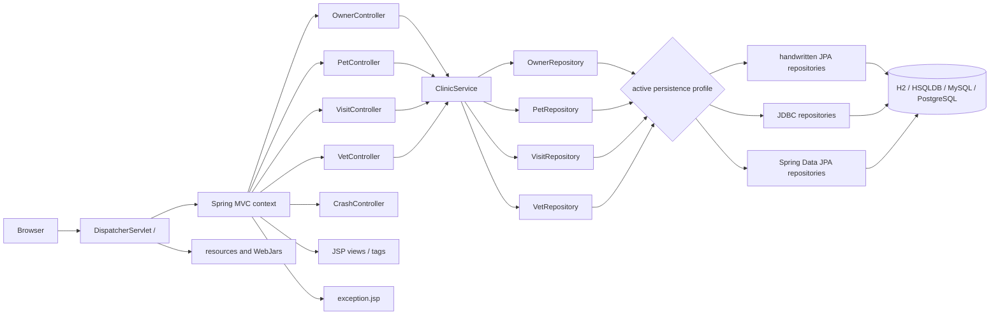
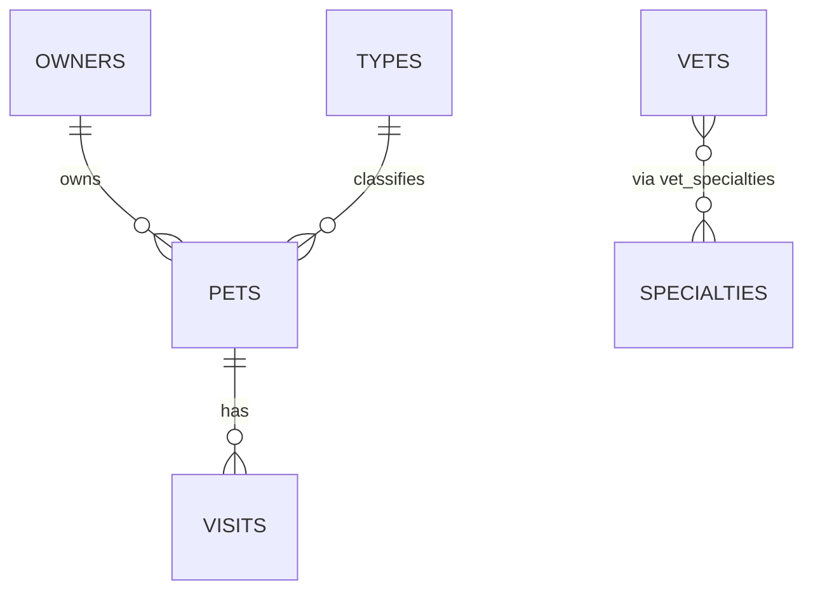

# Spring Framework Petclinic — Discovery Map

## Scope and repository boundary

This map covers the sole Git repository discovered in the workspace: `spring-framework-petclinic`. It is a Maven-built Java 17 WAR application (`pom.xml`) with a classic Spring MVC → service → repository topology. The repository does not declare another application repository, a message broker, or an outbound-service client. Browser HTTP and a relational database are its observed runtime boundaries.

## Runtime entry points and bootstrap

| Entry | Connection | Evidence |
|---|---|---|
| Servlet container | Loads `PetclinicInitializer`, which installs root and servlet application contexts and maps `DispatcherServlet` to `/`. | `src/main/java/org/springframework/samples/petclinic/PetclinicInitializer.java:39-72` |
| Root context | Loads `business-config.xml` and `tools-config.xml`; default persistence profile is `jpa`. An explicit active Spring profile overrides the default. | `PetclinicInitializer.java:52-59` |
| MVC context | Loads `mvc-core-config.xml`, scans `org.springframework.samples.petclinic.web`, enables annotation-driven MVC, resource mappings, formatters, and exception-to-view resolution. | `PetclinicInitializer.java:63-66`; `src/main/resources/spring/mvc-core-config.xml:17-66` |
| Static/welcome routes | `/` resolves to the logical `welcome` view; `/resources/**` and `/webjars/**` bypass controllers to serve packaged assets. | `mvc-core-config.xml:27-39` |
| Build/run paths | Maven produces a WAR named `petclinic`; the documented development launch is `./mvnw jetty:run-war`. Jib is configured to build an image using `jetty:11.0-jdk17`. | `pom.xml:341-343,465-490`; `readme.md:17-32` |

The request encoding filter forces UTF-8. No application authentication or authorization filter is registered by this initializer; platform controls outside the repository are not observable from this map.

## Component topology

## Module and call graph

### Presentation modules

| Module | HTTP routes / responsibility | Downstream calls and result |
|---|---|---|
| `OwnerController` | `GET/POST /owners/new`, `GET /owners/find`, `GET /owners`, `GET/POST /owners/{ownerId}/edit`, `GET /owners/{ownerId}` | Searches, loads, and saves through `ClinicService`; returns owner JSP logical names or redirects. The find route branches to form, detail redirect, or list based on result count. |
| `PetController` | Under `/owners/{ownerId}`: `GET/POST /pets/new`, `GET/POST /pets/{petId}/edit` | Loads owner and pet types as model attributes; creates or persists pets via `ClinicService`. `PetValidator` is bound for `pet`. |
| `VisitController` | `GET/POST /owners/*/pets/{petId}/visits/new`; `GET /owners/*/pets/{petId}/visits` | Loads a pet, adds a new `Visit`, persists through `ClinicService`, or reads the pet's visit collection for display. |
| `VetController` | `GET /vets`, `/vets.json`, `/vets.xml` | Calls `findVets`, wraps results in `Vets`, and produces a JSP, JSON, or XML response. |
| `CrashController` | `GET /oups` | Always throws a `RuntimeException`; `SimpleMappingExceptionResolver` maps unhandled exceptions to `exception.jsp`. |

Controllers are wired by component scanning and depend only on the `ClinicService` façade. View names resolve as JSPs below `WEB-INF/jsp/` through the configured JSP resolver; `Vets` is JAXB-annotated for the XML response. `mvc-view-config.xml` also declares a named `vets/vetList.xml` marshalling view, but the inspected `VetController` produces XML with `@ResponseBody`, so no static production caller was found for that named view.

### Service and cross-cutting modules

`ClinicServiceImpl` is the single controller-facing façade. It constructor-injects the four repository ports, assigns read-only transactions to lookups, and transactional writes to save operations. `findVets()` is additionally cached under the `vets` cache name. `tools-config.xml` enables annotation caching, configures `CaffeineCacheManager`, and exports `CallMonitoringAspect` through JMX.

| Service operation | Repository dependency | Observed callers |
|---|---|---|
| `findOwnerById`, `findOwnerByLastName`, `saveOwner` | `OwnerRepository` | `OwnerController`; `PetController` model population for owner |
| `findPetTypes`, `findPetById`, `savePet` | `PetRepository` | `PetController`; `VisitController` |
| `saveVisit`, `findVisitsByPetId` | `VisitRepository` | `VisitController` uses `saveVisit`; no inspected production MVC caller uses `findVisitsByPetId` |
| `findVets` | `VetRepository` | `VetController` |

### Persistence selection and implementation families

`business-config.xml` selects one repository family by Spring profile:

| Profile | Context wiring | Implementation family |
|---|---|---|
| `jpa` (default) | JPA `EntityManagerFactory`, `JpaTransactionManager`, component scan of `repository.jpa` | `JpaOwnerRepositoryImpl`, `JpaPetRepositoryImpl`, `JpaVisitRepositoryImpl`, `JpaVetRepositoryImpl` |
| `jdbc` | `DataSourceTransactionManager`, `JdbcClient`, component scan of `repository.jdbc` | JDBC repository implementations and row/extractor helpers |
| `spring-data-jpa` | JPA factory/transaction manager plus `jpa:repositories` scan | `SpringData*Repository` interfaces extending the common ports and Spring Data `Repository` |

The mutually selectable families are inactive alternatives under a single run profile, not dead code based solely on static references. The JPA and Spring Data JPA profiles share the JPA factory definition. `business-config.xml` configures both `persistenceUnitName` and `packagesToScan`; its own comment says the persistence unit wins, while no `persistence.xml` was identified during this map, leaving deployed JPA bootstrap behavior a verification point.

## Data topology and dependencies

### Domain relationships

The H2 schema creates `owners`, `pets`, `types`, `visits`, `vets`, `specialties`, and `vet_specialties`; foreign keys establish the displayed relationships. The JPA model mirrors these: `Owner` cascades to its pets, `Pet` refers to its owner and type and has eager visits, `Visit` refers to a pet, and `Vet` has eager many-to-many specialties. H2 is the default in-memory profile; HSQLDB, MySQL, and PostgreSQL profiles provide alternate connection values and vendor-specific schema/data scripts.

At data-source creation, `datasource-config.xml` resolves JDBC/JPA properties (with system-property override) and runs `${db.script}/schema.sql` and `data.sql`. The `javaee` profile instead declares a JNDI datasource named `java:comp/env/jdbc/petclinic`; whether that profile takes precedence over the regular datasource definition was not exercised.

### State and external dependencies

| Dependency | Direction | Purpose / constraints |
|---|---|---|
| Relational DB or in-memory DB | application → DB | Persistent state for the domain; schema/data scripts initialize a configured datasource. |
| Servlet container (Jetty/Tomcat) | container → application | Hosts the WAR and invokes the Servlet initializer. |
| Browser | browser ↔ application | HTML form requests and server-rendered JSP responses; vet list also has JSON/XML representations. |
| WebJars/static assets | packaged dependency → browser | Bootstrap, Font Awesome, Flatpickr, images, fonts, and compiled CSS served at configured resource paths. |
| JMX | operator/tool → application | `CallMonitoringAspect` is exported when the root context is started. No observed consumer is in this repository. |

No source evidence was found for a queue, scheduled job, batch entry point, outbound HTTP client, or remote service integration.

## Critical execution paths

1. **Application start and data initialization:** servlet container → `PetclinicInitializer` → root context (`business-config.xml`, `tools-config.xml`) + MVC context (`mvc-core-config.xml`) → profile-selected datasource/repositories → schema and seed data execution → DispatcherServlet accepts requests.
2. **Owner search/detail:** `GET /owners` → `OwnerController.processFindForm` → `ClinicService.findOwnerByLastName` → selected `OwnerRepository` → zero/many/one branch → find form, owner list, or detail redirect. `GET /owners/{id}` performs the detail load through the same façade.
3. **Pet create/edit:** owner and pet-type model methods populate before the handler → validation and duplicate-name check for creation → connect `Pet` to `Owner` → `ClinicService.savePet` → selected repository → redirect to owner detail. Edit loads by `petId` then binds a form-backed `Pet` and saves it.
4. **Visit create:** request model initialization loads the pet and attaches a new `Visit` → validation → `ClinicService.saveVisit` → selected `VisitRepository` → owner-detail redirect.
5. **Vet representations:** `/vets`, `/vets.json`, or `/vets.xml` → `ClinicService.findVets` → cache lookup/miss → selected `VetRepository.findAll` → `Vets` wrapper → JSP, Jackson JSON, or JAXB XML response.

## Static dead-end and uncertainty candidates

These findings are static candidates only; configuration, tests, or external callers can make them live.

| Candidate | Reason | Required confirmation |
|---|---|---|
| `ClinicService.findVisitsByPetId` | Implemented and test-supported, but the inspected production visit list gets visits from `findPetById(petId).getVisits()`. | Search non-MVC callers and runtime traces before removal. |
| `namedParameterJdbcTemplate` bean | Declared only for the `jdbc` profile; inspected JDBC implementations use `JdbcClient`. | Inspect all profile-specific consumers and external XML configuration. |
| `vets/vetList.xml` named view | Declared in MVC view configuration; inspected vet XML endpoint returns `@ResponseBody`. | Exercise content negotiation and search external/inherited configuration. |
| `CrashController` `/oups` | Deliberately terminates in an exception and routes to the general error JSP. | Decide whether this is intentionally retained as a demonstration path. |
| Alternate repository families | Two of three families are inactive in any one execution. | Determine supported deployment profiles; do not classify as removable from static reachability alone. |

## Map evidence and limits

This is a source/configuration topology map, not a runtime trace. It derives its findings from the Maven descriptor, Spring XML, Java controllers/service/repositories/models, schema scripts, and project documentation. Runtime activation of profiles, container compatibility, actual JNDI selection, cache eviction behavior, JMX use, database availability, and external infrastructure controls remain unobserved.
